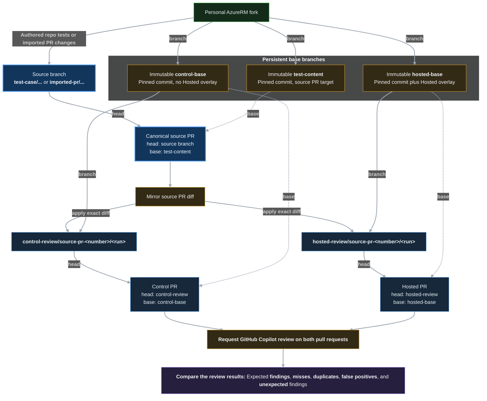

# Hosted Copilot Code Review Implementation Guide:

This guide defines how to implement the Hosted Toolkit described in [`docs/HOSTED_COPILOT_CODE_REVIEW_ARCHITECTURE.md`](../../docs/HOSTED_COPILOT_CODE_REVIEW_ARCHITECTURE.md).

The architecture document remains authoritative for product boundaries, rationale, trust, budgets, and adoption criteria. This guide owns the implementation sequence and the concrete first-party GitHub repository shape used during pre-adoption validation.

## Implementation Boundary:

Build the Hosted Toolkit directly from GitHub's documented customization model. Do not copy, transform, or depend on customization files from prior experiments in another repository.

Prior experiments are evidence about prompt limits, review behavior, and evaluation design. They are not an implementation source, migration baseline, or package layout.

All Hosted Toolkit files must be authored beneath `hosted_copilot/`. Nothing in this guide changes the Interactive Toolkit runtime, installer manifest, release bundle, or validation ownership.

## V1 Saved-Edit Boundary

The 2026-10-25 v1 decision supersedes the saved-edit relationship-checking and resolution requirements below. AI Assistance remains available for drafting and refining wording. Saving wording, applying published Rule Issue recommendations, and opening promotion preview perform no relationship discovery, adjudication, scope review, or reassessment.

- Preserve the original rebuild assessment as read-only evidence, and identify edited wording as maintainer-edited rather than freshly assessed.
- Keep full-rebuild relationship analysis and the published Rule Issues artifact. Edits do not dynamically replace or certify that snapshot.
- Retain deterministic schema, identity, lifecycle, protected-rule, rationale, resource-type, mutation-target, and unsaved-wording checks. Published unresolved Rule Issues still gate approval.
- Drop retired saved-edit check metadata when loading local sessions without discarding wording, decisions, or maintainer overrides.
- Verify direct saving, original evidence, and AI Assistance under `WB-UX-EDITING-001`; legacy-check cleanup under `WB-UX-EDITING-002`; and promotion preview without relationship certification under `WB-UX-EDITING-003`.

The [Workbench UI specification](HOSTED_RULE_WORKBENCH_UI_SPEC.md) owns the current titlebar sidebar preference, independent view/rule chats, request-owned busy state, shared scroll controls, saved-only wording status, and atomic wording-only Reset. Its current behavior supersedes the historical inline controls and broad proposal-reset descriptions below. These UI changes do not establish catalog publication or cross-run decision durability.

## Historical Workbench Checkpoint:

The 2026-10-16 checkpoint contains the implemented reusable waiting-panel UX and unfinished saved-edit integration. It is a progress checkpoint, not merge readiness or approval to refresh the live Workbench. The [saved-edit checkpoint and required repairs](#saved-edit-checkpoint-and-required-repairs-2026-10-16) owns the remaining defects, correction requirements, and validation limits. Requirements elsewhere in this guide do not establish that those unfinished guarantees have been implemented.

The [maintainer resolution UX design](#maintainer-resolution-ux-design-2026-10-20) records the agreed pending interaction changes and subsequent read-only findings. It distinguishes desired behavior from implemented behavior and does not establish merge readiness or supersede outstanding repair evidence.

## Maintainer Resolution UX Design (2026-10-20)

### Purpose And Status

Help the maintainer understand, improve, and deliberately accept Hosted rules. AI proposes and explains; the maintainer decides; deterministic code protects authority, ownership, validation, and persistence. Reuse the existing evidence presentation, resolution choices, and optional chat rather than create another workflow engine.

This section owns the design discussed on 2026-10-20 and refined through the browser prototype on 2026-10-21. The maintainer approved implementation of the compact Details presentation, resource-applicability visibility, collapsible AI Assistance, and explicit request-navigation confirmation. That approval does not settle the remaining relationship-resolution or advisory-acceptance semantics, change authority contracts, or establish that a proposed override is supported by export.

| Area | Status | Scope |
| --- | --- | --- |
| Proposed wording autofit | Implemented | Content-sized editor with an 84px minimum, no internal scrolling, and shrinking when text shortens or the container widens. |
| Compact Details presentation | Implemented; focused validation passed | Passive inline status, explicit Review Relationships action, grouped concerns, and one read-only shared resolution diff in Details. |
| Blended evidence and resolution controls | Choices remain open; implementation deferred | Preserve current validated grouped actions while settling explicit maintainer choices and persistence separately. |
| Advisory wording acceptance | Agreed direction; not implemented | Allow deliberate acceptance of exact wording despite current advisory concerns without bypassing deterministic safeguards. |
| Rule Issues and validation separation | Agreed direction; not implemented | Reconcile genuine relationships dynamically; keep wording and scope validation separate from relationship classifications. |
| Warning presentation and cross-view labels | Details layout approved; cross-view alignment pending | Keep the inline pill as navigation to the compact resolution section; do not equate layout approval with new acceptance or readiness authority. |
| Chat context alignment | Gap verified; implementation pending | Supply the displayed findings, freshness, and maintainer disposition alongside the selected rule wording. |
| Applicability visibility | Implemented; focused validation passed | Entire section appears only for implementation rules, without redundant applicability guidance. |
| Shared request icons | Implemented | Vendored native 16px Codicons play-circle and stop-circle, regenerated the sprite and preview, and replaced the shared chat stop drawing without changing cancellation. |
| Assistance disclosure and request navigation | Implemented; focused validation passed | Preserve one current chat and request, show compact collapsed activity, and confirm rule changes that would cancel an active request. |
| Blended DOM prototype | Presentation reviewed; scoped implementation approved | Preserve the live prototype until comparison; the remaining resolution-choice simulation is not production acceptance authority. |

Autofit validation passed 69 assertions in the focused `rule-assistance` browser journey. The running Workbench received only the updated stylesheet without a server restart or page refresh; its saved session fingerprint remained unchanged. The wrapper exited nonzero because its dependency audit reported 16 vulnerabilities, including six high. This is functional evidence subject to the audit gate, not clean complete Hosted validation. No dependency remediation was performed.

The subsequent shared stop-icon update also passed 69 focused assistance assertions, including native 16px sprite rendering and unchanged running controls. Its wrapper retained the same dependency-audit failure. The sprite was copied to the running server without restarting or refreshing the browser.

The 2026-10-21 source implementation now passes 110 assistance assertions, 157 relationship-progress assertions, 207 saved-assessment assertions, and 280 validation-status assertions against isolated deterministic endpoints. Coverage includes compact Details, keyboard pill navigation, unchanged global Rule Issues evidence, category-specific applicability, disclosure and fixed activity slots, reduced motion, error persistence, all confirmation dismissals, explicit cancellation, completion/navigation races, late replies, and unchanged saved drafts. The normal assessment explanation is restored when the last concern clears. The live browser prototype remains intact and has not been refreshed or replaced with the source implementation. These are functional diagnostics only: the wrappers still exit nonzero because the unchanged dependency audit reports 16 vulnerabilities, including six high; broader authority, chat-context, and saved-edit checkpoint work remains open.

### Assistance Tab-Row Checkpoint (2026-10-24)

The maintainer approved implementing the current browser prototype as a bounded commit checkpoint while reserving final UX judgment. One shared assistance command now sits outside the tablist at the right edge of the Candidates/Details or Assessments/Details row. Lists and empty or protected selections retain a visible disabled command. Matching selected Details enable it. Startup, lists, Rule Issues, Plan, and Preview do not expose an empty or unrelated assistance panel. Navigation preserves the conversation, request, width, and independent open/collapsed preference; changing a request's rule context retains the existing confirmation and cancellation safeguards.

The focused synthetic `rule-assistance` journey passes 166 assertions, including startup, both detail contexts, disabled list controls, retained collapsed preference, hidden in-flight requests, streaming, cancellation, confirmation, and unchanged saved decisions. Its wrapper still exits nonzero because the dependency audit reports 16 findings, including one critical and five high. This is functional checkpoint evidence, not a clean complete Workbench validation result. The manually started server and live prototype were not restarted or replaced during implementation.

- Revisit the assistance control's placement and interaction with the maintainer; this checkpoint is explicitly not the finished UX.
- Resolve dependency security separately and complete the required Workbench validation before claiming a clean validation gate or adoption readiness.

### Verified Starting Point

The 2026-10-24 presentation checkpoint supersedes the earlier navigable-pill prototype: status is passive, and a separate Review Relationships action follows the editor. Maintainer Resolution uses the shared Preview diff rows and exact change counts for saved versus recommended wording; identical paired blank lines remain context. The existing validated grouped operation remains the only recommendation-acceptance path. No experimental radio choice, manual acceptance bypass, or second resolution authority was introduced. Details also returns to the shared hover/focus scrollbar fade. Four synthetic browser journeys passed 587 assertions across assistance, relationship progress, Promotion Preview, and saved-rule assessment. Dependency security remains blocked by 16 audit findings; this functional evidence does not establish a clean complete validation result.

- The published Rule Issues artifact contains 14 issues. The observed effective set contains those same 14 plus one saved-edit overlap. The wording warning is not the counted fifteenth entry. Do not hard-code 14 or describe this count difference alone as corruption.
- `refreshSavedRuleIssues()` merges saved-evaluation relationship issues into the effective set. `renderRuleIssues()` separately prepends candidate wording warnings regardless of the selected issue-type filter, including above unrelated protected issues. The latter is a confirmed presentation-boundary defect.
- `renderManualRelationshipResolution()`, its click handler, resolution records, and action-change rollback code survive in `workbench/app.js`, but the current Details path renders grouped Rule Issue content instead. The old resolution renderer has no caller. Current readiness requires acceptable AI wording and no open related issue rather than recognizing intentional maintainer disagreement.
- The old pairwise resolution path cannot simply be re-enabled: the current flow uses grouped adjudicated evaluations, and `recordSavedRuleEvaluation()` replaces the current check record. Resolution persistence and invalidation must be aligned with that flow before reuse is claimed.
- Chat sends the editor wording, candidate identity, and conversation. The server adds original recommendation wording, contributing source evidence, and the full active and protected catalog. It does not receive the current saved evaluation's wording or scope findings, relationship issues, recommended operations, or maintainer disposition; saved versus unsaved wording is not explicitly identified.
- The observational walkthrough found inconsistent blocker labels between Details and Plan (`Review wording`) and Preview (`Relationship checks: 1 required`). A retained rationale concerned an earlier edit while Preview called rationales complete; presence is not proof of relevance, and manual rationale must not be silently overwritten.
- Two disabled chat controls retained pointer cursors. This is a recorded polish follow-up; disabled controls should use the default arrow cursor.

### Agreed Behavior

#### Genuine Relationships And Validation

- Rule Issues represents genuine unresolved relationships in the current evaluated draft and Plan, not a permanently frozen initial count. A successful evaluation can add a new overlap or contradiction, update an existing issue without duplication, or establish that a prior relationship is resolved.
- Wording quality and scope fit remain candidate validation findings. They must not manufacture a relationship issue or appear as unrelated banners in the global Rule Issues list. A wording concern does not erase genuine relationship evidence returned by the same evaluation.
- Preserve unrelated issues and decisions. Pending, stale, cancelled, failed, or incomplete evaluation must not claim resolution or leave an obsolete recommendation actionable. Relevant edits invalidate prior conclusions until current evaluation or a valid current maintainer disposition supports them.
- Distinguish a relationship eliminated by revised wording from a relationship intentionally retained by the maintainer. Both can cease to be outstanding after the appropriate validated decision, but the original AI finding and maintainer disagreement must remain distinguishable in the decision record.
- Counts, filters, status navigation, Plan readiness, and Preview must consume the same current findings and dispositions. Resolving a relationship must not require accepting unrelated recommendations or publishing catalog changes.

#### Maintainer Authority And Reuse

- Preserve the current grouped evidence, affected-rule comparison, and validated recommended operations. Remove the separate Suggested Consolidated Wording region from Details rather than reproduce another complete proposed text. Settle explicit keep-active and consolidation alternatives before implementing a new resolution command.
- AI wording, scope, and relationship judgments are advisory. An explicit maintainer decision can accept a current concern intentionally; closing a banner cannot. The standalone `Keep My Wording` button was removed from the accepted prototype and must not be introduced as part of this presentation implementation. Its underlying acceptance semantics remain an open design question.
- Bind an accepted disposition to the exact evaluated proposal, affected relationship context, and decision scope. Subsequent relevant wording or Plan changes require renewed review. Reload must preserve valid decisions; portable import and stale authority must follow the owning freshness and validation contracts rather than implicitly restoring approval.
- Preserve valid identities, protected-rule restrictions, complete evaluation, current context binding, and atomic persistence. Maintainer disagreement must not bypass failed evaluation or structural validation, invent authority, or authorize protected-source changes.
- Reuse manual rationale and suitable undo behavior. Do not add a mandatory questionnaire, silently generate a new rationale over manual text, or make chat a prerequisite for deciding. No retirement, unrelated mutation, or Plan membership change follows merely from asking a question or dismissing a finding.
- Explicit recommendation acceptance stages only the validated transaction. Wording acceptance, relationship disposition, saving, staging, and final approval/export remain distinct operations. Export must honor valid maintainer dispositions consistently without treating an AI reply as approval.

#### Presentation And Chat

- Keep the status pill inline with `Proposed Hosted Rule:` as passive status. Use the separate native Review Relationships button beneath the editor to scroll only the Details pane to `Maintainer Resolution:` and focus that heading without scrolling the outer shell. The heading is not a Tab stop and must not acquire the prototype's decorative focus rectangle; real Tab stops retain shared keyboard-focus styling.
- Show a single `Maintainer Resolution:` section below the editor when wording or relationship concerns exist. Group the amber wording warning and distinct blue-accented ordinary relationship review there. Genuine contradictions and protected conflicts retain appropriate severity cues; grouping must not reclassify, dismiss, or resolve findings.
- Remove the redundant Assessment paragraph and its label when the relationship-review panel already explains the same finding. Put the maintainer instruction in the shared information panel without an added `AI recommendation:` prefix. Keep existing validated actions right-aligned; do not introduce simulated radio choices, acceptance authority, or a new Mark as Resolved mutation before those semantics are settled.
- Use the same concern-specific labels and navigation targets in Details, relevant Assessment Results, Plan, and Preview. The two status concepts remain distinct: Rule Issues for relationship findings and Validation Issues for draft concerns or incomplete checks.
- Show the entire resource-applicability section only when `candidate.recommendation?.category === "implementation"`. Remove the redundant information panel entirely, including for implementation rules. Preserve Legacy, Typed, and Framework choices, existing action-dependent editability, validation, and saved values.
- Use the native 16px `codicon-stop-circle` sprite for existing stop controls, preserving cancellation handlers, accessible labels, and disabled state. Use `codicon-play-circle` for the dialog's allow action. Reuse shared button classes and their lighter hover borders; do not add modal-specific color overrides or scale larger icons down.
- Chat should explain the same selected proposal and findings that the UI presents. Supply current wording, an explicit saved or unsaved indicator, the relevant evaluated findings and recommendations, their freshness, and recorded maintainer dispositions. Do not present findings about saved wording as conclusions about a newer unsaved editor value.
- Preserve complete active and protected catalog context and the existing advisory, identity, injection, input-budget, and response-validation boundaries. Do not silently expand chat's claims to the complete projected Plan or unrelated drafts. Identify any deliberately supplied relevant projected context explicitly.
- Chat may explain, compare alternatives, and suggest wording. Applying a suggestion changes only the unsaved editor. Conversation, suggestions, acceptance, evaluation, and export must not trigger one another implicitly.

#### Approved Assistance Disclosure

- Use the same compact header and 24px chevron control as Source Rules. Start collapsed when the chat is empty, remember the user's disclosure choice for the current browser session, and preserve the composer, transcript, resize state, and active request when toggling.
- Keep the exact guidance inside the expanded section: `This response is AI-generated. Please review it for accuracy and relevance before use.` Preserve the unavailable-service explanation when no assistance profile exists.
- Reserve three fixed 24px slots, separated by the existing 8px gap, for working, cancel-or-error, and chevron controls. Empty slots retain their width. While collapsed and running, show the existing shared animated circle with tooltip `Working...`, the stop control with tooltip `Cancel request`, and the chevron. Expanded assistance uses its existing running treatment and cancellation control; hide the two header summaries without changing request state or moving the chevron.
- Successful completion and deliberate cancellation clear the working and stop icons. Failure replaces the cancel slot with the existing red circle-X error icon, with tooltip `The request encountered an error.` Clicking it opens assistance. Opening or closing assistance does not clear the error; a new attempt or clearing the conversation follows the existing error lifecycle. Honor reduced motion and accessible names.

#### Request Navigation

- Keep conversations and pending requests independent by view and rule. Navigation does not cancel requests or open a confirmation dialog. The current [UI specification](HOSTED_RULE_WORKBENCH_UI_SPEC.md) owns request lifecycle and shared modal behavior.

### Open Design Questions

- Decide whether one explicit wording-acceptance command can cover all displayed advisory concerns for the exact proposal, or whether relationship choices need separate confirmation. Avoid repetitive approval steps while making the accepted scope unambiguous.
- Decide how grouped multi-rule findings expose keep-active and consolidation choices without reverting to independent pairwise decisions that could conflict or partially apply a grouped transaction.
- Decide the compact presentation of intentionally retained relationships and invalidated prior decisions without adding a parallel history product or another global warning panel.
- Decide how to make the evaluation baseline and retained rationale's relevance understandable without automatically rewriting either. The displayed deployed Current Hosted Rule and the complete edit-preservation baseline are not interchangeable authorities.
- Decide how the chat-context envelope validates selected findings and dispositions, and how it labels results that do not apply to the current unsaved text. The source trace establishes missing context, not real-model explanatory accuracy.

### Prototype And Implementation Gates

- Prototype Candidate Details first in the existing browser DOM: grouped evidence, explicit maintainer alternatives, one wording warning, and differentiated relationship review. Then demonstrate consistent labels and reviewed states in Rule Issues, Plan, and Preview.
- Keep prototypes transient and clearly distinguish illustrative reviewed states from actual saved authority. Do not change session decisions, issue counts, approval eligibility, source files, or staged assets to simulate implementation. Preserve the live draft, Plan, conversation, and active requests; do not refresh or navigate away without checking for unsaved work.
- Positive prototype feedback approves only the displayed design. Source implementation, restaging, model requests, commits, pushes, and publication need their own explicit authorization. Do not run paid evaluation merely to prototype or recover the browser.
- After explicit implementation approval, adapt the current grouped evaluation and persistence boundary once, with the other views consuming it. Update the existing UI specification and owning contracts or schemas where the accepted behavior requires alignment; do not add a second acceptance authority or weaken validation for convenience.
- Required focused coverage includes real relationship creation, resolution, replacement and deduplication; wording-only findings leaving relationship counts unchanged; issue-type filtering; explicit disagreement and protected-rule limits; stale, failed, cancelled and late results; reload, import and undo; atomic grouped acceptance and persistence failure; unchanged unrelated decisions; consistent navigation, counts, readiness and export; and exact chat-context alignment without a paid model call.
- Use owning Hosted checks rather than Interactive workflows or repeated full-suite runs during iteration. Record audit-gate limitations and distinguish deterministic fixture coverage from live-model semantic evidence. Prototype appearance alone proves neither persistence nor export safety.
- For this authorized implementation, verify compact Details and category visibility, native icon rendering, disclosure state and stable header geometry, keyboard navigation, reduced motion, current-context preservation, cancellation, success and error summaries, rule-switch confirmation and completion races, and unchanged saved drafts against isolated deterministic fixture endpoints. Keep unresolved authority and chat-context work separate, preserve the live prototype, and do not run a paid model merely for validation.

### Separate Outstanding Blocker

Saved-edit adjudication has an outstanding prompt/validator representation mismatch: general instructions permit standalone `action: retire`, while saved-edit validation forbids it. Preserve the bound edited target and strict validation; investigate supported ancillary retirements through that target's `retireHostedRuleIds`. Do not solve this through a rule-specific exception, weaker validation, or a new workflow engine. The investigated rejected outputs do not establish the exact rule intended for retirement; no paid rerun or fix is implied by this design record.

## First-Party GitHub Shape:

GitHub documents the following repository customization paths for Copilot code review:

- [Repository-wide custom instructions](https://docs.github.com/en/copilot/customizing-copilot/adding-repository-custom-instructions-for-github-copilot) use `.github/copilot-instructions.md`.
- Path-specific custom instructions use `NAME.instructions.md` files beneath `.github/instructions/`.
- Each path-specific instruction file begins with YAML frontmatter containing an `applyTo` glob.
- Repository-wide and every matching path-specific instruction file are combined for a reviewed file.
- [Agent skills used by code review](https://docs.github.com/en/copilot/using-github-copilot/code-review/using-copilot-code-review#mcp-servers-and-agent-skills) live beneath `.github/skills/`; a review-focused directory name and description improve relevance.
- Repository instructions, agent instructions, and agent skills are read from the pull request head branch.
- Custom instructions must remain enabled for Copilot code review in repository settings.

The Hosted Toolkit source must mirror those destination paths exactly:

```text
hosted_copilot/
  CHANGELOG.md
  .github/
    copilot-instructions.md
    instructions/
      azurerm-go.instructions.md
      azurerm-tests.instructions.md
      azurerm-docs.instructions.md
    skills/
      code-review/
        SKILL.md
  docs/
    HOSTED_COMMAND_HELP_IMPLEMENTATION.md
    HOSTED_COPILOT_CODE_REVIEW.md
    HOSTED_COPILOT_CODE_REVIEW_IMPLEMENTATION.md
    HOSTED_REVIEW.md
  regression/
    README.md
    cases/
    schema/
    raw/
    results/
  rules/
    instruction-catalog.json
    instruction-catalog.schema.json
  tools/
    Install-HostedRules.ps1
    Invoke-HostedReview.ps1
    Start-RuleWorkbench.ps1
    Test-HostedRules.ps1
    README.md
    commands/
      adoption/
      catalog/
    config/
      adoption.json
      llm.json
      package-manifest.json
    npm/
      package.json
      package-lock.json
    internal/
      assessment/
      collection/
      reconciliation/
      review/
      semantic/
      workbench/
    modules/
    prompts/
    tests/
```

The relative path below `hosted_copilot/` is the destination path in the target repository. The implementation must not introduce a generated package directory, path-rewriting layer, Hosted release bundle, or Hosted version file.

## Pre-Adoption Scope:

Pre-adoption validation implements only the assets required to test whether compact Hosted guidance improves Copilot code review without reproducing the Interactive Toolkit.

**Implement Before Adoption:**

- Compact repository-wide review guidance
- Compact Go, acceptance-test, and documentation instructions
- Curated mandatory maintainer conventions identified from the Interactive Toolkit, including tribal knowledge, with each rule's requirement strength, provenance, and Hosted applicability reviewed before inclusion
- A normalized Hosted rule catalog that preserves every current rule as active and records upstream standards, confirmed and inferred maintainer conventions, and local safeguards independently
- Deterministic path-specific instruction generation with byte-for-byte freshness validation
- Read-only drift and catalog-coverage detection across the contributor README and every indexed contributor topic, including documents not yet cited by active Hosted rules
- AI-assisted semantic intake from complete upstream contributor guidance and the complete Interactive rule inventory, with persisted decisions and explicit maintainer approval
- Structured current and projected token reporting for each runtime file and combined review surface
- One review-focused agent skill
- A package manifest for exact deployment ownership
- A source-checkout deployment script with dry-run support
- Hosted structure, isolation, and token-budget validation
- Controlled test cases and result records for paired reviews
- User-facing Hosted setup and maintenance documentation

**Defer Until Adoption:**

- Unattended semantic interpretation or automatic application of upstream contributor-document changes
- Production-scale regression infrastructure
- Hosted-specific CI rollout
- Versioned Hosted releases or archives

During the experiment, the normalized catalog is the authority for path-specific rules. Generated instruction files are committed and frozen by Git commit for deployment, but they are consumers rather than a second rule authority. Repository-wide instructions and the review skill remain curated because they define Hosted process and trust boundaries rather than contributor rules.

## Runtime File Responsibilities:

### Repository-Wide Instructions:

`hosted_copilot/.github/copilot-instructions.md` contains only guidance needed for every Hosted review:

- Repository purpose and important evidence locations
- Actionable-defect threshold
- Evidence hierarchy
- Duplicate-feedback avoidance
- Concise inline-comment expectations
- Trust rules for Hosted customization changes
- Pointers to deterministic checks that are safe in the Hosted environment

Do not place detailed Go, test, or documentation requirements in this file.

### Go Instructions:

`hosted_copilot/.github/instructions/azurerm-go.instructions.md` uses:

```yaml
---
applyTo: "internal/**/*.go"
---
```

It contains compact, high-value rules that can identify correctness, compatibility, Azure API, Terraform state, schema, lifecycle, or provider behavior defects.

The Go instructions also apply to acceptance-test files. Shared Go requirements belong here and must not be repeated in the test supplement.

### Test Instructions:

`hosted_copilot/.github/instructions/azurerm-tests.instructions.md` uses:

```yaml
---
applyTo: "internal/**/*_test.go"
---
```

It supplements the Go instructions with acceptance-test-specific requirements. It focuses on lifecycle coverage, import behavior, assertion defects, unsafe execution claims, and established provider test patterns.

### Documentation Instructions:

`hosted_copilot/.github/instructions/azurerm-docs.instructions.md` uses:

```yaml
---
applyTo: "website/docs/**/*.html.markdown"
---
```

It contains published documentation requirements and mandatory confirmed maintainer conventions. Published requirements include canonical contributor-guide examples and templates when they prescribe the required documentation shape, including `*` list markers for argument and attribute entries. It must also include the Oxford comma requirement for documentation prose lists of three or more items.

## Normalized Instruction Generation:

### Authority And Preservation:

`hosted_copilot/copilot-rule-catalog/instruction-catalog.json` is the authority for the three path-specific instruction files. Its schema records each stable rule ID, exact runtime text, active or retired status, migration origin, provenance, evidence references, upstream source mappings, implementation model applicability, shared requirement defaults, and known upstream documentation gaps.

Implementation rules classify applicability across `legacy`, `typed`, and `framework`. Legacy identifies function-based untyped Plugin SDK maintenance surfaces, typed identifies ordinary receiver-based `internal/sdk` resources and data sources, and framework identifies framework-native or specialized surfaces. The generator renders this applicability with each implementation rule so review does not apply typed or framework patterns to legacy code, or treat maintenance as an implicit migration.

The initial catalog is a lossless migration of all existing Hosted path-specific rules. Every migrated rule remains `active`, retains its original text, and records `hosted-baseline-migration` as its origin. The generator must reproduce the committed instruction files byte-for-byte before any catalog change can be accepted.

Use `hosted-catalog-addition` as the origin for a rule first introduced through the normalized catalog after the baseline migration. Origin records how the rule entered the catalog; provenance separately records why the rule is authoritative.

Published upstream standards, confirmed maintainer conventions, inferred maintainer conventions, and local safeguards remain independent provenance classes. Missing upstream coverage must never remove or weaken a maintainer convention. Hybrid rules may record more than one provenance class. A rule can leave runtime output only through an explicit `retired` status and retirement reason.

### Generate Or Check Instructions:

Check whether the committed files match the catalog without writing:

```powershell
pwsh -NoProfile -File ./hosted_copilot/tools/commands/catalog/Generate-Instructions.ps1
```

After reviewing an intentional catalog change, update all stale generated files explicitly:

```powershell
pwsh -NoProfile -File ./hosted_copilot/tools/commands/catalog/Generate-Instructions.ps1 -Write
```

The command validates the catalog schema, unique rule IDs, source and evidence references, provenance-specific evidence, active-rule coverage, output containment, and deterministic content. Check mode fails when a generated file is stale. Write mode changes only the catalog-owned path-specific instruction files.

`Test-InstructionGeneration.ps1` exercises baseline freshness, catalog-native rule origins, read-only stale detection, and explicit writes entirely in a temporary Hosted root. `Test-HostedRules.ps1` runs this regression suite as part of the complete Hosted profile.

### Review Upstream Drift:

Run the Hosted-owned source check independently from the Interactive Toolkit:

```powershell
pwsh -NoProfile -File ./hosted_copilot/tools/commands/catalog/Test-UpstreamSources.ps1 -FailOnDrift
```

The command fetches the contributor README and every contributor topic in the Hosted source catalog, including documents not cited by an active Hosted rule. It compares raw-content SHA-256 values with approved baselines, reports affected rule IDs when mappings exist, and fails when the contributor README exposes an untracked topic or the catalog retains a stale topic. It is read-only and never updates the catalog. A changed digest or topic-coverage issue requires semantic maintainer review. Update approved rule text only when source meaning changed; update a baseline only after recording that review in the same catalog change.

Run live upstream drift detection as an explicit maintainer audit, not as a required pull-request or push CI gate. Required CI must pass `-SkipHostedUpstreamDrift` through `Validate-ChangedToolkits.ps1`, or `-SkipUpstreamDrift` when invoking `Test-HostedRules.ps1` directly, so unrelated upstream changes cannot make validation of an unchanged commit nondeterministic. CI still validates the committed source catalog, pinned baseline identity, schemas, mappings, and generated runtime output.

### Semantic Rule Intake:

#### Shared Invariant:

Semantic intake may produce a review bundle and proposed Hosted catalog changes. It must never change source baselines, intake decisions, normalized rules, generated instructions, or regression expectations before a maintainer explicitly approves the proposal.

Deterministic scripts own source collection, hashing, rule-block extraction, mapping, rendering, token projection, and validation. AI owns semantic comparison and candidate classification. The maintainer owns every final adoption, update, retirement, exclusion, deferral, and baseline-acceptance decision.

#### Candidate Sources:

Review all three candidate channels on their own terms:

- The upstream contributor channel contains the contributor README and every indexed topic. It is authoritative for published standards but does not contain all maintained provider conventions.
- The Interactive knowledge channel contains every Interactive contract rule. It is evidence for maintainer conventions, local safeguards, and cross-cutting review behavior, but it is not a Hosted runtime source.
- The Maintainer Proposals channel contains hand-authored rules for missing Hosted review behavior that neither other source contains. It is Hosted-owned maintenance input, not deployed runtime guidance.

Author Maintainer Proposals in these source-only files:

- `hosted_copilot/authored-rules/proposals/documentation.rules.md`
- `hosted_copilot/authored-rules/proposals/implementation.rules.md`
- `hosted_copilot/authored-rules/proposals/testing.rules.md`

Each rule uses an instruction-style `### RULE-ID: Title` heading followed by exactly one `Rule`, `Provenance`, and `Rationale` bullet. `Status` is optional and defaults to `active`; use `retired` only after the rule maps to a Hosted catalog record. Documentation IDs start with `DOCS-`, implementation IDs with `IMPL-`, and testing IDs with `TEST-`. Allowed provenance values are `confirmed-maintainer-convention`, `inferred-maintainer-convention`, and `local-safeguard`.

Author protected rules with the same heading and three required bullets under `hosted_copilot/authored-rules/protected/`. The source directory supplies immutable protected status; maintainers do not add lifecycle, impact, placement, or presentation fields. `Generate-ProtectedRules.ps1` produces `copilot-rule-catalog/protected-rules.json`, and that generated projection must never be edited directly.

The initial Interactive intake audit must classify all 349 currently active rules. The three directly applicable contract families currently contain 158 rules: 102 documentation rules, 36 implementation rules, and 20 testing rules. Fifty-three IDs overlap the current Hosted catalog, leaving 105 direct candidates before semantic equivalence review. These counts describe the initial baseline and must not become hard-coded future limits.

Review direct implementation, testing, and documentation candidates first. Then review cross-cutting code-review rules and the remaining workflow-specific families. Do not automatically exclude a rule from its contract path alone; record a semantic decision for every rule.

#### Archived Interactive Intake Ledger:

The former intake ledger and schema are preserved under `local-only-docs/obsolete-v3/hosted_copilot/copilot-rule-catalog/` as historical migration evidence and are not active validation inputs.

Each ledger record must contain:

- `sourceRuleId`
- `sourceContractPath`
- `sourceContentSha256`
- `sourceStatus`
- `decision`
- `rationale`
- `reviewedOn`
- `hostedRuleIds`
- `selectionFactors`
- `selectionRationale`
- `foundationalOverride`

Use `equivalent`, `included`, `excluded`, or `deferred` as durable ledger states. An unchanged content hash keeps the decision current. A new rule, changed content hash, or lifecycle change reopens review. An `equivalent` or `included` decision must identify the corresponding Hosted rule ID. An `excluded` or `deferred` decision must explain the Hosted applicability, evidence, duplication, regression, or token constraint.

The ledger preserves completed review work without coupling normal Hosted validation to Interactive Toolkit changes. The complete Hosted validator may validate ledger shape and Hosted references, but only the explicitly invoked intake command may compare the ledger with the current Interactive catalog and contracts.

#### Archived Version 3 Review Bundle:

The former collector is preserved at `local-only-docs/obsolete-v3/hosted_copilot/tools/legacy-v3/New-RuleIntakeReview.ps1` for historical reference. It used to:

- Validate the Hosted catalog and intake ledger before analysis.
- Collect changed upstream documents with immutable baseline and current source identity.
- Extract exact Interactive rule blocks from the hand-authored contracts and verify their hashes against the Interactive catalog.
- Parse strict instruction-style Maintainer Proposal blocks, generate their hashes and structured metadata, and map exact Hosted rule IDs without requiring hand-authored JSON.
- Include baseline, new, changed, retired, and deferred Interactive records requiring semantic review.
- Include current Hosted rules and existing mappings relevant to each candidate.
- Write generated review artifacts only to an explicit output directory or an external temporary directory.
- Return structured JSON without modifying either toolkit.

The instruction catalog pins the approved upstream baseline commit. Bundle generation resolves the current upstream ref to a commit before fetching content, so both sides of every comparison are immutable and reproducible. It rejects a baseline commit that does not reproduce every approved source hash.

Run the collector directly to refresh candidates or create a Workbench input artifact:

```powershell
pwsh -NoProfile -File ./local-only-docs/obsolete-v3/hosted_copilot/tools/legacy-v3/New-RuleIntakeReview.ps1 -OutputPath <external-path>/rule-intake-review.json
```

The bundle classifies Interactive rules as `new`, `changed`, `retired`, `deferred`, or `current`. It classifies Maintainer Proposals as `new`, `changed`, `retired`, or `current` by comparing source status and exact rule text with the same Hosted rule ID. A source content hash, lifecycle, or contract-path change reopens a prior decision. Exact normalized contract rule text must match the Interactive catalog hash before it enters the bundle.

Refresh candidates by restarting the Workbench or invoking the collector and assessor directly. The browser does not expose a refresh action because its staged bundle is fixed for the server lifetime. Candidate regeneration does not update the ledger, catalog, source baselines, or generated instructions.

Do not make the Hosted package or complete Hosted validator depend on the current Interactive Toolkit. The intake command is a repository-maintenance bridge invoked only when a maintainer requests an audit.

#### Archived Version 3 Semantic Assessment:

Run the incremental assessment command when creating a complete Workbench bundle:

```powershell
pwsh -NoProfile -File ./local-only-docs/obsolete-v3/hosted_copilot/tools/legacy-v3/Invoke-RuleIntakeAssessment.ps1 -OutputPath <external-path>/rule-intake-review.json
```

The command invokes `New-RuleIntakeReview.ps1`, partitions cache misses into bounded source-specific batches, and calls the local Copilot CLI noninteractively with the configured model and reasoning effort. Upstream contributor documents use a separate, smaller batch-size limit because each source carries complete document content. Decompose each contributor document into independently enforceable rule candidates, including each existing Hosted rule that cites the document and each uncovered requirement; Interactive and Maintainer Proposal sources each produce one rule candidate. Each rule candidate owns its lifecycle state, recommendation, proposed text, and at most one semantic Hosted target. Each model call runs in an isolated evidence directory containing only the batch, current Hosted catalog, and assessment schema; expose only the read-only `view` tool, consume the raw assistant message from JSONL output, and verify the reported model. Validate each source ID, rule-candidate ID, source hash, semantic target, semantic field, and final bundle schema, and fail closed after bounded malformed-output retries. Tests inject a fake evaluator and must never invoke a model.

When a schema or evaluator-contract change adds proposal fields without invalidating existing semantic judgments, run smart field repair instead of forcing complete reassessment:

```powershell
pwsh -NoProfile -File ./local-only-docs/obsolete-v3/hosted_copilot/tools/legacy-v3/Invoke-RuleIntakeAssessment.ps1 -RepairMissingFields -OutputPath <external-path>/rule-intake-review.json
```

Smart repair loads the prior baseline only through this explicit mode, verifies the baseline envelope, catalog hash, source hashes, assessment identities, and all unchanged semantic fields, and determines the missing or invalid proposal fields per assessment. Existing targets inherit their exact target identity and current Hosted text deterministically when those values are sufficient. Remaining candidates enter compact source-specific repair batches containing the existing assessment and an explicit field allowlist. The evaluator returns only proposed identity, proposed text, category, and affected surfaces; merge only requested fields, preserve recommendation, applicability, factors, rationale, and target identity, then run complete assessment and bundle validation. Reserve proposal IDs across the full run, retry colliding model output within the normal bounded retry policy, persist validated repairs in the disposable cache, and report deterministic repairs, semantic repairs, repair batches, and full evaluations separately. Changed source hashes remain full assessment misses rather than being repaired against stale evidence.

The committed shared baseline lives under `hosted_copilot/copilot-rule-catalog/rule-assessments/` and contains only source identity, source-content hash, and validated assessment records. It does not duplicate candidate source documents, capacity reports, or Workbench state. Resolve assessments in this order:

1. Use a machine-local cache entry matching source identity, source-content hash, Hosted catalog hash, evaluator contract hash, model, and reasoning effort.
2. Use a committed baseline entry matching source identity and source-content hash when the baseline targets the current Hosted catalog.
3. Invoke Copilot for the remaining candidates.

A changed source rule normally reassesses only that candidate. A changed Hosted catalog invalidates the shared baseline and relevant local cache because the semantic comparison target changed. Evaluator-contract, model, and reasoning changes invalidate local cache entries but do not erase a maintainer-accepted shared baseline. Cache files, batch artifacts, and assessed bundles must remain outside the repository.

Treat the machine-local cache as disposable acceleration state. When it contains malformed JSON, uses an unsupported schema version, or lacks required entry identity, atomically replace it with an empty current-schema cache and continue resolving assessments from the committed baseline before invoking Copilot. Normal assessment runs reject a malformed committed baseline because it is reviewed repository evidence rather than disposable machine state. Explicit smart repair may inspect a prior-schema baseline only when its envelope, catalog binding, source binding, and unchanged semantic fields remain valid and the complete merged result satisfies the current schema.

After reviewing and accepting a complete refreshed bundle, preview and then explicitly publish the next shared baseline:

```powershell
pwsh -NoProfile -File ./local-only-docs/obsolete-v3/hosted_copilot/tools/legacy-v3/Publish-RuleIntakeAssessmentBaseline.ps1 -BundlePath <external-path>/rule-intake-review.json
pwsh -NoProfile -File ./local-only-docs/obsolete-v3/hosted_copilot/tools/legacy-v3/Publish-RuleIntakeAssessmentBaseline.ps1 -BundlePath <external-path>/rule-intake-review.json -Publish
```

The publisher rejects unevaluated candidates and source-hash mismatches, validates the compact baseline schema, previews without writing by default, and replaces only the baseline file when `-Publish` is explicit.

Assessment is explicitly invoked maintainer automation. It produces a read-only bundle and never updates the Hosted catalog, intake ledger, source baselines, generated instructions, regression assets, or shared assessment baseline. Only the separate explicit publisher may update the shared assessment baseline. Neither command authorizes unattended semantic synchronization or automatic rule promotion.

#### Decision Proposal:

AI-assisted review consumes the deterministic bundle and emits one proposal record per candidate:

- `no-change`: The source changed without changing applicable rule meaning.
- `add`: Add a new Hosted-owned rule with origin `hosted-catalog-addition`.
- `update`: Replace materially changed Hosted rule meaning through the approved lifecycle process.
- `retire`: Retire Hosted behavior that is no longer valid and is not independently preserved by maintainer evidence.
- `exclude`: Record that the source behavior is not applicable to Hosted review.
- `defer`: Record the unresolved evidence, applicability, regression, or capacity gap.

Every assessment must carry a complete resulting Hosted proposal independently from its recommendation: proposed Hosted rule ID, complete Hosted wording, category, and affected surfaces. The existing target remains a separate nullable identity. Every proposal must cite its source evidence, distinguish published guidance from maintainer knowledge, and explain whether an existing Hosted rule already covers the same failure condition. A proposal is review output only; it grants no write authority.

#### Impact-Weighted Selection:

Apply eligibility gates before calculating impact. A rule is eligible only when it applies to native Hosted review, can produce an actionable finding or necessary cross-cutting safeguard, has sufficient evidence, and is not materially duplicated by stronger Hosted behavior. A failed eligibility gate requires an `exclude` or `defer` proposal regardless of score.

The AI semantic review pass assigns eligibility, recommendation, selection factors, and selection rationale. These values are read-only in the Workbench. The maintainer independently chooses one catalog-status-constrained rule action, controls whether add, update, or retire enters the promotion plan, records decision rationale, and owns final approval. Every new maintainer decision begins at no change rather than silently adopting the AI recommendation. If the maintainer disputes factor evidence or scoring, defer the candidate or request another AI assessment; do not overwrite the factor values manually.

Rate each eligible rule from `0` through `5` on these independently justified factors:

- `severity`: Consequence of the defect or review failure the rule prevents
- `frequency`: Evidence-backed likelihood of the failure in provider changes
- `breadth`: Applicability across resources, services, and review surfaces
- `hostedDetectability`: Likelihood that Hosted review can prove and locate the problem reliably
- `evidenceStrength`: Durability and authority of the supporting evidence
- `falsePositiveRisk`: Likelihood that the rule produces unsupported or noisy findings
- `redundancy`: Degree to which existing Hosted guidance already covers the same failure condition

Do not rate missing evidence optimistically. Use `defer` when an unknown factor materially affects the inclusion decision.

Calculate the derived impact score as:

```text
impactScore = max(0, 6*severity + 3*frequency + 3*breadth + 4*hostedDetectability + 4*evidenceStrength - 5*falsePositiveRisk - 3*redundancy)
```

For candidates with a positive guarded token delta, calculate token efficiency as:

```text
tokenEfficiency = 100 * impactScore / guardedTokenDelta
```

This reports impact points per 100 guarded tokens. Retirements and text reductions report token savings instead of an efficiency ratio. The proposal must show every factor rating and rationale; it must not present the derived score as objective fact.

Store `selectionFactors` and `selectionRationale` on every active Hosted rule and on every Interactive intake-ledger decision. Calculate `impactScore` and `tokenEfficiency` from those inputs rather than storing them. The initial intake implementation must backfill the current 54 Hosted rules before using score-based ranking for new candidates.

Foundational safeguards may be necessary because they improve the reliability of many other rules rather than directly identifying one frequent defect. Set `foundationalOverride` only with a concrete package-level rationale, affected rule IDs or surfaces, and explicit maintainer approval. An override does not bypass token projection, evidence requirements, or the final approval gate.

Use impact and token efficiency to order eligible candidates and explain tradeoffs. Never automatically include, exclude, or retire a rule from its score alone.

#### Token Projection:

Token reporting uses the dependency-free character-quarter estimate and the existing 25% safety margin. It must not be described as actual GitHub runtime token consumption.

Run the shared read-only capacity command directly when inspecting current usage:

```powershell
pwsh -NoProfile -File ./hosted_copilot/tools/internal/workbench/Get-GuidanceCapacity.ps1 -OutputFormat Json
```

`Get-GuidanceCapacity.ps1` is the single arithmetic owner for current capacity. `New-RuleIntakeReview.ps1` embeds its complete eight-report result in each candidate bundle, and `Test-HostedRules.ps1 -OutputFormat Json` exposes the same result under `guidanceCapacity`. Consumers must not reconstruct capacity from validator detail text.

For every current and projected runtime file and combined review surface, report:

- `estimatedTokens`
- `guardedTokens`
- `budgetTokens`
- `budgetHeadroomTokens`
- `utilizationPercent`

For every proposed add, update, or retirement, also report `estimatedTokenDelta`, `guardedTokenDelta`, `impactScore`, `tokenEfficiency` when defined, and the projected post-change values. Calculate projections by rendering the complete proposed catalog in a temporary Hosted root. Do not estimate a rule in isolation because section headings, model markers, ordering, and shared guidance affect the rendered totals.

Implementation rules affect the Go file budget, the Go combined budget, and the test combined budget because test files load both Go and test instructions. Test rules affect the test file and test combined budgets. Documentation rules affect the documentation file and documentation combined budgets. Repository-wide or review-skill changes affect every applicable combined surface.

Derived token values belong in validator and proposal output. Do not store them manually in the rule catalog or intake ledger, where they would become stale.

#### Hosted Rule Workbench:

The static proof-of-concept interface lives beneath `hosted_copilot/workbench/`. Launch it with:

```powershell
pwsh -NoProfile -File ./hosted_copilot/tools/Start-RuleWorkbench.ps1
```

Ordinary launch refreshes the static Workbench assets, resolves the authenticated GitHub login, validates local CODEOWNERS membership, validates the writable fork and its synchronization status, jointly validates the last staged display and Rule Issues artifacts, confirms that they represent the same source-file set, and serves them without source collection or semantic work. Run the launcher with `-Rebuild` to collect the three source inventories and reconstruct the current display and Rule Issues artifacts. A rebuild always executes deterministic collection, cache resolution, artifact reconstruction, schema validation, and atomic publication; a displayed phase does not imply a model call, and its cached and evaluated counts are authoritative. Add `-Force` to bypass semantic cache reads while still writing each newly validated result. Source assessment uses a conservative `400`-byte-per-second-per-worker bootstrap baseline calibrated from a complete uncached run, then updates remaining time from completed work. If any phase fails, the launcher preserves the prior validated artifacts.

GitHub integration has three explicit ownership layers. `tools/modules/shared/HostedGitHub.Helpers.psm1` is the sole owner of GitHub CLI process execution, UTF-8 stdin and output handling, API argument construction, CODEOWNERS parsing, and canonical fork resolution. `tools/modules/workbench/Workbench.GitHubContext.psm1` composes those primitives into the fail-closed `maintainerIdentity` and `targetRepository` browser runtime contracts. Review tooling retains `Invoke-HostedReviewGitHubApi` as a compatibility facade over the shared API helper. Source inventory retains credential fallback, anonymous REST, GraphQL, retry, and rate-limit policy while delegating authenticated GitHub CLI execution to the shared process helper. Do not add direct `gh` process execution to launchers, collectors, or lifecycle scripts.

Source assessment emits only independently enforceable meanings from each source record; it does not propose Hosted rule wording. `SourceAssessmentPresentation.psm1` owns labels, workload estimates, status rows, diagnostics, and spacing outside semantic behavior authority. The source-assessment contract snapshots that module through `presentationFiles`, while `behaviorFiles` remain content-hashed baseline authority. Individual source cache entries remain content-addressed and are reused only after current-schema and current-input validation; `-Force` explicitly requests semantic reevaluation after a behavior change. When evaluation is pending, Source Assessment reports its cache-aware workload before matched aggregate and batch lifecycle rows. When every source is reusable, it reports source totals and `Execution: Fully cached` without zero workers, payload, estimate, or evaluation lifecycle rows. Reconciliation builds one complete semantic ledger containing applicable assessments, mutable catalog rules, and protected rules. The visible stages are `Initial Assessment Grouping`, where byte-bounded routing shards propose local semantic groups; `Group Consolidation`, where pair-cover shards compare local components across shard boundaries; and `Recommendation Synthesis`, where each final component is rehydrated before producing compact Hosted recommendations. Each major stage has an explicit section boundary before its workload, with the parent `Hierarchical Reconciliation` section introducing Initial Assessment Grouping. Every recommendation must explain how its final rule text preserves each member assessment meaning, score that final consolidated rule with its own complete selection-factor vector and rationale, and retain every member reference. Trusted reduction rejects missing, duplicate, non-member, or disposition-inconsistent coverage before display construction; it never substitutes the highest child score for parent scoring.

The hierarchical stage runtime owns routing, consolidation, synthesis, and post-synthesis Rule Issue adjudication. Each deterministic `<stage>:<sha256>` shard binds its semantic payload, complete behavior authority, catalog and protected-rule bytes, prompt, result schema, evaluator, model, and reasoning effort into a version-2 cache identity. Both reconciliation contracts declare hashed `behaviorFiles` separately from snapshot-only `presentationFiles`. Retained runs copy both sets for execution evidence, but labels, workload estimates, status formatting, and spacing live in `ReconciliationStagePresentation.psm1` and cannot invalidate semantic cache entries. Assessment reconciliation and Rule Issue adjudication construct the same content-hashed behavior authority before cache lookup. Synthesis excludes audit-only `assessmentProvenance` from its semantic payload so a regenerated `assessedAt` timestamp cannot invalidate otherwise identical work; semantic assessment fields and every explicit authority input remain cache-bound. Every validated reconciliation shard is written immediately to the persistent cache, so a later failure or cancellation does not discard completed work and the next rebuild automatically reuses every exact-authority match. Final display and Rule Issues publication remains atomic. Reconciliation defaults to three parallel workers, within the enforced range of one through eight. Every reconciliation stage reports aligned cache-aware workload totals using its own calibrated throughput baseline and only the workers that can process pending shards. Fully cached stages report `Execution: Fully cached`; pending shards stream lifecycle rows with elapsed timing. Running, Retrying, and Failed rows retain actual shard identity. Passed rows report aggregate completed progress including cached batches, so a stage with two cached batches closes its only successful evaluation as `batch 3/3` rather than the evaluated shard's original ordinal. Batch rows own execution lifecycle, while aggregate reconciliation summaries report total, cached, and evaluated batches plus pipeline elapsed time without redundant parent lifecycle rows.

Rule Issue adjudication remains a distinct post-synthesis safety gate. On every rebuild it deterministically derives current components from the reconstructed display, resolves exact cache identities, reassembles and schema-validates the Rule Issues artifact, and publishes it with the candidate display. Cached components do not invoke the model; only cache misses are evaluated. It reads the final assigned rule IDs, exact proposed wording, lifecycle operations, retirements, protected-rule membership, and provisional related coverage; decides every supplied relationship exactly once; and emits the unchanged version-4 Rule Issues artifact consumed by the Workbench. Batch rows own adjudication lifecycle, and the final summary reports Rule Issue and cache totals plus elapsed time.

Display Projection reports its builder elapsed time after constructing the candidate artifact. `Workbench UI Artifact Publication` then schema-validates and atomically publishes the candidate display and Rule Issues artifacts. Text mode ends with one condition-aware `Workbench Summary` for stage-only or serving execution; JSON mode retains complete cache paths, recovery state, and other operational diagnostics.

Validated assessments remain in `%LOCALAPPDATA%\hosted-workbench\assessment-cache\assessment-cache.json`. Hierarchical reconciliation shards are stored beneath `%LOCALAPPDATA%\hosted-workbench\reconciliation-cache\`, and Rule Issue adjudication shards are stored beneath `%LOCALAPPDATA%\hosted-workbench\hierarchical-rule-issue-adjudication-cache\`. The staged display pair is durable presentation state, not semantic cache evidence or freshness authority. Ordinary launch may serve the last jointly validated display and Rule Issues artifacts until a maintainer explicitly requests a rebuild.

Every failed evaluator attempt is retained with its validation reason before retry. Internal diagnostic recovery may resume a retained hierarchical run only when its complete authority matches the current run; ordinary rebuilds do not require a temporary run directory because each validated shard is already persistent. Successful runs remove their temporary artifacts. Malformed or incompatible cache state is rejected rather than migrated, and caches or recovery directories outside the repository are never treated as source files.

Use `-AssessmentCacheDirectory`, `-ReconciliationCacheDirectory`, `-AssessmentResumeDirectory`, or `-MaxParallelBatches` only to override rebuild defaults for diagnosis or controlled execution. `-Force` requires `-Rebuild`, cannot be combined with assessment recovery, bypasses assessment and reconciliation cache reads, and preserves existing cache entries until validated replacements are written. `-StageOnly` validates the selected reuse or rebuild operation without starting the server, and `-NoLaunch` keeps the launcher from opening the browser automatically.

Static content accepts only `GET` and `HEAD`. The running server owns an in-memory `GET /runtime-config` response containing its per-launch operation tokens; staged `shutdown-config.js` is only initial page bootstrap and cannot replace server authority. **Close Workbench** and scoped relationship checks refresh the no-store runtime config immediately before their authenticated `POST` requests, so a stale tab or failed second launch cannot strand the active server with mismatched tokens. `POST /shutdown` stops the local server and grants no repository-write authority. The stable origin preserves browser storage across launches.

##### Rule Assistance

The Workbench owns the [accepted AI Assistance sidebar](HOSTED_RULE_WORKBENCH_UI_SPEC.md#ai-assistance) outside its view panels. Candidate Details, Assessment Details, and Rule Issues share one renderer and request lifecycle, with independent conversations keyed by view and candidate or stable issue ID. A titlebar toggle immediately before Close Workbench uses the local right-sidebar on/off Codicons and Show/Hide AI assistance tooltips. Hiding reclaims the workspace column without cancelling requests or losing unsent input, history, reading position, or chosen width. The sidebar starts at 420px, uses the shared bounded pointer and keyboard splitter, and becomes a drawer on narrower supported screens. The splitter has an 8px transparent hit area and 4px active highlight. The response fills the remaining height without a border, while the composer keeps its 160px height and border. Navigation selects a different owned conversation without cancelling work or prompting; inactive completions update only their originating chat. Protected-rule views clear the editable candidate target, while Rule Issue discussions may inspect protected rules as immutable evidence. Advice cannot change applicability or decisions.

The shared conversation retains one fixed bordered Copilot identity chip, native waiting-panel animation, real cancellation, measured completion time, and confirmed New Chat reset. The identity chip shows the selected rule ID or issue title. User bubbles shrink to fit and cap at 90% width. Each reply shows completion time and its view-specific grounding note before the answer. Candidate and Assessment wording suggestions appear inline without a disclosure or nested scrollbar, with a hover-and-focus copy toolbar and custom-only tooltip feedback; Rule Issue alternatives remain advisory text with explicit rule IDs. A theme-matched, blue-outlined circle at the conversation's bottom-right returns to the latest reply while preserving the reader's position during ordinary updates. Shared information guidance directly beneath the heading asks maintainers to review AI-generated responses. The inferred Related Hosted Coverage list is omitted from Candidate Details; original coverage remains in the read-only Assessment Results audit and underlying assessment data. Source Rules explains the distinction between original evidence and selected Plan rules.

The local [waiting-phrase catalog](../workbench/assistance-waiting-phrases.json) contains the approved geeky messages. Startup validates it as a required static asset. One session-wide shuffled bag supplies all conversations, consuming every phrase before reshuffling and preventing adjacent repeats across cycles when more than one phrase exists. Each request retains its selected phrase through rerenders, using the existing shared shimmer and reduced-motion treatment rather than timed phrase rotation. Waiting messages remain UI-only and cannot enter model context or replace real completion, cancellation, or failure output.

Both loopback server entry points expose authenticated `POST /assist-rule` through `modules/workbench/RuleAssistance.psm1` and `internal/workbench/Invoke-RuleAssistance.ps1`. The worker obtains source requirements, recorded parent and member assessments, contribution rationales, mappings, the original recommendation, and every active or protected Hosted rule from the validated server-owned display snapshot. It binds historical assessment evidence to the original proposal's text hash, identifies edited wording explicitly, and supplies scoring definitions from the display schema. The prompt distinguishes recorded explanations from new advisory analysis, source confidence from parent reconciliation scores, and claimed preservation from actual wording coverage; missing evidence must not become an invented historical justification. Candidate identity, source hash, exact wording, evaluator authority, model, and catalog snapshot bind the answer, and the display schema participates in runtime freshness. It never trusts client-supplied assessment evidence or a browser-selected related-rule subset as catalog-wide coverage.

Candidate requests use `RuleAssistance.md`, Assessment requests add `AssessmentAssistance.md`, and Rule Issues use `RuleIssueAssistance.md`. Issue requests identify a stable issue ID and hash-bound issue snapshot rather than supplying candidate wording or client-authored assessment evidence. The worker validates the issue artifact and matching display source set, then supplies the entire issue, affected rules, relationships, recorded recommendation, all linked candidate evidence, and active and protected catalog. Issue replies bind the issue identity, snapshot, view, model, and runtime authority, and must return `suggestedWording: null`; rule-specific alternatives remain textual advice. All three views share transport, safe rendering, cancellation, and request ownership without sharing conversation history.

The `normal` profile in [the central LLM configuration](../tools/config/llm.json) owns assistance model and reasoning-effort defaults. The launcher's `-Model` and `-AssessmentReasoningEffort` settings are explicit overrides, not competing defaults. Saved-rule evaluation resolves the independent `savedRuleEvaluation` profile from the same file. Both server entrypoints resolve profiles before constructing runtime authority and expose the effective assistance profile to the UI. Assistance uses stdin, separate stdout/stderr, non-streaming JSONL, no tools, and a dedicated strict response schema; it does not weaken the reconciliation adapter's contracts. Every new evaluator prompt is registered through the assistance runtime authority and checked for quoted-data injection boundaries.

Both server entrypoints also require CLI-only availability preflight before serving; the launcher performs it before staging writes or rebuild work. The shared CLI module resolves the configured executable for metadata and inference alike and queries sessionless `status.get`, `auth.getStatus`, and `models.list` RPC under `--no-auto-update`. It requires verified authentication, protocol 3, enabled exact model IDs, and supported profile efforts, without generating a response or creating a conversation. It fails explicitly on incomplete metadata, authentication, model policy, transport, or compatibility problems rather than selecting a fallback or treating every failure as retirement. The [installation and verification notes](../tools/README.md#cli-availability-and-installation-nuances) preserve the observed npm PowerShell-shim timeout, the successful native-runtime probe, and the distinction between direct-path testing and standalone-installer testing. Both remain separate from GitHub-hosted PR-review model selection.

Conversations and unsent input live only in browser memory. Follow-ups send only the selected chat's complete successful exchanges. Switching views, candidates, or issues retains each originating conversation, input, pending request, and reading position; confirmed New Chat clears only its captured conversation, while reload starts fresh chats. The complete prompt, including catalog and history, must fit the `393216`-byte engineering input bound. Oversized input fails explicitly without truncation. This is not a guarantee about the CLI model's context-window capacity. The Workbench removes owned temporary transport files on completion, cancellation, and shutdown, but the CLI's independent provider-managed session retention is not controlled by New Chat.

Replies remain advice, not validation or approval receipts. Wording suggestions can be copied but never enter the editor automatically or through a chat action. Copying does not validate freshness or grant approval; maintainers review any wording they put into the existing editor. Save, semantic validation, maintainer decisions, atomic consolidation acceptance, and protected-rule and approval gates remain unchanged. Retirement ideas remain textual advice rather than executable chat operations.

Focused validation uses synthetic CLI and HTTP fixtures, not paid model calls:

```powershell
pwsh -NoProfile -File ./hosted_copilot/tools/tests/Test-RuleWorkbench.ps1 -Run rule-assistance
pwsh -NoProfile -File ./hosted_copilot/tools/tests/Test-RuleWorkbench.ps1 -Run browser-playwright-journeys -Journey rule-assistance,saved-rule-assessment
```

Dependency-audit failures remain blocking validation evidence; explicit focused continuation does not turn those runs into a clean validation result.

##### Next Implementation Step: Portable Assessment Bootstrap

The current machine-local assessment cache makes a first launch, or any evaluator-contract change that invalidates the complete cache, too expensive for normal maintainer adoption. Do not distribute a ZIP of `%LOCALAPPDATA%`; machine-local cache layout is disposable implementation state, opaque archives are difficult to review, and copied entries can silently carry stale context.

Publish a catalog-owned, portable assessment bootstrap after an explicit maintainer-approved full run.

- Store canonical assessment records plus a manifest of source-content, Hosted catalog, evaluator contract, prompt, schema, model, and reasoning-effort hashes. Do not include absolute paths, credentials, browser state, retry artifacts, or machine-specific metadata.
- Keep the bootstrap reviewable and deterministic. Prefer canonical JSON with a top-level content hash over an opaque cache-directory archive; rely on source-control transport compression rather than making a ZIP the authority.
- Validate the bootstrap schema, manifest hash, source identities, and every entry through the existing trusted assessment builder before reuse. A bootstrap entry is acceleration input, never accepted catalog state.
- Hydrate only exact context matches into the maintainer's local cache, using the normal content-addressed cache keys and atomic writes. Evaluate missing or invalid entries through the bounded parallel source-assessment runner.
- Publish bootstrap updates only through an explicit preview-then-publish command after the complete corpus passes source-assessment, reconciliation, and Hosted validation. Required CI validates the committed bootstrap but never regenerates semantic output unattended.
- Define bounded cleanup for obsolete hydrated entries. A changed source should invalidate only its matching entry; catalog, prompt, schema, model, or reasoning changes invalidate every entry whose manifest context no longer matches.
- Extend the same portable-manifest pattern to validated hierarchical reconciliation and Rule Issue shards, so a new maintainer normally evaluates only changes made after the published bootstrap.

##### Ownership Validation And Conflict-View Removal

Reconciliation preserves diagnostic evidence, but ownership repair is not a maintainer Workbench task.

- Retain every invalid batch draft under an attempt-specific path with its validation failure; do not delete evidence needed to diagnose evaluator output.
- Retry malformed output, invented related coverage, duplicate targets, and other recommendations that are not backed by their member assessments, while preserving failed attempts when retries are exhausted.
- Require canonical catalog mappings to be the only authority for existing Hosted targets. Related coverage and semantic similarity must never create a target.
- Reject a final corpus containing duplicate target ownership or a recommendation whose target disagrees with its canonical mapping.
- Fail launch after bounded retries when ownership remains invalid. Do not emit blocked display status or conflict groups.
- Remove the conflict MessageBar, **Review Conflicts** command, Conflicts tab and panes, conflict activity and plan indicators, conflict-specific approval gating, `AllowConflicts` builder path, conflict display schema, and `WB-UX-CONFLICT-001` regression coverage. Retain the pinned conflict icons in the general-purpose local icon inventory without a runtime dependency.

##### Next Implementation Step: Advisory Consolidation Proposals

Restore cross-assessment optimization without weakening identity ownership.

- Saved-edit consolidation into a maintainer-selected, already-bound target is implemented separately below. The future workflow in this subsection allocates a new identity; it does not prohibit updating an existing rule through its owning candidate.
- Compare each assessment with the complete Hosted catalog and enumerate every materially equivalent, overlapping, extending, narrowing, conflicting, or otherwise related rule as structured related-rule evidence.
- Keep `existingCoverage` as aggregate completeness and render the structured evidence as **Related Rules** so maintainers can identify redundant catalog guidance and token waste.
- Emit consolidation proposals separately from ordinary candidate recommendations. Each proposal uses one new collision-free Hosted ID, merged wording, member assessment identities, existing rules proposed for retirement, per-member meaning coverage, source relationships, and before-and-after token totals.
- Keep every proposal pending until a maintainer accepts it, splits its members, edits the proposal, or keeps the current rules unchanged.
- Apply an accepted consolidation atomically by adding the new rule, retiring only selected existing rules, and preserving all approved evidence and source relationships. Never overwrite an existing Hosted rule ID or classify absorbed candidates as excluded.

The Workbench supports laptop and desktop browsers only. At viewport widths below `768px`, or when the browser identifies as mobile, display the unsupported-device screen with the approved yellow JSON-braces product lockup and no `HR` mark, and do not load the candidate bundle or initialize IndexedDB. Do not maintain a separate responsive handset workflow for rule assessment or promotion.

Use IndexedDB for bundles, read-only AI assessments, maintainer choices, evidence notes, and resumable drafts. Use local storage only for lightweight preferences and the active session ID. Key every decision and assessment to its source identity and content hash so changed input invalidates prior analysis. Support explicit draft export and import because browser storage is a convenience rather than the durable promotion boundary.

The proof of concept does not run a model inside the browser. Semantic evaluation must complete before a candidate appears in either Workbench tree. Do not show unevaluated candidates or invent fallback scores. Bind every assessment to the candidate source-content SHA-256 and reject stale assessments.

Place a tab control directly below the shared search toolbar. The **Candidate Sources** tab contains a second connected **Candidates** and **Details** tab set. Those views replace each other at full workspace width: activating a candidate row opens Details, returning to Candidates preserves expanded folders, selection, sorting, and scroll position, and checkbox changes select the candidate without leaving the list. Details remains available without a selection and shows a **Select a candidate** empty state instead of stale form content. The **Assessment Results** tab uses the same nested pattern at every supported viewport: connected **Assessments** and **Details** tabs replace one full-width pane with the other. Activating an assessment row opens Details, returning to Assessments preserves the selected key and visible row highlight, and a fresh load initializes Assessments with no selection so Details shows **Select an assessment result**. Keep both outer tab DOMs and both nested pane DOMs alive so switching visibility does not reset state. The one search input queries only the currently selected outer tab's dataset and restores that tab's independent query on return; do not add a second search bar or eligibility-mode controls inside Assessment Results. Show source rule, applicability decision, AI recommendation, impact and factor evidence, exact mapped Hosted coverage, and maintainer-proposal rationale when present. Do not expose Rule Actions, editable decision rationale, plan checkboxes, or any other promotion affordance in Assessment Results.

While a proposed-rule relationship check is running, show a status panel beneath the editor with a rotating blue spinner, an indeterminate blue sweep, and explanatory text. Announce the status politely, honor reduced-motion preferences, and do not invent percentages or completion estimates. Keep the panel visible across Details rerenders only while that candidate has an active check. Hide it on success or failure, retaining the relationship results or shared compact error banner. Keep the banner's X as its only button and leave rechecking available through the existing editor control outside the banner.

The current v1 editor does not run saved-wording relationship checks or show a resolution-undo confirmation when Rule Action changes. The shared [modal dialog contract](HOSTED_RULE_WORKBENCH_UI_SPEC.md#shared-modal-dialogs) covers Assessment Details Legend, Reset Rule to Original, and New Chat without restoring retired validation workflows.

Render Candidate Sources and Assessment Results as independent adapters over one generic hierarchical-view engine. The engine owns stable node identity, semantic parentage and depth, expansion state, flattened visible rows, explicit row heights and top offsets, sticky membership, one scroll owner, and model-routed disclosure and wheel behavior. Each adapter owns domain grouping, row content, sorting, actions, accessibility metadata, root accumulation, and terminal-row policy. Render natural and sticky rows through the same adapter renderer instead of cloning DOM nodes or deriving tree geometry from nested `details` elements. Keep a maximum of seven connected sticky renderers per view, prewarm them before scrolling, preserve retained semantic rows by identity, reuse an already-connected same-shape renderer for child handoffs, and keep unused renderers hidden, inert, outside the accessibility tree, and parked outside the visible stack. Keep sticky parents complete, fixed, and opaque. Natural child and leaf rows may scroll beneath the widget. Change sticky membership only when an incoming parent reaches the widget's bottom edge: append a deeper parent, replace at the same semantic depth, or remove deeper rows before replacing a shallower parent. Assign physical sticky slots only after semantic membership is resolved so the additional Overrides hierarchy does not alter normal-tree semantic depths or require spacer rows. Derive terminal runway from the flattened height map and pre-transition parent boundaries; never hide or translate natural rows, mutate bottom padding during scrolling, or correct scroll position from rendered DOM rectangles.

Own the Workbench palette under the `theme-hosted-dark` document class. Its initial values use VS Code Dark 2026 as a visual reference: `#121314` editor surfaces, `#191A1B` title/activity/status and panel surfaces, `#2A2B2C` structural borders, `#333536` input borders, `#BFBFBF` active foreground, `#8C8C8C` inactive foreground, and `#3994BC` interaction accents. Use the [Fluent UI Theme Colors](https://storybooks.fluentui.dev/react/?path=/docs/theme-colors--docs) catalog as the visual and token reference for Fluent-derived semantic surfaces, then map accepted values to Workbench-owned variables rather than adding a runtime theme dependency. Do not import, resolve, or depend on an installed VS Code theme at runtime; evolve these product-owned tokens directly. Use Segoe UI for shell and interface text and Consolas for compact operational values and code.

Keep upstream icon sources in separate `workbench/icons/codicons/`, `octicons/`, `fluent/`, and `llms/` directories. Keep Workbench-authored derivatives in `workbench/icons/custom/`, with their upstream attribution and license. Each family retains its own independent sprite and symbol prefix; moving a derivative into the custom family requires updating its UI references, not leaving an alias in the upstream sprite.

Each family's `runtime.json`, validated against `contracts/workbench/icon-runtime.schema.json`, owns its display name, symbol prefix, source URL and revision, color handling, asset membership, and runtime companion files:

- `preview.icons` is `all`: show every adjacent source SVG in `preview.png`, excluding generated SVGs. Use at most six columns and enough rows for the inventory; do not make exact PNG dimensions a test contract.
- `sprite.icons` lists the exact runtime symbols. Include supported helper inputs and conditional states, not only currently visible or literal call sites. Preserve native geometry and presentation; do not silently substitute another glyph for a missing symbol.
- `runtimeFiles` lists `sprite.svg` and the family's legal and attribution notices. Staging copies exactly those files, rejects missing notices and unsafe paths, and removes obsolete staged icon files. Source SVGs, previews, and manifests remain in the checkout.

All five families use `New-WorkbenchIconAssets` in `tools/internal/workbench/WorkbenchIconAssets.ps1`. The existing family-specific command entry points are thin wrappers around that same implementation. Generation is offline and uses the locked Hosted Puppeteer runtime for previews. LLM generation has no model-prefix or chat-specific branch: its manifest declares the four runtime brand icons, while `workbench/llm-brands.json` belongs to the chat presentation consumer.

To add artwork, preserve its provenance and license, add its SVG to the appropriate family, and update that family's manifest if the icon is needed at runtime. Regenerate through the family entry point, then update the owning UI caller to reference the correct sprite and symbol explicitly. Ordinary inventory changes must not require another hardcoded list in generators, staging, or tests. Missing icons may indicate mismatched deployed assets; update UI files and sprites together instead of masking the mismatch with fallback artwork. The sole intentional fallback is the Codicon question mark for an unknown or missing chat model name.

Use Codicons for the IDE shell and general Workbench controls, Octicons for GitHub-familiar review controls inside Preview, and optically sized Fluent regular and filled pairs for application-semantic surfaces. Preserve Workbench-specific semantic colors for recommendation, risk, readiness, and diff meaning. Use the yellow JSON braces Codicon as the product mark.

Distinguish Rule Issues from validation warnings in the status bar. Rule Issues uses the Workbench-owned `collection-issues-compact` Codicon derivative: the existing collection silhouette with a filled lower-right exclamation badge, transparent exclamation cutouts, and clear separation between the badge and collection outlines. Keep its native `16px` geometry in the shared `13px` status-bar icon slot. Eligible Candidates retains the unbadged `collection` glyph, and validation warnings retain `warning-compact`; preserve each entry's count, semantic color, tooltip, and navigation.

Treat Fluent workflow metaphors as application semantics, not only status decoration. The local regular and filled inventory covers relationship topology and consolidation, maintainer decisions, lifecycle and reconciliation operations, evidence inspection, status, governance, rule documents, assessment, AI judgment, capacity, approval, feedback, and the maintainer-approved Arrow, Board, Book, Branch, Bot, Brain, Bug, Chat, Chevron, Cloud, Code, Collections, Column, Comment, Content View, Dashboard, and Link domains. Existing Workbench consumers may continue using Codicons for IDE-shell controls and Octicons for GitHub review surfaces, but overlap with those families does not exclude Fluent icons from the pinned local inventory.

Prefer native compact Fluent geometry for the fixed status-bar icon box. Mapped Hosted rules use `link-multiple-16-filled`; Not Mapped uses the semantically equivalent `link-dismiss-16-filled` because Link Off has no upstream 16px variant; Hosted guidance headroom uses `gauge-16-regular` to represent remaining capacity.

Enforce typography globally through `theme-hosted-dark`, independently from viewport breakpoints. Default interface text is `14px` regular with a `20px` line height. Explicit `.type-compact` surfaces use `12px` regular with a `16px` line height. Semantic headings and emphasis use `14px` semibold with a `20px` line height, including inside compact surfaces. Fixed Details rule titles are the single hierarchy exception and use `20px` semibold with a `24px` line height; their source-and-rule identity lines reuse the tree's accent-blue uppercase `14px` semibold treatment. Do not introduce other component-specific font sizes or weights below these values; preserve density through spacing and layout instead.

Use the reusable `.error-banner` component for inline failure notifications. It owns a compact status-icon/message/dismiss layout, the shared pink error foreground with error background and border tokens, and default interface typography. Keep short messages on one line when space permits; let longer diagnostics wrap without truncation. Keep X as its only button. Recovery actions such as Retry or Fix belong outside the banner in the owning workflow. Callers supply the safe, actionable error reason and bind dismissal to hiding this notification only; dismissal must not clear the underlying failure, mark validation successful, or change saved state. The component supports the `hidden` attribute and inherits the shared keyboard-focus treatment.

```html
<div class="error-banner" role="alert" aria-atomic="true">
  <svg class="codicon error-banner-icon" aria-hidden="true">
    <use href="icons/codicons/sprite.svg#codicon-error"></use>
  </svg>
  <div class="error-banner-message">
    <strong>Validation failed.</strong> The request contains an invalid relationship.
  </div>
  <button class="error-banner-dismiss clickable" type="button"
          aria-label="Dismiss error" data-workbench-tooltip="Dismiss error">
    <svg class="codicon" aria-hidden="true">
      <use href="icons/codicons/sprite.svg#codicon-close"></use>
    </svg>
  </button>
</div>
```

The saved-rule relationship-failure renderer consumes this shared presentation primitive. Dismissal hides only that failure notification for the loaded page, survives Details rerenders, and does not mutate the session, persisted failure, validation counters, or saved timestamps. A newly failed check or page reload can show the notification again. The existing editor control remains available for rechecking outside the banner. Other error renderers and backend diagnostic transport remain separate. Place caller-specific spacing on the surrounding layout rather than coupling the banner to a particular workflow.

Render all interface help through one fixed Workbench-owned tooltip rather than native `title` attributes. Author tooltip phrases in sentence case: capitalize only the first word plus proper product names and acronyms, omit terminal punctuation from short phrases, preserve normal punctuation in complete sentences, and leave generated paths, IDs, and values unchanged. Read the current `data-workbench-tooltip` value or generated truncation text from the directly hovered or focused owner, reset the tooltip measurement origin before calculating placement, use `14px` regular text with a `20px` line height and intrinsic `max-content` width capped to the viewport minus `8px` on each side, prefer placement `6px` below the owner, flip above when needed, and clamp both axes inside the rendered canvas. Hide it on pointer exit, focus exit, and resize. Never search a hovered container for descendant tooltip owners.

Apply one shared `scroll-surface` treatment to every Workbench overflow owner. Keep a stable `10px` scrollbar gutter, hide flat arrowless thumbs while idle, reveal them over `180ms` when the scroll surface is hovered or contains keyboard focus, and hide them over `360ms` after interaction ends. Scope hover to the scroll surface itself so entering its scrollbar does not activate unrelated tooltips or reveal scrollbars in other controls.

The status bar reports projected headroom against the single `25K` Hosted guidance allowance from the current promotion plan rather than the loaded baseline alone. One declarative status-bar service owns entry identity, alignment, order, icon, tooltip, accessible label, navigation key, semantic kind, visibility, and displayed value; application code supplies domain values through service updates instead of mutating status DOM metadata directly. CSS custom properties own status-bar height, spacing, and stable item dimensions. Keep the target fork and draft-autosave indicators non-interactive. Make the complete icon-and-value surfaces for Rule Issues, Eligible Candidates, Excluded Assessments, Mapped, Not Mapped, Promotion Plan, Headroom, and Preview approval keyboard-accessible navigation controls. Mapped and Not Mapped apply visible `status:mapped` and `status:unmapped` Candidate Sources filters; Headroom opens the Promotion Plan and focuses Guidance Capacity. Preview approval uses success green for `Ready`, warning amber for `Draft`, and error red for `Blocked`, including both shield icon and text, and updates through the same readiness render path as the approval badge. Reserve one stable width for all three labels so state changes never shift neighboring status items.

Guidance Capacity renders one global projection against the `25K` allowance followed by the five non-overlapping runtime-file buckets: Repository-wide Guidance, Implementation Instructions, Testing Supplement, Documentation Instructions, and Review Skill. The five bucket budgets sum to the global allowance. Allocate each planned Add, Update, or Restore to its recommendation category and each Retire to every physical catalog placement; fixed repository and skill buckets receive no draft delta unless a future mutation can target them explicitly. Show free capacity beside each semibold label, current plus or minus draft arithmetic beneath the bar, utilization at the trailing edge, and the exact projected total through the shared Workbench tooltip and progress-bar accessible label. Keep Draft Item Estimate visible, but do not repeat Current Guidance in a separate score item. Combined review-surface reports remain validator and semantic-intake evidence and do not appear as overlapping Workbench rows.

Promotion Preview keeps every file header mounted in one continuous review document while virtualizing off-screen diff bodies beyond a two-viewport buffer. Preserve each unmounted body's exact height, hydrate a navigated or interacted target, retain delegated disclosure, Viewed, and line-expansion behavior, and remeasure placeholders after browser or tree-pane width changes.

After authenticated shutdown succeeds, replace the Workbench shell with a centered empty state that remains self-contained after the local server stops. Render the exact JSON-braces Codicon path inline beside the larger semibold **HOSTED COPILOT RULE MANAGER** product name, then show the smaller Title Case **Workbench Closed** state and muted explanatory copy beneath it. Do not depend on the stopped server's icon sprite or restore the legacy `HR` monogram.

Constrain the application shell to the viewport with a `35px` title bar, `48px` icon-only activity rail, and `22px` bottom status bar. Put Export draft and Import draft in the title-bar Draft options menu and keep Close Workbench at the far right. Add one lower-right Promotion Plan badge to the activity rail: hide it at zero, render exact counts through `999`, display `999+` for larger plans, anchor its right edge, expand it left as a rounded pill, and use compact semibold text. Preserve the exact localized count in the stage tooltip and accessible label. The status bar directly renders the authenticated user's validated writable AzureRM fork, default branch, and short target commit, plus autosave state, eligible and excluded counts, mapped and unmapped counts, the full promotion-plan count, global Hosted-guidance headroom, and preview readiness. Resolve the target branch against its HashiCorp parent for informational housekeeping only. Keep the target neutral when `behindBy` is zero, including ahead-only forks; use amber at rest and on hover when `behindBy` is nonzero; append only nonzero `↓ N` and `↑ N` values after pipe separators in its tooltip; and never block Workbench behavior on this comparison. Truncate target text at compact widths while keeping the target chip's complete tooltip authoritative. Use the standard pointer and disable text selection across non-interactive status items. Do not present the HashiCorp contributor-reference snapshot as the promotion target. Do not mirror status values elsewhere in the Catalog toolbar, outer tabs, panel headings, or dashboard metrics bands. Catalog keeps its compact search, outer tabs, and nested pane tabs fixed while the active tree, assessment-result list, or detail form scrolls within the remaining height. Promotion Plan keeps its page heading and Plan Projection fixed while the table owns both scroll axes and keeps column headings sticky. Preview uses the continuous changed-file review layout defined below.

Organize promotion-eligible candidates beneath non-selectable **Interactive Toolkit**, **Contributor Guidance**, and **Maintainer Proposals** source roots in **Eligible Candidates**. In both Candidate Sources and Assessment Results, append a non-interactive green provenance pill only to the Contributor Guidance root; show the reference repository, ref, and short immutable commit from `snapshots.upstream`, and separate it from the uppercase label by `8px`. Use a Workbench-owned tooltip with the same concise repository, ref, and short-commit text; anchor it at pointer entry, clamp it to an `8px` horizontal viewport inset, place it `6px` below when space permits, and flip it above only when necessary. At supported compact widths, reserve one shared trailing count track so every blue source count begins at the same position without clipping the provenance pill. Place provisionally reincluded candidates once in a separate, expanded **Overrides** group before those source roots; do not duplicate them in their normal category. Interactive and maintainer category folders are navigation-only; Contributor Guidance rules are direct children of their source root. Place column headers inside every row-bearing subsection. Make Candidate Sources and Assessment Results headers independently sortable within their owning source or category group, default each subsection to Candidate ascending, and place the one active ascending or descending chevron immediately beside its label. Assessment Results exposes Candidate, source lifecycle State, Category, and Recommendation; do not repeat the invariant excluded Outcome in every row. Candidate Sources also shows authoritative Hosted catalog status separately from source lifecycle. Cap the Candidate track on wide screens in both trees so fixed status columns remain visually associated with the candidate. In the compact Tokens column, an unsigned value is current guarded-token usage and a signed value is an explicit action's estimated delta. When an overridden exclusion has no AI token delta, estimate its maintained proposed text with the standard guarded character-quarter method and reuse that value in Candidate, Details, Plan, and capacity displays. Every leaf checkbox controls only promotion-plan membership, independently from Rule Action. Clicking or keyboard-activating a candidate row opens the full-width Details view and must not change plan membership, rebuild the tree, or collapse expanded folders. Up and Down Arrow on a focused candidate or assessment-result row must select, focus, and reveal the previous or next visible row without intercepting folder-summary or checkbox keyboard behavior.

Decorate selected leaves and every ancestor with product-owned added-resource green when all selected descendants are promotion-ready, or modified-resource amber when any selected descendant needs input; amber wins for mixed states. Keep untouched leaves blue, place the `diff-modified` Codicon at the trailing edge of each capped title cell without moving count badges, and expose exact selected and needs-input counts through tooltips and accessible descriptions.

The full-width Details view displays the complete selected source rule, authoritative catalog status, exact mapped Hosted rule IDs, text and placements, the AI recommendation, plain-language impact description, token cost, projected headroom, all seven factor judgments, selection rationale, related Hosted coverage, proposed Hosted wording, and editable decision rationale. Assessment Results uses the generated proposed Hosted rule ID in both its tree and fixed Details breadcrumb, while retaining the source-bound assessment ID internally, and displays the complete proposed ID and wording as read-only evidence before Maintainer Override. Its fixed header uses the standalone `26px` `arrow-circle-up` Codicon for Back to Top inside a stable `26px` hit target, without a second CSS-drawn circle. Assessment details are AI-adjudicated evidence and cannot be edited.

Promotion Preview uses an authenticated GitHub-style changed-file review shell. Render Proposed Changes, Payload Changes, Resulting Catalog, and conditional Protected Rules as independently disclosed top-level folders in the filterable file tree while keeping every file mounted back-to-back in one continuous review document. Render only folders with at least one child and expand every rendered folder by default. Protected Rules contains one locked read-only reference per protected instruction source file that contributes at least one generated protected rule; omit empty protected instruction files and exclude its files from changed-file totals, diffstats, Viewed state, and approval readiness. Parent folders only expand or collapse their own children; they do not select a node or move the review pane. Keep the full-width review toolbar, resizable tree pane, and contained diff scroller as sibling-owned layers. File selection owns the persistent tree highlight and matching blue file outline, jumps to that file without changing its disclosure state, and does not become a scroll spy. The file-header chevron alone owns file-card disclosure while Viewed remains independent. Use status-aware local added, removed, and modified file Octicons for changed file leaves, lock icons for protected references, and filled directory Octicons for folders. Render virtual artifact paths such as `PROPOSED CHANGES/REVIEW-EVID-001.md` in file headers and copy controls while preserving internal paths for navigation identity. Keep `16px` before the first file and between every adjacent file regardless of artifact folder. Give each file card a sticky header wrapper and sibling body, and overlap the wrapper beneath the toolbar divider so only one boundary rule remains visible. Render proposed rules and changed draft records as equal-width split files with one `44px` line-number gutter per pane, wrapped complete text, compact CODEOWNERS headers, diffstat, copy-path, collapse, and Viewed controls. Checking Viewed collapses an expanded changed file; unchecking Viewed does not change disclosure, and the header chevron continues to expand or collapse a file independently without changing Viewed. Pair the original changed-file total and colored addition and deletion counts with a five-cell diffstat. Top-of-file hunk rows use the local `kebab-horizontal-16` Octicon; expansion icons appear only where unchanged context is hidden. Keep the existing approval and export workflow behind Review changes rather than in a persistent sidebar. At 900px and below, stack the file navigator above the contained review surface.

Render each protected instruction file as a neutral GitHub-style single-pane source viewer rather than a diff. Use a distinct `52px` right-aligned line-number gutter, a structural divider, a fixed `16px` code inset, aligned `20px` line heights, and wrapped continuations that remain in the code column. Render source text with the shared informational foreground used by Applicability Decision copy, use red immutable lock and shield icons, and render the header lock plus `Protected` label as a yellow warning-palette status pill. Do not apply added or removed row colors.

Render Resulting Catalog as one complete `approval/approved-rules.json` file rather than one file or disclosure per mutation. Preserve each changed row in its true file position, show exactly two unchanged context lines before and after changes, and collapse larger unchanged ranges into blue hunk rows. Use the pinned local `fold-up-16`, `unfold-16`, and `fold-down-16` Octicons in a `44px` control matching the line-number gutter. Fold Up and Fold Down reveal up to ten lines per activation from the nearest hunk edge; Unfold reveals the complete range between hunks. When unchanged context is hidden, expose a file-header **Expand all lines** override using `unfold-16`. Any inline or file-level expansion switches that override to **Collapse all lines** using `fold-16`; activating it restores the canonical contextual view and switches back to **Expand all lines**.

Treat authoritative catalog status as persistent rule identity in every Candidate and Assessment Details state, independently from source lifecycle, AI recommendation, or maintainer action. Render `Mapped`, `Not Mapped`, or `Retired` as the final capsule in the fixed Details header. For an AI-excluded result with an active override, precede catalog status with `Excluded`, `Contested`, and `Maintainer Included`; make both override-derived statuses navigate to Maintainer Override, and render `Excluded` with the same palette as `Recommend Exclude`. Size the header status group to its content while space is available and wrap it within the header at narrower widths. Do not repeat catalog status, mapping counts, or unmapped explanatory copy in the scrolling body. When mapped Hosted rules exist, render only their substantive cards under `MAPPED HOSTED RULES:`; omit that section when no mapped rules exist.

An authenticated Hosted CODEOWNER can add a source-bound provisional override to an AI-excluded result with a required rationale. Place icon-only Apply Override and Cancel Override controls on the Override Rationale label row above the textarea, with Apply first using `git-stash-apply` and Cancel rightmost using `close`; preserve accessible names, Workbench tooltips, and disabled Apply state until rationale exists. Applying the override removes the row from active Assessment Results, adds it to Overrides and the promotion plan with `No Change` still selected, and retains the original AI exclusion plus override record in the local draft. Explicit Undo and Remove Override atomically remove both the decision and provisional override, return the candidate to active Assessment Results, and clear stale selections. Carry the audit record and plan-membership provenance through draft schema version 4; the final approved-rules file contains only the resulting catalog mutation and source relationships. Treat this as trusted maintainer discretion; do not describe it as unbypassable multi-party enforcement.

Rule Actions is mutually exclusive: unmapped candidates allow no change, add, exclude, or defer; mapped candidates normally allow no change, update, retire, or defer; source-retired and retired-mapping cases use their narrower applicable subsets. For a Current mapped candidate whose recommendation is No Change, has no ancillary retirement, and has no applicability override, omit No Change from Rule Actions and leave no action selected; expose Update only after proposed wording differs, while Retire and Defer remain explicit maintainer overrides. Show the generated identity in the single `Rule Actions: <HOSTED_ID>` heading, following the [shared detail UI specification](HOSTED_RULE_WORKBENCH_UI_SPEC.md). A non-default action and Decision Rationale remain staged until the maintainer activates **Save decision**; saving a promotion action also enters it into the promotion plan. Choosing `No Change` where available immediately clears the saved decision, disables Decision Rationale, and preserves the Details scroll position and selected-radio focus.

The Details Token Cost and Token Headroom values follow the staged Rule Action rather than the AI recommendation. Add and Restore use their positive guarded-token estimate, Update uses the signed net difference from current to proposed text, Retire uses the negative guarded-token estimate of the current mapped rule, and No Change, Exclude, and Defer use zero because they do not mutate the catalog. Project Token Headroom from the complete current plan, replace the active candidate's saved contribution with its staged contribution when editing an existing plan item, and never double-count that candidate. Update Rule Action controls, rationale state, score values, and the decision pill in place; do not replace the Details scroll owner. Keep the Details scrollbar paint stable while radio focus changes so unrelated header pills do not repaint visibly.

Every reconciliation recommendation carries the complete generated Hosted rule identity, wording, category, placement, provenance, evidence, and source relationships. `targetHostedRuleId` separately identifies the existing catalog rule when one exists. The trusted display builder assigns collision-free IDs to additions and requires mapped updates, retirements, deferrals, and no-change proposals to retain their canonical target identity. Maintainers do not allocate or rename Hosted IDs in the Workbench. Persist the generated value in resumable drafts and use it unchanged as the resulting candidate identity in the tree, fixed Details header, Rule Actions header, Promotion Plan, Preview, and approved mutation without changing the source-bound candidate key.

Project each synthesized recommendation as one ordinary Workbench parent candidate. That parent alone owns the maintainer decision, Promotion Plan item, preview, and approved mutation. Nest every contributing source assessment under `members` as read-only evidence containing its source rule, source-local assessment, catalog mapping, and exact meaning-preservation rationale. Use the canonical mapped member as the stable source-bound parent identity when the recommendation targets an existing Hosted rule; otherwise use the first member in deterministic assessment-key order. Render the synthesized title, wording, selection factors, and selection rationale on the parent, and render contributing members only as evidence. Do not create separate browser recommendation identity, re-key local draft state, or give member rows independent promotion controls.

Eligible-tree checkboxes and Bulk Actions remain shortcuts for plan membership and preserve tree context. Hide and disable the checkbox for a Current mapped candidate whose recommendation is No Change, has no ancillary retirement, and has no applicability override; repair any persisted No Change membership for that state to `inPlan: false` with membership source `none`. Reveal plan membership only after an explicit promotion action is saved. The Details pane does not repeat a promotion-plan checkbox: saving a promotion action implies manual membership, and choosing `No Change` where available removes the saved action and membership. Every Rule Action transition preserves the active Details scroll owner and selected-control focus.

Bulk Actions requires an authenticated Hosted CODEOWNER. Each Add operation skips candidates with an existing manual decision, selects the evaluated Add or Update recommendation, and generates a deterministic rationale that clearly attributes the decision to bulk acceptance of AI guidance. Record the authenticated actor, timestamp, query, candidate keys, and source-content hashes on the operation. Subsequent individual edits promote that candidate to manual ownership; Undo removes only unchanged decisions still owned by the operation.

Bulk Add and Bulk Undo synchronize existing Candidate Sources rows in place rather than rebuilding the tree. Preserve the exact disclosure state present when each operation begins: a fully collapsed tree remains collapsed after Add, and source and category branches expanded after Add remain expanded after Undo. Keep the Bulk Actions flyout open while the pointer crosses its visual gap or remains inside the menu, and close it immediately after the pointer leaves the full control. Use the normal arrow cursor for disabled bulk commands. Position visible toast notifications `4px` above the status bar.

Use the complete available width for each Candidate Sources replacement view; do not compress Candidates and Details beside each other or introduce a breakpoint-specific split. Style outer workspace tabs and nested pane tabs as uppercase text-only tabs on the editor background with an active bottom-edge indicator; do not add decorative tab icons or make unused strip space look like another tab. Candidate Sources and Assessment Results share one sortable-header treatment: Candidate is left-aligned, remaining columns are centered, and every active chevron sits immediately beside its label without shifting or overlapping it. All data headers use the product theme surface and line tokens. Status capsules share one height, padding, border radius, semibold type treatment, and Title Case labels while retaining semantic colors. Summary and hierarchy counts use labeled VS Code-blue badges with white semibold text. Section titles use one uppercase `14px` semibold style with a trailing colon; subordinate field and factor labels use one white `14px` semibold Title Case style with a trailing colon. Summary headings place the title on the left and status capsule on the right. Any text visually truncated with an ellipsis exposes its complete current text through the shared Workbench tooltip without adding a static-content tab stop.

The [Hosted Rule Workbench UI specification](HOSTED_RULE_WORKBENCH_UI_SPEC.md) owns the shared detail section order, boundaries, information panels, inline metric cards, Rule Actions heading and unboxed controls, and editor-surface parity. Candidate Details and Assessment Results consume the same evidence renderers; Assessment Results retains its applicability and override audit without promotion controls. Decision Rationale keeps its icon-only Save command at the far right of the label row using the shared title-bar toolbar treatment; preserve its tooltip, accessible name, plan-return wording, and normal arrow cursor while disabled. Align the Save glyph's bottom edge with the label text without changing the toolbar hit target. Its behavioral limits remain unchanged.

Assessment scoring guidance must explain how to interpret the model rather than only map numbers to adjectives. The [Assessment Details Legend contract](HOSTED_RULE_WORKBENCH_UI_SPEC.md#assessment-details-legend) owns its copy, layout, priority bands, factor colors, and collapsed per-rule calculation. Keep one icon-only accent-blue question action beside **Assessment Details:** and use the shared modal lifecycle and palette-backed classes. Preserve read-only factor evidence and the existing score and token calculations. Factor numbers remain muted gray rather than repeating the bars' semantic colors. Do not display the former impact-per-100-tokens heading metric; token cost remains in the score strip and capacity view.

In Preview, render Proposed Changes as a GitHub-style unified diff with old and new line-number gutters followed by a body-colored marker column. Render the side-by-side draft comparison with one tinted line-number gutter and one body-colored marker column on each side. Reuse the exact rendered green and red row colors, number colors, white code text, and gray structural dividers across Proposed Changes, Payload Changes, and Resulting Catalog. Resulting Catalog uses compact muted chevrons for its disclosure and separately highlights and navigates complete in-plan Add, Update, and Retire mutations. If manual scrolling moves the active change block entirely above or below the resulting-catalog viewport, enable the corresponding navigation chevron to snap back to that same block even when it is the only change. Disabled resulting-catalog navigation chevrons retain the normal arrow cursor; enabled chevrons use the pointer cursor. An unresolved override remains visible in the draft comparison even though approval stays blocked until the maintainer chooses an explicit promotion action.

The interface must provide these views as one process:

- A tabbed workspace beneath the search toolbar that swaps complete **Candidate Sources** and **Assessment Results** child containers, with full-width **Candidates** and **Details** replacement views inside Candidate Sources
- A searchable, excluded-only, read-only assessment-results audit containing every rejected candidate and its applicability rationale
- A searchable eligible-candidate tree with source-state and catalog-status columns, leaf-only promotion-plan checkboxes, and an action count; search preserves the complete tree, expands the best matching path, and scrolls that candidate into view, while only Bulk Actions use the matching subset; Contributor Guidance documents are non-actionable parents whose independently assessed rules are the leaves
- A CODEOWNER-only **Bulk Actions** menu scoped to current search results that can accept recommended Add candidates, recommended Update candidates, or both groups as complete attributed decisions while preserving existing manual decisions
- An assessment workspace following the [shared detail UI specification](HOSTED_RULE_WORKBENCH_UI_SPEC.md), with common evidence, assessment, wording, and editor styles across both detail views; Candidate Details alone owns status-constrained Rule Actions and editable maintainer decision rationale
- A promotion-plan panel containing only proposed adds, updates, and retirements
- Live impact, token delta, guarded usage, remaining capacity, utilization, and dependency totals
- A staged preview that renders every selected rule action as a unified red/green line diff against its singular semantic Hosted target, compares changed selection-payload fragments side by side against default Workbench state, and keeps the complete raw JSON available in a collapsed disclosure
- A Preview approval summary containing read-only, CODEOWNERS-validated GitHub identity, readiness state, selection-payload hash, and **Approve & Export** action

Every rule candidate has one explicit action and one complete resulting Hosted proposal. Provenance links identify evidence sources and never become action targets. An update or retirement identifies exactly one active Hosted rule and carries that same resulting identity; an addition has no existing target and carries one valid new proposed Hosted rule ID. A mapped candidate exposes `update` only when its complete proposed Hosted rule differs from that target's current text; identical text is a no-op, so stale updates normalize to `no-change` and leave the plan. Bulk operations persist an operation ID, timestamp, current-results query, recommendation scope, and only the candidate keys newly added by that operation. Existing manual and override selections remain untouched. Individually editing a bulk-added candidate promotes its membership provenance to manual; bulk Undo removes only candidates still owned by the matching operation. The current Preview action remains disabled while any Rule Issue is open, or until at least one add, update, or retire action is in the plan, every promotion action has a valid proposed ID, every plan item has maintainer rationale, and the server establishes a CODEOWNERS-validated GitHub identity. Approval Requirements uses green checks for passed conditions, amber correction buttons for actionable pending work, and red circled-X errors with accessible recovery tooltips for failed identity or required rebuild evidence. Correction buttons navigate to the first actual repair target without saving decisions or discarding unsaved wording. The read-only login has no `@` prefix and is the sole approval attribution; legacy draft display names are not authorization.

**Approve & Export** produces the approved-rules v4 mutation snapshot described under [Staged Promotion Transaction](#staged-promotion-transaction), not the archived selection-handoff or receipt contracts. Browser draft membership and bulk-operation provenance remain draft state; they do not constitute final approval or a second approval authority.

##### Saved-Edit Runtime Integration

**Status:** Partially implemented and not ready for live adoption. Explicit Save is wired through the existing relationship checker, existing group adjudicator, and deterministic validator. Typing updates readiness and labels original assessment evidence without invoking either evaluator. Both loopback-server entrypoints use the same [saved-rule orchestration](../tools/internal/reconciliation/Invoke-SavedRuleEvaluation.ps1). The [required repairs](#saved-edit-checkpoint-and-required-repairs-2026-10-16) below qualify the current integration; the pipeline wiring is not proof of complete transaction safety.

- The server loads candidate identity, complete reconciled baseline, source provenance, and initial issues from the staged validated display artifacts. Browser proposals and retained relationships are untrusted draft inputs, not alternative baseline or policy authorities.
- [The central LLM configuration](../tools/config/llm.json) owns the independent `savedRuleEvaluation` and `normal` profiles. The shared loader resolves defaults and explicit model/effort overrides without fallback literals in production entrypoints. The launcher exposes `SavedRuleEvaluationModel` and `SavedRuleEvaluationReasoningEffort` as saved-only overrides; both loopback handlers, the saved runner, and saved-evaluation authority consume the resolved profile. Normal source assessment, reconciliation, rebuild-time Rule Issue adjudication, and AI Assistance resolve `normal`, with `Model` and `AssessmentReasoningEffort` as launcher overrides. Projected recommendation checks use the same saved-only profile and unchanged strict validation; effective model or effort changes invalidate incompatible saved results without rebuilding the corpus or binding unrelated profile changes into the saved cache identity.
- A mapped `no-change` candidate outside the Promotion Plan whose effective proposed wording matches its current Hosted rule is a no-op, allowing only CRLF/LF normalization. Details shows `Unchanged`, retains the original assessment, and offers no Save or Retry until the wording changes. Obsolete check failures do not create a reassessment pill or saved-edit Validation Issue for that unchanged proposal; stored inactive draft text is preserved. After validating authority, sources, the complete proposal snapshot, selected text, actions, and supplied relationship ownership, the server returns an explicit version-4 `evaluationMode: unchanged` receipt with no fresh assessments and without starting the checker, adjudicator, or a cache. Its acceptable wording status records retention of the exact current rule, not a new AI quality assessment. Original Rule Issues are retained as baseline evidence, not republished as newly evaluated relationships or saved-edit warnings. Independent edits retain their own validation requirements and do not turn this unchanged candidate into a reassessment target.
- The checker compares current wording across surfaces. The adjudicator decides scope even when the checker finds no relationships, distinguishes unchanged clauses from additions, and interprets imperfect grammar without inventing permission or weakening explicit obligations.
- The same adjudication returns one complete saved-wording assessment for each covered proposal, using its original contributing source evidence and the unmodified Hosted catalog separately from current working proposals. It refreshes all seven factors, the factor rationale, recommendation, applicability, and individual related-coverage explanations. Coverage score measures completeness, not related-rule count. The version-4 saved result binds each assessment to its exact candidate and proposal hash; both server and browser reject incomplete assessment sets, invalid scores, unsupported lifecycle recommendations, and foreign coverage. The registered assessment schema is supplied to the evaluator and participates in behavior and cache authority.
- The existing scope phase independently returns scope fit and wording acceptability through required `scopeReview.wordingStatus` (`acceptable` or `needs-review`) and `wordingRationale`. Non-rule additions that require correction cannot be accepted merely because they add no enforceable obligation or produce no relationships. Issue synthesis preserves both fields exactly. No additional AI pass or prose-parsing heuristic is introduced. The shared warning, validation counter, Plan readiness, and approval gate consume that structured outcome without rewriting text or changing selected actions. Pre-version-4 saved results remain loadable but are stale and require explicit revalidation; prompt and schema changes also invalidate incompatible semantic caches through existing authority hashes.
- Every saved-edit component uses dependency-scoped scope, assessment, relationship, and connected-issue phases through the existing byte-bound splitter, stage executor, consolidation, cache, retry, and resume mechanisms. The complete staged source-identity snapshot is shared authority, independent of the current connected component's membership. Under that unchanged snapshot and evaluator authority, assessments depend on their own exact proposal, baseline, lifecycle context, complete original source evidence, and the unmodified catalog, not unrelated working proposals. Pair decisions depend on the exact endpoint texts and provisional edge evidence. Scope reviews depend on the candidate's exact baseline and proposal and the supplied active or protected owners. Connected issue groups include every member's validated scope and extractive baseline constraints, with a stable group primary independent of the browser's selected candidate.
- Cache lookup occurs per semantic item before request packing. Only misses are packed into budget-fitting evaluator requests; validated batch outputs are projected back to their exact item identities and revalidated before caching. Editing one candidate therefore preserves unaffected assessments, pair decisions, and issue groups even when batch membership or the complete-draft hash changes. Changing active working wording can legitimately invalidate other scope decisions that compare that owner. Validated work is persisted immediately, so a normal retry after a later failure reuses completed work without requiring a manually supplied resume directory. Explicit resume also validates its original complete authority and can consume matching newer persistent results.
- Semantic phase hashes and the complete-draft binding have separate ownership. Cached results remain bound to their actual inputs, source snapshot, catalog, protected rules, prompt, schema, behavior, evaluator, model, and effort. Local orchestration composes them under the current whole-draft hash and runs the original complete-component validator before publishing anything. A cold cache or changed semantic authority requires new evaluation; earlier display scores or incompatible cached output are not substituted as current evidence. Ordinary non-saved rebuild components retain their complete-component path. Every actual request includes serialized stage input, catalog, protected rules, prompt, schema, contract, and retry-correction reserve within the unchanged `393216`-byte limit. An indivisible evidence item or final semantic group that cannot fit fails explicitly rather than truncating evidence.
- Candidate Details, Assessment Results, candidate-row scores, and approved-rule scoring consume the same current saved result. When unsaved wording or pending, failed, legacy relationship-only, or stale-context results make it unavailable, Details and Assessment Results retain the original assessment factors, rationale, applicability, and related coverage with explicit original-evidence labels. Details keeps its score strip and Assessment Details section visible, distinguishes the original priority score from deterministic draft token and headroom projections, and states that edited wording has not yet been reassessed. These display-only original values never become current candidate-row scoring or approval evidence. A successful result replaces the original-evidence labels with its current assessment and persists across normal session reload; it never chooses a maintainer action, changes plan membership, or claims the catalog has already been updated.
- Deterministic validation binds source, catalog, prompt, schema, evaluator, model, and proposal context and verifies literal quotations. Ordinary extractive recommendations must exactly reproduce a complete baseline or proposal and retain supplied retirements. Explicit `suggestion` operations may correct and consolidate the maintainer's intended rule without changing its bound identity. `intendedCandidateKey` survives bounded phases independently of their lexical routing anchor. Each suggestion binds complete target and retiring-member proposals to literal merged quotations and preservation rationale; append-only edits retain the entire unchanged baseline. Unknown, self, protected, duplicate, non-member, unpaired, and conflicting planned retirements are rejected. New-identity consolidation remains a separate future workflow.
- Existing Rule Issue wording and Apply Recommended Actions controls present corrected wording and justified retirements as one advisory change. The complete projected plan is evaluated for every operation's candidate before any decision changes. Every result must have acceptable scope and wording, complete assessment coverage, and no unresolved relationship issues. Evaluation-only work does not write browser session state. Acceptance stages a separate session snapshot, verifies unchanged draft and authority at every asynchronous boundary, and commits it through one IndexedDB transaction before publishing decisions. Rejected, cancelled, stale, or persistence-failed acceptance leaves original decisions and persisted state unchanged; concurrent maintainer edits survive.
- Details and Rule Issues render the same validated group through the shared projection and renderer. Scope guidance appears in both places; it does not silently move the edit or create a new rule.
- Pending, failed, stale, unresolved, or unsaved edits block approval. Late responses cannot overwrite a newer proposal context. Returning a mapped candidate to its exact current Hosted wording with `no-change` and no plan membership restores its original assessment without reevaluation; other restored proposals require a current Save result.
- Draft wording and selection previews remain available while reassessment is required. Resulting catalog generation instead displays an explicit reassessment requirement and never substitutes obsolete scores; approval requires the complete current assessment.
- Successful Save results and restored current cached evaluations are persisted in the browser draft session. Accepted retirement intent survives reload and portable draft export/import. Draft import rejects unknown, protected, duplicate, and self retirements and assigns empty check and evaluation state, so imported edits and newly selected retirements require a new check. Approval refreshes runtime authority before exporting a new exact approved-rules snapshot; an earlier downloaded export is not mutated or remotely revoked.
- Saved-edit Validation Issues have their own error and warning counters before Saved, separate from catalog Rule Issues. Errors count failed validation attempts; warnings count saved edits awaiting validation, distinct current unresolved relationships, and scope guidance. A legacy or stale evaluation contributes one revalidation warning for its owner, not its obsolete relationship count. Details explicitly labels that state `Revalidation required` and initializes its enabled recheck action even when the wording is unchanged. Rendering and reload preserve the saved, edit, and check timestamps. Validation navigation returns to affected Details. Failures retain their safe error text across navigation, unrelated saves, and reload; the editor's external recheck control replaces the compact pink error banner with active progress. Its only internal button is dismiss X, which hides the banner without clearing validation failure or saved state. Successful checks remove progress and show their normal results, or no results panel when resolved. Explicit discard removes the affected validation state, and validated draft import clears prior evaluation authority.
- Both loopback request handlers use one module-owned saved-evaluator launcher, omit empty optional evaluator-script arguments, and prohibit interactive child prompts. Diagnostic extraction belongs to that module rather than relying on an ambient helper in the server's caller scope. Failures preserve structured evaluator explanations, including retained-artifact locations, in the JSON response. The saved evaluator emits a structured diagnostic separately from the PowerShell exception display, and the shared reader selects it instead of the transcript. Details displays and persists the returned explanation rather than replacing it with a generic HTTP `500` message. Non-JSON failures retain an explicit HTTP-status fallback, and malformed JSON retains the existing safe invalid-response diagnostic.
- Saved reports the timestamp only after its IndexedDB transaction completes, never active relationship checking. A failed transaction exposes a red error icon and diagnostic tooltip that ordinary rendering cannot overwrite; a later successful save restores the saved timestamp. Descriptive status-bar tooltips use Title Case, with `No Problems` for zero validation errors and warnings, and `Rule Issues` breakdowns without a repeated total. Compact counters preserve 12px text and the 22px status row down to a 768px viewport.
- The orchestration uses bounded request bodies and isolated temporary evaluation files. It does not rebuild the corpus, change catalog files, restage the live site, or refresh an existing browser session.

Focused deterministic fixtures verify the pipeline and rejection boundaries. They do not establish global semantic determinism or replace the historical real-model evidence below. Complete validation remains subject to the repository's dependency-audit gate.

The no-op boundary does not complete selective reassessment for genuine edits: the current saved-edit assessment phase still includes unchanged connected proposals on a cold saved-edit cache. Existing display assessments must remain original evidence, and comparison membership must be separated from actual reassessment targets before that flow is considered complete. Warm saved-edit cache reuse is not proof of that first-edit requirement.

##### Saved-Edit Checkpoint And Required Repairs (2026-10-16)

**Checkpoint Boundary:**

- Completed the reusable `renderWaitingPanel({ title, body })` component and shared CSS: escaped accessible text, the accepted C64-style heading, stationary blue, mint-green, and purple perimeter colors, one connected clockwise highlight with a smooth tail, a 3.5-second loop, a one-physical-pixel crisp frame, and a separate glow.
- Verified real browser zoom at 100%, 125%, 150%, and 200%, independent instances, resize and contained scrolling, cleanup, reduced motion, and existing relationship success, failure, retry, and stale-response transitions. Emulated device scale alone is not equivalent to browser zoom for fractional CSS border rounding; the journey uses the existing real-zoom browser harness.
- Preserved the existing live browser and unsaved draft. The accepted live DOM prototype has not been refreshed from the changed source. Do not refresh, restart, restage, or run a live evaluator without separate maintainer approval.
- Started, but did not complete, shared saved-edit adjudication. Preserve the current strict schemas, prompt injection boundaries, exact baseline and proposal authority, and archived rejected evaluator evidence. This checkpoint does not authorize catalog application, deployment, or production adoption.

**Confirmed Repairs Required Before Integration Completion:**

| ID | Current Gap And Owner | Required Correction And Regression Evidence |
| --- | --- | --- |
| SE-01 | [Grouped recommendation staging](../workbench/app.js) now validates every affected candidate before atomically persisting a separate projected session. | The focused `maintainer-consolidation` journey covers successful multi-candidate acceptance, rejection of a later candidate, and preservation on warning, stale authority, concurrent edits, cancellation, and persistence failure. Complete validation remains subject to the dependency-audit gate. |
| SE-02 | [Evaluation-only reconciliation](../workbench/app.js) now avoids browser session and persistence writes with `commit: false`, including failed checks. | The same focused journey compares complete memory and IndexedDB snapshots on rejected projected evaluations. Evaluation caches remain separate from browser draft persistence. |
| SE-03 | [Cached Save restoration](../workbench/app.js) now persists the restored current evaluation before returning. | The focused `validation-status` journey checks persisted state and reload for the exact current proposal and authority context. Complete validation remains subject to the dependency-audit gate. |
| SE-04 | [Saved-rule orchestration](../tools/internal/reconciliation/Invoke-SavedRuleEvaluation.ps1) now excludes trusted baseline self-coverage before validating provisional edges, matching the [existing exporter](../tools/internal/reconciliation/Export-WorkbenchRuleIssues.ps1). | The production pipeline and browser HTTP regression include normal mapped self-coverage. Dedicated negative cases retain rejection of unknown candidates, mismatched owners, unknown related rules, and caller-supplied self-relationships without publishing results. Complete validation remains subject to the dependency-audit gate. |
| SE-05 | [Draft import](../workbench/app.js) now assigns the empty `manualRelationshipChecks` and `savedRuleEvaluations` prepared by `deserializeDraft`. | The focused `validation-status` journey checks cleared prior evaluations, imported wording requiring revalidation, and unchanged state for invalid imports. Complete validation remains subject to the dependency-audit gate. |
| SE-06 | The [portable-state journey](../regression/workbench/playwright/journeys/portable-review-state.journey.cjs) retains obsolete checker-only staging responses and an unawaited asynchronous primary-retirement scenario. | Migrate happy-path fixtures to the real version-2 grouped-evaluation shape and await staging completion. Preserve atomic failure, legitimate explicitly authorized retirement, and unrelated-decision guarantees; do not remove assertions or relax production contracts to obtain a pass. |

**Completion Invariant And Resume Order:**

- Repair the shared projected-evaluation and commit boundary before adapting the remaining browser fixtures. Scope decisions belong to the existing adjudicator; deterministic code validates identity, authority, completeness, and exact allowed operations. Do not introduce browser semantic policy.
- Keep **Save**, **Apply Recommended Actions**, and **Approve & Export** distinct. Failed Save retains the maintainer's edited text and blocks approval. Failed grouped application makes no partial changes. Export requires current validation of the exact resulting mutations and fresh explicit approval; an older downloaded export is not rewritten or revoked.
- After SE-01 through SE-05 are implemented, complete SE-06 and prove the complete Save-to-shared-results-to-staging-to-export path, including reload, draft import, cached restoration, stale authority, later-candidate rejection, and unrelated work preservation.
- Reconcile these status notes and the changelog with the resulting verified behavior. Do not describe atomic staging or imported-evaluation reset as complete before their owning regressions pass.
- New-identity consolidation, unrelated synthesized obligations, and the planned repository-writing apply command remain separate work. Maintainer-directed consolidation into the already-bound target uses the explicit suggestion and acceptance contract above. The single refined prototype case does not establish global model determinism.

**Recorded Validation And Outstanding Blockers:**

| Check | Command | Recorded Result |
| --- | --- | --- |
| Focused relationship, validation-feedback, and viewport journeys | `pwsh -NoProfile -File .\hosted_copilot\tools\tests\Test-RuleWorkbench.ps1 -Run browser-playwright-journeys -Journey relationship-check-progress,validation-status,viewport-behaviors -ContinueAfterNpmAuditFailure` | Passed 843 browser assertions: 94 relationship/progress, 104 validation-status, and 645 shared viewport assertions. Validation-status includes 32 status-bar layouts across eight widths from 1960px to 768px and four error/warning count combinations, plus failure, Retry, navigation, reload, cached Save, draft import, discard, transaction abort, and save recovery. Wrapper exited 1 because the lockfile audit reports 16 vulnerabilities, including five high. Functional continuation remains explicitly unverified; this is not a clean profile or CI result. |
| Puppeteer viewport boundaries | `pwsh -NoProfile -File .\hosted_copilot\tools\tests\Test-RuleWorkbench.ps1 -Run browser-viewport-layout -ContinueAfterNpmAuditFailure` | Passed all nine required viewport boundaries; wrapper exited 1 for the dependency-audit gate. |
| Icon, browser-state, and tooltip contracts | Focused `Test-RuleWorkbench.ps1 -Run` selectors: `local-icon-family-sprites`, `browser-state-contract`, `tooltip-sentence-case`, and `statusbar-tooltip-title-case`, with `-ContinueAfterNpmAuditFailure` | Each selected check passed; each wrapper exited 1 for the dependency-audit gate. Non-status tooltips retain sentence case; descriptive status-bar tooltips use Title Case. |
| Behavior-manifest alignment | `pwsh -NoProfile -File .\hosted_copilot\tools\tests\Test-RuleWorkbench.ps1 -Run browser-behavior-manifest -ContinueAfterNpmAuditFailure` | Manifest check passed; wrapper exited 1 for the same audit gate. |
| Non-Workbench Hosted profile | `pwsh -NoProfile -File .\hosted_copilot\tools\Test-HostedRules.ps1 -SkipUpstreamDrift -SkipRuleWorkbench` | Exited 1. `output-contracts` requires the launcher's missing `Write-ValidationSectionHeader -Title 'Summary'`; `source-assessment` reports a missing `Output` property; `reconciliation-stage-executor` fails `hierarchical-stage-throughput-baselines`. Diagnose these owning checks separately; the output does not establish their root causes or justify weakening their assertions. |
| Complete local Hosted profile | `pwsh -NoProfile -File .\hosted_copilot\tools\Test-HostedRules.ps1 -SkipUpstreamDrift` | Exited 1 with failures in `output-contracts`, `source-assessment`, `reconciliation-stage-executor`, and `rule-workbench`. The Workbench check is blocked by npm audit. No complete Hosted pass or adoption readiness is claimed. |
| Syntax and whitespace | `node --check .\hosted_copilot\workbench\app.js`; `node --check .\hosted_copilot\regression\workbench\playwright\journeys\relationship-check-progress.journey.cjs`; `git diff --check -- hosted_copilot` | Passed. |
| Changed Hosted Markdown | `.\hosted_copilot\tools\npm\node_modules\.bin\markdownlint-cli2.cmd "hosted_copilot\CHANGELOG.md" "hosted_copilot\docs\HOSTED_COPILOT_CODE_REVIEW_IMPLEMENTATION.md" --config .github\.markdownlint.json` | Passed. |

Additional affected journeys and their follow-up status:

- The [bulk/manual lifecycle journey](../regression/workbench/playwright/journeys/bulk-manual-color-lifecycle.journey.cjs) expects the empty preview title `No Approved Rules`, while the UI renders `No Resulting Catalog`. Both the old assertion and current label exist in committed `HEAD`; this is a confirmed pre-existing mismatch.
- The [Plan Undo journey](../regression/workbench/playwright/journeys/plan-undo-menu.journey.cjs) initially timed out clicking the hidden override Undo item: its fixture left the menu open after inspecting disabled Bulk Undo, then toggled it closed in the next scenario. A focused follow-up resets fixture menu state, waits for Undo persistence before inspecting or re-seeding state, and explicitly verifies that the real menu opens and closes for each scope. Runtime behavior and timeouts are unchanged. `pwsh -NoProfile -File .\hosted_copilot\tools\tests\Test-RuleWorkbench.ps1 -Run browser-playwright-journeys -Journey plan-undo-menu -ContinueAfterNpmAuditFailure` completed the browser journey in 3.59 seconds with 25 passing assertions. The wrapper exited 1 solely for the existing npm audit failure (16 vulnerabilities, five high); functional continuation remains `UNVERIFIED` under that security gate.

The earlier adjudicator fixture run passed 18 tests, and the earlier focused saved-edit backend check passed. Those are historical pipeline results, not proof of complete integration, portable-state migration, or a clean full suite. Dependencies were not changed or installed. Npm remediation remains separately deferred and must satisfy the existing audit threshold before complete validation can pass. Live upstream drift, Interactive Toolkit validation, model reruns, and deployment are outside this checkpoint.

##### Saved-Edit Adjudication Prototype (2026-10-16)

**Status:** Historical isolated, maintainer-only experimental evidence. The prototype itself did not change the production adjudicator prompt, catalog, staged display and Rule Issues artifacts, live editor, browser draft, or server. The separately approved runtime integration is described above; the prototype results are not adoption approval.

**What And Why:**

The surfaced problem was flow-specific: saved proposed-rule edits used the manual relationship checker, while rebuild-generated Rule Issues passed through final group adjudication. A meaningless suffix could therefore expose provisional relationships that the existing adjudicator subsequently rejected. A meaningful addition also exposed inconsistent interpretation of imperfect English, missing recommendation wording, and confusion between an older catalog rule and the complete reconciled edit baseline.

The prototype reuses the existing [adjudicator entrypoint](../tools/internal/reconciliation/Invoke-RuleIssueAdjudication.ps1), CLI adapter, production prompt, and production validator. It appends experimental instructions and extends the input and result schemas without removing production requirements. It does not introduce another independent semantic authority.

- The adjudicator interprets meaning, scope fit, relationships, and recommendations. Imperfect grammar alone is not evidence of a contradictory permission; genuine uncertainty remains explicit.
- Deterministic code checks supplied context identity, baseline reconstruction, exact source quotations, candidate identity, operation shape, and protected-rule constraints. Passing these checks is not proof of arbitrary semantic equivalence.
- The Workbench displays validated results and records maintainer choices. It does not independently decide ownership, invent consolidated text, or repair invalid evaluator output.
- The preservation invariant is to retain every independently enforceable baseline obligation unless the maintainer's actual edit changes or removes it. Explicit scope, conditions, exceptions, modal strength, and required configuration forms must not disappear into a broad outcome summary.
- The experimental prompt makes `editContext.baselineText` the sole edit-baseline authority, separates unchanged clauses from `appendText`, and distinguishes meaning-preserving paraphrase from literal quotation provenance. Explanations may be concise without weakening authoritative rule text.

**When And Where:**

This milestone was recorded on 2026-10-16. The prototype is stored outside the checkout under `%USERPROFILE%\.copilot\session-state\<session-id>\files\adjudicator-prototype\`. The maintainer's external PR 43 restart checkpoint records the exact local directory; machine-specific paths and experimental JSON are not deployment or catalog inputs.

- `interpretation-extension.md` owns the isolated prompt refinement; `prototype-prompt.md` is its compiled runtime consumer.
- `Invoke-Prototype.ps1` prepares controlled inputs, invokes the production adjudicator, validates results, checks the registered runtime prompt's injection boundaries, archives evidence, and cleans only its scratch directory.
- `prototype-input.schema.json` and `prototype-result.schema.json` retain production requirements and add explicit edit-context, scope, quotation, and extractive-text provenance fields.
- `Test-PlanEditBoundary.cjs` exercises the actual production recommendation-matching functions in an isolated VM with two real issues and in-memory decisions.
- `prototype-results.json` retains all eight refined controlled inputs, both outputs per case, acceptance status, and the rejected evidence.
- `prototype-results-case-06.json` separately retains the formerly failing case after the baseline-preservation prompt refinement. It does not overwrite the eight-case history.

**Validation Evidence:**

The production adapter used `gpt-5.4` with reasoning effort `high`. Repeats used identical component inputs and separate empty caches. The eight-case prototype deliberately supplied five controlled provisional edges per edit using real rule text and eleven real provenance records; these edges were test inputs, not claimed checker findings.

| Experiment | Observed Result |
| --- | --- |
| Initial five semantic variants, each adjudicated twice after checking | Meaningless text produced no issue; explicit opposite instructions produced contradiction. Clear and imperfect-English replacement variants alternated between overlap and no issue, and the original phrasing was interpreted as contradiction. |
| Synthetic unsupported recommendation added to an initial result | Existing production validation accepted the altered result. The sentence was injected by the test, not generated by the model; this exposed the limits of structural validation. |
| Refined eight-case prototype, sixteen outputs | Scope and owner agreed in 8/8 cases; complete relationship-decision sets agreed in 7/8. Fifteen outputs passed the additional checks; one was rejected for citing the wrong edit baseline and recommending truncated text. |
| Baseline-preservation prompt refinement, one case repeated twice | Both outputs preserved the complete baseline, routed the unrelated addition to its existing owner, and agreed on every relationship decision. Both passed production and prototype validation. The other seven cases were not rerun after this refinement. |
| Negative validation checks | Stale context, invented source quotations, invented recommendation text, silent ancillary retirement, and protected retirement were rejected. The archived truncated recommendation also failed when its baseline quotation was corrected. |
| Isolated plan-boundary test | Editing one of two independent staged recommendations reopened that issue while preserving unrelated handled state and plan entries. Action, retirement-set, and membership mismatches also invalidated exact matching. |

The refined cases covered meaningless text, three equivalent password-replacement phrasings, an explicit opposite instruction, a copied existing testing obligation, an unrelated proposed obligation, and copied protected guidance. The initial refined-A wrapper failure was a prototype self-owner validation bug, subsequently corrected and revalidated; it was not a model decision failure. The later wrong-baseline result was a real rejected evaluator output, not PowerShell escaping. An exact-quotation failure alone establishes a provenance mismatch, not semantic loss; the separate truncated replacement and incorrect attribution of an unchanged clause supplied the additional evidence.

**Agreed Save And Approval Direction At Prototype Time:**

The following records the prototype agreement, not current completion claims. Runtime wiring has since started; the [checkpoint repair list](#saved-edit-checkpoint-and-required-repairs-2026-10-16) owns the remaining integration gaps.

- Typing makes conclusions for different wording inapplicable immediately. Saving proposed wording is the intended editor trigger for checker, existing adjudicator, deterministic validation, and one shared result displayed in Details and Rule Issues; it is not a per-keystroke model invocation. Other explicit Workbench actions may also request reconciliation.
- Reuse results only for matching proposal and authority context, and prevent late results from overwriting newer proposals. The current manual path's original-wording and exact-text shortcuts are not a complete context-freshness implementation.
- Preserve plan entries and unrelated maintainer work when wording changes, but reopen affected conclusions and validate the changed proposal before approval. Existing exact recommendation matching is not semantic recomputation of other Rule Issues.
- Report a supported scope mismatch without discarding the draft or silently retargeting it. Identify a supplied existing owner, suggest separate maintainer-rule intake, or retain uncertainty.
- Keep genuine consolidation separate from ordinary edits: the architecture still requires a new identity, complete member-meaning coverage, and explicit selected retirements. Password-only coverage does not by itself absorb an all-secrets obligation.
- Use the active [approval transaction](#staged-promotion-transaction); do not introduce another mutable approved-plan flag, receipt, or approval authority.

**Remaining Limits And Resume Boundary:**

The prototype supports additive edits and extractive recommendations whose text exactly matches the supplied baseline or proposal. It does not implement arbitrary meaning-preserving synthesis, full multi-rule consolidation, new identity allocation, live Save integration, dynamic Rule Issues replacement, or production approval/freshness synchronization. Exact quotation checks cannot prove that a rationale follows from its quotations.

The focused success addresses the observed baseline-truncation failure, not global model determinism or integration readiness. Preserve the rejected evidence and strict checks. Extend coverage to all variants and future edit shapes only through an explicitly scoped next step; do not automatically rerun costly matrices, rebuild the live site, or wire experimental results into the catalog or browser.

#### Workbench Browser Regression Contract:

Treat these IDs as the stable executable contract for the first Playwright journeys:

- `WB-UX-ASSISTANCE-001`: The Workbench provides one rule-scoped, transient AI Assistance sidebar shared across candidate and assessment views, with header visibility control, bounded width resizing, responsive drawer geometry, preserved reading position, a fixed-height composer, server-derived model metadata, native waiting animation, real cancellation, safe replies, full catalog context, inline copy-only wording, hover-and-focus tools, scroll-to-latest navigation, protected-target clearing, error and stale-reply rejection, and conversation reset without draft mutation.
- `WB-UX-TREE-001`: Untouched candidate identities remain neutral.
- `WB-UX-TREE-002`: Selected needs-input state propagates to ancestors.
- `WB-UX-TREE-003`: Completed selection propagates ready state.
- `WB-UX-TREE-004`: Trailing decorations preserve capped tree geometry and collapsed status.
- `WB-UX-TREE-005`: Overrides root and leaf share aggregate readiness decoration.
- `WB-UX-TREE-006`: Contested status pills remain centered text while sort headers retain chevrons.
- `WB-UX-TREE-007`: Assessment categories truncate to one line with delayed full-text tooltips.
- `WB-UX-TREE-008`: Contested status routes directly to the matching Maintainer Override details section without inline expansion.
- `WB-UX-TREE-009`: Assessment Details distinguishes original AI outcome, override inclusion, and catalog status without overflow.
- `WB-UX-TREE-010`: Cold sprite loading paints persisted Overrides and Contributor Guidance root decorations before folder expansion.
- `WB-UX-PREVIEW-001`: Promotion Preview renders all review artifacts in one continuous changed-file document.
- `WB-UX-PREVIEW-002`: Non-empty review artifact folders start expanded, empty scopes remain absent, and disclosure stays independent from file navigation.
- `WB-UX-PREVIEW-003`: Split files use authenticated sticky headers, status-aware tree icons, independent Viewed and disclosure state, and uniform GitHub spacing.
- `WB-UX-PREVIEW-004`: Resulting Catalog remains one complete contextual file diff with exact expansion behavior.
- `WB-UX-PREVIEW-005`: Review approval remains available through Review changes across supported continuous-file layouts.
- `WB-UX-PREVIEW-006`: Review toolbar, tree, and diff scroller retain independent layer ownership.
- `WB-UX-PREVIEW-007`: Each file card owns a sticky header wrapper and sibling diff body.
- `WB-UX-PREVIEW-008`: Changed-file tree exposes an accessible draggable splitter.
- `WB-UX-PREVIEW-009`: File headers expose virtual artifact paths without changing navigation identity.
- `WB-UX-PREVIEW-010`: Changed-file summary pairs colored totals with a five-cell diffstat.
- `WB-UX-PREVIEW-011`: File-level line expansion remains reversible after any inline context expansion.
- `WB-UX-PREVIEW-012`: Changed-file tree navigation preserves chevron-owned file-card disclosure state.
- `WB-UX-PREVIEW-013`: Large reviews virtualize off-screen diff bodies while preserving navigation and scroll geometry.
- `WB-UX-PREVIEW-014`: Open Rule Issues block promotion approval with stable status geometry and an explicit requirement.
- `WB-UX-PREVIEW-015`: Review Changes uses verified CODEOWNER identity and accessible hard-error, warning, and success states.
- `WB-UX-PREVIEW-016`: Readiness warnings navigate to the first exact correction target without discarding unsaved wording.
- `WB-UX-STICKY-001`: Candidate tree preserves sticky source, category, and column context.
- `WB-UX-STICKY-002`: Collapsed candidate branches do not paint stale sticky content.
- `WB-UX-STICKY-003`: Candidate rows settle below stable sticky ancestry.
- `WB-UX-STICKY-004`: Candidate sorting preserves tree position and disclosure state.
- `WB-UX-STICKY-005`: Static candidate headers mirror folder disclosure state.
- `WB-UX-STICKY-006`: Sibling folder expansion preserves tree position.
- `WB-UX-STICKY-007`: Candidate hierarchy rows and terminal scrolling stay on a 40px grid.
- `WB-UX-STICKY-008`: Coarse wheel input preserves speed on a grid-aligned destination.
- `WB-UX-STICKY-009`: Assessment Results preserves contained 40px leaves through sorting.
- `WB-UX-STICKY-010`: Sticky child handoffs reuse a bounded prewarmed renderer pool.
- `WB-UX-STICKY-011`: Candidate Sources parents start collapsed, including Overrides.
- `WB-UX-PROTECTED-001`: Protected rules render as locked immutable rows under Overrides.
- `WB-UX-PROTECTED-002`: Protected rule details remain read-only and preserve authored provenance and source identity.
- `WB-UX-PROTECTED-003`: Protected rules coexist with applicability overrides in the existing sticky hierarchy.
- `WB-UX-PROVENANCE-001`: Contributor provenance tooltip retains concise complete text.
- `WB-UX-PROVENANCE-002`: Contributor provenance tooltip anchors and clamps inside the viewport.
- `WB-UX-CONTRIBUTOR-001`: Contributor documents are non-actionable candidate parents.
- `WB-UX-CONTRIBUTOR-002`: Contributor document requirements are independent rule candidates.
- `WB-UX-CONTRIBUTOR-003`: Update preview and payload use one semantic Hosted target.
- `WB-UX-IDENTITY-001`: Add candidates retain one proposed Hosted rule identity across views and exports.
- `WB-UX-IDENTITY-002`: Trusted display construction assigns collision-free identities before Workbench load.
- `WB-UX-IDENTITY-003`: Rule Actions exposes generated identity as immutable evidence without an editable ID control.
- `WB-UX-IDENTITY-004`: Mapped candidates expose and export their resulting Hosted identity.
- `WB-UX-SEARCH-001`: Candidate search preserves the tree and navigates to the best match.
- `WB-UX-ASSESSMENT-001`: Assessment Results supports search, sorting, evidence selection, and return navigation.
- `WB-UX-OVERRIDE-001`: Applicability overrides apply, edit, persist, and remove through real controls.
- `WB-UX-DECISION-001`: Save decision atomically persists action, generated identity, rationale, and plan membership.
- `WB-UX-DECISION-002`: Implementation decisions preserve maintainer-selected resource types through Approved Rules.
- `WB-UX-CAPACITY-001`: Plan decisions project exact guarded tokens and headroom from fixture baselines.
- `WB-UX-SYNC-001`: Candidate edits synchronize Candidate Sources, Assessment Results, and Promotion Plan.
- `WB-UX-BACKTOTOP-001`: Details back-to-top follows real scroll state and returns to its disabled state.
- `WB-UX-DRAFT-001`: Draft download bytes restore UI decisions through the file input.
- `WB-UX-DRAFT-002`: Invalid and mismatched Draft imports leave browser and IndexedDB state unchanged.
- `WB-UX-SESSION-001`: Version 4 Draft state persists decisions across reload.
- `WB-UX-APPROVAL-001`: Approval download preserves exact payload bytes, attribution, timestamps, and decisions.
- `WB-UX-RELATIONSHIP-001`: Saved edits render identical adjudicator-owned grouped results in Details and Rule Issues without independent browser consolidation or retirement decisions.
- `WB-UX-DETAILS-001`: Both detail views follow the shared UI specification: source disclosures, correctly spaced section borders, an assessment-context information panel, three bordered inline metrics with stable white semibold labels, and shared editor surfaces. Candidate Details alone owns AI Assistance, the single blue-ID Rule Actions heading, guidance panels, and unboxed controls, without the inferred coverage list. Assessment Results retains independent source and coverage disclosures, applicability, and override evidence without promotion controls.
- `WB-UX-DETAILS-002`: Complete saved reassessments refresh the single non-dismissible explanation, seven scores, recommendation, applicability, and coverage together. Details, Assessment Results, candidate rows, session reload, and approved-rule scoring consume the same exact-wording result while preserving original source provenance and the maintainer's selected action.
- `WB-UX-DETAILS-003`: Unsaved wording, inflight evaluation, failures, obsolete relationship-only results, and stale proposal contexts preserve visible original assessment evidence in Details and Assessment Results without presenting it as current. The score strip, Assessment Details, seven factors, and original rationale remain available with explicit freshness labels, including after restoring a failed check without a saved evaluation; original related coverage remains in Assessment Results and underlying data rather than the Candidate Details display. A successful assessment replaces those labels. Client and server reject incomplete, duplicate, unknown-owner, stale-text, out-of-range-score, mismatched-coverage-score, foreign-coverage, and lifecycle-invalid assessment results; unavailable current assessment blocks promotion and approved catalog generation.
- `WB-UX-RELATIONSHIP-002`: Relationship checks show an accessible animated status panel only while running, honor reduced motion, and remove the panel on success, failure, or cancellation without losing saved wording, prior evidence, or retry. The transparent panel has no background fill or gradient. `[Elapsed: HH:MM:SS]` follows the explanatory text on the left, uses a non-announcing timer, and measures monotonic elapsed time rather than counting interval ticks; navigation and rerendering retain the start time, and completion clears the interval. A right-aligned blue primary Cancel button is `28px` high with `14px` horizontal padding and the existing brighter blue hover state. The text and timer wrap without overflow down to `768px`. Cancel aborts both runtime-configuration loading and evaluation transport; the server detects the disconnected request and terminates its owned native worker and descendant processes. Cancelled or late results cannot become current, and cancellation does not bypass validation or create an evaluator failure. The process wrapper retains independently drained stdout and stderr and the existing error diagnostic extraction. Other waiting surfaces reuse `renderWaitingPanel({ title, body })`; optional `elapsed` text and trusted action markup support the relationship control without duplicating the shared frame. One 3.5-second CSS animation moves a connected highlight and smooth tail clockwise around four edge masks over a stationary, equal-perimeter-quarter blue, mint-green, and purple palette. Right and bottom masks anchor to the actual pseudo-element edges rather than rounded geometry dimensions. The crisp border is one physical screen pixel, with a separate soft glow. Geometry updates on insertion, resize, scrolling, and visibility changes snap the decorative frame to the device-pixel grid without moving content; removed instances release their geometry rules and resize observations. There is no JavaScript animation loop. The reusable `shimmer-heading` class retains a muted-gray baseline and a discrete seven-character band with two progressively lighter grays, three white characters, and the mirrored gray tail. Its renderer segments graphemes and reuses length-dependent CSS keyframes. Reduced motion retains static text and one accessible label.
- `WB-UX-RELATIONSHIP-003`: Relationship reviews disappear when editor wording diverges from saved checked text; restored original and prior wording become current only after an explicit source-bound Save.
- `WB-UX-RELATIONSHIP-004`: Late responses and incorrect hashes cannot replace newer editor context or become current validation.
- `WB-UX-RELATIONSHIP-006`: Row, scoped Plan, and bulk-operation Undo retain their existing meaning and icon while cancelling the affected running checks before reset. Pending row actions explain `Cancel validation and undo this candidate` through tooltip and accessible name. Discarded checks cannot restore prior metadata, accept late results, clear replacement progress, or re-add Plan membership. Unrelated current wording warnings and candidate decorations survive Undo and session reload. Standalone Cancel preserves the saved draft and validation requirement.
- `WB-UX-RELATIONSHIP-005`: In-flight Plan readiness uses the existing search icon and compact `Checking` text with full accessible context, remains inside its column with painted search and Undo icons at supported desktop widths, and returns to the same running Details progress without another request. Both server launchers use one serialized evaluator runspace independently of their HTTP request loop, so GET, HEAD, runtime configuration, authorization failures, and authenticated shutdown stay responsive during validation. Source-owned `relationship-check-responsiveness` tests hold real, production-shaped saved-rule requests open through deterministic adapters and verify validated results, serialized checks, operational errors, disconnect cancellation, and shutdown process-tree cleanup without a live AI request.
- `WB-UX-VALIDATION-001`: Saved-edit counters count required saved-edit validation, distinct current unresolved relationships, and scope guidance, not catalog Rule Issue totals or obsolete relationship findings.
- `WB-UX-VALIDATION-002`: Operational validation failures replace progress with the shared compact pink error banner and X as its only button. Dismissal survives Details rerenders without clearing the persisted failure, global count, or saved timestamps; a new failure or reload can show the banner again. Rechecking remains available through the existing editor control outside the banner.
- `WB-UX-VALIDATION-003`: Validation counters precede Saved, use independent error and warning colors, retain readable 12px text and a 22px row from 1960px down to 768px with zero, nonzero, and three-digit counts, and show contained Title Case tooltips.
- `WB-UX-VALIDATION-004`: Only completed persistence transactions update Saved. Aborts show an error that rendering cannot hide, do not become validation failures, and do not poison later successful saves.
- `WB-UX-VALIDATION-005`: Cached validation persists its current state across reload; No Change, single-item reset, and bulk or Plan Undo clear the discarded decision's own validation metadata through one shared owner; validated draft import resets prior evaluation authority without mutating state for invalid imports.
- `WB-UX-VALIDATION-006`: Restored legacy and stale-authority evaluations produce an explicit revalidation warning and enabled unchanged-wording check. Reload and Details rendering preserve saved, edit, and check timestamps, and rechecking does not manufacture a wording edit.
- `WB-UX-VALIDATION-007`: Browser Save and unchanged-wording rechecks pass through the real HTTP server, saved-rule orchestrator, checker, and adjudicator with production-shaped deterministic adapters and mapped baseline self-coverage; they persist a current result without route interception.
- `WB-UX-VALIDATION-008`: Completed wording concerns retain their blocking authority with zero relationship pairs. Details and read-only Assessment Results show one amber AI-issue warning above the proposed wording, suppress the advisory recommendation there, and preserve current catalog status and assessment evidence. Validation markers include unselected candidates and ancestors. Plan readiness respects missing decision inputs; its review action and the status-bar warning focus the same validation destination without changing saved evidence or restarting evaluation, including after rerender and reload.
- `WB-UX-VALIDATION-009`: Explicit wording concerns block readiness independently of an accepted scope disposition and zero relationship issues. The saved non-rule text and selected action remain unchanged, the existing Details and Plan warning survives navigation and reload without another request, incomplete wording decisions are rejected, and older receipts require revalidation without breaking draft loading. Corrected wording becomes ready only after a fresh acceptable result. The focused `saved-rule-wording-review` contract test covers strict structured decisions, issue-phase preservation, and injection boundaries across the registered evaluator prompt set; `saved-rule-evaluation` covers the real deterministic checker/adjudicator pipeline.
- `WB-UX-CONSOLIDATION-001`: Saved-edit suggestions keep the maintainer's bound target and present corrected complete wording and justified active-rule retirements through the existing Rule Issue controls. Evaluation is advisory. Explicit acceptance validates every affected projected candidate and persists the complete group atomically; warning, cancellation, stale authority, concurrent edits, or persistence failure cannot partially apply it. Accepted intent survives reload and portable import, while import requires fresh validation and rejects invalid retirement identities. The `saved-rule-consolidation` contract test enforces full-source preservation and target identity independently of the lexical phase anchor.
- `WB-UX-SCROLLBAR-001`: Scrollbars hide while idle and reveal on interaction.
- `WB-UX-SCROLLBAR-002`: Scrollbar reveal and hide use asymmetric timing.
- `WB-UX-SCROLLBAR-003`: Scrollbars retain flat arrowless stable geometry.
- `WB-UX-OWNERSHIP-001`: Bulk Add creates a bulk-owned ready green hierarchy.
- `WB-UX-OWNERSHIP-002`: Manual edits remove bulk ownership and propagate incomplete amber state.
- `WB-UX-OWNERSHIP-003`: Completed manual decisions propagate ready green state.
- `WB-UX-OWNERSHIP-004`: Unselecting manual decisions removes preview projections and restores neutral hierarchy without losing edits.
- `WB-UX-OWNERSHIP-005`: Plan Undo menu exposes fixed ownership scopes and live counts.
- `WB-UX-OWNERSHIP-006`: Plan Undo scopes reset only matching manual and bulk items.
- `WB-UX-OWNERSHIP-007`: Plan Undo override scope removes its decision and override record.
- `WB-UX-OWNERSHIP-008`: Plan Undo all atomically clears plan items while preserving unrelated draft decisions.
- `WB-UX-ZOOM-001`: Browser zoom enlarges content while preserving the physical window.
- `WB-UX-ZOOM-002`: Browser zoom reduces the CSS viewport proportionally.
- `WB-UX-ZOOM-003`: Browser zoom preserves usable Workbench layout through 200 percent.
- `WB-UX-VIEWPORT-001`: Mobile rejection and contained viewport scrolling work at every boundary.
- `WB-UX-VIEWPORT-002`: Rule Action changes preserve Details context.
- `WB-UX-VIEWPORT-003`: No Change preserves Details scroll position and selected-control focus.
- `WB-UX-VIEWPORT-004`: No Change preserves app-shell geometry while disabling Decision Rationale.
- `WB-UX-VIEWPORT-005`: Decision Rationale save layout remains accessible and contained.
- `WB-UX-VIEWPORT-006`: Overrides decorations remain consistent at every supported viewport.
- `WB-UX-VIEWPORT-007`: Bulk Actions preserve ownership, disclosures, and tree identity.
- `WB-UX-VIEWPORT-008`: Status tooltip geometry remains contained at every supported viewport.
- `WB-UX-VIEWPORT-009`: Provenance tooltip geometry remains contained at every supported viewport.
- `WB-UX-VIEWPORT-010`: Candidate, Assessment, Plan, and Preview panes retain fixed controls.
- `WB-UX-CANDIDATE-007`: Parent candidates render every contributing rule and meaning-preservation rationale.
- `WB-UX-SHUTDOWN-001`: Close Workbench refreshes server-owned launch authority, shuts down the active server, and renders the closed state.

`regression/workbench/behavior-manifest.json` maps each behavior ID to exactly one target Playwright journey. When Workbench behavior changes, update this authoritative contract and the mapped journey in the same change. Add a new behavior ID for a separately testable user-visible invariant; do not rely on assertion totals as the coverage contract. Playwright journeys run in isolated browser contexts and must restore any temporary application state they create. `Test-RuleWorkbench.ps1` executes the manifest and journeys, and `Test-HostedRules.ps1` consumes that result in the complete Hosted profile.

Before installing or executing Node validation dependencies, the complete Workbench suite must invoke the shared `tools/Test-NpmSecurity.ps1` authority against `hosted_copilot/tools/npm/package-lock.json` only, with package scripts disabled, and fail immediately on findings at any severity. Shared repository validation remains responsible for auditing every tracked lockfile when shared infrastructure changes. Default validation must not modify dependency manifests. `-FixNpmAudit` delegates staged ordinary npm fixes and same-major transitive overrides to the shared validator, which re-audits the complete staged graph and applies both manifests only after the graph is clean. Require the additional `-AllowBreakingNpmFix` switch before evaluating npm's breaking direct-dependency recommendation, and still reject it when the resulting graph does not pass the same audit. After applying a clean remediation, install the resulting lock with package scripts disabled and run the complete Workbench suite.

Focused local development may use `-ContinueAfterNpmAuditFailure` to execute one explicitly selected `-Run` after a conclusive audit failure only when the installed package graph exactly matches the committed lockfile and both required browser runtimes are already present. This mode must still run and report the audit, perform no dependency or browser installation, mark functional results unverified, and exit nonzero. Reject the switch for the complete suite and when combined with remediation. Never treat its output as Hosted profile, CI, release, or final validation evidence.

Keep `regression/workbench/puppeteer/` as a temporary second consumer while behaviors move to Playwright. Puppeteer and Playwright must execute the same current viewport suite and report the same assertion and viewport totals. Remove the Puppeteer consumer after Playwright owns all browser behavior. Static source checks complement browser journeys but do not replace user-visible interaction coverage.

`Test-RuleWorkbench.ps1 -Run browser-playwright-journeys -Headed` provides visible playback through the same Playwright runner, synthetic fixture, random-port loopback server, authenticated shutdown, and temporary staging cleanup as headless validation. Add `-Journey <name>` to watch one manifest-owned journey; omitting it runs every Playwright journey. `-Headed` is a valueless modifier and is rejected for every non-Playwright subtest.

The `browser-zoom` journey uses Chrome's per-tab zoom API at `100%`, `125%`, `150%`, and `200%` in one fixed large physical window. Verify that the CSS viewport shrinks proportionally, from `1920x900` at `100%` to `960x450` at `200%`, while fixed Workbench chrome remains contained, page-level overflow stays absent, and the unsupported-device screen does not replace the supported desktop workflow. Keep browser zoom separate from operating-system display scaling and viewport-breakpoint coverage.

#### Staged Promotion Transaction:

The promotion workflow is:

- **Collect:** Capture current source inventories without changing the catalog.
- **Assess:** Decompose every source into independently enforceable meanings without assigning Hosted rule IDs.
- **Reconcile:** Consolidate assessments, select category and placement, and assign collision-free Hosted IDs.
- **Review:** Persist unfinished maintainer choices only in the local draft and render the exact selected catalog mutations in Preview.
- **Approve:** Export one `approved-rules-v4.schema.json` object containing the catalog precondition, attribution, complete Add, Update, and Retire mutations, placements, and source relationships.
- **Apply:** Use a separate planned maintainer command to verify the catalog precondition, apply mutations atomically, regenerate instructions, and run validation.
- **Deploy:** Deploy and observe the changed Hosted package separately; approval and catalog apply do not claim deployment.

The former immutable promotion plan and receipt contracts are archived under `local-only-docs/obsolete-v3/hosted_copilot/copilot-rule-catalog/`. The active v4 Workbench keeps unfinished selection in its local draft and exports one approved-rules file; catalog apply remains a separate planned maintainer command.

Staging a recommended operation is not final approval. An approved-rules export records the catalog precondition, attribution, and exact mutations contained in that file; a later browser edit neither rewrites nor remotely revokes it. Changed mutations require current readiness validation and a fresh explicit **Approve & Export**, rather than inheriting approval from an older export. The saved-edit prototype's snapshot-hash demonstration is isolated test logic, not a new persistent approval mechanism.

The planned apply command must fail before writing when the approved-rules schema or current catalog hash differs. It must stage generated output outside the repository, validate the staged Hosted Toolkit before replacing repository files, preserve unrelated worktree changes, and never use destructive Git commands.

After successful apply and worktree validation, ordinary Git diff and commit history provide the durable audit trail. Do not create a second receipt authority.

#### Archived Implementation Order:

- Define immutable upstream baseline identity and the intake-ledger schema.
- Define selection-factor schema, calculation rules, foundational overrides, and deterministic scoring tests.
- Implement read-only upstream and Interactive bundle collection with offline fixtures.
- Expose structured current token budgets from the existing estimator.
- Add temporary-render token projections for candidate proposals.
- Define promotion-plan and receipt schemas plus exact UTF-8 file-byte hashing.
- Build the static Workbench, IndexedDB persistence, draft portability, and stale-source invalidation.
- Implement staged preview and guarded promotion with offline fixtures.
- Add AI-maintenance workflow guidance and the immutable approval handoff.
- Integrate schema, storage, read-only server, projection, staging, no-partial-write, and receipt tests into `Test-HostedRules.ps1`.
- Run the initial 349-rule Interactive intake audit and review proposed Hosted additions before changing runtime guidance.

### Review Skill:

`hosted_copilot/.github/skills/code-review/SKILL.md` defines one compact review procedure:

- Group related implementation, acceptance-test, and documentation files into one Terraform behavior change.
- Resolve ambiguous relationships through registration, shared clients and helpers, typed resource IDs, API paths, and generated SDK types.
- Trace the provider contract across validation, Azure requests, state, lifecycle operations, and import where applicable.
- Compare changed implementation behavior with its acceptance coverage and user-facing documentation.
- Report proven cross-surface mismatches on changed lines, include applicable stable rule IDs, and suppress materially equivalent existing comments.

Mandatory requirements remain in path-specific instructions. Skill relevance is not a sufficient enforcement boundary.

## Guidance Budgets:

Use the architecture's conservative engineering budgets:

| Surface | Maximum budget |
| --- | ---: |
| Repository-wide guidance | `2K tokens` |
| Shared Go instructions | `8K tokens` |
| Test supplement | `4K tokens` |
| Documentation instructions | `8K tokens` |
| Review skill | `3K tokens` |
| Maximum combined guidance | `25K tokens` |

The Hosted validator must measure each runtime file and every applicable combined surface. A test file loads repository-wide, Go, test, and potentially relevant skill guidance; the combined check must reflect cumulative loading rather than validating each file in isolation.

Token measurement is an engineering guardrail, not a claim about GitHub's unpublished prompt-accounting implementation. The validator uses `character-quarter-estimate-25pct-v1`, based on Microsoft Learn's documented approximation that [one token is approximately four characters in English](https://learn.microsoft.com/azure/azure-functions/functions-bindings-openai-embeddings-input#usage). It calculates the raw estimate as `ceiling(character count / 4)`, applies 25% safety headroom as a local safeguard, and compares the guarded estimate with each budget. Microsoft also documents that [the specific tokenization method varies by LLM](https://learn.microsoft.com/dotnet/ai/conceptual/understanding-tokens), so text and JSON output report the estimator by name plus the raw and guarded values. This method has no external package dependency and does not claim to reproduce GitHub's undisclosed model tokenizer.

The validator and semantic-intake workflow must also report remaining guarded capacity and utilization as structured fields. Candidate approval must use projected post-render totals rather than only checking the final output after a catalog change.

## Implementation Sequence:

### Phase One: Documentation Vertical Slice:

Create the smallest deployable review package:

- Repository-wide instructions
- Documentation instructions
- Review skill
- Initial package manifest
- Hosted installer dry-run
- Hosted validation for layout, isolation, frontmatter, and documentation-surface budget
- One controlled documentation test case with expected findings

This phase proves head-branch discovery, path matching, skill relevance, deployment, token measurement, and result capture on the best-bounded review surface.

### Phase Two: Go Review Surface:

Add compact Go instructions and controlled implementation test cases. Include only rules with clear defect impact and evidence support.

Extend validation to calculate the repository-wide plus Go plus review-skill budget.

### Phase Three: Acceptance-Test Surface:

Add the test supplement and controlled acceptance-test cases. Verify that test reviews load both Go and test instructions without duplicated rule meaning.

Extend validation to calculate the repository-wide plus Go plus test plus review-skill budget.

### Phase Four: Controlled Hosted Evaluation:

Deploy from the current source checkout into the writable test fork and run paired reviews:

- Use identical test changes and verify identical changed-file sets and diff hashes.
- Use the same review effort for each pair.
- Record the source commit and manifest hashes.
- Record observed model metadata and its evidence source when available.
- Mark comparisons with different or unknown models as confounded.
- Record expected findings, misses, duplicates, false positives, and unexpected findings.

#### Paired Branch And Pull Request Topology:

Pin the local fork's current `main` commit for the experiment. Point immutable `control-base` and `test-content` at that exact commit, then create `hosted-base` by installing and committing only the Hosted overlay on top of `control-base`. Author or import each canonical change on a source branch and open it as a pull request against `test-content`. For every run, mirror that source pull request's exact diff onto disposable Control and Hosted heads. Open the review pair only after their changed-file sets and diff hashes match.

| Experiment Path | Starting Point | Contents | Pull Request Target |
| --- | --- | --- | --- |
| Control base | Pinned local fork `main` | No Hosted overlay | None; unchanged control baseline |
| Hosted base | `control-base` | Hosted overlay and installed-state record only | None; unchanged Hosted baseline |
| Test-content base | Same pinned local fork `main` | No accumulated test changes | Target for canonical source PRs |
| Source PR | `test-case/...`, `imported-pr/...`, or another authoring branch | One canonical test change | `test-content` |
| Control review head | `control-base` | Source PR diff on `control-review/source-pr-<number>/<run>` | `control-base` |
| Hosted review head | `hosted-base` | Same source PR diff on `hosted-review/source-pr-<number>/<run>` | `hosted-base` |



For each test, open two matching pull requests in the writable fork. The control pull request targets `control-base`, and the Hosted pull request targets `hosted-base`. Both pull requests must contain the same planned test change.

The control and Hosted test-change commits cannot have the same Git commit SHA because they have different parent commits. Equality means that both temporary source branches apply the same test change and that each pull request, measured against its corresponding base branch, has the same changed-file set and diff hash. The Hosted overlay must be inherited from `hosted-base`; it must not appear in the Hosted test pull request diff.

Before requesting either review:

- Verify `control-base` and `hosted-base` start from the same pinned local fork `main` commit.
- Verify `control-base` contains no Hosted package files.
- Verify `hosted-base` contains the manifest-owned files and installed-state record from the approved source commit.
- Author each synthetic case as a repository-shaped content tree and derive its changed-file set from Git.
- Import real pull request diffs only from HashiCorp's AzureRM provider or one of its forks.
- Reject test changes under `.github/` so a test cannot alter its own review configuration.
- Verify each temporary source branch changes only the test-case paths expected for its case.
- Verify the paired pull request diffs have identical changed-file sets and diff hashes.
- Open the control pull request against `control-base` and the Hosted pull request against `hosted-base`.
- Keep `control-base` and `hosted-base` unchanged for every repeated run in the comparison set.
- Apply the same review effort, repository settings, MCP configuration, memory setting, and review trigger.
- Request both reviews within the same test window.

#### Phase Four Automation:

Use `Invoke-HostedReview.ps1` and `HOSTED_REVIEW.md` instead of creating branches, pull requests, captures, or result records manually. The command starts or resumes one controlled case, exits while GitHub reviews are pending, guides blinded local maintainer adjudication, validates the result, reports the comparison, and cleans up only with explicit `-Cleanup` approval.

The scripts beneath `tools/internal/review/` implement guarded lifecycle stages. They are not supported maintainer commands and must not require direct invocation during a normal review.

The commands enforce the following contract:

- Accept the pinned upstream commit, change source, run identifier, and review effort as explicit inputs.
- Create or verify immutable `control-base`, `hosted-base`, and `test-content` branches without rewriting existing experiment history.
- Deploy the Hosted overlay only to `hosted-base` through `Install-HostedRules.ps1`.
- Require each canonical source PR to target `test-content`, then apply its exact diff independently to Control and Hosted review heads.
- Guard every mutation so it can target only the authenticated user's writable fork of HashiCorp's AzureRM provider.
- Derive disposable review heads from validated case and run identifiers, require exact `control-review/` and `hosted-review/` namespaces during cleanup, and reject any pair record that names unrelated branches.
- Refuse to continue when changed-file sets or diff hashes differ.
- Push all three persistent bases and both temporary mirror heads, then open the control pull request against `control-base` and the Hosted pull request against `hosted-base` only after the pair passes validation.
- Record branch names, base and head commits, source commit, manifest hash, test-case identity, diff hash, pull request URLs, review effort, request timestamps, and observed model evidence.
- Resolve each review to one GitHub Actions run and record the Actions-log hash, configured primary model, instantiated primary and sub-agent sessions by `clientName`, configured-only auxiliary models, runtime version, `MaxPromptTokens`, memory count, loaded skills, and previous-feedback deduplication counts.
- Create fresh pull requests for each independent run because GitHub deduplicates new candidates against prior feedback on the same pull request.
- Keep review invocation and result capture separate from deployment approval.

Historical pull request titles are contextual evidence only. They do not select the Hosted review model and must not be treated as authoritative runtime metadata.

#### Phase Four Result Artifacts:

Reusable result infrastructure is checked in beneath `hosted_copilot/`: controlled cases under `regression/cases/`, the paired-result schema under `contracts/review/`, and capture and validation commands under `tools/`.

The architecture's **Historical Provenance** section owns the immutable Vieran pull request pairs and the commits that generalized them into the current Phase Four harness.

The original Phase Four workflow used an AI assistant interactively after evidence capture. `Invoke-HostedReview.ps1` replaces that incomplete boundary with deterministic local orchestration and script-guided maintainer adjudication. AI orchestration is prohibited, maintainers do not edit result JSON, and `Test-ReviewResults.ps1` remains an internal validator only.

Generated evidence remains local to the maintainer checkout:

- `regression/raw/` contains pair records, complete GitHub captures, profile-blinded adjudication views, and readable summaries.
- `regression/results/` contains schema-valid paired result records after adjudication.
- Both generated directories are Git-ignored and must not be committed.
- `Test-ReviewResults.ps1` validates all local result records when present and succeeds with zero records in a clean clone.
- The final validation conclusion and adoption rationale are checked in after evaluation; individual generated runs are not.

## Package Manifest Requirements:

`hosted_copilot/tools/config/package-manifest.json` owns the exact deployable file set.

The initial schema must support:

- A manifest schema version
- Deployable paths relative to `hosted_copilot/` and mirrored beneath the target repository root
- File ownership by the Hosted package
- A stable package identity for installed-state comparison

Phase One fixes these camel-case manifest properties:

- `schemaVersion`
- `packageIdentity`
- `installedStatePath`
- `files`

Each `files` entry is one relative path string. The same path resolves beneath `hosted_copilot/` for the source and beneath `RepoDirectory` for the destination; path rewriting is not supported.

The checked-in manifest is an ownership map and does not contain file hashes. The installer computes source hashes from the current checkout during dry run and installation. The generated installed-state record uses `schemaVersion`, `packageIdentity`, `commit`, `manifestHash`, and `files`; each installed file records its derived `targetPath` and verified deployed `hash`.

The manifest must not include the implementation guide, Hosted changelog, experiment test artifacts, or other maintainer-only files unless the target repository needs them to operate or maintain the installed Hosted Toolkit.

The installer and validator consume this shared schema rather than defining parallel interpretations.

## Installer Requirements:

`Install-HostedRules.ps1` runs from this source checkout and accepts an explicit target repository directory.

**Dry-Run Behavior:**

- Resolve all paths through the manifest.
- Report additions, updates, unchanged files, owned modifications, and unowned collisions.
- Write nothing to the target repository.
- Report the source Git commit when available.
- Exit nonzero for an invalid manifest, missing source, unsafe path, or unapproved collision.

**Install Behavior:**

- Merge into existing `.github/`, `tools/`, and `docs/` directories without replacing unrelated content.
- Create only manifest-owned destination files.
- Fail closed when an unowned destination already exists.
- Require explicit approval before replacing a collision or locally modified package-owned file.
- Compute source hashes from the current checkout and verify every copied file against its computed source hash.
- Reject source and destination paths that traverse symbolic links, junctions, or other filesystem reparse points, both during planning and immediately before each write.
- Record installed hashes and source commit for later ownership checks.

The Hosted installer must not call, import, overwrite, or otherwise depend on the Interactive Toolkit installer or `installer/file-manifest.config`.

## Validation Requirements:

`Test-HostedRules.ps1` remains the complete Hosted profile validator. As each phase is implemented, extend it to enforce:

- Required Hosted layout
- Valid instruction frontmatter and exact `applyTo` patterns
- Valid normalized catalog schema, provenance evidence, source references, and complete active-rule rendering
- Byte-identical generated instruction freshness
- Temporary-directory regression coverage for check and write behavior
- Read-only upstream contributor-source drift detection with complete indexed-topic coverage and affected-rule reporting
- Hosted-owned Interactive intake-ledger validation without an automatic cross-toolkit freshness dependency
- Read-only semantic-review bundle generation and no-mutation regression coverage
- Immutable upstream before-and-after snapshots plus new, changed, retired, deferred, and current Interactive refresh-state coverage
- Selection-factor schema, impact calculation, foundational-override, and token-efficiency validation
- Structured current and projected token-budget reporting, including remaining guarded capacity
- Workbench static-asset, stable-origin, desktop-only support boundary, browser-storage, draft-portability, and no-write-endpoint validation
- Pre-install lockfile auditing that blocks high and critical dependency findings, reports actionable package paths, and permits only explicit staged remediation that passes a complete re-audit
- Pinned Puppeteer geometry checks at `767`, `768`, `900`, `901`, `1180`, `1181`, `1399`, `1400`, and `1920` pixels that activate Candidate Details, Assessment Details, Promotion Plan, and Preview; reject document-level overflow; verify designated pane scrolling; and confirm fixed controls remain stationary
- Promotion-plan hashing, staged validation, stale-precondition rejection, no-partial-write, and append-only receipt validation
- Review-focused skill metadata
- Package-manifest schema and complete owned-file coverage
- Manifest source containment, existence, and hashability
- Deployable-payload scanning for recognizable GitHub tokens, AWS access keys, and private-key material
- Installer-computed source and installed-state hash agreement
- No Interactive Toolkit runtime dependencies
- No Hosted `VERSION` or release bundle
- Per-file and cumulative token budgets
- Installer dry-run behavior against a temporary target
- Markdown validity
- Mermaid rendering and browser geometry checks through exact direct versions and transitive integrity hashes in the checked-in Node package lock
- Controlled test-case schema and result completeness
- Local result schema conformance and recomputed adjudication totals when result records are present
- Git-ignored raw captures, readable pair summaries, and result records with no generated evidence tracked in source

The validator must continue to distinguish design phase from runtime phase. Runtime gates become mandatory when `.github/` runtime assets or `package-manifest.json` appear.

Text output must use the same execution-state contract as the Interactive Toolkit one-shot validator:

- Report the Hosted purpose, deployment model, and current `DESIGN` or `RUNTIME` phase before executing checks
- Report each check transition with `[RUNNING]`, `[PASSED]`, `[FAILED]`, or `[SKIPPED]`
- Treat phase-dependent checks that do not apply as `SKIPPED`, not `PASSED`
- Report the duration of every executed check
- End with a check, status, and duration table plus detailed failure output when applicable

JSON output must suppress all progress and presentation text. It must return only the structured result containing the same overall status, purpose, deployment model, phase, check statuses, durations, and issues represented by text mode.

## Deployment And Repository Settings:

Use a writable fork for implementation and controlled evaluation. Deployment to another maintainer's repository requires that repository's owner or administrator to approve files and configure settings.

Before requesting a Hosted review:

- Deploy the overlay through the Hosted installer dry run and review every collision.
- Install only after the exact plan is approved.
- Commit the deployed files on the pull request head branch.
- Confirm custom instructions are enabled for Copilot code review.
- Select and record the review effort.
- Confirm any required agent skill and MCP settings are available.

GitHub's built-in MCP server is read-only for the current repository by default. Additional MCP tools are repository settings, not files owned by this overlay, and must be separately approved by a repository administrator.

## Pre-Adoption Validation Gates:

The Hosted Toolkit is ready for an adoption decision only when:

- Documentation, Go, and acceptance-test reviews complete without the captured prompt-size failure.
- Every runtime path is first-party supported and manifest owned.
- The installer can preview and deploy without modifying unrelated target files.
- The Hosted validator passes all cumulative guidance budgets.
- The normalized catalog reproduces every committed path-specific instruction, tracks the complete contributor-document set, and has reviewed baselines for every tracked source.
- Every Interactive rule in the initial intake baseline has a persisted equivalent, included, excluded, or deferred decision.
- Every active Hosted rule and Interactive intake decision has reviewed selection factors and rationale, with explicit justification for any foundational override.
- Every proposed runtime rule change includes deterministic token deltas and projected remaining guarded capacity before approval.
- Controlled comparisons use identical test-change diffs and review effort.
- Results distinguish useful findings, misses, duplicates, false positives, and model-confounded runs.
- The evidence supports an explicit decision to adopt, revise, or stop the Hosted Toolkit direction.

Passing pre-adoption validation does not automatically authorize automatic semantic synchronization, production-scale CI, or release machinery. Those remain adoption decisions.

## Naming Consistency And Immediate Next Step:

The Hosted package manifest, installed-state record, installer, and validator must reuse existing Interactive Toolkit terminology when an equivalent concept already exists. Equivalent concepts must not be renamed solely because they belong to the Hosted Toolkit. Introduce Hosted-specific terminology only when the direct source-deployment model has no Interactive Toolkit equivalent.

The following minimum vocabulary is fixed for the Hosted implementation:

| Concept | Shared term | Hosted use |
| --- | --- | --- |
| Target repository directory | `RepoDirectory` | Installer parameter and resolved deployment root |
| Manifest file location | `ManifestPath` | Path to `package-manifest.json` |
| Parsed manifest | `ManifestConfig` | Validated manifest data consumed by the installer and validator |
| Manifest-owned file | `Path` | Relative path mirrored from `hosted_copilot/` beneath `RepoDirectory` |
| Source file | `SourcePath` | Path beneath `hosted_copilot/` |
| Target file | `TargetPath` | Same relative `Path` beneath `RepoDirectory` |
| Source provenance | `Commit` | Git commit of the source checkout when available |
| Content integrity | `Hash` | SHA-256 value for source, target, and installed-state comparisons |
| Validation result | `Valid`, `Reason`, and `Issues` | Structured validation outcome and diagnostics |
| Operation result | `Success` | Structured installer outcome |
| Execution state | `Status` | `running`, `passed`, `failed`, or `skipped` check state |
| Check duration | `DurationSeconds` | Elapsed execution time for a validation check |

This table fixes shared conceptual terminology, not JSON property casing. The manifest schema must apply one consistent casing convention when its properties are implemented.

Hosted-only concepts with no Interactive equivalent, including the installed-state record, per-file package ownership, and installed hashes, may introduce new terms. Those terms must remain consistent between the manifest, installer, validator, and user-facing Hosted documentation.

Do not carry Interactive-only version, build-fingerprint, release-bundle, or archive terminology into the Hosted Toolkit. The Hosted Toolkit remains unversioned and source deployed.

With this naming convention established, the local Phase One documentation package, Phase Two Go package, and Phase Three acceptance-test package are implemented. The next step is Phase Four: deploy the approved source package into the writable test fork and run controlled Hosted evaluation. Deployment and Hosted evaluation remain separate approval steps; no target-repository deployment is authorized by these implementation milestones alone.
