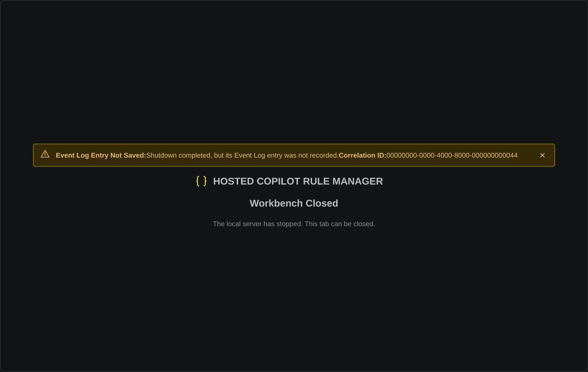

# Workbench Audit Table Mock

## Status and Scope

Design reference for the operational Event Log. The shared audit module, native launcher startup, assessment/recovery, reconciliation/adjudication, and explicit Exit integrations are implemented in application schema revision 13. Counts and typed analysis-run targets are implemented; the additional diagnostic fields and other operation coverage described below remain proposed. Existing saved databases are not automatically migrated or rewritten. All example IDs, timestamps, and GUIDs are synthetic.

The Exit implementation records a generic USER request and SYSTEM completion in separate short audit transactions under one correlation. It records completion only after the listener stops accepting connections, returns audit persistence separately from shutdown success, and shows one final-page warning for missing or uncertain audit recording. Exit does not implicitly save browser drafts; its state-save outcome is `unknown`. Existing domain authorization, identities, and legacy audit callers are unchanged.

The shared invariant is one append-only operational Event Log for major tool actions: generic USER/SYSTEM actors, categories identifying where events happen, and one correlation linking every workflow triggered by an initiating action. This is not a CRUD audit trail or a database transaction trace.

One [shared audit module](../tools/modules/workbench/WorkbenchAudit.mjs) owns registration, event/fact validation, generic actors, correlation lookup, safe summaries, independent audit transactions, persistence aggregation, and once-per-correlation warning state. Callers supply confirmed operation facts, not SQL, arbitrary messages, actor identities, or their own audit retry/error-handling implementations. The [PowerShell adapter](../tools/modules/workbench/Workbench.Audit.psm1) transports that context and presents warnings; it does not implement a second database writer.

Recording is best-effort, not a condition of operational success. An audit-only failure must not stop otherwise valid work, but it must produce a safe, non-blocking warning. Genuine domain persistence failures remain operation failures.

## Event Selection Boundary

| Include | Exclude |
| --- | --- |
| Workbench startup and explicit Exit | Individual input checks and immediate UI validation |
| LLM discovery | Each discovered model as a separate success event |
| Rebuild and major assessment/reconciliation/adjudication boundaries | Each successfully evaluated rule or batch |
| Catalog export | Routine edits, save-change actions, and update-plan actions |
| Confirmed completion, failure, cancellation, or meaningful recovery of those operations | SQL statements, row mutations, function calls, polling, and progress ticks |

- Record operationally important actions and outcomes, not everything that changes database state.
- Keep detailed execution and revision history in its existing domain tables.
- Record a blocking startup check as one Workbench startup failure, not a series of per-input audit events.
- Keep ordinary rejected edits and validation feedback in the UI, outside this Event Log.
- Summarize successful phase work with counts and domain references rather than per-item success events.
- Record actionable failures once at their owning major operation; do not copy them into each caller or a Database category.
- Do not emit an event for every transparent internal retry. Record a retry or recovery only when it is a meaningful operational transition.
- Expect healthy-run event volume to follow major workflow boundaries rather than rule, batch, or SQL-query counts.

Continued use still grows the history. Retention or archival requires a separate explicit decision; this proposal does not introduce silent pruning, error sampling, or a size cap that drops required events.

## Table Inventory

| Table | Disposition | Responsibility |
| --- | --- | --- |
| `actors` | Reuse | Supply the generic USER and SYSTEM audit actors |
| `audit_actions` | New | Define registered actions once |
| `audit_categories` | New | Define the tool sections that own events |
| `audit_correlations` | New | Identify an initiating action and group its event history |
| `audit_events` | Revise | Record major actions, confirmed outcomes, and allowlisted troubleshooting context |
| `audit_targets` | Extend | Link events to actual domain records through typed FKs |

This is six participating tables, three of them new. Severity and outcome remain constrained event values, not separate lookup tables. There is no separate event-type registry, phase hierarchy, per-category log table, or correlation-status engine.

## Relationships

```text
actors.id ---------> audit_correlations.initiated_by_actor_id
audit_actions.id --> audit_correlations.action_id

audit_correlations.id --> audit_events.correlation_id
audit_actions.id -------> audit_events.action_id
audit_categories.id ----> audit_events.category_id
actors.id --------------> audit_events.actor_id

audit_events.id --> audit_targets.event_id
domain table PK --> audit_targets.<specific typed FK>
```

Arrows identify referenced PKs and their dependent FKs. Every PK shown below is an integer; the correlation GUID is a separate unique text value.

## Actors: Existing Table, Generic Audit Records

Reuse `actors`; do not introduce a second audit actor table. The existing table also participates in non-audit domain behavior. Its current identity columns are not removed or repurposed by this mock.

Proposed generic records using the existing columns:

| id | actor_kind | provider_code | provider_actor_id | display_name |
| --- | --- | --- | --- | --- |
| 1 | `person` | `local-workbench` | `operator` | USER |
| 2 | `system` | NULL | NULL | SYSTEM |

- Treat both records as server-controlled logical actors, not identified individuals.
- Use only these two records in the new operational audit and its initiating-actor references.
- Perform no GitHub, OS-account, environment-variable, or Git-configuration identity lookup for auditing.
- Do not collect handles, aliases, email addresses, account identifiers, or identity hashes for this log.
- Resolve actors server-side; clients cannot label their own requests SYSTEM.
- Keep authorization separate. Neither generic actor is proof of authentication, ownership, or permission.
- Do not delete, anonymize, or rewrite existing domain identities or historical records as part of this mock.

The example integers are not proposed hard-coded runtime IDs. Production code resolves registered generic actors, and implementation must enforce their permitted use at the audit boundary.

## `audit_actions`: New

| Column | Type | Constraints / Meaning |
| --- | --- | --- |
| `id` | INTEGER | PK |
| `code` | TEXT | Required, unique, stable action code |
| `label` | TEXT | Required, human-readable display label |

Illustrative registered actions:

| id | code | label |
| --- | --- | --- |
| 1 | `start-workbench` | Start Workbench |
| 2 | `rebuild` | Rebuild |
| 3 | `assess` | Assess |
| 4 | `reconcile` | Reconcile |
| 5 | `adjudicate` | Adjudicate |
| 6 | `discover-llms` | Discover LLMs |
| 7 | `export-catalog` | Export Catalog |
| 8 | `exit-workbench` | Exit Workbench |

The same registry serves root requests and individual event actions. The correlation's action identifies the original request; an event's action identifies the work recorded by that event. A rebuild may therefore contain reconcile events without changing its initiating action.

Do not reuse the existing `action_definitions` table: its add/update/retire rule-recommendation semantics are different.

Input checks, individual saves, and Plan membership changes are intentionally absent. Registering additional actions must preserve the major-operation selection boundary, not expand into a general change audit.

## `audit_categories`: New

| Column | Type | Constraints / Meaning |
| --- | --- | --- |
| `id` | INTEGER | PK |
| `code` | TEXT | Required, unique, stable section code |
| `label` | TEXT | Required, human-readable display label |

Illustrative registered categories:

| id | code | label |
| --- | --- | --- |
| 1 | `workbench` | Workbench |
| 2 | `assessment` | Assessment |
| 3 | `reconciliation` | Reconciliation |
| 4 | `adjudication` | Adjudication |

- Give every event exactly one owning category.
- Keep categories flat: no Analysis parent, redundant phase field, or automatic Database child event.
- Record a persistence failure encountered by Reconciliation under Reconciliation.
- Distinguish routing, consolidation, and synthesis through specific registered actions when that detail is needed within Reconciliation.
- Register additional actual tool sections as needed; this seed list is illustrative, not a complete command-coverage inventory.
- Keep authored-rule surfaces such as implementation/testing separate from audit categories.

## `audit_correlations`: New

| Column | Type | Constraints / Meaning |
| --- | --- | --- |
| `id` | INTEGER | PK used by internal FK references |
| `correlation_guid` | TEXT | Required, unique, canonical server-generated GUID; displayed for troubleshooting |
| `action_id` | INTEGER | Required FK to `audit_actions.id`; original initiating action |
| `initiated_by_actor_id` | INTEGER | Required FK to the generic USER or SYSTEM record in `actors` |
| `started_at` | TEXT | Required, server-generated UTC timestamp |
| `repository_context_id` | INTEGER | Optional FK to existing `repository_contexts.id`, when known at initiation |

- Create one record for each initiating major command attempt, not one per application session or routine UI request.
- Generate the display GUID at the entry point and carry it in operation context across participating functions and process boundaries. Carry the integer FK only after its correlation record is confirmed persisted.
- Retain the correlation for internally triggered workflows and retries.
- Create a new correlation for a later explicit user request, including a separately requested resume of an existing run.
- Do not update the initiating action when execution reaches another section.
- Keep the row immutable after creation. Do not add a competing workflow outcome or current-state column.
- Use the root repository context when available without copying it into every event. Exact affected versions remain discoverable through typed targets.
- If correlation persistence fails, retain the GUID in transient operation context for immediate diagnostics and continue otherwise valid domain work. Do not invent an integer ID, create dangling events, or weaken the required event FK.

## `audit_events`: Revised Existing Table

| Column | Type | Constraints / Meaning |
| --- | --- | --- |
| `id` | INTEGER | PK; append-order tie-breaker within the database |
| `correlation_id` | INTEGER | Required FK to `audit_correlations.id` |
| `category_id` | INTEGER | Required FK to `audit_categories.id`; where the event happened |
| `action_id` | INTEGER | Required FK to `audit_actions.id`; what this event records |
| `actor_id` | INTEGER | Required FK to the generic USER or SYSTEM record in `actors` |
| `severity` | TEXT | Required; `info`, `warning`, or `error` |
| `outcome` | TEXT | Required; proposed values: `started`, `succeeded`, `failed`, `refused`, `cancelled`, `reused` |
| `occurred_at` | TEXT | Required, server-generated UTC observation timestamp |
| `safe_summary` | TEXT | Required, bounded, server-owned human-readable explanation |
| `diagnostic_code` | TEXT | Optional registered, stable cause code; not arbitrary exception text |
| `diagnostic_stage` | TEXT | Optional diagnostic boundary: `request`, `evaluate`, or `commit` |
| `diagnostic_path` | TEXT | Optional safe schema/property location; never a machine filesystem path |
| `authored_collection_code` | TEXT | Optional registered authored collection, preserving existing missing-input scope |
| `authored_surface_id` | INTEGER | Optional FK to `guidance_surfaces.id` |
| `authored_relative_path` | TEXT | Optional server-derived expected repository-relative authored-input path |
| `requested_port` | INTEGER | Optional requested port; range 0-65535, with 0 reserved for an OS-assigned port request |
| `listener_port` | INTEGER | Optional actual bound or confirmed stopped listener port; range 1-65535 |
| `elapsed_ms` | INTEGER | Optional confirmed operation duration; nonnegative |
| `state_save_outcome` | TEXT | Optional Exit result: `saved`, `nothing-pending`, `failed`, or `unknown` |
| `item_count` | INTEGER | Optional confirmed item count, with meaning defined by the action; nonnegative |
| `failure_count` | INTEGER | Optional confirmed failed-item count for a major phase summary; nonnegative |

The diagnostic boundary is not another workflow phase: for example, Reconciliation is the category while `commit` identifies where result processing failed.

- Replace text `action_code` with the action FK.
- Replace `startup_attempt_guid` with the shared correlation FK.
- Resolve initiating actor and root repository context through the correlation instead of duplicating them in every event.
- Retain authored-scope protections for relevant major-operation failures, using correlation rather than startup-only identity. These optional fields do not authorize per-file success logging.
- Register valid action/outcome/diagnostic combinations server-side; do not accept caller-authored audit rows.
- Keep diagnostic metadata optional for normal events and available for failures that occur before any evaluation exists.
- Reuse the trusted diagnostic builder; do not independently reinterpret errors in the audit writer or terminal renderer.
- Record only the minimal safe diagnostic envelope, not raw stdout/stderr, source quotations, full domain payloads, or a generic JSON context blob.
- Do not expand an evaluation's complete stored diagnostics into another copied payload. Domain-specific detail remains accessible through the target link.
- Populate operational context only for actions that define its meaning. Use NULL for unavailable or inapplicable values, not invented ports, zero counts, or success-shaped defaults.

Proposed severity meanings:

| Severity | Meaning |
| --- | --- |
| `info` | Normal requests, phase boundaries, completion, reuse, and expected cancellation |
| `warning` | Attention needed without claiming a failed operation succeeded |
| `error` | An operation or phase could not complete its intended work |

`outcome` records the major event's result, not a mutable current workflow status. Detailed outcomes such as individual input validity or changed/unchanged revisions remain in their owning domain records or immediate UI feedback.

### Allowlisted Troubleshooting Context

| Major operation | Pertinent context |
| --- | --- |
| Start Workbench | Requested and actual listening ports, startup outcome, and non-personal tool/schema versions |
| Exit Workbench | Actual listener port, confirmed listener-stop outcome, and required state-save outcome |
| LLM discovery | Registered provider label, available-model count, duration, and safe failure details |
| Assessment, reconciliation, adjudication | Run/evaluation references, recorded model/settings, duration, and summary counts |
| Export catalog | Exact catalog/version reference, exported-item count, duration, and outcome |

- Keep queryable scalar facts in the typed columns above; do not add a generic metadata table, arbitrary key/value properties, or a JSON context dump.
- Resolve model/provider/settings through existing run/evaluation/profile records where available. Do not copy their complete configuration into the event.
- Include approved non-personal version/provider labels in a server-owned summary when needed and not already available through a domain reference.
- Store only registered, formatted context. Never persist full URLs with authentication material, personal output paths, machine names, prompts, credentials, or raw exception/process output.
- Do not inspect user-profile identity or unrelated environment configuration to enrich the log.
- Distinguish the requested port from the actual listener port. A failed bind can have a requested port but no actual listener port.
- Record confirmed listener state, not assumptions derived from a UI click. Do not probe or stop unrelated processes to manufacture confirmation.
- Treat required-state persistence as the existing Exit contract defines it. This mock does not introduce autosaving or promise that unsaved editor buffers are persisted.

### Exit Lifecycle

- Record the USER's explicit Exit request with a new correlation.
- Record SYSTEM's confirmed Exit outcome under that correlation, including the listener port and `state_save_outcome`.
- Distinguish `saved` from `nothing-pending`; neither is implied merely by clicking Exit.
- Use `failed` when required persistence fails and `unknown` when its result cannot be established. Do not claim a clean, successful Exit in either case.
- Confirm listener shutdown before recording it as completed, while the audit writer is still available. Do not claim that the entire process has terminated before it actually has.
- Do not add a separate operational event for every state write performed during Exit.
- Do not report an unexpected browser/process termination as a clean Exit. A missing completion event means unconfirmed completion, not automatic proof of a crash.
- Keep audit recording separate from the Exit result. Confirmed state persistence and listener shutdown can succeed even when recording their event fails; show the audit warning on the final closed page without relabeling Exit as failed.

### Shutdown Page Design Reference

Visual reference for the implemented native shutdown page. The native Workbench has its own stylesheet and Exit handler; they now render the approved heading, spacing, and optional warning. This example assumes shutdown completed but its Event Log entry was not recorded. The correlation GUID is synthetic.



- Place the existing dismissible warning banner above the product branding, inside the centered shutdown grid rather than at the screen's top edge.
- Keep the yellow product SVG at 28 by 28 pixels.
- Render Workbench Closed at 20px, weight 600, with a 30px line height.
- Use the existing 16px section-spacing token between grid rows.
- Preserve the full warning context and inline correlation ID, with a working right-aligned Close button. Allow natural wrapping on narrower windows instead of clipping the text or pushing the grid off-center.
- Render both warning labels at weight 600 and the GUID at regular weight. Show no warning when both Exit events were recorded; use distinct unconfirmed-recording wording when persistence is uncertain.
- Show no separate success panel, saved-state card, port status, or acknowledgement requirement on the closed page.

The warning reads: **Event Log Entry Not Saved:** Shutdown completed, but its Event Log entry was not recorded. **Correlation ID:** `00000000-0000-4000-8000-000000000044`.

Dismissing the notice does not change the shutdown result or imply that recording succeeded. Other state-save outcomes retain the distinctions described above.

## `audit_targets`: Extend Existing Table

| Column / Group | Type | Constraints / Meaning |
| --- | --- | --- |
| `id` | INTEGER | PK |
| `event_id` | INTEGER | Required FK to `audit_events.id` |
| `target_role` | TEXT | Required; `subject`, `before`, or `after` |
| Existing typed target columns | INTEGER | Retain actual domain FKs for revisions, Plans, evaluations, sources, snapshots, and other currently supported targets |
| `analysis_run_id` | INTEGER | New optional FK to `analysis_runs.id` |
| `catalog_version_id` | INTEGER | New optional FK to `catalog_versions.id` |

- Require exactly one typed domain FK per target row.
- Allow multiple target rows per event, including a run and an evaluation or before/after versions.
- Allow no target rows when a major operation fails before a domain record exists; do not fabricate an evaluation or revision.
- Link meaningful domain roots and exact versions, not every detail row reachable from them.
- Verify target scope and ownership as well as FK existence.
- Retain one typed-target table rather than introducing a junction table for every target type.
- Add future typed FK columns only when a new domain root needs a direct audit link.

## Synthetic Rebuild Trace

Correlation record:

| id | correlation_guid | action_id | initiated_by_actor_id | started_at | repository_context_id |
| --- | --- | --- | --- | --- | --- |
| 42 | `00000000-0000-4000-8000-000000000042` | 2 | 1 | `2030-01-01T10:00:00.000Z` | NULL |

Event rows shown with FK labels resolved for readability:

| id | correlation_id | Category | Action | Actor | Severity | Outcome | occurred_at | safe_summary |
| --- | --- | --- | --- | --- | --- | --- | --- | --- |
| 101 | 42 | Workbench | Rebuild | USER | info | started | `2030-01-01T10:00:00.000Z` | Rebuild requested |
| 102 | 42 | Assessment | Assess | SYSTEM | info | started | `2030-01-01T10:00:01.000Z` | Assessment started |
| 103 | 42 | Assessment | Assess | SYSTEM | info | succeeded | `2030-01-01T10:00:05.000Z` | Assessment completed |
| 104 | 42 | Reconciliation | Reconcile | SYSTEM | info | started | `2030-01-01T10:00:06.000Z` | Reconciliation started |
| 105 | 42 | Reconciliation | Reconcile | SYSTEM | error | failed | `2030-01-01T10:00:08.000Z` | Reconciliation result could not be saved |

Event 105 can carry a safe persistence diagnostic and separate typed targets for its run and evaluation. It does not generate another Database-category error or repeat the same failure at each caller.

## Synthetic Startup and Exit Traces

These are separate initiating actions, so each has its own correlation. Example ports are synthetic.

| Event | Correlation | Category | Action | Actor | Severity / Outcome | requested_port | listener_port | state_save_outcome | safe_summary |
| --- | --- | --- | --- | --- | --- | --- | --- | --- | --- |
| 201 | Startup | Workbench | Start Workbench | USER | info / started | 43800 | NULL | NULL | Workbench startup requested |
| 202 | Startup | Workbench | Start Workbench | SYSTEM | info / succeeded | NULL | 43800 | NULL | Workbench listener opened |
| 203 | Exit | Workbench | Exit Workbench | USER | info / started | NULL | 43800 | NULL | Exit requested |
| 204 | Exit | Workbench | Exit Workbench | SYSTEM | info / succeeded | NULL | 43800 | saved | Listener stopped; required state persistence confirmed |

If Exit cannot save required state, its SYSTEM outcome is `failed` with `state_save_outcome = failed`, a safe diagnostic, and only the listener facts actually confirmed. It must not emit the successful row shown above. If nothing required saving, successful Exit uses `nothing-pending` instead of `saved`.

## Simple Trace Query

This query describes the proposed schema, not the current application schema:

```sql
SELECT
    e.id,
    e.occurred_at,
    category.label AS category,
    action.label AS action,
    actor.display_name AS actor,
    e.severity,
    e.outcome,
    e.safe_summary,
    e.diagnostic_code,
    e.diagnostic_stage,
    e.diagnostic_path,
    e.requested_port,
    e.listener_port,
    e.elapsed_ms,
    e.state_save_outcome,
    e.item_count,
    e.failure_count
FROM audit_correlations AS correlation
JOIN audit_events AS e ON e.correlation_id = correlation.id
JOIN audit_categories AS category ON category.id = e.category_id
JOIN audit_actions AS action ON action.id = e.action_id
JOIN actors AS actor ON actor.id = e.actor_id
WHERE correlation.correlation_guid = :correlation_guid
ORDER BY e.id;
```

An optional read-only view can encapsulate these joins. It is not another table or copied log. A details query retrieves typed targets separately, avoiding multiplication of event rows when an event has several targets.

## Persistence, Ordering, and Failure Boundaries

- Preserve append-only events and targets; use restrictive FK behavior, not cascading history deletion.
- Keep referenced action/category codes stable so later registration changes do not reinterpret historical events.
- Index `audit_events(correlation_id, id)` for the trace query and `audit_targets(event_id)` for details. The unique GUID constraint supplies the GUID lookup index.
- Generate timestamps at observation. Event IDs describe insertion order, not causal ordering between parallel workers or guaranteed commit-time order.
- Use shared correlation and run/evaluation references to distinguish concurrent work. Do not add another sequence table.
- Let the domain owner commit or roll back its own work independently of audit persistence. A domain commit failure or uncertain domain outcome is not an audit-only failure and must never be reported as confirmed success.
- At safe transaction boundaries, append audit events in separate short audit transactions. Record successful results after confirmed domain commit; record failures after the domain owner has completed rollback and any applicable failed-evaluation status update.
- Do not write best-effort audit records inside a domain transaction where an audit error could invalidate otherwise valid work. Do not hold a domain transaction open while waiting for audit recording.
- Commit each event and all its typed targets atomically within the audit transaction. Roll back only that audit transaction if its event or target insertion fails, leaving no partially linked event.
- Keep initial request/start events in their own short audit transactions, not in transactions held across inference or the lifetime of an operation.
- Record external facts such as listener startup/shutdown only after confirmation; a database transaction cannot make those external effects atomic. Report audit-persistence uncertainty honestly if recording the confirmed result fails.
- Assign one owner to record each failure. Propagating the exception does not create another copy of that error.
- Keep separate, genuinely meaningful lifecycle facts distinct; an action-start event is not a duplicate of its later failure.
- If an insert/commit acknowledgement is uncertain, reconcile against persisted operation/domain evidence before retrying an audit write. A correlation ID groups events; it is not an event deduplication key.
- When the database cannot open or accept writes, report the correlation GUID and honest audit-persistence status through the immediate command response. Do not claim that an event was stored or create a fallback log file.

Separate commits deliberately permit a gap between a domain result and its audit event, including interruption before the event is written. The Event Log helps investigation but is not a complete transaction ledger or authoritative workflow state. Missing history cannot prove that the corresponding domain action did not happen.

## Audit-Only Failure Policy

| Situation | Operation result | Audit handling |
| --- | --- | --- |
| Domain work succeeds; audit succeeds | Success | Report confirmed recording |
| Domain work succeeds; only audit recording fails | Success with audit warning | Continue; report incomplete history |
| Domain work fails; audit succeeds | Original operation failure | Record the safe failure once |
| Domain work and audit recording both fail | Original operation failure plus audit warning | Preserve the primary error; do not replace it with the logging error |
| Domain commit/rollback outcome is uncertain | Uncertain domain result, not confirmed success | Follow the domain owner's recovery rules and report audit status separately |
| Correlation cannot be persisted | Determined by the actual domain operation | Carry the transient GUID, warn, and do not insert events without a valid correlation FK |

- Catch audit-only failures at the shared audit boundary, not with a broad catch around the actual operation.
- Return safe structured recording status; do not swallow the failure or emit a success-shaped recording result.
- Preserve `auditPersistence` distinctions: `recorded` for acknowledged writes, `not-recorded` for confirmed unsuccessful recording, and `uncertain` when persistence cannot be established.
- Do not reset an action's degraded-history indication merely because a later event saves successfully.
- Bound audit-write waits and attempts. Do not retry indefinitely, block useful work waiting for logging, or introduce a background retry service.
- Do not recursively record the audit writer's failure in the failing Event Log.
- Do not create fallback log files, a second database, or another persistent error queue.
- Never suppress a genuine data-save failure as though it were merely an audit failure.
- Do not change domain transaction, validation, authorization, or required-state persistence guarantees to make best-effort auditing easier.

## Warning Delivery

The backend owns one safe structured audit warning; the active caller owns its presentation. Operation success/failure, audit-persistence status, and the warning remain separate. Do not add another notification framework or persist a copy of the warning in a separate store.

| Execution context | Warning surface |
| --- | --- |
| Script or terminal command | Native warning/diagnostic stream; preserve clean machine-readable stdout |
| Running Workbench | Existing toast control, with non-blocking warning semantics |
| Startup before the UI is available | Launcher warning |
| Exit after the normal UI is replaced | Final Workbench Closed page |

Proposed warning example:

```text
Export completed, but its Event Log entry could not be saved.
Correlation: <correlation-guid>
```

- Deliver one user-facing audit warning per correlation, deduplicating repeated audit failures without hiding distinct operation errors.
- Carry the warning in the existing command result or progress channel; the browser must not query the failing audit store to discover it.
- Include a safe warning code/message and the existing display GUID, not raw database errors, credentials, or personal paths.
- Keep successful operations successful. In scripts, an audit-only warning does not turn the successful operation into a failure exit status.
- Preserve the original operation error when both work and recording fail; the audit warning is secondary.
- Give Workbench toasts warning semantics, not an operation-failed message or modal acknowledgement requirement.
- Preserve the audit warning through final response rendering so an ordinary success notification does not immediately overwrite it.
- Render Exit warnings in the final closed-page content; do not rely on a toast removed when the page body is replaced.
- If shutdown prevents delivery of its final response, do not claim the browser received confirmation. Use the launcher diagnostic surface where available and preserve uncertainty rather than inventing a clean result.

## Shared Module and Current Coverage

This is a cross-cutting change at major-operation boundaries, not a logging parameter or write added to every function.

| Area | Responsibility |
| --- | --- |
| Schema and shared audit writer | Registered actions/categories, generic actors, correlations, safe context, isolated audit transactions, and recording status |
| Major-operation owners | Emit only approved lifecycle/phase events with confirmed facts |
| Operation context | Forward the same correlation across nested work and process boundaries |
| Command/server response adapters | Preserve the actual operation result and expose audit warnings separately |
| Existing UI notification/shutdown surfaces | Present the same warning as a toast or final-page notice |
| Focused owning tests | Verify correlation continuity, major-operation event volume, privacy, audit-failure isolation, and warning delivery |

The [shared module](../tools/modules/workbench/WorkbenchAudit.mjs) provides `start`, `finish`, and `transition` at major-operation boundaries, plus `run` to preserve the original exception while recording a terminal failure, refusal, or cancellation. `snapshot` carries transient context across processes. `result` reports persistence independently from the domain outcome, and `takeWarning` returns at most one structured warning for that correlation. No caller receives or invents a correlation integer PK.

| Existing native owner | Current recording boundary |
| --- | --- |
| [Native launcher](../tools/Start-RuleWorkbenchNew.ps1) | One startup request after the database location is selected; success after confirmed server readiness and any requested browser launch, or one failed startup outcome |
| [Analysis command](../tools/internal/workbench/Invoke-WorkbenchAnalysis.ps1) | One correlation across command preparation, model availability checks, and the database worker; a separately requested resume or continuation creates a new correlation |
| [Database worker](../tools/modules/workbench/WorkbenchDatabase.mjs) | Assessment completion/reuse, typed busy refusal, failure, and cooperative cancellation; structured audit warning/context packets are separate from progress and domain-result packets |
| [Downstream execution](../tools/modules/workbench/WorkbenchDownstreamExecution.mjs) | One reconciliation outcome after routing/consolidation/synthesis, then an adjudication start before its planning; adjudication completion follows confirmed analysis completion and execution-guard cleanup |
| [Native HTTP server](../tools/modules/workbench/WorkbenchNewServer.mjs) | Authenticated explicit Exit request and confirmed listener-stop outcome; final closed-page persistence status is unchanged |

- Keep internal launcher preflight probes read-only; they do not initiate another correlation or startup event.
- Treat model availability as a check within the initiating command, not one event per model. There is no separate native discovery command wired here.
- Preserve the correlation through internally invoked stages. Source assessment and a later explicitly requested downstream continuation are separate commands, so they receive separate correlations even when they target the same analysis run.
- Keep routing, consolidation, synthesis, individual batches, progress ticks, source saves, and Plan membership out of the operational Event Log.
- Link known analysis runs through the typed `analysis_run_id` target. Assessment item counts describe sources, reconciliation counts describe source assessments, and adjudication counts describe comparisons.
- Keep action/category registrations append-only so their stable codes cannot reinterpret earlier events.
- Preserve legacy authored-input/domain audit rows and their existing transaction semantics. Operational events additionally require normalized correlation, action, and category links; the operational trace joins exclude legacy rows with null normalized links.
- Report a lost audit transport reply as `uncertain` and do not retry an unacknowledged event. The PowerShell adapter preserves the primary native exit status and uses the warning stream, including when the caller's warning preference would otherwise stop execution.
- Do not create a replacement database or fallback log when storage is unavailable. Before a usable database location/context exists, persisted startup history is unavailable; an unavailable selected store produces a launcher warning with the transient correlation GUID.

Native rebuild, standalone LLM discovery, staged catalog export, and publication are not implemented or added by this audit integration. Initial catalog capture precedes a database and is not converted into another audit store. The legacy Workbench remains outside this native rollout. Keep cross-team generalization, an Event Log viewer, and speculative extension frameworks deferred.

## Approval Boundary

Explicit approval covers the shared audit module and thin native major-operation integrations, in addition to the operational foundation, real Exit recording, and matching native closed page. Historical-data migration, database replacement, identity-history changes, absent workflows, broad validation, and an Event Log viewer remain outside this change.

Before expanding coverage, map only major commands and workflow boundaries to registered actions/categories and confirm applicable success, failure, refusal, cancellation, meaningful retry, and recovery coverage. Confirm each operation's context allowlist, isolated audit-write boundary, and response/warning integration without changing save behavior. Populated databases require a separately approved supported migration; fresh initialization uses revision 13 and preserves incompatible existing databases.

Schema owner: [WorkbenchAuthoredRefresh.mjs](../tools/modules/workbench/WorkbenchAuthoredRefresh.mjs). Shared audit owner: [WorkbenchAudit.mjs](../tools/modules/workbench/WorkbenchAudit.mjs). Native HTTP owner: [WorkbenchNewServer.mjs](../tools/modules/workbench/WorkbenchNewServer.mjs). Broader existing design: [Workbench SQLite V1 Design](WORKBENCH_SQLITE_V1_DESIGN.md). Unimplemented portions of this design are not replacement runtime authority.
