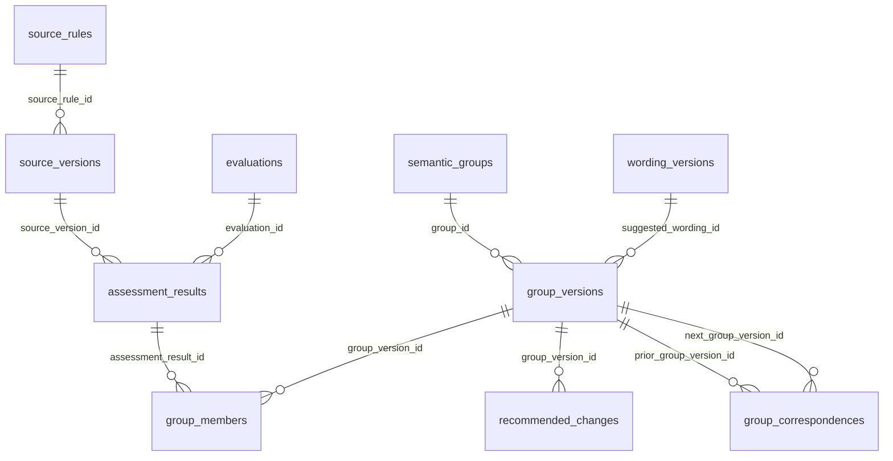
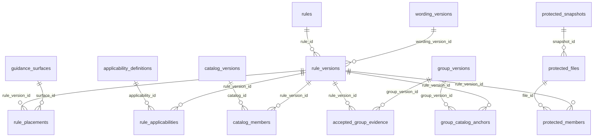
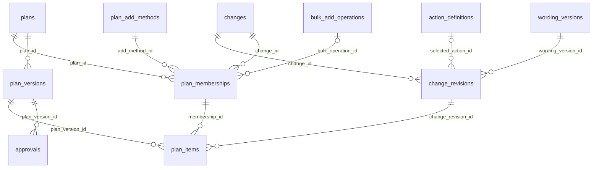
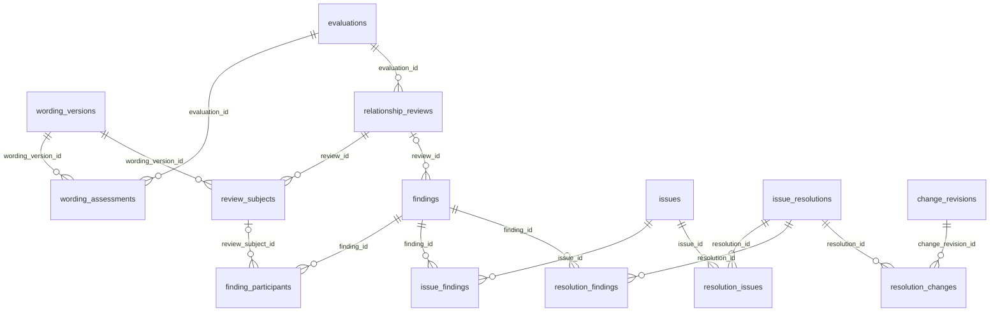
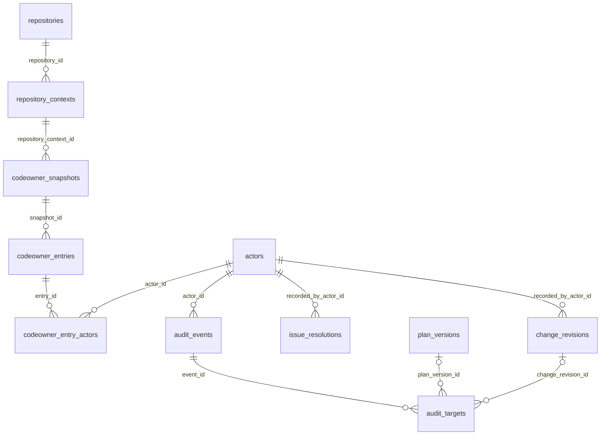
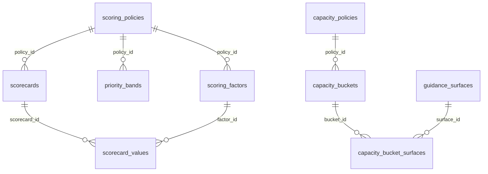
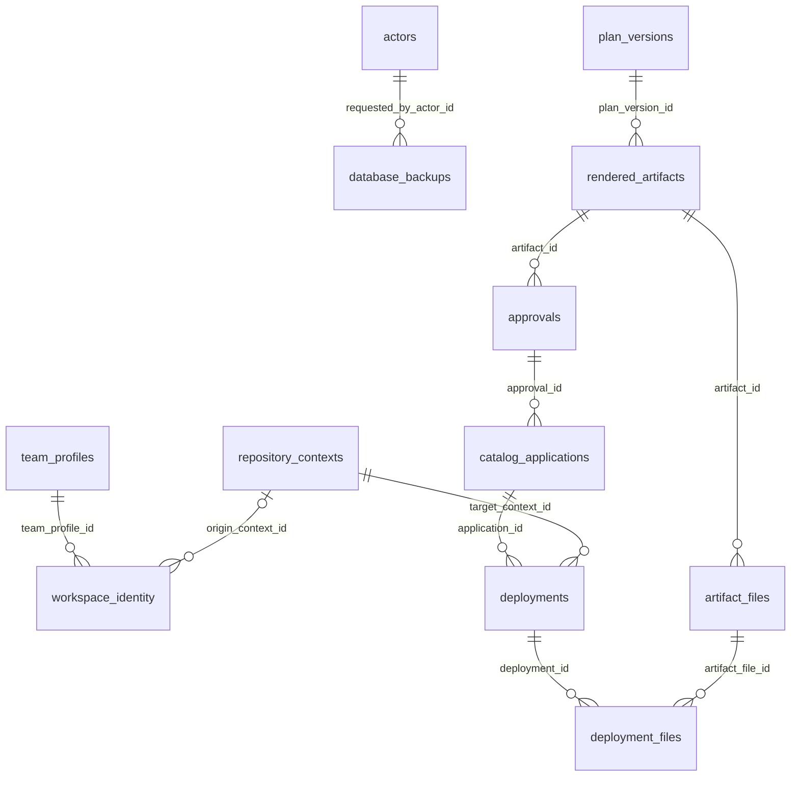

# Workbench SQLite V1 Database Design

## Status and Review Boundary

First consolidated design draft, 2026-11-02. This is a reviewable proposal for table definitions and workflow ownership, not a migration, executable schema, implemented API, or permission to replace the preserved Workbench. Settled product requirements and proposed physical structures are distinguished below.

This document owns the SQL-v1 model. The [architectural reset checkpoint](WORKBENCH_ARCHITECTURAL_RESET_CHECKPOINT.md) preserves the old implementation and its known limitations. The [deferred v2 snapshot-sharing design](WORKBENCH_DATABASE_SNAPSHOT_V2_DESIGN.md) owns future whole-database sharing, inspection, and optional replacement. Neither document makes that feature part of v1.

The definitions deliberately expose the referenced table and column for every FK. They are more concrete than the earlier conversation diagram, but require review before conversion to DDL. Small junction tables preserve real relationships; they are not independently configurable workflow engines. A table's presence in this draft is not approval of its final name, fields, or implementation cost.

## Settled Product Requirements

- Use embedded local SQLite, not a hosted service, subscription, shared multi-tenant database, or JSON document store hidden inside SQL.
- Store durable facts once. The server owns commands, transactions, authorization, projections, review applicability, readiness, and audit. The UI owns unsaved buffers and presentation.
- Keep source identities, captured versions, assessed meanings, semantic groups, generated wording, saved decisions, published rules, and Plan membership distinct.
- Keep accepted evidence and maintainer outcomes across rebuilds. Force creates new evaluation attempts; it does not overwrite acceptance or silently reopen equivalent settled outcomes.
- Preserve the fast relationship check. Current wording assessment must also refresh priority and Assessment Details when explicitly requested; chat advice is not a formal assessment.
- Check changed wording against the complete applicable projected active/protected catalog, not just its former conflict partner or source group.
- Save is a server API command. It does not silently invoke AI, select an unselected item, approve, publish, or deploy.
- Keep a selected Plan item selected after Save, with the new saved revision and unchanged manual/bulk provenance. Undo removes membership only; it does not reset wording or decisions.
- Show one effective Action value: saved maintainer choice when present, otherwise the AI recommendation. Preserve both facts without requiring two pills. Recommendation fallback is not consent.
- Catalog Status describes the current published catalog. Saving or staging Retire does not turn Mapped into Retired; actual publication does.
- Preserve protected content and the manifest-owned deployment boundary. Approval, local catalog application, and actual fork deployment are distinct outcomes.
- Keep source lanes, naming, scoring, capacity, and icon provenance adaptable to other repositories without assuming specific provider names or displayed-ID prefixes.
- Use ordinary operational audit and backup/recovery. No signed evidence infrastructure, distributed locking, or speculative enterprise framework.
- Exclude draft/database import-export and their runtime stubs from v1. Include database identity now; defer whole-database sharing to v2.

## SQLite Capabilities and Server Responsibilities

SQLite is a relational SQL engine embedded in the application process. It is not a separate database service, and it does not provide every feature or dialect of a server database such as SQL Server or PostgreSQL. The server functions in this design are application functions, not SQLite stored procedures.

| Feature | SQLite Behavior | Consequence for This Design |
| --- | --- | --- |
| Relational queries | Supports joins, unions, grouping, aggregates, subqueries, CTEs, and window functions | Query normalized evidence and decisions instead of rebuilding copied JSON graphs |
| Views | Named stored SELECT queries; not stored query results and no view parameters | Use for reusable joined read models where they simplify actual consumers; use bound queries for request values |
| Stored procedures | No built-in stored-procedure facility | Implement Save, resolution, Plan, approval, and apply commands as server functions executing parameterized SQL |
| Triggers | Supports actions associated with table changes; ordinary views can be made writable with INSTEAD OF triggers | Use narrowly justified integrity guards, not an elaborate trigger system attempting to reproduce stored procedures or workflow commands |
| Transactions | Supports atomic commit/rollback for database changes | Save the decision revision, selected Plan revision, and audit together; filesystem work and AI calls remain outside the transaction |
| Concurrency | Multiple readers, but only one writer at a time per database; WAL can allow readers alongside a writer | Keep writes short, handle busy/cancellation with bounds, and do not hold locks while waiting for inference or user input |
| Types | Ordinary tables use flexible type affinity; supported modern versions offer STRICT tables | Use STRICT for application tables by default, with explicit nullability, range, uniqueness, and ownership constraints; document any justified exception |
| Foreign keys | Supported, but enforcement must be enabled and verified for each connection | Initialize connections with `PRAGMA foreign_keys = ON` before starting transactions; do not rely on defaults or toggle enforcement around invalid writes |
| Dates and booleans | No dedicated date/time or Boolean storage classes | Use consistent UTC text and constrained integer booleans as defined below |
| Database users and roles | No server-style built-in user/role authorization system | Authenticate and enforce scoped permissions in the application; database identity and recorded CODEOWNERS rows are not credentials |
| Schema changes | ALTER TABLE and migration capabilities differ from server engines | Design explicit versioned migrations for the selected SQLite release; do not assume arbitrary server-database DDL can be copied unchanged |
| SQL dialect and functions | SQL syntax and driver-provided capabilities differ between engines and releases | Verify the actual embedded SQLite version; do not assume T-SQL batches, EXEC, procedure syntax, or optional extensions are available |

A view is not a replacement name for a stored procedure. It describes a query over stored records, not a command that validates a request, performs several mutations, authorizes a user, or commits a workflow. Views are read-only by default. This design does not use writable-view triggers to hide Save operations.

Application-registered SQL functions, if supported by the selected driver, are also not stored procedures. They are not a reason to execute code stored in a database row. Prefer ordinary SQL and explicit server code before adding custom functions or extensions.

### Example: Show This Candidate's Details

The browser requests the selected change/candidate and its context. A server read function uses a parameterized SELECT, optionally through reusable views, to join:

- The change's current and original decision revisions and their wording.
- The originating group version, member assessment results, captured source versions, and coverage rationales.
- The current published catalog mapping and the compatible wording assessment and relationship results.
- The applicable scoring/capacity policies and current Plan membership when the view includes them.

The server binds the requested identifier as a value, reads a consistent snapshot, computes derived fields, and returns a read model. Source meaning and recorded decisions come from existing records; this operation does not ask AI to generate them again. A view by itself neither captures a historical snapshot nor calculates semantic freshness: the exact version references and server rules establish that context.

The UI displays and styles the result. It does not join private database tables, infer a mapping from a displayed ID, or reconstruct the authoritative candidate state independently.

### Example: Save This Maintainer Decision

The browser sends the selected action, saved wording/rationale, target, and expected current revision to a server command. The command performs the work a developer might otherwise place in a stored procedure:

1. Authenticate the caller and validate the request and target context.
2. Begin a short database transaction using the chosen driver's supported API.
3. Check current permission and expected revision under the operation's concurrency rules; reject stale or unauthorized writes.
4. Insert the immutable decision revision and any required wording or applicability rows using bound parameters.
5. Advance that change's current reference. If already selected, create the new Plan snapshot while retaining its membership and manual/bulk origin; otherwise leave it unselected.
6. Record the audit event and its exact domain references in the same transaction.
7. Commit only after every required write succeeds; roll back the database changes on failure.
8. Return the updated revision-bound read model after a successful commit.

There is no SQL `CREATE PROCEDURE` or `EXEC SaveDecision` behind this example. The concrete server language, method names, routes, and SQLite binding remain implementation choices. Bind values rather than concatenate request text into SQL; any selected SQL identifiers must come from trusted application definitions, not arbitrary caller input.

Save does not run inference, publish a catalog, change Git state, or deploy files inside this transaction. A failed Save must not announce success or discard the user's local buffer. The command/transaction map later in this document defines the other operations using the same ownership boundary.

### Verify Before Writing Executable DDL

Record the actual SQLite library version exposed by the chosen driver, not just the presence of a machine-wide SQLite CLI. Confirm its supported STRICT-table, query, FK, migration, transaction, busy-handling, and backup capabilities. The table notation below is still a design proposal; it is not evidence that these guards have been implemented or exercised.

### Embedded Engine Prerequisites, Not the SQLite CLI

Database creation, startup, and validation must check the selected application runtime and its actual embedded SQLite binding. The standalone `sqlite3` command-line tool is not a v1 prerequisite. Do not require its executable on PATH, invoke it for required validation, or tell adopters to install it merely because that command is absent.

- Load the selected binding and query its engine directly, including `SELECT sqlite_version()` through that binding, rather than accepting a separate CLI version as evidence.
- Check the supported runtime/library versions and required capabilities, not only a version string. Verify per-connection foreign-key enforcement and the expected STRICT schema through the shared database layer.
- If a required runtime or binding is missing or unsupported, stop before creating/publishing a database and give installation or upgrade instructions for that exact supported dependency. Do not automatically install software, change persistent PATH settings, or substitute another database engine.
- Keep any CLI installation instructions optional and limited to manual inspection workflows. A CLI present on the machine must not make an unsupported application binding pass validation, and an absent CLI must not make a supported binding fail.

The final binding decision must specify its supported runtime range and reproducible dependency/setup instructions. A local available runtime is not automatically the minimum version all adopters must install.

On 2026-11-02, a disposable in-memory capability probe using the installed Node `node:sqlite` binding reported Node `v26.13.0` and embedded SQLite `3.54.0`. It successfully enabled FKs, created STRICT tables, and rejected both an orphan reference and a nonconvertible integer value without using a standalone SQLite CLI. This verifies an available binding option, not the complete application schema, initializer, migrations, backup support, or a finalized runtime choice. No repository database was created by that probe.

### Mandatory Code Enforcement and Acceptance Gates

These requirements are not advisory documentation. The future database layer must implement them, and focused tests must demonstrate them before production cutover. No connection factory, SQLite schema, migration runner, or runtime guard has been implemented merely by adding this section.

| Requirement | Required Code Owner and Enforcement | Required Acceptance Evidence |
| --- | --- | --- |
| Embedded local storage | The database layer resolves the explicitly bound local workspace; no browser SQL or implicit remote service | Startup opens the intended local database and does not create or switch workspaces from an untrusted request path |
| Foreign-key enforcement | One shared connection-opening policy sets and verifies enforcement before exposing each connection | Fresh, reopened, pooled, and worker connections report enabled enforcement; orphan inserts and forbidden parent deletions fail |
| Strict types and constraints | Schema creation uses supported STRICT tables and explicit NOT NULL, CHECK, UNIQUE, and ownership FKs | Nonconvertible wrong types, required NULLs, out-of-range values, duplicates, and mismatched owners are rejected |
| Short transactions and one writer | Server command implementations keep database transactions bounded; inference, user waits, remote calls, and deployment file work occur outside them | A paused evaluator holds no write transaction; concurrent saves either complete safely or return a bounded busy/concurrency result, without partial decisions or duplicate audit |
| Application authorization | Every mutation command checks authenticated identity, applicable current scoped permissions, and expected context; disabled UI controls are not enforcement | Direct API attempts with missing authority, revoked protected capabilities, or a stale revision are rejected without changing domain state |
| Controlled migrations | A versioned migration owner checks the actual driver capabilities, takes required backup, applies a reviewed sequence, and verifies the resulting schema/references before writable use | Upgrade and failure/rollback scenarios preserve recoverable data; unsupported schemas and failed verification cannot be opened for normal writes |

### Foreign-Key Enforcement Is Per Connection

The connection policy must execute the equivalent of the following before beginning a transaction:

```sql
PRAGMA foreign_keys = ON;
PRAGMA foreign_keys;
```

Read the second result and require `1`. A missing result, unsupported behavior, or `0` is a connection-initialization failure: do not hand that connection to a query/command owner and hope constraints will apply. Validate this against the actual SQLite library embedded by the driver, including its enabled capabilities.

Apply the policy to every application-created connection, including connections reopened after recovery and connections owned by background workers. If the driver pools connections, prove that all leased connections satisfy the invariant and cannot return to circulation with enforcement disabled. Do not initialize one connection and assume every later connection inherits its setting.

Setting `foreign_keys` inside an active transaction does not enable it for that transaction; connection initialization must happen first. An ordinary write path must never disable enforcement to insert otherwise invalid data. Use the supported transaction/deferrable-constraint mechanism for legitimate cyclic initialization, not a bypass around required relationships.

Tests must distinguish immediate and explicitly deferred constraints: a deferred invalid relationship may fail at commit instead of at insertion, but it must not survive a successful transaction. The failed operation must leave no partial decision, Plan head, or audit record claiming success.

Use `PRAGMA foreign_key_check` at the appropriate migration/restore/integrity gates to detect existing violations; an integrity check alone does not replace that relationship check. Do not probe a real workspace by inserting deliberately invalid test data at startup. Negative-write tests belong in complete disposable synthetic fixtures.

### STRICT Typing Is a Table Declaration

There is no global FK/STRICT switch. Foreign keys protect relationships; `STRICT` protects storage types on each table that declares it. Require a SQLite release and driver supporting STRICT tables, introduced in SQLite 3.37.0, rather than silently falling back to ordinary flexible tables when a required capability is missing.

Create application-owned tables with STRICT by default. Any exception must identify its concrete need and retained type/integrity checks during DDL review. STRICT permits the declared type names INT, INTEGER, REAL, TEXT, BLOB, and ANY; this model uses the appropriate INTEGER, REAL, TEXT, and BLOB types rather than assuming server-specific BOOLEAN, DATETIME, or arbitrary type declarations are legal.

STRICT can accept a value that SQLite can losslessly convert to the declared type. It does not mean every string submitted for an integer column is automatically rejected. API validation must still check the request's intended types and values. Do not use ANY merely to avoid those checks.

Keep boolean range checks, score bounds, required fields, unique indexes, composite ownership FKs, and semantic result validation explicit. STRICT alone does not stop an integer from referencing the wrong parent, prove a factor belongs to its policy, authorize a user, or establish that a rule resolves a conflict.

### Migration and Read-Only Connection Boundaries

Select and test SQLite-specific migrations; do not generate server-database DDL and assume it works unchanged. Prefer supported transactional migration steps and verify rollback behavior. A table-rebuild migration or exceptional connection-setting change requires a separately reviewed maintenance sequence, quiesced ordinary writers, recoverable backup, full reference verification, and restored connection invariants before normal use. Do not expose a general API for weakening constraints or continue writable service after a failed migration.

Configure writable and read-only connections deliberately. Connection-local FK enforcement is not permission to change file-level journal mode, migrate a received database, refresh its source records, or repair its contents during inspection. The future v2 inspection boundary remains read-only. V1 backup/restore must also re-establish and verify all normal connection invariants before allowing writes.

## How to Read the Definitions

These are field definitions in a compact notation, not SQL statements:

- `INTEGER PK` is an internal integer primary key.
- `FK -> table.column` names a real referenced column. Every field is required unless its type ends in `?`.
- `TEXT?` and `INTEGER?` permit NULL. NULL is not an empty string, zero, an inferred approval, or an invented record.
- `UNIQUE(a, b)` constrains the combination. Junctions with `PK(a, b)` have a composite primary key instead of an extra `id`.
- `CHECK(...)` describes a required constraint. Constraint shorthand must be translated into valid SQLite syntax during DDL review.
- Time values are server-generated UTC ISO-8601 text. GUIDs and SHA-256 values have application validation and suitable SQLite checks.
- Booleans are INTEGER with `CHECK(value IN (0, 1))`. Named code sets are registered application behavior, not executable configuration from database rows.
- Version/result records are immutable after successful finalization. Current pointers, job status, counters, and active membership endings are explicitly mutable coordination records.
- Historical records use restrictive deletion by default. Undo ends a membership; it does not cascade-delete its old Plan items or audit evidence.

`PARENT ||--o{ CHILD` means one parent can be referenced by zero or many child rows. Each child has one required FK to that parent. An optional FK instead permits zero or one parent. This does not mean that a parent must already have children, or that every pair of children is semantically compatible.

Example: `group_members.group_version_id = 12` points to `group_versions.id = 12`. Its other FK, `assessment_result_id = 81`, points to the exact assessed meaning contributed to that group. The junction explains the many-to-many relationship rather than storing an array of copied assessments.

## Workspace and Repository Identity

V1 candidate: one logical active workspace and owning team profile per database. Other teams run independent local databases. These tables do not introduce tenant routing or a shared database service. Whether a checkout owns one database across branches or separate branch-associated workspaces remains an explicit decision before implementation.

```text
team_profiles
  id INTEGER PK
  code TEXT UNIQUE
  label TEXT

repositories
  id INTEGER PK
  provider_code TEXT
  provider_repository_id TEXT?
  canonical_name TEXT
  UNIQUE(provider_code, canonical_name)

repository_contexts
  id INTEGER PK
  repository_id INTEGER FK -> repositories.id
  branch_ref TEXT
  commit_oid TEXT
  observed_at TEXT

workspace_identity
  id INTEGER PK CHECK(id = 1)
  database_guid TEXT UNIQUE
  team_profile_id INTEGER FK -> team_profiles.id
  origin_context_id INTEGER? FK -> repository_contexts.id
  created_by_actor_id INTEGER? FK -> actors.id
  created_at TEXT
```

The GUID identifies database lineage, not a branch, person, permission, or content match. Initialization creates it once; restart, Save, backup, and ordinary restore preserve it. Origin is historical provenance. A later branch switch cannot silently change accepted rules, permissions, or deployment target.

Machine-local checkout locations and credentials remain outside transferable domain facts. `repository_contexts` records observed branch/commit context; it is not an instruction to switch Git branches. Use the normal schema migration/version mechanism instead of a second independently maintained schema version in `workspace_identity`.

## Database Initialization and Adoption Commands

V1 must provide a PowerShell entry point for creating a new local workspace database and a separate read-only validation entry point. Users must not need to create tables, insert seed rows, or set connection safeguards manually. These commands are required implementation work, not implemented scripts or usable command examples in the current checkout.

The existing [repository adoption validator](../tools/commands/adoption/Test-RepositoryAdoption.ps1) checks declared product configuration and adaptation boundaries; it is not a SQLite initializer or proof of database integrity. Keep that responsibility distinct while aligning the new adoption path with the selected repository profile.

### Shared Implementation Owner

PowerShell is the user-facing command adapter. Creation, schema migrations, seed loading, connection initialization, CODEOWNERS parsing/refresh, and database validation must call the same database/domain implementations used by normal application startup and runtime commands.

Do not implement one schema or permission algorithm in a PowerShell script and a different one in the server. Resolve the SQLite binding and executable migrations before creating the working entry points; do not add a no-op wrapper, a missing-module call, or a script that creates only a header and reports a usable database.

The final command names, parameter spelling, module location, and runtime binding are technical choices to review with the owning implementation. The following contracts define behavior without prematurely fixing those details.

### Create Database Inputs and Preconditions

- Require an explicit target repository root, database location, and selected adoption/profile configuration, or resolve them through a previously confirmed local workspace binding.
- Validate repository identity and observed branch/commit context separately from the new database GUID. A branch name or folder basename must not choose another workspace silently.
- Validate the declared profile, supported adapters, required seed configuration, selected runtime capabilities, and path safety before publishing a usable database.
- Validate the actual embedded SQLite runtime/binding without requiring or invoking the standalone SQLite CLI; report actionable setup instructions only for missing required dependencies.
- Refuse to overwrite any existing destination database. Repeated creation must not replace its GUID, reseed duplicate actors, reset counters, erase evidence, or act as an implicit upgrade/restore command.
- Enforce safe ownership of any staging destination and a no-overwrite final handoff; avoid a check-then-write race that can replace a database another process just created.
- Use normal local authentication and the configured ownership policy. Do not accept credentials as seed data or grant capabilities solely because someone supplied a repository path.

Creation may require temporary local staging to protect an existing workspace. Remove only partial files owned by that attempt, never the existing database, its WAL/SHM companions, another operation's candidate, or the only recovery copy. Do not record the destination as an active workspace until initialization and verification succeed.

### Required Initialization Sequence

1. Resolve and validate the explicit inputs and supported native runtime; capture the non-sensitive current repository context.
2. Open the new candidate through the shared connection factory. Enable and read back foreign-key enforcement before transactions; reject unsupported required SQLite/STRICT capabilities.
3. Apply the versioned schema migrations, including STRICT declarations, PK/FK constraints, ownership guards, checks, and indexes. Use the same migration/version authority as future upgrades.
4. Create the persistent workspace GUID once and record the owning profile and observed origin without fabricating historical evidence.
5. Seed the SYSTEM actor, supported action/status vocabulary, and the profile's required naming, source, scoring, capacity, and guidance-rendering configuration. UI icons, previews, selection manifests, and legal documents are file-based application assets, not database seeds.
6. Resolve supported current actor/principal identities, capture and parse the configured CODEOWNERS file through the shared ownership implementation, and populate the snapshot, ordered entries, and current membership projection.
7. Record initialization and ownership-refresh attribution using the server UTC clock. These records describe this observation, not every past repository change or an old maintainer's unobserved decision.
8. Complete structural, relational, seed, and repository-binding validation. Reopen through the normal connection path where needed to prove that persisted identity and required safeguards survive reopening.
9. Publish/register the initialized database only after all required steps succeed, then report its safe identity/location and schema version in human-readable output.

Use short transactions with explicit failure boundaries. Schema or seed failure must not leave an apparently ready database, half-established current pointers, or audit rows claiming a successful initialization. If required CODEOWNERS data cannot be obtained or parsed for the selected profile, report that failure and do not silently create trusted ownership or grant capabilities. Optional ownership behavior must be an explicit profile rule, not an initializer fallback.

An initialized empty workspace has valid identity, schema, policy, and current ownership records but no invented source assessments, generated groups, saved decisions, accepted rules, or approvals. Loading the initial repository-published catalog and deliberately preserving compatible legacy evidence is a separate, still-open bootstrap/cutover decision; it is not a reason to run AI or restore the removed Import Draft UI.

### CODEOWNERS After Initialization

The initializer performs the first observation only. Normal startup must continue the documented shared refresh policy, including hash/parser-version checks, unchanged attempts, failed attempts, inactive memberships, and path-scoped permissions. Do not treat seeded memberships as permanently trusted, give every observed actor permission on every path, or delete actor history when ownership changes.

Initialization does not impersonate the creator as every CODEOWNER or mark a principal authenticated merely because its name appears in the source file. Resolve the current caller through the normal authentication owner; preserve observed ownership and authenticated identity as different facts.

### Validate Database Contract

Validation opens an explicitly selected database without changing its stored contents. It must not create missing files, migrate tables, seed absent records, refresh CODEOWNERS, repair references, run AI, or change the active workspace. It may set and verify connection-local safety flags; that does not authorize file-level journal changes or domain writes.

Report these categories independently:

| Check | Required Result |
| --- | --- |
| Application and identity | Recognized Workbench database, supported schema/version authority, exactly one valid workspace GUID and owning profile |
| Engine capabilities | Selected application runtime and actual embedded SQLite/driver support the required features; connection FK enforcement reads back as enabled; standalone CLI presence/version is irrelevant |
| Schema shape | Expected tables, columns, PK/FK definitions, indexes, guards, and STRICT declarations match the selected migration version |
| Storage integrity | Appropriate SQLite integrity check succeeds; no corruption or missing required captured content |
| Referential integrity | Foreign-key check reports no violations; required ownership/current-head relationships are valid |
| Required seeds | Supported action/status rows, SYSTEM actor, and complete profile policy references exist without duplicates |
| Repository association | Requested repository/workspace binding is compatible; recorded branch context is not treated as permanent identity |
| Ownership evidence | The selected profile's required ownership snapshot/entry/membership data is coherent; any difference from live permissions is reported, not silently refreshed |

Validation is not a permission grant or a fresh semantic review. A database can be structurally valid while containing historical assessments, an unready Plan, or ownership that needs normal startup refresh. Report those distinctions instead of making every recorded assessment appear current.

Use actionable safe failure codes and normal human-readable progress. Invalid or unsupported databases return a non-success result; do not hide independent failures or print raw SQL, credentials, or secret-bearing configuration. Negative insert/delete/type tests run against disposable fixtures, not a maintainer's database during read-only validation.

### Adoption Acceptance Gates

- Create the new database for the selected real target repository using its actual adoption profile, required configuration, and CODEOWNERS; validate it through the public entry point and the normal application connection path. Do not substitute synthetic identities, profiles, or ownership records during adoption.
- Prove GUID persistence, STRICT declarations, FK read-back, seed completeness, CODEOWNERS snapshot/ordering, membership scope, and honest audit attribution.
- Prove database creation and validation work without a standalone SQLite CLI when the supported embedded binding is available; verify no hidden CLI subprocess dependency.
- Prove a second creation attempt refuses the existing path without changing database bytes, GUID, counters, memberships, or saved work.
- Prove the validator leaves database/domain contents unchanged and reports independent structural/relational/configuration failures without silently repairing them.
- Prove normal startup uses the shared connection, validation, and ownership-refresh implementations without rerunning database creation, reseeding configuration, or silently migrating the database.

### Automated Test Coverage

Developer tests use separate disposable fixtures for invalid configuration, missing/invalid required ownership, unsupported engines, schema/seed failure, destination contention, and interrupted creation. Synthetic repositories/profiles are appropriate for these controlled tests, but are never substituted for the actual repository/profile when initializing an adopter's database. Tests must model the complete required schema and seed shape without weakening production constraints.

Include missing/unsupported embedded-runtime cases with actionable dependency guidance and a supported binding with no CLI available. An installed CLI must not mask a missing or incompatible application binding. Do not uninstall real tooling or alter the user's persistent environment to simulate these cases; isolate test-process configuration or dependency resolution instead.

Do not deliberately corrupt, interrupt, or insert invalid data into a maintainer's real workspace to test failure handling. Live adoption verification and automated negative tests are separate activities; neither requires a user to construct a synthetic repository before using the tool.

## Vocabulary, Naming, and Guidance Placement

```text
action_definitions
  id INTEGER PK
  code TEXT UNIQUE
  label TEXT
  CHECK(code IN (add, update, retire, restore, no-change, exclude, defer))

workflow_status_definitions
  id INTEGER PK
  dimension TEXT
  code TEXT
  label TEXT
  description TEXT
  UNIQUE(dimension, code)

rule_id_schemes
  id INTEGER PK
  scheme_code TEXT
  revision INTEGER
  prefix TEXT
  separator TEXT
  numeric_width INTEGER CHECK(numeric_width > 0)
  UNIQUE(scheme_code, revision)

rule_id_counters
  scheme_id INTEGER PK FK -> rule_id_schemes.id
  next_value INTEGER CHECK(next_value > 0)

guidance_surfaces
  id INTEGER PK
  surface_code TEXT
  revision INTEGER
  label TEXT
  output_relative_path TEXT
  renderer_code TEXT
  UNIQUE(surface_code, revision)

surface_patterns
  surface_id INTEGER FK -> guidance_surfaces.id
  pattern TEXT
  PK(surface_id, pattern)

applicability_definitions
  id INTEGER PK
  code TEXT UNIQUE
  label TEXT
  renderer_code TEXT
```

Actions are behavior contracts; adding an arbitrary row cannot implement a new action. Status definitions centralize domain vocabulary, not CSS. For example, source/current, catalog/mapped, and decision/action-required are independent dimensions. The server derives applicable statuses from facts. It does not persist another mutable pill selection beside those facts.

The client maps stable status/action codes to known styles, never integer PKs to CSS selectors. Column headings, impact-direction annotations, icons, tooltips, and layout remain presentation. A table is not needed for every string.

ID allocation is transactional and scoped to the owning workspace's scheme. Scheme changes do not rename existing rules. The draft supports a literal prefix plus sequence; arbitrary templating or executable naming expressions are not proposed. Surface paths are validated against the product's allowed manifest-owned output paths.

## Source Collection and Evidence

```text
source_lanes
  id INTEGER PK
  code TEXT UNIQUE
  label TEXT
  display_order INTEGER

source_definitions
  id INTEGER PK
  lane_id INTEGER FK -> source_lanes.id
  code TEXT UNIQUE
  label TEXT

source_definition_versions
  id INTEGER PK
  definition_id INTEGER FK -> source_definitions.id
  revision INTEGER
  adapter_code TEXT
  adapter_version TEXT
  repository_id INTEGER? FK -> repositories.id
  location TEXT
  configured_ref TEXT?
  content_format TEXT
  UNIQUE(definition_id, revision)

source_rules
  id INTEGER PK
  definition_id INTEGER FK -> source_definitions.id
  external_key TEXT
  UNIQUE(definition_id, external_key)

source_versions
  id INTEGER PK
  source_rule_id INTEGER FK -> source_rules.id
  title TEXT
  captured_text TEXT
  content_sha256 TEXT
  captured_location TEXT
  captured_revision TEXT?
  UNIQUE(source_rule_id, content_sha256, captured_location)

source_collections
  id INTEGER PK
  definition_version_id INTEGER FK -> source_definition_versions.id
  repository_context_id INTEGER? FK -> repository_contexts.id
  started_at TEXT
  completed_at TEXT?
  outcome TEXT CHECK(outcome IN (running, complete, failed, cancelled))

source_collection_members
  collection_id INTEGER FK -> source_collections.id
  source_rule_id INTEGER FK -> source_rules.id
  source_version_id INTEGER FK -> source_versions.id
  presence TEXT CHECK(presence IN (present, missing-last-known))
  PK(collection_id, source_rule_id)

source_version_comparisons
  id INTEGER PK
  evaluation_id INTEGER FK -> evaluations.id
  prior_version_id INTEGER FK -> source_versions.id
  current_version_id INTEGER FK -> source_versions.id
  classification TEXT
  rationale TEXT
  prior_evidence_quote TEXT?
  current_evidence_quote TEXT?
```

Definitions own collection configuration; versions pin the adapter and source context used. `captured_text` is evidence, not a live-file lookup. A collection member's source version must belong to its stated source rule and definition; use composite FK guards or a narrowly scoped trigger in final DDL, not a claim that unrelated single-column FKs prove that match.

The candidate source-version uniqueness above needs review for metadata-only changes: different provenance/title/revision must not be silently overwritten. A physical implementation may separate content identity from observation metadata rather than force every observation into a new semantic version. This is an open design detail, not permission to discard provenance.

Only a complete successful collection can advance the last-observed source view. A fetch/parse failure is not evidence that a source disappeared. Preserve last-known content for missing records. The accepted version is reached through accepted group evidence, not a mutable `accepted_source_version` field on a source rule.

Comparison classifications and verbatim quotations must be validated against exact captured versions. Source split/merge/rename correspondence requires explicit grounded matching; an ordinal, title, source key, or hash cannot establish equivalent meaning by itself.

## Evaluation History, Reuse, and Scoring

```text
evaluator_profiles
  id INTEGER PK
  code TEXT
  revision INTEGER
  task_code TEXT
  adapter_code TEXT
  model TEXT
  reasoning_effort TEXT
  prompt_sha256 TEXT
  behavior_sha256 TEXT
  result_contract_sha256 TEXT
  UNIQUE(code, revision)

analysis_runs
  id INTEGER PK
  requested_by_actor_id INTEGER FK -> actors.id
  requested_at TEXT
  force_requested INTEGER CHECK(force_requested IN (0, 1))
  outcome TEXT CHECK(outcome IN (running, complete, failed, cancelled))
  completed_at TEXT?

run_collections
  run_id INTEGER FK -> analysis_runs.id
  collection_id INTEGER FK -> source_collections.id
  PK(run_id, collection_id)

evaluations
  id INTEGER PK
  evaluator_profile_id INTEGER FK -> evaluator_profiles.id
  input_fingerprint TEXT
  requested_at TEXT
  completed_at TEXT?
  outcome TEXT CHECK(outcome IN (running, complete, failed, cancelled))
  failure_code TEXT?

run_evaluations
  run_id INTEGER FK -> analysis_runs.id
  evaluation_id INTEGER FK -> evaluations.id
  use_kind TEXT CHECK(use_kind IN (executed, reused))
  PK(run_id, evaluation_id)

scoring_policies
  id INTEGER PK
  code TEXT
  revision INTEGER
  minimum_total INTEGER
  UNIQUE(code, revision)

scoring_factors
  id INTEGER PK
  policy_id INTEGER FK -> scoring_policies.id
  code TEXT
  label TEXT
  description TEXT
  minimum_value INTEGER
  maximum_value INTEGER
  weight INTEGER
  contribution_kind TEXT CHECK(contribution_kind IN (value, risk))
  UNIQUE(policy_id, code)

priority_bands
  id INTEGER PK
  policy_id INTEGER FK -> scoring_policies.id
  code TEXT
  label TEXT
  minimum_score INTEGER
  maximum_score INTEGER?
  UNIQUE(policy_id, code)

scorecards
  id INTEGER PK
  policy_id INTEGER FK -> scoring_policies.id
  selection_rationale TEXT

scorecard_values
  scorecard_id INTEGER FK -> scorecards.id
  factor_id INTEGER FK -> scoring_factors.id
  value INTEGER
  PK(scorecard_id, factor_id)
```

Index evaluations by evaluator profile, outcome, and input fingerprint. Do not make the fingerprint globally unique: Force can evaluate the same input again and preserve a different result. Reuse links a new run to an existing completed validated result; it does not copy its result rows or falsify its original evaluation time.

A completed evaluation with zero assessed meanings or findings remains a completed evaluation. No child result rows does not mean unprocessed. Persist each validated job in a short transaction. Publish a new complete run view only when the required stages and coverage succeed; a partial failed run must not replace the previous complete view or accepted catalog.

Score values must reference factors belonging to their scorecard's policy, include every required factor exactly once, and lie in its bounds. The final implementation must enforce policy ownership with composite keys/guards and validate complete vectors. Band ranges must not overlap. The server calculates the weighted total with the policy minimum and selects a band; it does not ask AI to regenerate arithmetic or store another independently editable priority.

### Exact Evaluation Inputs

```text
evaluation_inputs
  id INTEGER PK
  evaluation_id INTEGER FK -> evaluations.id
  role_code TEXT
  source_version_id INTEGER? FK -> source_versions.id
  group_version_id INTEGER? FK -> group_versions.id
  wording_version_id INTEGER? FK -> wording_versions.id
  rule_version_id INTEGER? FK -> rule_versions.id
  catalog_version_id INTEGER? FK -> catalog_versions.id
  protected_snapshot_id INTEGER? FK -> protected_snapshots.id
  plan_version_id INTEGER? FK -> plan_versions.id
  scoring_policy_id INTEGER? FK -> scoring_policies.id
  capacity_policy_id INTEGER? FK -> capacity_policies.id
  CHECK(exactly one of the typed input FKs is non-null)
```

This is a typed input junction: every permitted subject has an actual FK. It is not an unconstrained `(entity_type, entity_id)` pair or an arbitrary attribute store. Add partial uniqueness indexes for each `(evaluation_id, role_code, non-null target)`.

The fingerprint covers the complete relevant semantic payload and execution authority, including configured prompt/model/behavior versions and comparison context. Do not include audit-only timestamps or UI labels. References alone are not a complete cache key. Reuse requires server validation that current inputs match the recorded evaluated context; hash equality does not prove a semantic conclusion correct.

## Source Meanings and Generated Wording

```text
assessment_results
  id INTEGER PK
  evaluation_id INTEGER FK -> evaluations.id
  source_version_id INTEGER FK -> source_versions.id
  local_result_key TEXT
  title TEXT
  source_meaning TEXT
  impact_description TEXT
  hosted_applicable INTEGER CHECK(hosted_applicable IN (0, 1))
  applicability_rationale TEXT
  confidence_level TEXT CHECK(confidence_level IN (low, medium, high))
  confidence_rationale TEXT
  existing_coverage_score INTEGER CHECK(existing_coverage_score BETWEEN 0 AND 5)
  existing_coverage_rationale TEXT
  scorecard_id INTEGER FK -> scorecards.id
  UNIQUE(evaluation_id, source_version_id, local_result_key)

assessment_uncertainties
  assessment_id INTEGER FK -> assessment_results.id
  ordinal INTEGER
  description TEXT
  PK(assessment_id, ordinal)

assessment_surfaces
  assessment_id INTEGER FK -> assessment_results.id
  surface_id INTEGER FK -> guidance_surfaces.id
  PK(assessment_id, surface_id)

assessment_catalog_links
  assessment_id INTEGER FK -> assessment_results.id
  rule_version_id INTEGER FK -> rule_versions.id
  relationship_code TEXT
  rationale TEXT
  PK(assessment_id, rule_version_id)

wording_versions
  id INTEGER PK
  text TEXT
  content_sha256 TEXT
  created_at TEXT

semantic_groups
  id INTEGER PK
  created_at TEXT

group_versions
  id INTEGER PK
  group_id INTEGER FK -> semantic_groups.id
  revision INTEGER
  synthesis_evaluation_id INTEGER FK -> evaluations.id
  suggested_wording_id INTEGER FK -> wording_versions.id
  scorecard_id INTEGER FK -> scorecards.id
  title TEXT
  semantic_summary TEXT
  synthesis_rationale TEXT
  UNIQUE(group_id, revision)

group_members
  group_version_id INTEGER FK -> group_versions.id
  assessment_result_id INTEGER FK -> assessment_results.id
  member_role TEXT CHECK(member_role IN (primary, supporting))
  meaning_coverage_rationale TEXT
  PK(group_version_id, assessment_result_id)

group_catalog_anchors
  group_version_id INTEGER FK -> group_versions.id
  rule_version_id INTEGER FK -> rule_versions.id
  relationship_code TEXT
  rationale TEXT
  PK(group_version_id, rule_version_id)

group_correspondences
  id INTEGER PK
  prior_group_version_id INTEGER FK -> group_versions.id
  next_group_version_id INTEGER FK -> group_versions.id
  correspondence_kind TEXT
  rationale TEXT
  evaluation_id INTEGER? FK -> evaluations.id
  recorded_by_actor_id INTEGER? FK -> actors.id
  recorded_at TEXT
  CHECK(at least one of evaluation_id or recorded_by_actor_id is non-null)

recommended_changes
  id INTEGER PK
  group_version_id INTEGER FK -> group_versions.id
  ordinal INTEGER
  operation_role TEXT CHECK(operation_role IN (primary, ancillary))
  action_id INTEGER FK -> action_definitions.id
  target_rule_version_id INTEGER? FK -> rule_versions.id
  wording_version_id INTEGER? FK -> wording_versions.id
  surface_id INTEGER? FK -> guidance_surfaces.id
  section_heading TEXT?
  rationale TEXT
  UNIQUE(group_version_id, ordinal)

reconciliation_dispositions
  run_id INTEGER FK -> analysis_runs.id
  assessment_result_id INTEGER FK -> assessment_results.id
  disposition_code TEXT CHECK(disposition_code IN (grouped, deferred, excluded))
  rationale TEXT
  PK(run_id, assessment_result_id)
```

Source cardinality is zero-to-many. An assessment-local key is not a persistent catalog identity. One assessed meaning can participate in several group versions; membership is not copied assessment text. Complete coverage requires every supplied applicable meaning to be accounted for and every grouped disposition to have valid memberships in that run. Preserve member-by-member coverage rationale; a rationale is evidence to inspect, not proof that wording preserves meaning.

Each final group version owns one generated wording and its independent scorecard. No separate one-to-one recommendation header duplicates that ownership. `recommended_changes` explicitly distinguishes the primary operation and any ancillary retirements; do not infer their role from array order. Enforce at most one primary per group with a partial unique index and require one at finalization. A routing component can produce multiple final groups; it is not itself a final candidate.

Generated wording may exist before a managed rule ID. Do not invent a published rule row merely to persist an AI suggestion. Do not globally deduplicate wording by text/hash: identical text can have different origins and histories.

Correspondence rows record established equivalence, split, merge, or material membership change. A split or merge has multiple pair rows. Reject self-links and unsupported classifications; record the comparison evidence through the evaluation inputs. Stable group identity can be reused only when correspondence is established, not because the model returned the same ordinal. Do not automatically reopen equivalent settled outcomes or carry approval across materially changed wording/operations.



## Published Catalog and Protected References

```text
rules
  id INTEGER PK
  displayed_id TEXT UNIQUE
  rule_kind TEXT CHECK(rule_kind IN (managed, protected))
  naming_scheme_id INTEGER? FK -> rule_id_schemes.id

rule_versions
  id INTEGER PK
  rule_id INTEGER FK -> rules.id
  revision INTEGER
  wording_version_id INTEGER FK -> wording_versions.id
  lifecycle TEXT CHECK(lifecycle IN (active, retired))
  retirement_reason TEXT?
  UNIQUE(rule_id, revision)
  UNIQUE(rule_id, id)

rule_placements
  rule_version_id INTEGER FK -> rule_versions.id
  surface_id INTEGER FK -> guidance_surfaces.id
  section_heading TEXT
  display_order INTEGER
  PK(rule_version_id, surface_id, section_heading)

rule_applicabilities
  rule_version_id INTEGER FK -> rule_versions.id
  applicability_id INTEGER FK -> applicability_definitions.id
  PK(rule_version_id, applicability_id)

protected_snapshots
  id INTEGER PK
  repository_context_id INTEGER FK -> repository_contexts.id
  captured_at TEXT
  content_sha256 TEXT

protected_files
  id INTEGER PK
  snapshot_id INTEGER FK -> protected_snapshots.id
  relative_path TEXT
  content BLOB
  content_sha256 TEXT
  UNIQUE(snapshot_id, relative_path)

protected_members
  file_id INTEGER FK -> protected_files.id
  rule_version_id INTEGER FK -> rule_versions.id
  PK(file_id, rule_version_id)

catalog_versions
  id INTEGER PK
  parent_catalog_id INTEGER? FK -> catalog_versions.id
  protected_snapshot_id INTEGER FK -> protected_snapshots.id
  revision INTEGER UNIQUE
  content_fingerprint TEXT
  created_at TEXT

catalog_members
  catalog_id INTEGER FK -> catalog_versions.id
  rule_id INTEGER FK -> rules.id
  rule_version_id INTEGER FK -> rule_versions.id
  PK(catalog_id, rule_id)
  FK(rule_id, rule_version_id) -> rule_versions(rule_id, id)

accepted_group_evidence
  rule_version_id INTEGER FK -> rule_versions.id
  group_version_id INTEGER FK -> group_versions.id
  approval_id INTEGER? FK -> approvals.id
  acceptance_origin TEXT CHECK(acceptance_origin IN (published-bootstrap, local-approval))
  PK(rule_version_id, group_version_id)
```

The composite catalog FK prevents attaching a version belonging to a different rule while claiming another `rule_id`. Each catalog contains at most one version of a given rule. Protected member versions must belong to protected rules; mutable changes must target managed rules. Enforce these ownership constraints with final DDL guards and server commands, not disabled controls alone.

The catalog member set is immutable. A version can be prepared before publication without being the current published version. Successful catalog application determines the current published head; a running or failed apply cannot advance it. The exact initial bootstrap/published-file adapter is an open cutover decision.

Active placement cardinality is profile-owned: the current product expects one placement per active managed rule. Retired versions have no active placement; restoration obtains the last active placement from history instead of copying a competing mutable `lastPlacement` authority. `rule_applicabilities` records renderer-specific variants through registered applicability definitions; do not infer them from an ID prefix. The renderer/profile validates which definitions are legal and required for a surface.

Accepted evidence pins exact group membership, source assessments, and generated wording through FKs. A later source collection or group synthesis cannot repoint that link. Baseline acquisition must not fabricate a local approval or historical evaluator; missing old evidence must be reported honestly rather than invented during bootstrap.



## Saved Maintainer Decisions

```text
changes
  id INTEGER PK
  origin_group_version_id INTEGER? FK -> group_versions.id
  origin_source_version_id INTEGER? FK -> source_versions.id
  original_revision_id INTEGER? FK -> change_revisions.id
  current_revision_id INTEGER? FK -> change_revisions.id

change_revisions
  id INTEGER PK
  change_id INTEGER FK -> changes.id
  revision INTEGER
  selected_action_id INTEGER? FK -> action_definitions.id
  target_rule_id INTEGER? FK -> rules.id
  baseline_rule_version_id INTEGER? FK -> rule_versions.id
  wording_version_id INTEGER FK -> wording_versions.id
  rationale TEXT
  recorded_by_actor_id INTEGER FK -> actors.id
  recorded_at TEXT
  UNIQUE(change_id, revision)
  UNIQUE(change_id, id)

change_placements
  change_revision_id INTEGER FK -> change_revisions.id
  surface_id INTEGER FK -> guidance_surfaces.id
  section_heading TEXT
  display_order INTEGER
  PK(change_revision_id, surface_id, section_heading)

change_retirements
  change_revision_id INTEGER FK -> change_revisions.id
  retired_rule_version_id INTEGER FK -> rule_versions.id
  PK(change_revision_id, retired_rule_version_id)

change_applicabilities
  change_revision_id INTEGER FK -> change_revisions.id
  applicability_id INTEGER FK -> applicability_definitions.id
  PK(change_revision_id, applicability_id)
```

Add composite ownership FKs from `(changes.id, original_revision_id)` and `(changes.id, current_revision_id)` to `change_revisions(change_id, id)`. Initialize the cyclic references inside a short transaction using supported deferrable constraints or a validated nullable initialization sequence. Before exposing the item, both original/current references must resolve to revisions of that change. Never leave a half-created candidate as the active read model.

The original revision is a pinned baseline, not the latest AI suggestion after a Force run. The current revision advances on successful Save. The selected action can be NULL before an explicit choice; do not copy the AI recommendation into a field that claims a maintainer selected it. Require a valid chosen action at the appropriate Save/staging/approval gate according to confirmed UI behavior.

For Add, a target may be unallocated while the suggestion is being inspected. Before a Plan requiring a stable rule ID is reviewed, allocate/reserve its ID through the naming owner without pretending it is already published. A rule with no published catalog member is not Mapped. Existing target/baseline versions must belong to the same managed rule; Retire/Update require an active baseline, Restore a retired baseline. Reject a conflicting primary and ancillary retirement.

AI operations in `recommended_changes` are immutable evidence. The maintainer's selected action and rationale live in `change_revisions`; no pill overwrite changes the recorded recommendation. Save without semantic input changes need not invalidate an otherwise compatible evaluation merely because an audit timestamp changed. Approval still binds the exact decision/Plan revision.

## Plans, Membership, and Approval

```text
plans
  id INTEGER PK
  label TEXT
  current_version_id INTEGER? FK -> plan_versions.id

plan_add_methods
  id INTEGER PK
  code TEXT UNIQUE CHECK(code IN (manual, bulk))
  label TEXT

bulk_add_operations
  id INTEGER PK
  plan_id INTEGER FK -> plans.id
  initiated_by_actor_id INTEGER FK -> actors.id
  initiated_at TEXT
  selection_description TEXT

plan_memberships
  id INTEGER PK
  plan_id INTEGER FK -> plans.id
  change_id INTEGER FK -> changes.id
  add_method_id INTEGER FK -> plan_add_methods.id
  bulk_operation_id INTEGER? FK -> bulk_add_operations.id
  added_by_actor_id INTEGER FK -> actors.id
  added_at TEXT
  removed_by_actor_id INTEGER? FK -> actors.id
  removed_at TEXT?

plan_versions
  id INTEGER PK
  plan_id INTEGER FK -> plans.id
  revision INTEGER
  base_catalog_id INTEGER FK -> catalog_versions.id
  recorded_by_actor_id INTEGER FK -> actors.id
  recorded_at TEXT
  UNIQUE(plan_id, revision)
  UNIQUE(plan_id, id)

plan_items
  plan_version_id INTEGER FK -> plan_versions.id
  membership_id INTEGER FK -> plan_memberships.id
  change_revision_id INTEGER FK -> change_revisions.id
  PK(plan_version_id, membership_id)

approvals
  id INTEGER PK
  plan_version_id INTEGER FK -> plan_versions.id
  artifact_id INTEGER FK -> rendered_artifacts.id
  approved_by_actor_id INTEGER FK -> actors.id
  permission_snapshot_id INTEGER FK -> codeowner_snapshots.id
  approved_at TEXT

approval_reviews
  approval_id INTEGER FK -> approvals.id
  review_id INTEGER FK -> relationship_reviews.id
  PK(approval_id, review_id)
```

Add a partial unique index on active `(plan_id, change_id)` where `removed_at IS NULL`. Manual membership has no bulk operation; bulk membership requires one from the same Plan. Ending membership requires removal actor/time together. Already-selected manual items are not duplicated or relabeled when included in a subsequent bulk operation. Undo then re-add creates a new membership and preserves the earlier origin.

The Plan/current-version FK needs the same composite owner guard as changes. Every Plan item must pin a revision of its membership's change and belong to that membership's Plan. Old snapshots continue to reference an ended membership historically; current membership ending does not mutate prior Plan versions.

Save of a selected item creates a new Plan version referencing the new change revision, keeping the membership ID and origin. Save of an unselected item does not create membership. Undo ends membership and advances the Plan, but does not restore wording, delete findings, change action, or rewrite audit.

The server validates the complete projected target set, including ancillary retirements, for conflicting operations. One rule cannot be independently mutated twice in a Plan. Approval requires exact base catalog, current decision revisions, applicable reviews/assessments, protected snapshot, policy/render authority, current permissions, and actual previewed bytes. An approval row does not itself publish or deploy.



## Wording Assessment, Reviews, Findings, and Resolutions

```text
wording_assessments
  id INTEGER PK
  evaluation_id INTEGER FK -> evaluations.id
  wording_version_id INTEGER FK -> wording_versions.id
  scorecard_id INTEGER FK -> scorecards.id
  meaning_summary TEXT
  impact_description TEXT
  applicable INTEGER CHECK(applicable IN (0, 1))
  applicability_rationale TEXT
  confidence_level TEXT CHECK(confidence_level IN (low, medium, high))
  confidence_rationale TEXT
  existing_coverage_score INTEGER CHECK(existing_coverage_score BETWEEN 0 AND 5)
  existing_coverage_rationale TEXT

wording_assessment_uncertainties
  assessment_id INTEGER FK -> wording_assessments.id
  ordinal INTEGER
  description TEXT
  PK(assessment_id, ordinal)

wording_assessment_surfaces
  assessment_id INTEGER FK -> wording_assessments.id
  surface_id INTEGER FK -> guidance_surfaces.id
  PK(assessment_id, surface_id)

relationship_reviews
  id INTEGER PK
  evaluation_id INTEGER FK -> evaluations.id
  base_catalog_id INTEGER FK -> catalog_versions.id
  protected_snapshot_id INTEGER FK -> protected_snapshots.id
  plan_version_id INTEGER? FK -> plan_versions.id
  scope_code TEXT CHECK(scope_code IN (saved-changes, plan))

review_subjects
  id INTEGER PK
  review_id INTEGER FK -> relationship_reviews.id
  rule_version_id INTEGER? FK -> rule_versions.id
  change_revision_id INTEGER? FK -> change_revisions.id
  wording_version_id INTEGER FK -> wording_versions.id
  subject_role TEXT CHECK(subject_role IN (changed, active, protected))
  CHECK(exactly one of rule_version_id or change_revision_id is non-null)

review_removals
  review_id INTEGER FK -> relationship_reviews.id
  removed_rule_version_id INTEGER FK -> rule_versions.id
  change_revision_id INTEGER FK -> change_revisions.id
  PK(review_id, removed_rule_version_id)

findings
  id INTEGER PK
  evaluation_id INTEGER FK -> evaluations.id
  review_id INTEGER? FK -> relationship_reviews.id
  finding_kind TEXT
  title TEXT
  rationale TEXT

finding_participants
  id INTEGER PK
  finding_id INTEGER FK -> findings.id
  participant_role TEXT
  ordinal INTEGER
  review_subject_id INTEGER? FK -> review_subjects.id
  assessment_result_id INTEGER? FK -> assessment_results.id
  group_version_id INTEGER? FK -> group_versions.id
  evidence_quote TEXT?
  CHECK(exactly one of the three typed participant FKs is non-null)
  UNIQUE(finding_id, ordinal)

issues
  id INTEGER PK
  display_key TEXT UNIQUE
  title TEXT
  created_at TEXT

issue_findings
  issue_id INTEGER FK -> issues.id
  finding_id INTEGER FK -> findings.id
  correspondence_rationale TEXT
  matched_by_evaluation_id INTEGER? FK -> evaluations.id
  matched_by_actor_id INTEGER? FK -> actors.id
  PK(issue_id, finding_id)

issue_resolutions
  id INTEGER PK
  decision_code TEXT
  rationale TEXT
  recorded_by_actor_id INTEGER FK -> actors.id
  recorded_at TEXT

resolution_issues
  resolution_id INTEGER FK -> issue_resolutions.id
  issue_id INTEGER FK -> issues.id
  PK(resolution_id, issue_id)

resolution_findings
  resolution_id INTEGER FK -> issue_resolutions.id
  finding_id INTEGER FK -> findings.id
  PK(resolution_id, finding_id)

resolution_changes
  resolution_id INTEGER FK -> issue_resolutions.id
  change_revision_id INTEGER FK -> change_revisions.id
  PK(resolution_id, change_revision_id)
```

Wording assessment uses the exact edited wording, member meanings/evidence, policy, and relevant catalog context bound in `evaluation_inputs`. It is not a rerun of source decomposition pretending edited text is an original source. Show current factor/rationale/confidence/priority only when the matching assessment applies. Preserve the original source/group assessment as history.

Keep the fast findings-only relationship response compact. Wording assessment and relationship results are separate types; one UI action may coordinate them without requiring multiple buttons. One combined model response versus separate calls is still an implementation/latency decision. Do not silently add scores to the existing checker and declare the tradeoff solved without proving reliability and cost.

Review subjects form the complete effective comparison catalog for the declared scope, including other relevant changes and protected rules. Removed rules are recorded as removals, not comparison targets. Every subject's wording must equal its exact rule/change version, and every finding participant must belong to that evaluation's input scope. Uniqueness guards must prevent multiple effective subjects for one logical rule. A Plan-scoped review requires its exact Plan version; a saved-changes review must not claim Plan-wide approval unless its projection is compatible with the approved Plan.

Validate findings against full rule texts and exact contiguous quotations. Do not require every issue to contain two participants: integrity findings can be unary. Directional relationships keep participant roles; do not deduplicate them as unordered pairs when direction matters.

An issue is a durable investigation identity, not a globally mutable resolved flag. Old findings remain immutable. A newer finding can be linked to the same issue only after correspondence is established; otherwise create a new issue. `correspondence_rationale` and its evaluating/recording reference identify why the evidence belongs, not a proof supplied by matching integers. Initial issue creation need not invent an earlier match; later correspondence must have a grounded reference.

A saved resolution pins its issues, the exact findings considered, and intended change revisions. `resolution_findings` must reference findings belonging to one of that resolution's linked issues. New findings added later do not automatically inherit the old decision. Current Plan relevance/readiness is computed from compatible results and actual membership, while an established equivalent outcome can retain its prior resolution through the recorded correspondence.

If edited A no longer conflicts with B but now conflicts with C, preserve the A/B evidence and resolution, record the A/C finding, and derive current attention/readiness from the complete new result. A failed, incomplete, cancelled, or stale result cannot clear an old issue. Counts use distinct issues, not the number of joined participants or findings.



## Actors, CODEOWNERS, and Audit

```text
actors
  id INTEGER PK
  actor_kind TEXT CHECK(actor_kind IN (person, system))
  provider_code TEXT?
  provider_actor_id TEXT?
  display_name TEXT
  UNIQUE(provider_code, provider_actor_id)

codeowner_snapshots
  id INTEGER PK
  repository_context_id INTEGER FK -> repository_contexts.id
  source_relative_path TEXT
  captured_text TEXT
  content_sha256 TEXT
  parser_version TEXT
  captured_at TEXT

codeowner_entries
  id INTEGER PK
  snapshot_id INTEGER FK -> codeowner_snapshots.id
  ordinal INTEGER
  path_pattern TEXT
  UNIQUE(snapshot_id, ordinal)

codeowner_entry_actors
  entry_id INTEGER FK -> codeowner_entries.id
  actor_id INTEGER FK -> actors.id
  PK(entry_id, actor_id)

codeowner_memberships
  repository_id INTEGER FK -> repositories.id
  actor_id INTEGER FK -> actors.id
  last_snapshot_id INTEGER FK -> codeowner_snapshots.id
  active INTEGER CHECK(active IN (0, 1))
  PK(repository_id, actor_id)

codeowner_refreshes
  id INTEGER PK
  repository_context_id INTEGER FK -> repository_contexts.id
  successful_snapshot_id INTEGER? FK -> codeowner_snapshots.id
  initiated_by_actor_id INTEGER? FK -> actors.id
  attempted_at TEXT
  observed_sha256 TEXT?
  outcome TEXT CHECK(outcome IN (changed, unchanged, failed))
  failure_code TEXT?

audit_events
  id INTEGER PK
  actor_id INTEGER FK -> actors.id
  initiated_by_actor_id INTEGER? FK -> actors.id
  permission_snapshot_id INTEGER? FK -> codeowner_snapshots.id
  repository_context_id INTEGER? FK -> repository_contexts.id
  action_code TEXT
  outcome TEXT
  occurred_at TEXT
  safe_summary TEXT

audit_targets
  id INTEGER PK
  event_id INTEGER FK -> audit_events.id
  change_revision_id INTEGER? FK -> change_revisions.id
  resolution_id INTEGER? FK -> issue_resolutions.id
  plan_version_id INTEGER? FK -> plan_versions.id
  approval_id INTEGER? FK -> approvals.id
  catalog_application_id INTEGER? FK -> catalog_applications.id
  deployment_id INTEGER? FK -> deployments.id
  backup_id INTEGER? FK -> database_backups.id
  codeowner_refresh_id INTEGER? FK -> codeowner_refreshes.id
  evaluation_id INTEGER? FK -> evaluations.id
  CHECK(exactly one of the typed target FKs is non-null)
```

Create one server-controlled SYSTEM actor, enforced by a partial unique constraint for `actor_kind = system`. A user cannot submit SYSTEM as their authenticated identity. Stable provider IDs survive display-name changes; integrations without a stable ID must have an explicit identity-resolution policy before implementation.

CODEOWNERS rules retain ordered path semantics. Membership indicates whether an actor appears in the current successful ownership snapshot, not permission for every repository path. Commands resolve scoped owners from ordered entries and current authenticated identity. Removal revokes protected capabilities, not all tool access; preserve the actor and old evidence. Reactivation reuses identity/history.

At startup, read source bytes once, hash them, and reuse the last successful parse only when repository/source identity, hash, and parser version match. Record unchanged/changed/failed attempts. Failed parsing cannot advance successful permissions or its hash. The current individual-account profile does not justify adding organizational team-resolution infrastructure preemptively.

The UI may cache effective capabilities for disabled controls; it cannot authorize Save/approval/apply. Recheck appropriate capabilities server-side at command time. Database snapshots of old permissions never grant new authority.

Audit links actual domain records through typed FKs rather than an unenforced generic entity ID. Record actor/time/action/revisions/outcome, not credentials or full process output. These are normal local operational records, not tamper-proof evidence or a distributed event-sourcing framework.



## Capacity and Rendering Policy

```text
capacity_policies
  id INTEGER PK
  code TEXT
  revision INTEGER
  estimator_code TEXT
  estimator_version TEXT
  characters_per_token REAL? CHECK(characters_per_token > 0)
  safety_margin_percent REAL CHECK(safety_margin_percent >= 0)
  UNIQUE(code, revision)

capacity_buckets
  id INTEGER PK
  policy_id INTEGER FK -> capacity_policies.id
  code TEXT
  label TEXT
  guarded_limit INTEGER CHECK(guarded_limit >= 0)
  accounting_mode TEXT CHECK(accounting_mode IN (surface-sum, rendered-union))
  UNIQUE(policy_id, code)

capacity_bucket_surfaces
  bucket_id INTEGER FK -> capacity_buckets.id
  surface_id INTEGER FK -> guidance_surfaces.id
  PK(bucket_id, surface_id)
```

Buckets are data rows, not five fixed UI columns or hardcoded names. A bucket can represent an individual file, combined surface, or all output. Overlap accounting is explicit: render unions account for shared headings/content according to the renderer rather than summing inconsistent cached estimates.

The estimator is a registered server implementation, not executable code loaded from the database. Parameters must match that estimator; a tokenizer need not use `characters_per_token`. The server calculates impact, guarded usage, delta, and remaining capacity from the exact selected content and policy. Do not persist competing mutable copies in every candidate or Plan row.

In read models, Tokens includes a measurement kind such as current-usage or projected-delta. An unmapped deferred proposal can have current usage zero without having empty proposed text. CSS/number formatting belongs to the UI; deciding the measurement does not.



## Icon Assets and Attribution

UI icons are application assets, not workspace data. Do not store icon libraries, sprite selection, SVG payloads, preview PNGs, or their legal documents in SQLite. Database initialization does not import icons or generate sprites. A shared database does not replace the recipient's UI assets, and no UI GUID or cross-maintainer icon-version match is required.

```text
hosted_copilot/
  tools/internal/icons/
    New-WorkbenchSprite.ps1
    WorkbenchIconAssets.ps1
    WorkbenchIconPreview.ps1
    Render-WorkbenchIconPreview.cjs
    <family>/
      <source-icon>.svg
      preview.png
      runtime.json
      <original-legal-documents>
  workbench/
    sprite/
      sprite.svg
      <family>/legal/
        <original-legal-documents>
```

Each family keeps its complete raw library, preview PNG, pinned provenance, and original legal text. The generic offline generator reads the file-based family manifests and outputs one sprite containing only required symbols, including configured dynamic model glyphs. Retain family-qualified IDs and native geometry/color behavior; reject duplicate IDs, unresolved fragments, missing artwork, and missing legal documents.

Copy every declared required legal document verbatim to `workbench/sprite/<family>/legal/`, retaining filenames and keeping families separate. URLs and SVG comments do not replace readable notices. Some original attribution documents describe historical tooling locations; preserve their authored text and use the current generator documentation for operational commands.

Stage only the generated sprite and legal companions. Raw SVGs, preview PNGs, and manifests stay under tooling. The standalone browser favicon remains a separate browser asset. Sprite generation is an explicit build operation, not a side effect of reading a database or opening a view.

A missing dynamic symbol displays a clearly marked red hatched placeholder and a tooltip naming the missing icon. This does not certify the asset set: required-symbol validation still rejects missing or corrupt sprite inputs. UI style changes do not change database identity or require transferring donor icons.

Preserve the current chat-bearing Workbench while relocating source files; verify new assets on a separate fixture site rather than reloading or restarting that live session.

## Backup, Publication, and Deployment

```text
database_backups
  id INTEGER PK
  database_guid TEXT
  requested_by_actor_id INTEGER FK -> actors.id
  requested_at TEXT
  completed_at TEXT?
  local_path TEXT
  content_sha256 TEXT?
  outcome TEXT CHECK(outcome IN (running, complete, failed, cancelled))
  verification_outcome TEXT?

rendered_artifacts
  id INTEGER PK
  plan_version_id INTEGER FK -> plan_versions.id
  base_catalog_id INTEGER FK -> catalog_versions.id
  protected_snapshot_id INTEGER FK -> protected_snapshots.id
  capacity_policy_id INTEGER FK -> capacity_policies.id
  renderer_sha256 TEXT
  manifest_sha256 TEXT
  content_fingerprint TEXT
  created_at TEXT

artifact_files
  id INTEGER PK
  artifact_id INTEGER FK -> rendered_artifacts.id
  relative_path TEXT
  content BLOB
  content_sha256 TEXT
  expected_before_sha256 TEXT?
  UNIQUE(artifact_id, relative_path)

catalog_applications
  id INTEGER PK
  approval_id INTEGER FK -> approvals.id
  base_catalog_id INTEGER FK -> catalog_versions.id
  resulting_catalog_id INTEGER? FK -> catalog_versions.id
  applied_by_actor_id INTEGER FK -> actors.id
  permission_snapshot_id INTEGER FK -> codeowner_snapshots.id
  started_at TEXT
  completed_at TEXT?
  outcome TEXT CHECK(outcome IN (running, complete, failed))

deployments
  id INTEGER PK
  application_id INTEGER FK -> catalog_applications.id
  target_context_id INTEGER FK -> repository_contexts.id
  deployed_by_actor_id INTEGER FK -> actors.id
  permission_snapshot_id INTEGER FK -> codeowner_snapshots.id
  started_at TEXT
  completed_at TEXT?
  outcome TEXT CHECK(outcome IN (running, complete, failed))

deployment_files
  deployment_id INTEGER FK -> deployments.id
  artifact_file_id INTEGER FK -> artifact_files.id
  observed_before_sha256 TEXT?
  observed_after_sha256 TEXT?
  outcome TEXT CHECK(outcome IN (pending, written, unchanged, failed))
  PK(deployment_id, artifact_file_id)
```

Backups use a consistent SQLite mechanism, not an arbitrary live main-file copy that misses WAL data. A backup GUID is captured lineage metadata, not an FK to an unrelated future database. Keep backup paths local and out of shared AI context. A completed backup's success event occurs after the captured point; do not claim the snapshot contains that later event. Retention and restore UX remain explicit decisions; no v2 sharing controls are introduced here.

Artifacts are exact approved file bytes, not a parallel JSON workflow state or a versioned Hosted release package. Capture them at the review/approval boundary when needed for reproducibility, not on every keystroke. A different renderer, manifest, protected snapshot, or semantic Plan input requires compatibility validation and, when content/authority changes, a new preview/approval. Do not regenerate different bytes under an old approval.

Preview/readiness are derived from a consistent Plan/catalog projection. Proposed Changes compares rule wording; Payload Changes compares decision/membership metadata; Resulting Catalog describes the full projected catalog rather than mislabeling a mutation envelope. The browser may display JSON or text diffs but does not build authoritative catalog mutations.

Catalog application and filesystem deployment cannot be made atomic by one SQLite transaction. Prepare and validate the exact approved operation, recheck current base/permissions, record intent, perform only allowed file work through its owner, verify outputs, then record success. On failure retain the last verified published state and record partial outcomes accurately. The final apply owner must specify recovery/compensation before implementation; do not hold a database write lock across Git commands or file copying.

Approval, successful local catalog application, and verified target deployment remain distinct. The target repository must match the explicitly chosen context, manifest paths, base preconditions, and current authorization. Never commit or push as an automatic side effect. A historical deployment record does not authorize another deployment.

Protected authored files remain unchanged references/constraints. If they appear in an artifact, their bytes must match the pinned protected snapshot; no Plan mutation can edit, retire, replace, exclude, or indirectly overwrite them.



## Concrete Row Walkthrough

All IDs below are synthetic examples within one database, not fixed seed IDs or production records.

| Table / Row | Selected Fields | Meaning |
| --- | --- | --- |
| `source_versions.id = 40` | Source 7, captured guidance version | Original source evidence |
| `assessment_results.id = 81` | `source_version_id = 40` | One independently enforceable meaning |
| `group_versions.id = 12` | Group 3, suggested wording 32 | Consolidated proposal version |
| `group_members` | Group version 12, assessment 81, coverage rationale | Why that meaning contributes |
| `rule_versions.id = 17` | Rule 8, wording 32, active | Accepted wording/lifecycle |
| `accepted_group_evidence` | Rule version 17, group version 12 | Evidence accepted for that rule version |
| `catalog_members` | Catalog 3, rule 8, rule version 17 | What is currently published |
| `change_revisions.id = 6` | Change 4, selected Retire, baseline 17 | Maintainer's saved intention, not publication |
| `plan_memberships.id = 9` | Plan 2, change 4, manual | Selection and its origin |
| `plan_items` | Plan version 11, membership 9, change revision 6 | Exact decision being previewed |

If AI recommended No Change, that remains on the original generated operation. The one Action display shows saved Retire. Catalog Status remains Mapped until a successful apply produces a catalog member pointing to a retired version. Saving Retire, adding to Plan, or approving does not change catalog status.

If the maintainer instead edits wording to version 33, Save creates a new change revision and, if already selected, a new Plan version referencing the same membership 9. It does not relabel the membership as bulk or overwrite wording 32. Current Assessment Details remains pending/stale until a compatible wording assessment for 33 exists.

If review of wording 33 clears A/B but finds A/C, new `findings` and `finding_participants` identify the exact new subjects. Old A/B records stay. A/C requires attention, so the server cannot present blanket approval merely because the old issue disappeared.

If a later collection observes source version 41, accepted evidence still reaches version 40 through assessment 81 and group version 12. Another rebuild with unchanged version 41 cannot erase the unresolved difference by advancing the last-observed collection. A later equivalent result may preserve a settled outcome only through established correspondence, not reused ordinals.

## Command and Transaction Map

| Command | Transaction / Boundary | Must Not Do |
| --- | --- | --- |
| Initialize Workspace | PowerShell adapter calls shared migration/seed/ownership/validation owners; publish a new database only after verification | Overwrite an existing database or invent acceptance/evaluation history |
| Validate Database | Read-only checks of identity, engine, schema, constraints, references, seeds, and repository binding | Create, migrate, reseed, refresh, repair, or run AI |
| Collect Sources | Persist captured versions and complete collection membership; advance observed view only after completeness | Treat fetch failure as deletion |
| Start Evaluation | Pin relevant immutable inputs and job ownership; release transaction before inference | Keep a write transaction open during AI |
| Complete Evaluation | Validate result, IDs, quotes, coverage, input context, cancellation/ownership; persist typed results | Relabel stale/failed output current |
| Save Change | Check expected current revision; append revision and audit; update selected Plan snapshot if needed | Automatically stage an unselected item or run AI |
| Add to Plan | Create active membership with method/actor/time and a new Plan version | Duplicate/relabel existing membership |
| Undo Plan Selection | End matching membership and create a new Plan version | Reset wording, action, rationale, or history |
| Save Resolution | Record decision, issues, and exact change links; stage only if explicitly requested | Declare unrelated/new findings resolved |
| Reset to Original | Proposed: append baseline-equivalent revision, preserve history; Plan effects require confirmation | Treat Undo as Reset or silently overwrite original evidence |
| Review Current Wording | Capture exact scope; coordinate focused assessment/check tasks outside transactions | Reassess all source intake or auto-approve advice |
| Approve Plan | Check current actor, exact revisions/base, required coverage, policy, protected bytes, and artifact | Publish or deploy merely by inserting approval |
| Apply Catalog | Recheck approved preconditions, create verified new catalog head and audit | Mark publication complete on partial failure |
| Deploy Instructions | Verify explicit target, allowed files, authorization and exact artifact; record actual outcomes | Write unrelated paths or automatically commit/push |
| Back Up Database | Use supported consistent capture, validate completed artifact, record outcome | Create a v2 sharing/import workflow |

Every command returns an updated revision/context-bound read model. Optimistic concurrency rejects stale Save/approval rather than silently overwriting another command. Retry only when operation identity and recorded outcome make it safe; do not blindly repeat file writes or approval actions after an uncertain failure.

## Read Models and Prompt Context

| View / Consumer | Database Facts / Server Computation |
| --- | --- |
| Candidate summary | Source state from collection/baseline; catalog mapping from accepted/current catalog; impact from scorecard/policy; token measurement from renderer/policy; effective action from saved choice or recommendation |
| Assessment Details | Exact original and current wording/source assessment, confidence/rationale, coverage, factors, and semantic freshness |
| Rule Issues | Distinct issue counts, participant versions, immutable findings, resolution history, and current Plan-relative relevance |
| Promotion Plan / Preview | Active membership, pinned decision revisions, projected catalog, complete applicable findings, exact artifact and readiness |
| Assistance chat | Three explicit contexts for candidate, assessment, and issue; source/member evidence and actual catalog/policy scope |
| Capabilities | Current authenticated actor and path-scoped latest successful ownership snapshot |

The AI receives authored instructions plus relevant queried data, not SQL access or a dump of every table. Current unsaved wording and the latest question/conversation may come from the browser as explicitly identified, untrusted overlays. Do not save an overlay merely to ask a question.

Preserve the compact advisory response and fast relationship response. Formal scoring/review output updates only through its validated command. Chat cannot save, stage, rescore, resolve, approve, or deploy. Existing chat currently describes a published active/protected snapshot, not all drafts/Plan changes; any expanded scope requires deliberate prompt/context alignment. Conversation persistence is not included merely because database grounding is available.

Keep required validation at source intake, API, AI, and generated/publication boundaries. Retire duplicated internal JSON state schemas and receipts only after their authority has a concrete database/server owner. Do not delete dependency manifests, catalog input adapters, external formats, or genuine boundary validation simply because they are JSON.

## Constraints Requiring Explicit DDL Review

- Enforce and verify the mandatory connection, STRICT schema, authorization, transaction, and migration gates above; in particular, every application connection must report foreign keys enabled before use.
- Declare the unique composite parent keys needed by ownership FKs; a child FK to `id` alone cannot prevent cross-owner links.
- Use partial unique indexes for active memberships and typed input/target uniqueness; no globally unique evaluation fingerprint.
- Enforce immutable finalized versions/results and non-null finalized head references through the database layer and suitable guards. Do not expose partial construction as current state.
- Check scorecard policy ownership, factor completeness/ranges, nonoverlapping priority bands, protected rule kind, placement cardinality, and snapshot/collection source ownership.
- Check typed finding participant scope, relation direction/cardinality, exact quotations, and complete comparison coverage in trusted result validation.
- Validate all primary and ancillary Plan targets as one projected set before readiness/approval; SQL constraints do not certify semantic compatibility.
- Avoid cascade deletion of historical evidence. Define explicit retention/backup policies before pruning anything.

## Open Decisions Before Implementation

| Decision | Candidate / Evidence Needed |
| --- | --- |
| Database versus checkout/branch lifecycle and location | Prefer an explicitly bound local workspace; settle whether branch switches continue it or require explicit reassociation |
| Server runtime and SQLite binding | Choose a maintained native-Windows-compatible binding in sympathy with the current toolchain; do not introduce WSL or a second framework without justification |
| Initial data and cutover | Decide how published sources/configuration are bootstrapped and whether old draft/cache evidence is deliberately preserved, adapted, or left as reference; never discard it silently |
| Source content versus observation metadata | Resolve version identity so title/location/revision changes retain provenance without unnecessary AI regeneration |
| Rule applicability profile | Confirm the registered definitions and surface validation used by the proposed applicability junctions instead of hardcoded arrays or displayed-ID parsing |
| Reset semantics | Confirm exactly what Original means and whether Reset removes Plan membership; Undo semantics are already settled and distinct |
| Details review scope | Confirm how saved-changes checks relate to selected Plan projection; record scope explicitly and do not overclaim approval coverage |
| Wording assessment call shape | Demonstrate one compact response versus focused calls without weakening required output, fidelity, cancellation, or latency reporting |
| Publication/apply boundary | Specify authoritative published input/output adapters, file rollback/recovery, and how external changes invalidate the base before advancing database head |
| File-based icon generation | Verify one sprite, complete source previews, stable symbols, and byte-identical per-family legal companions independently of SQLite |
| Backup retention and recovery | Choose a supported backup API, local destination/retention, schema-version policy, and safe restore procedure without implementing v2 |

These decisions do not reopen the settled product requirements. Do not ask maintainers to decide arbitrary library names or every column spelling; present evidence-backed recommendations for technical choices. Conversely, do not treat a draft table list as permission to guess user-visible Reset, migration, or branch behavior.

## Verification Plan and Cutover Gates

First prove one complete local workflow under two independent team configurations. Use complete synthetic fixtures rather than weakening required fields for test convenience. This document does not run those tests or claim a working schema.

- Verify every FK, ownership guard, active uniqueness rule, finalized-reference constraint, and rollback path with the chosen driver.
- Prove connection initialization fails closed when FK enforcement is unavailable/disabled, including reopened and pooled/worker paths. Prove actual orphan writes and restrictive deletes fail in disposable fixtures, not just that a PRAGMA statement was issued.
- Verify application tables actually declare STRICT and reject nonconvertible wrong types while API validation handles lossless-conversion cases. Preserve explicit boolean/range/null/unique checks and stop on unsupported required SQLite capabilities instead of silently relaxing them.
- Exercise bounded writer contention, authorization failures through direct APIs, migration rollback, post-migration FK checks, and restore connection initialization. Verify no transaction remains open during a paused AI or remote operation.
- Exercise the PowerShell adoption entry points: complete new-database initialization, non-overwrite on repeated creation, failure cleanup, coherent CODEOWNERS seeding, and genuinely read-only validation through the shared runtime/database owner.
- Demonstrate source zero-to-many assessment, grouped member coverage, separate consolidated scores, source drift across two rebuilds, Force disagreement, cancellation, and recovery of completed results.
- Demonstrate original/current wording, saved action versus recommendation, one effective pill, manual/bulk membership, Undo, and the agreed Reset behavior.
- Demonstrate reassessment updates priority/details and A/B-fixed-A/C-created findings without losing historical evidence or declaring stale checks current.
- Demonstrate protected content, exact base/context, current permissions, approval bytes, catalog application, deployment failure reporting, and backup recovery.
- Demonstrate chat context queries for all views without extra inference to regenerate stored evidence, false scope claims, or an authoritative browser projection.
- Demonstrate configurable IDs/sources/scoring/statuses/capacity and icon/license ownership for two local profiles, without shared-service or arbitrary workflow infrastructure.
- Preserve expected UI behavior and unsaved buffers. SQL does not by itself prevent DOM remounting. Browser checks use normal motion; do not disable animation or emulate reduced motion.
- Measure representative response/backup latency and AI call/output behavior; do not claim performance or reliability solely because SQLite has FKs.
- Remove old feature-exclusive JSON/runtime consumers only after the replacement path is proven. Preserve current WIP and browser state until the agreed cutover, with no unsolicited branch, commit, push, or extra worktree.
- Run focused owning checks during implementation; obtain explicit approval before the final complete Hosted validator. Do not use Interactive validation or unrelated Workbench tests as substitutes.

## Design Review Checklist

- Can each displayed fact be traced to one stored owner or one server calculation?
- Can a reviewer follow every FK to its exact table/column and explain the relationship with concrete rows?
- Do all newly identified domains have a proposed definition, and are unresolved physical details clearly marked rather than hidden behind arrows?
- Does every table remove real duplication or represent required evidence, membership, policy, or lifecycle, instead of anticipating hypothetical enterprise features?
- Can a failed or stale command leave the previous accepted catalog, saved work, complete view, and audit history intact?
- Does the proposed model reduce independent authorities rather than place SQLite under unchanged browser-owned logic?

Only after this review and the open decisions are resolved should the definitions be turned into implementation DDL and replacement commands.
