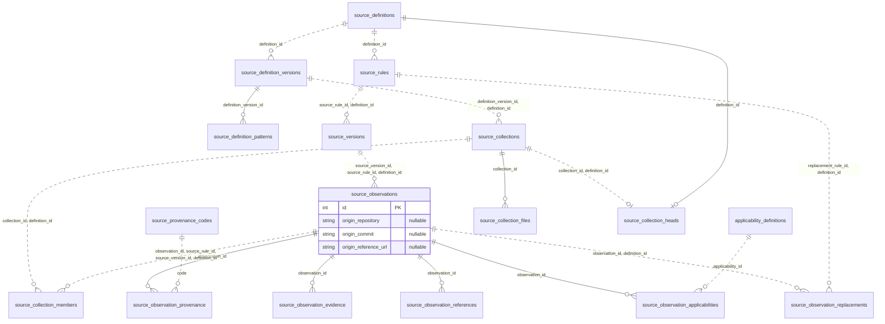
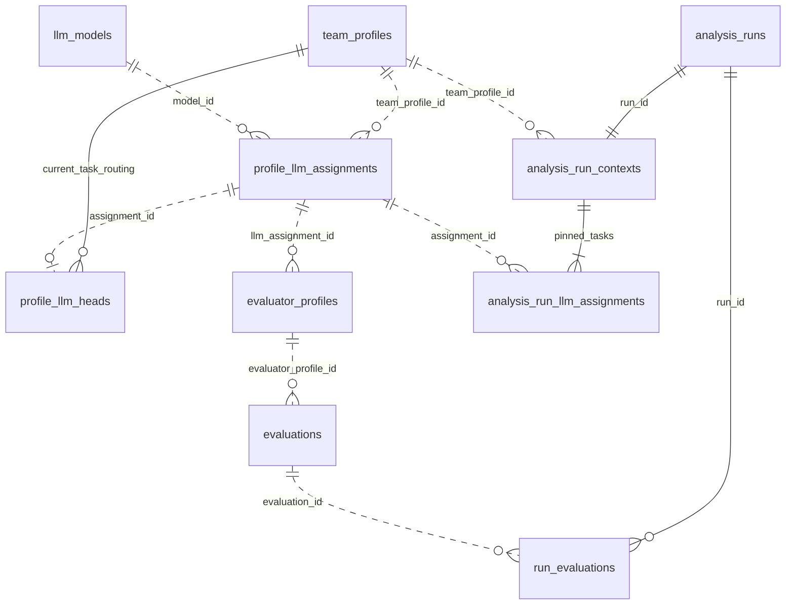
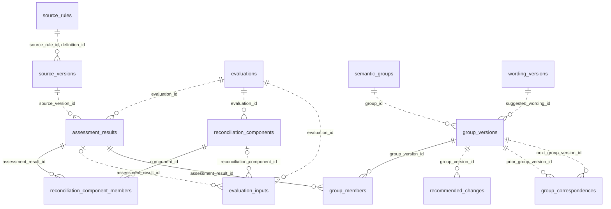
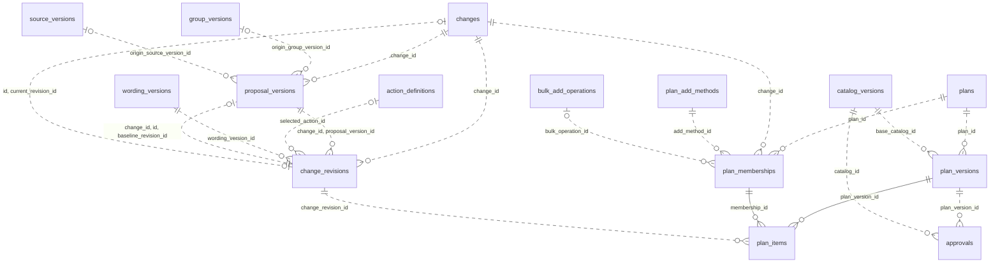
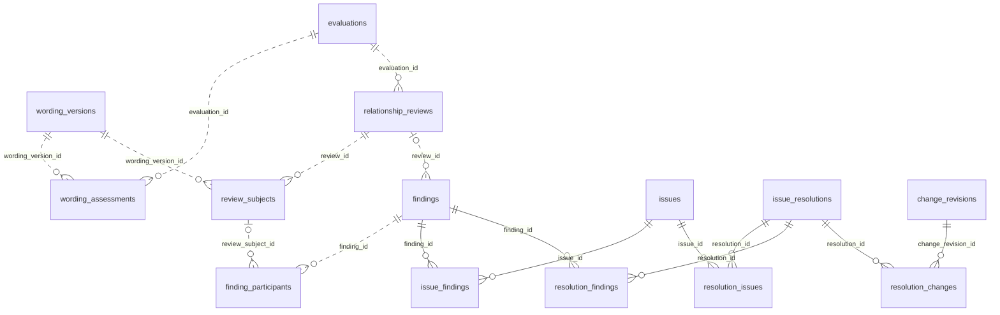
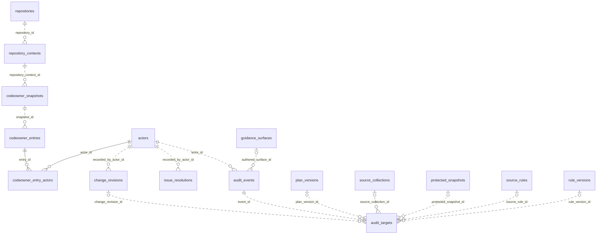
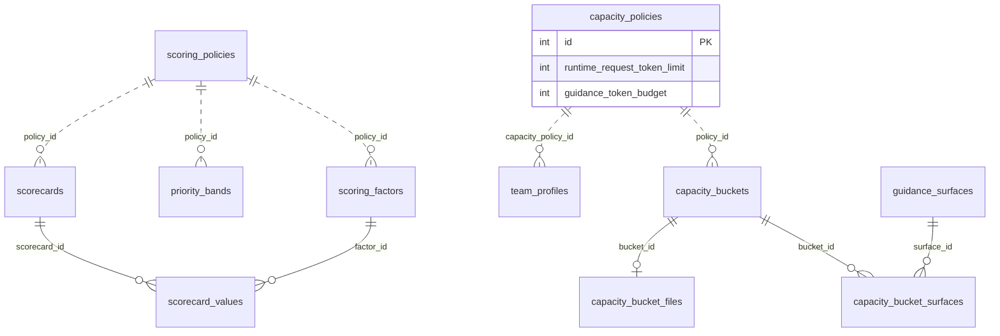
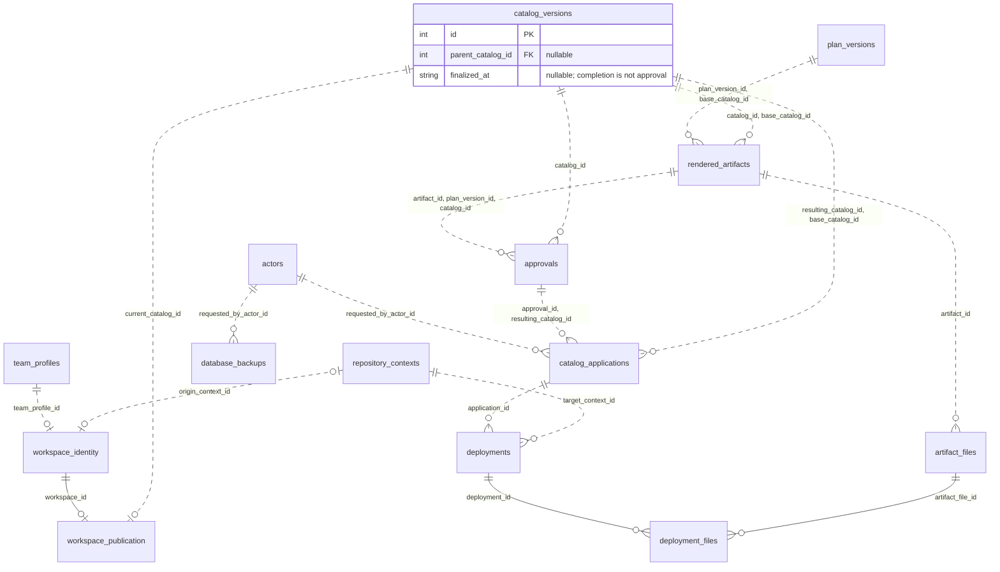

# Workbench SQLite V1 Database Design

## Status and Review Boundary

First consolidated design draft, 2026-11-02. This remains a reviewable proposal for complete application behavior and input mappings, not permission to replace the preserved Workbench. The component and application-schema checkpoints identify the executable portions; unsettled mappings and unimplemented commands remain adoption blockers.

The isolated connection, source-ingestion, workspace-reference, protected-persistence, authored-refresh, and application-schema checkpoints below identify implemented components. They do not establish complete initialization, usable database-backed startup, or authorization for live adoption/cutover.

V1 targets the existing Terraform AzureRM profile and its current Workbench UI only. Its immediate objective is a concrete cutover from internal JSON/configuration authorities to database-owned policies, catalog facts, and workflow state, with existing behavior preserved. Generalized team onboarding, additional team profiles, capacity refresh controls, and advisory-overage behavior changes are deferred; they are not prerequisites for this cutover. The extension boundaries below document future configuration needs, not additional V1 product work.

This document owns the SQL-v1 model. The [architectural reset checkpoint](WORKBENCH_ARCHITECTURAL_RESET_CHECKPOINT.md) preserves the old implementation and its known limitations. The [deferred v2 snapshot-sharing and inspection design](WORKBENCH_DATABASE_SNAPSHOT_V2_DESIGN.md) owns future whole-database sharing, the local maintainer database-inspector backlog, and optional replacement. Neither document makes those features part of v1.

The definitions deliberately expose the referenced table and column for every FK. They are more concrete than the earlier conversation diagram, but require review before conversion to DDL. Small junction tables preserve real relationships; they are not independently configurable workflow engines. A table's presence in this draft is not approval of its final name, fields, or implementation cost.

### Connection Foundation Checkpoint: 2026-11-03

The first implemented slice is the isolated [shared native connection owner](../tools/modules/workbench/WorkbenchSqlite.mjs), using Node `node:sqlite`. It supports explicitly requested in-memory connections and read-only inspection of existing local files. It is not connected to the preserved Workbench server. Writable workspace files, executable application DDL, migrations, initialization, database validation, authentication, and ownership refresh are not implemented by this slice.

Every connection opened by this owner enables and reads back FK enforcement before exposure. It checks the embedded engine and actual STRICT support, establishes a bounded busy timeout, disables extension loading, and installs an authorizer blocking safeguard-setting changes and database attachment. Inspection also uses the binding's read-only open mode and verified `query_only`; it cannot create a missing database, change journal mode, or create a `VACUUM INTO` copy. Inspection rejects relative, network, symbolic-link, and junction paths. SQL methods are internal trusted domain plumbing, not browser or caller-supplied SQL endpoints.

The [focused connection checks](../tools/tests/sqlite/workbench-sqlite.test.mjs) pass on native Windows Node `26.13.0` with SQLite `3.54.0`. This is the verified development baseline, not a finalized minimum adopter version or evidence for other runtime versions. No package installation or standalone SQLite CLI is required. Run only these checks with:

```powershell
pwsh -NoProfile -File ./hosted_copilot/tools/tests/Test-WorkbenchSqlite.ps1
```

The seven checks cover fresh/reopened and worker-owned connections, actual FK/type/range/null/uniqueness rejection, deferred-constraint rollback, bound values, safeguard bypass attempts, missing-path refusal, and read-only inspection of both ordinary files and committed WAL data. Disposable constraint fixtures exercise the connection contract; they do not represent initialized application workspaces. Inspection preserved main-database and WAL bytes in the exercised cases; WAL shared-memory coordination is not a promise that every sidecar byte is immutable.

No real workspace database, real-workspace backup, initializer, validator command, or schema migration has been created or executed. Busy-timeout configuration is verified, but bounded writable-workspace contention remains unproved. The later disposable backup probe establishes binding-level capability, not implemented application backup/restore commands or writable recovery. The full Hosted validator has not run. The live Workbench and finalized icon assets remain untouched.

### Application Schema Checkpoint: 2026-11-05

The [application-schema owner](../tools/modules/workbench/WorkbenchApplicationSchema.mjs) now composes the existing source, protected-snapshot, workspace-identity, and authored-audit schema owners with the remaining declared application domains. `migrateNewWorkbenchApplication` creates 116 STRICT tables and their indexes/guards in one explicit transaction, records version 1 in `application_migrations`, and refuses any nonempty database or enclosing transaction. This is the first executable application-schema candidate, not an upgrade path for old component fragments or a complete initialized workspace. No initializer, seeds, file-backed writable connection, binding registration, normal startup, or UI integration is supplied by this module.

`validateWorkbenchApplicationSchema` compares schema objects with the same migration implementation in an isolated memory connection, checks migration history, FK enforcement, STRICT declarations, SQLite integrity, and FK integrity. It reports independent schema/version/reference failures without repairing the selected connection. Its `valid` result applies only to schema/storage structure, not identity, complete profile seeds, permissions, bootstrap, semantic freshness, or application readiness. It is not the public database validator described below.

The existing [SQLite suite](../tools/tests/sqlite/workbench-sqlite.test.mjs) passes 18 checks: the seven connection checks plus eleven application-schema checks. New checks cover actual schema composition, transaction rollback after a component failure, repeated-creation refusal, read-only inspection behavior, schema/index/guard drift, unsupported migration history, independent FK violations, deferred proposal/baseline ownership, protected-target rejection, scoring-policy/range checks, nonoverlapping priority bands, Plan addition provenance, catalog-scoped references, and immutable finalized catalog membership. The capacity checks verify the nested runtime limit, guidance reservation, and category allowances, reject inconsistent configuration, and permit storing wording that exceeds both token budgets. They also verify explicit selected-policy references, rejection of mismatched workspace/repository/branch bindings, no automatic latest-revision selection, category/file mappings, duplicate and unsafe-path refusal, and preservation of caller-owned transactions. A branch check proves that observing a later commit on the same branch does not change policy selection or rewrite historical origin. They do not establish a working initializer, launcher, script handoff, or export command. These are disposable in-memory schema/constraint fixtures, not complete current-profile initialization or durable application reopening evidence. The inspection check does not change the supplied schema; it does not claim that the separate file-backed initialization/reopen gates have run.

Current-profile mapping review still blocks a usable initializer and UI connection:

- Capacity policy now distinguishes the observed request allowance from the Hosted guidance reservation and its category allocations. The schema requires `team_profiles.capacity_policy_id`, and the bound capacity reader follows that exact reference. `capacity_bucket_files` accounts for the Hosted repository-wide and skill files independently of the three authored categories; they must not be added as authored surfaces or require extra proposal/protected files. These bindings and readers are implemented, but trusted current-profile population, durable workspace binding, and script/API handoff remain pending. Do not build a measurement ledger or new skill/agent registry.
- The managed catalog contract requires surface descriptions, titles, introductions, closing text, ordered sections, and canonical candidate bindings. The current draft does not faithfully own all these fields. Existing scorecards and placements also do not by themselves resolve the already recorded optional published scoring/override and retired-placement mapping gaps. Do not silently discard fields, fabricate assessed groups, or persist the original document as a competing authoritative JSON payload.
- `guidance_surfaces.code` preserves the established executable refresh/protection interface. The draft's `surface_code` notation below predates that interface. The schema candidate has one registered row per current code; independently versioned surface selection/history still needs an explicit owner before configuration changes are supported.

Review the smallest faithful relational/profile mappings before extending the physical model. Generalized team onboarding remains deferred. No live database, legacy JSON, source collection, browser state, listener, Git state, or full Hosted validation was changed for this checkpoint.

## Settled Product Requirements

- Use embedded local SQLite, not a hosted service, subscription, shared multi-tenant database, or JSON document store hidden inside SQL.
- Store durable facts once. The server owns commands, transactions, authorization, projections, review applicability, readiness, and audit. The UI owns unsaved buffers and presentation.
- Keep source identities, captured versions, assessed meanings, semantic groups, generated wording, saved decisions, published rules, and Plan membership distinct.
- Keep accepted evidence and maintainer outcomes across rebuilds. Force creates new evaluation attempts; it does not overwrite acceptance or silently reopen equivalent settled outcomes.
- Preserve the fast relationship check. Current wording assessment must also refresh priority and Assessment Details when explicitly requested; chat advice is not a formal assessment.
- Check changed wording against the complete applicable projected active/protected catalog, not just its former conflict partner or source group.
- Save is a server API command. It does not silently invoke AI, select an unselected item, approve, publish, or deploy.
- Keep a selected Plan item selected after Save, with the new saved revision and unchanged manual/bulk provenance. Undo removes membership only; it does not reset wording or decisions.
- Show one effective Action value: saved maintainer choice when present, otherwise the AI recommendation. Preserve both facts without requiring two pills. Recommendation fallback is not consent.
- Catalog Status describes the current published catalog. Saving or staging Retire does not turn Mapped into Retired; actual publication does.
- Preserve protected content and the manifest-owned deployment boundary. Approval, local catalog application, and actual fork deployment are distinct outcomes.
- Keep source lanes, naming, scoring, capacity, and icon provenance adaptable to other repositories without assuming specific provider names or displayed-ID prefixes.
- Reduce adopter configuration and maintenance by retiring redundant internal JSON files, receipts, and state-only contracts after their database/server replacements are proven; do not retain the old file workflow as a parallel authority beneath SQLite.
- Use ordinary operational audit and backup/recovery. No signed evidence infrastructure, distributed locking, or speculative enterprise framework.
- Exclude draft/database import-export and their runtime stubs from v1. Include database identity now; defer whole-database sharing to v2.

### Adoption Simplicity and File Retirement

The intended adopter workflow is to select/configure a supported profile, configure its sources, provide a parser only for a genuinely new source format, initialize the workspace, and operate through supported commands/UI. Adopters must not hand-edit saved workflow records, insert SQL seed rows, synchronize several internal JSON ledgers, or fork core database/UI behavior merely to express supported source facts.

- Retire assessment/reconciliation cache files, superseded browser-owned saved state, redundant intermediate snapshots/receipts, and schemas used exclusively by those internal files only after validated replacements, legacy preservation, and recovery gates pass.
- Keep and simplify genuine boundary contracts for normalized parser output, API requests, AI responses, external configuration, and published/generated instruction formats. Share format-neutral contracts where their meanings match; do not weaken source-specific input checks or delete required validation to improve a file count.
- Preserve authored prompts, protected rules, application assets, dependency/deployment manifests, and real external input/output formats under their existing owners. JSON API responses or generated read models may remain serialization formats without becoming additional hand-maintained workflow stores.
- Record a before/after inventory of team-maintained configuration and workflow files, including retired consumers and their replacement owners, retained boundary contracts and reasons, and the setup tasks an adopting team actually performs. Judge adoption improvement by reduced required maintenance and independent authorities, not an arbitrary percentage reduction or a goal of zero JSON files.

This is a cutover acceptance requirement, not evidence that the files have already been removed or permission to delete working caches/contracts during design. V1 proves the current Terraform profile's cutover. The later two-profile adoption proof must demonstrate simplified setup and operation without depending on retired internal files; every retained team-specific maintenance requirement needs an explicit purpose. That later proof is not a V1 completion gate.

Track concrete removals and retained exceptions in the [Database Cutover Retirement Checklist](#database-cutover-retirement-checklist), rather than maintaining competing deletion lists in implementation checkpoints.

## SQLite Capabilities and Server Responsibilities

SQLite is a relational SQL engine embedded in the application process. It is not a separate database service, and it does not provide every feature or dialect of a server database such as SQL Server or PostgreSQL. The server functions in this design are application functions, not SQLite stored procedures.

| Feature | SQLite Behavior | Consequence for This Design |
| --- | --- | --- |
| Relational queries | Supports joins, unions, grouping, aggregates, subqueries, CTEs, and window functions | Query normalized evidence and decisions instead of rebuilding copied JSON graphs |
| Views | Named stored SELECT queries; not stored query results and no view parameters | Use for reusable joined read models where they simplify actual consumers; use bound queries for request values |
| Stored procedures | No built-in stored-procedure facility | Implement Save, resolution, Plan, approval, and apply commands as server functions executing parameterized SQL |
| Triggers | Supports actions associated with table changes; ordinary views can be made writable with INSTEAD OF triggers | Use narrowly justified integrity guards, not an elaborate trigger system attempting to reproduce stored procedures or workflow commands |
| Transactions | Supports atomic commit/rollback for database changes | Save the decision revision, selected Plan revision, and audit together; filesystem work and AI calls remain outside the transaction |
| Concurrency | Multiple readers, but only one writer at a time per database; WAL can allow readers alongside a writer | Keep writes short, handle busy/cancellation with bounds, and do not hold locks while waiting for inference or user input |
| Types | Ordinary tables use flexible type affinity; supported modern versions offer STRICT tables | Use STRICT for application tables by default, with explicit nullability, range, uniqueness, and ownership constraints; document any justified exception |
| Foreign keys | Supported, but enforcement must be enabled and verified for each connection | Initialize connections with `PRAGMA foreign_keys = ON` before starting transactions; do not rely on defaults or toggle enforcement around invalid writes |
| Dates and booleans | No dedicated date/time or Boolean storage classes | Use consistent UTC text and constrained integer booleans as defined below |
| Database users and roles | No server-style built-in user/role authorization system | Authenticate and enforce scoped permissions in the application; database identity and recorded CODEOWNERS rows are not credentials |
| Schema changes | ALTER TABLE and migration capabilities differ from server engines | Design explicit versioned migrations for the selected SQLite release; do not assume arbitrary server-database DDL can be copied unchanged |
| SQL dialect and functions | SQL syntax and driver-provided capabilities differ between engines and releases | Verify the actual embedded SQLite version; do not assume T-SQL batches, EXEC, procedure syntax, or optional extensions are available |

A view is not a replacement name for a stored procedure. It describes a query over stored records, not a command that validates a request, performs several mutations, authorizes a user, or commits a workflow. Views are read-only by default. This design does not use writable-view triggers to hide Save operations.

Application-registered SQL functions, if supported by the selected driver, are also not stored procedures. They are not a reason to execute code stored in a database row. Prefer ordinary SQL and explicit server code before adding custom functions or extensions.

### Example: Show This Candidate's Details

The browser requests the selected change/candidate and its context. A server read function uses a parameterized SELECT, optionally through reusable views, to join:

- The change's current and original decision revisions and their wording.
- The originating group version, member assessment results, captured source versions, and coverage rationales.
- The current published catalog mapping and the compatible wording assessment and relationship results.
- The applicable scoring/capacity policies and current Plan membership when the view includes them.

The server binds the requested identifier as a value, reads a consistent snapshot, computes derived fields, and returns a read model. Source meaning and recorded decisions come from existing records; this operation does not ask AI to generate them again. A view by itself neither captures a historical snapshot nor calculates semantic freshness: the exact version references and server rules establish that context.

The UI displays and styles the result. It does not join private database tables, infer a mapping from a displayed ID, or reconstruct the authoritative candidate state independently.

### Example: Save This Maintainer Decision

The browser sends the selected action, saved wording/rationale, target, and expected current revision to a server command. The command performs the work a developer might otherwise place in a stored procedure:

1. Authenticate the caller and validate the request and target context.
2. Begin a short database transaction using the chosen driver's supported API.
3. Check current permission and expected revision under the operation's concurrency rules; reject stale or unauthorized writes.
4. Insert the immutable decision revision and any required wording or applicability rows using bound parameters.
5. Advance that change's current reference. If already selected, create the new Plan snapshot while retaining its membership and manual/bulk origin; otherwise leave it unselected.
6. Record the audit event and its exact domain references in the same transaction.
7. Commit only after every required write succeeds; roll back the database changes on failure.
8. Return the updated revision-bound read model after a successful commit.

There is no SQL `CREATE PROCEDURE` or `EXEC SaveDecision` behind this example. The concrete server language, method names, routes, and SQLite binding remain implementation choices. Bind values rather than concatenate request text into SQL; any selected SQL identifiers must come from trusted application definitions, not arbitrary caller input.

Save does not run inference, publish a catalog, change Git state, or deploy files inside this transaction. A failed Save must not announce success or discard the user's local buffer. The command/transaction map later in this document defines the other operations using the same ownership boundary.

### Verify Before Writing Executable DDL

Record the actual SQLite library version exposed by the chosen driver, not just the presence of a machine-wide SQLite CLI. Confirm its supported STRICT-table, query, FK, migration, transaction, busy-handling, and backup capabilities. The table notation below is still a design proposal; it is not evidence that these guards have been implemented or exercised.

### Embedded Engine Prerequisites, Not the SQLite CLI

Database creation, startup, and validation must check the selected application runtime and its actual embedded SQLite binding. The standalone `sqlite3` command-line tool is not a v1 prerequisite. Do not require its executable on PATH, invoke it for required validation, or tell adopters to install it merely because that command is absent.

- Load the selected binding and query its engine directly, including `SELECT sqlite_version()` through that binding, rather than accepting a separate CLI version as evidence.
- Check the supported runtime/library versions and required capabilities, not only a version string. Verify per-connection foreign-key enforcement and the expected STRICT schema through the shared database layer.
- If a required runtime or binding is missing or unsupported, stop before creating/publishing a database and give installation or upgrade instructions for that exact supported dependency. Do not automatically install software, change persistent PATH settings, or substitute another database engine.
- Keep any CLI installation instructions optional and limited to manual inspection workflows. A CLI present on the machine must not make an unsupported application binding pass validation, and an absent CLI must not make a supported binding fail.

The final binding decision must specify its supported runtime range and reproducible dependency/setup instructions. A local available runtime is not automatically the minimum version all adopters must install.

On 2026-11-02, a disposable in-memory capability probe using the installed Node `node:sqlite` binding reported Node `v26.13.0` and embedded SQLite `3.54.0`. It successfully enabled FKs, created STRICT tables, and rejected both an orphan reference and a nonconvertible integer value without using a standalone SQLite CLI. This verifies an available binding option, not the complete application schema, initializer, migrations, backup support, or a finalized runtime choice. No repository database was created by that probe.

### Mandatory Code Enforcement and Acceptance Gates

These requirements are not advisory documentation. The database layer must implement them, and focused tests must demonstrate them before production cutover. The connection foundation above implements only its stated safeguards; it does not establish a working application schema, migration runner, or adoption path.

| Requirement | Required Code Owner and Enforcement | Required Acceptance Evidence |
| --- | --- | --- |
| Embedded local storage | The database layer resolves the explicitly bound local workspace; no browser SQL or implicit remote service | Startup opens the intended local database and does not create or switch workspaces from an untrusted request path |
| Foreign-key enforcement | One shared connection-opening policy sets and verifies enforcement before exposing each connection | Fresh, reopened, pooled, and worker connections report enabled enforcement; orphan inserts and forbidden parent deletions fail |
| Strict types and constraints | Schema creation uses supported STRICT tables and explicit NOT NULL, CHECK, UNIQUE, and ownership FKs | Nonconvertible wrong types, required NULLs, out-of-range values, duplicates, and mismatched owners are rejected |
| Short transactions and one writer | Server command implementations keep database transactions bounded; inference, user waits, remote calls, and deployment file work occur outside them | A paused evaluator holds no write transaction; concurrent saves either complete safely or return a bounded busy/concurrency result, without partial decisions or duplicate audit |
| Application authorization | Every mutation command checks authenticated identity, applicable current scoped permissions, and expected context; disabled UI controls are not enforcement | Direct API attempts with missing authority, revoked protected capabilities, or a stale revision are rejected without changing domain state |
| Controlled migrations | A versioned migration owner checks the actual driver capabilities, takes required backup, applies a reviewed sequence, and verifies the resulting schema/references before writable use | Upgrade and failure/rollback scenarios preserve recoverable data; unsupported schemas and failed verification cannot be opened for normal writes |

### Foreign-Key Enforcement Is Per Connection

The connection policy must execute the equivalent of the following before beginning a transaction:

```sql
PRAGMA foreign_keys = ON;
PRAGMA foreign_keys;
```

Read the second result and require `1`. A missing result, unsupported behavior, or `0` is a connection-initialization failure: do not hand that connection to a query/command owner and hope constraints will apply. Validate this against the actual SQLite library embedded by the driver, including its enabled capabilities.

Apply the policy to every application-created connection, including connections reopened after recovery and connections owned by background workers. If the driver pools connections, prove that all leased connections satisfy the invariant and cannot return to circulation with enforcement disabled. Do not initialize one connection and assume every later connection inherits its setting.

Setting `foreign_keys` inside an active transaction does not enable it for that transaction; connection initialization must happen first. An ordinary write path must never disable enforcement to insert otherwise invalid data. Use the supported transaction/deferrable-constraint mechanism for legitimate cyclic initialization, not a bypass around required relationships.

Tests must distinguish immediate and explicitly deferred constraints: a deferred invalid relationship may fail at commit instead of at insertion, but it must not survive a successful transaction. The failed operation must leave no partial decision, Plan head, or audit record claiming success.

Use `PRAGMA foreign_key_check` at the appropriate migration/restore/integrity gates to detect existing violations; an integrity check alone does not replace that relationship check. Do not probe a real workspace by inserting deliberately invalid test data at startup. Negative-write tests belong in complete disposable synthetic fixtures.

### STRICT Typing Is a Table Declaration

There is no global FK/STRICT switch. Foreign keys protect relationships; `STRICT` protects storage types on each table that declares it. Require a SQLite release and driver supporting STRICT tables, introduced in SQLite 3.37.0, rather than silently falling back to ordinary flexible tables when a required capability is missing.

Create application-owned tables with STRICT by default. Any exception must identify its concrete need and retained type/integrity checks during DDL review. STRICT permits the declared type names INT, INTEGER, REAL, TEXT, BLOB, and ANY; this model uses the appropriate INTEGER, REAL, TEXT, and BLOB types rather than assuming server-specific BOOLEAN, DATETIME, or arbitrary type declarations are legal.

STRICT can accept a value that SQLite can losslessly convert to the declared type. It does not mean every string submitted for an integer column is automatically rejected. API validation must still check the request's intended types and values. Do not use ANY merely to avoid those checks.

Keep boolean range checks, score bounds, required fields, unique indexes, composite ownership FKs, and semantic result validation explicit. STRICT alone does not stop an integer from referencing the wrong parent, prove a factor belongs to its policy, authorize a user, or establish that a rule resolves a conflict.

### Migration and Read-Only Connection Boundaries

Select and test SQLite-specific migrations; do not generate server-database DDL and assume it works unchanged. Prefer supported transactional migration steps and verify rollback behavior. A table-rebuild migration or exceptional connection-setting change requires a separately reviewed maintenance sequence, quiesced ordinary writers, recoverable backup, full reference verification, and restored connection invariants before normal use. Do not expose a general API for weakening constraints or continue writable service after a failed migration.

Configure writable and read-only connections deliberately. Connection-local FK enforcement is not permission to change file-level journal mode, migrate a received database, refresh its source records, or repair its contents during inspection. The future v2 inspection boundary remains read-only. V1 backup/restore must also re-establish and verify all normal connection invariants before allowing writes.

## How to Read the Definitions

These are field definitions in a compact notation, not SQL statements:

- `INTEGER PK` is an internal integer primary key.
- `FK -> table.column` names a real referenced column. Every field is required unless its type ends in `?`.
- `TEXT?` and `INTEGER?` permit NULL. NULL is not an empty string, zero, an inferred approval, or an invented record.
- `UNIQUE(a, b)` constrains the combination. Junctions with `PK(a, b)` have a composite primary key instead of an extra `id`.
- `CHECK(...)` describes a required constraint. Constraint shorthand must be translated into valid SQLite syntax during DDL review.
- Time values are server-generated UTC ISO-8601 text. GUIDs and SHA-256 values have application validation and suitable SQLite checks.
- Booleans are INTEGER with `CHECK(value IN (0, 1))`. Named code sets are registered application behavior, not executable configuration from database rows.
- Version/result records are immutable after successful finalization. Current pointers, job status, counters, and active membership endings are explicitly mutable coordination records.
- Historical records use restrictive deletion by default. Undo ends a membership; it does not cascade-delete its old Plan items or audit evidence.

The Mermaid diagrams are selected physical FK views, not exhaustive table/constraint inventories or workflow state machines. `PARENT ||..o{ CHILD` means each child has one required parent and a parent can have zero or many children; `o|` permits zero or one. Optional FK tuples permit an absent parent, while PK/UNIQUE keys and explicit singleton checks can limit a parent to at most one child. Solid `--` connectors identify relationships whose complete child FK is contained in the child's primary key; dotted `..` connectors show the other FK references. Labels name the complete child FK, including every composite column. Neither a connector nor a version reference establishes semantic compatibility, approval, finalization, or publication; those require the declared guards and commands.

Example: `group_members.group_version_id = 12` points to `group_versions.id = 12`. Its other FK, `assessment_result_id = 81`, points to the exact assessed meaning contributed to that group. The junction explains the many-to-many relationship rather than storing an array of copied assessments.

## Workspace and Repository Identity

V1 candidate: one logical active workspace and owning team profile per database. Other teams run independent local databases. These tables do not introduce tenant routing or a shared database service. Whether a checkout owns one database across branches or separate branch-associated workspaces remains an explicit decision before implementation.

```text
team_profiles
  id INTEGER PK
  code TEXT UNIQUE
  label TEXT
  capacity_policy_id INTEGER FK -> capacity_policies.id

repositories
  id INTEGER PK
  provider_code TEXT
  provider_repository_id TEXT?
  canonical_name TEXT
  UNIQUE(provider_code, canonical_name)

repository_contexts
  id INTEGER PK
  repository_id INTEGER FK -> repositories.id
  branch_ref TEXT
  commit_oid TEXT
  observed_at TEXT

workspace_identity
  id INTEGER PK CHECK(id = 1)
  database_guid TEXT UNIQUE
  team_profile_id INTEGER FK -> team_profiles.id
  origin_context_id INTEGER? FK -> repository_contexts.id
  created_by_actor_id INTEGER? FK -> actors.id
  created_at TEXT
  current_protected_snapshot_id INTEGER? FK -> protected_snapshots.id
```

The GUID identifies database lineage, not a branch, person, permission, or content match. Initialization creates it once; restart, Save, backup, and ordinary restore preserve it. Origin is historical provenance. A later branch switch cannot silently change accepted rules, permissions, or deployment target.

Machine-local checkout locations and credentials remain outside transferable domain facts. `repository_contexts` records observed branch/commit context; it is not an instruction to switch Git branches. Use the normal schema migration/version mechanism instead of a second independently maintained schema version in `workspace_identity`.

### Current Protected-Input Reference Checkpoint: 2026-11-04

The isolated [workspace identity owner](../tools/modules/workbench/WorkbenchWorkspace.mjs) implements the singleton `workspace_identity` table and its nullable `current_protected_snapshot_id` FK. It requires the complete profile, actor, repository-context, and protected-snapshot dependencies; it does not create seed identities, capture protected files, or initialize a usable application workspace.

`readCurrentProtectedSnapshot` reads this explicit reference, never the newest snapshot, an audit event, or a historical catalog's protected reference. A null reference is permitted only as an uninitialized bootstrap state, not evidence of a valid empty protected collection or successful startup. A validated empty collection must still have its captured files and snapshot. Once selected, the reference cannot be cleared to null. Workspace lineage is immutable through ordinary commands.

`advanceCurrentProtectedSnapshot` uses a bound database GUID and repository identity plus the expected previous snapshot for a compare-and-swap update. The repository must match the workspace's recorded origin context even before its first protected reference; a missing origin context cannot establish repository scope. Both the command and SQL guards reject snapshots from another repository, including attempts supplying a matching foreign repository/snapshot pair. Reassociation is not an ordinary pointer update. These trusted internal functions do not authenticate callers or grant permissions.

The reference update does not independently commit an enclosing transaction. Five checks in the existing [source-ingestion suite](../tools/tests/sqlite/workbench-source-ingestion.test.mjs) exercise real STRICT/FK guards, immutable lineage, explicit-current reads, stale and invalid bindings, cross-repository rejection, and commit/rollback together with source ingestion in one caller transaction. These checks establish pairwise transaction composition; the audited composition is covered by the later authored-refresh checkpoint. Neither checkpoint implements launcher integration. No JSON state file, schema, or separate current-state table is added.

### Durable Local Storage and Reconnection

Storage direction agreed on 2026-11-03: keep the database under the existing durable local data root, `%LOCALAPPDATA%\hosted-workbench`, in a dedicated workspace directory rather than the staged site or disposable assessment/reconciliation cache folders. The proposed layout is:

```text
%LOCALAPPDATA%\hosted-workbench\workspaces\<workspace-id>\workbench.sqlite
```

This names a future storage layout, not a directory or database created by this document. The database is durable workspace data, not disposable cache. Cache cleanup, site restaging, browser cleanup, and editor updates must not remove it. Keep it outside the checkout, temporary directories, staged site, and version-specific VS Code or extension installation directories.

For the current adoption, the selected local checkout is the owning Git repository and its `hosted_copilot/` folder is the managed content root. The configured upstream contributor repository is read-only source intake, not the workspace owner or an implied deployment target. Other adopters explicitly bind their own repository and managed content scope.

A durable machine-local binding identifies the selected repository root, branch reference, managed content scope, database location, and expected database GUID. It is a locator, not a duplicate workflow store or permission grant, and must not depend on browser storage. V1 uses a separate database per branch within the selected checkout. Every normal launch and standalone script resolves that branch's explicit binding through the same owner, regardless of browser origin, loopback port, or server/editor restart. Do not fall back to another branch's database or switch a running session's database silently. A branch with no initialized workspace requires explicit first-run setup, not automatic creation of an empty replacement. Branch renaming/reassociation and cross-branch copying or migration are explicit maintenance operations, not ordinary startup behavior.

### Branch Isolation, First-Run Readiness, and Input Freshness

Direction agreed on 2026-11-05: separate branch databases isolate potentially different rules, data, policies, schema versions, and file layouts. The branch reference selects a binding; the database GUID identifies its durable lineage. A branch name alone does not prove compatible data, and matching commits do not permit implicit cross-branch sharing. Validate the selected binding, supported schema, and relevant configuration/source context without changing Git state or inventing another workspace.

A new branch's explicit first-run workflow must initialize its complete Terraform profile/configuration and capture its catalog, protected rules, and selected source evidence, then run the existing assessment, reconciliation, and adjudication pipeline and persist its results. Schema-valid is not UI-ready. Verify required data and references before opening the existing UI; never fabricate assessments, maintainer decisions, approvals, or source records to complete bootstrap. Initialization and AI processing are distinct phases even if an explicit setup command eventually orchestrates them. Remote collection during explicitly requested bootstrap/rebuild is not permission to repeat it during ordinary startup.

Always perform lightweight binding/connection/schema/configuration checks and check required local input fingerprints. Reuse stored facts and compatible parses when unchanged; run only the affected deterministic processing when relevant local data or registered behavior changes. A new commit by itself is not an invalidation signal. Commit metadata records capture provenance; content and metadata actually used by consumers, contracts, selected policies, parser behavior, and evaluator configuration determine applicable freshness. Do not require current commit equality with historical origin, automatically rerun AI for unrelated commits, or silently migrate after infrastructure changes. Off-repository source content is explicitly skipped during ordinary startup; do not make a remote revision/hash lookup part of this local change check. AI rebuilds and migrations remain explicit operations.

The current capacity reader implements an initial branch guard: its trusted request includes `databaseGuid`, `repositoryId`, and `branchRef`, and it checks the recorded origin branch without comparing commit IDs. This does not implement a durable locator, standalone command selection, branch rename maintenance, startup freshness orchestration, or the first-run pipeline. Those remain current-profile integration work rather than reasons to introduce generalized team onboarding.

Successful Save is acknowledged only after the database transaction commits. Persist validated evaluations, reconciliation evidence, saved adjudication/decisions, proposals, and history independently of browser lifetime. Ordinary reopening reads those records without upstream collection, assessment, adjudication, or other AI calls. The narrow local authored-input refresh below is required on every startup, including launches that reuse a staged display. A missing, unsupported, corrupt, or mismatched database stops normal startup with an actionable recovery/selection result; never silently create an empty replacement, reseed it, or regenerate results through AI. Unsaved editor buffers and deferred conversation persistence are separate concerns, not a promise that every transient browser state survives.

### Local Authored-Rule Startup Policy

Direction agreed on 2026-11-04: validate and refresh local authored inputs on every Workbench startup through the shared server/domain owner. For this Hosted profile, both `hosted_copilot/authored-rules/proposals/` and `hosted_copilot/authored-rules/protected/` must exist, and each requires `implementation.rules.md`, `testing.rules.md`, and `documentation.rules.md`. Neither collection is optional. Profile-owned paths and registered surface definitions identify the inputs; a cached/staged display cannot bypass their validation. Do not fetch upstream sources, invoke AI, recreate the database, regenerate published instructions, approve, or export as a side effect.

Explicit remote-source skip: [Contributor Guidance](../copilot-rule-catalog/source-definitions/contributor-guidance.json) lives in the upstream HashiCorp repository, not this local authored-input scope. Ordinary startup must not resolve its latest upstream ref, download its documents, compute live remote content hashes, or use remote availability or unseen upstream commits to trigger refresh/reassessment. Retain and read its last captured database evidence as recorded. Only an explicitly requested remote refresh or bootstrap/rebuild that includes this source may collect it and advance its captured versions. Database reference integrity and local parser/contract compatibility remain normal validation; neither authorizes checking the live upstream content or silently replacing stored evidence with an empty collection.

| Observation | Startup / State Outcome | Required Audit |
| --- | --- | --- |
| Required directory missing | Fail startup; retain the last successful state | Error identifying the collection and expected repository-relative directory |
| Required category file missing | Fail startup; retain the last successful state | Error identifying the collection, category, and expected repository-relative file |
| Read, enumeration, parsing, duplicate-ID, or contract validation fails | Fail startup; do not infer disappearance from an incomplete scan | Scoped error describing the actual failed check |
| Valid file contains zero rules | Continue; an empty stub is valid, including when all six files contain zero rules | Successful empty-file result; warnings for any newly absent previously observed rules |
| Valid inputs are unchanged | Continue; reuse compatible immutable versions and snapshots | Successful unchanged result for each file checked on this startup |
| Valid inputs add, change, move, remove, or restore rules | Continue after committing the complete refresh | Successful file results and warnings identifying newly removed rule IDs and their previous files; record other observed transitions accurately |
| Off-repository Contributor Guidance | Explicitly skip live remote freshness checks and collection; use retained evidence | Do not claim a new remote observation, successful remote refresh, or newly discovered upstream change |

Verify the bound workspace and configured input roots, capture bytes once per file, and validate the complete required set before committing source-presence or current-protection changes. Use the same captured bytes for parsing and hashing. Detect file-set/content changes during capture and fail or retry within a bounded policy rather than committing a mixed scan. Diagnose both collections independently: report the actual directory/file checks performed, without manufacturing three individual file failures beneath a directory that could not be enumerated. The complete startup refresh is still one acceptance boundary; a file that validates does not authorize applying a partial collection when another required input fails.

On success, record the proposal collection, validated current protected-input snapshot, their current references, successful refresh audit, and removal transitions in one short database transaction. Unchanged versions may be reused without duplicating captured content, but each startup still records the file check results. On failure, leave prior successful heads and saved domain facts unchanged and record validation results/failures separately without claiming a committed refresh. If the bound database cannot be opened or audit cannot be committed, report the failure through the startup diagnostic and fail startup; do not create a replacement database or parallel audit file to hide that failure.

Rule absence is determined by scoped identity across the complete valid collection, not by a missing file or a text hash. A rule found in another file is moved, not removed; genuinely changed identity needs grounded reconciliation. For newly absent proposals, retain the previous version/observation as `missing-last-known` with the first observed removal time. Retain protected rule/file versions in historical snapshots while excluding absent rules from the new current protected-input set. Missing proposals or protected rules leave the normal current UI lists; neither becomes an ordinary managed rule or an implicit retirement of a published rule. Preserve assessments, findings, decisions, Plan references, and published catalog history, checking affected pending work against the new inputs rather than silently deleting it or leaving incompatible readiness current.

Reuse a returning source identity and record reappearance; compare its actual captured inputs before reusing prior results. Removal warnings describe transitions and do not repeat merely because a rule remains absent on another startup. File success/unchanged results do repeat, so users can distinguish a new successful check from an old removal event. One parser-authored block digest is authoritative for that captured block version; the projected `contentSha256` copies it, not another stored hash fact. Exact whole-file bytes and wording-only digests remain distinct scopes, and identical wording does not merge separate rule IDs.

This is the startup implementation contract, not current launcher behavior. The protected parser permits zero rules per category stub while requiring all three files, and the combined protected projection schema now accepts an empty `rules` array. Disposable generation checks cover a complete empty projection, downstream instruction generation, rejection of each missing required category file without replacing the prior projection, and rejection of a rule with missing required fields. This establishes empty-input support at the parser/projection boundary, not a complete startup refresh or an initialized protected snapshot in SQLite.

The current normal-launch staged-display shortcut must still be aligned with this mandatory local refresh. The durable current protected-input reference is now `workspace_identity.current_protected_snapshot_id`, distinct from a catalog's historical `protected_snapshot_id`; an audit query for the newest event must not become that current-state authority. The isolated persistence and audit-integrated command are implemented below. Application migrations, trusted installed-profile/capture orchestration, terminal diagnostic rendering, and launcher integration remain adoption prerequisites.

### Startup Source-Refresh Dispatch Checkpoint: 2026-11-05

The [production launcher](../tools/Start-RuleWorkbench.ps1) now separates `Read-StagedWorkbenchDisplay` from `Invoke-WorkbenchRebuild`. `Update-StagedDisplay` dispatches to rebuild only when the explicit `-Rebuild` switch is set; otherwise it reads and validates staged facts. The rebuild owner also rejects entry without that request before creating its run directory or invoking any source collector or assessment. Missing or mismatched staged data fails ordinary startup instead of falling back to an upstream refresh. Explicit rebuild retains the selected-source collection path, including Contributor Guidance. This enforces the existing startup/rebuild boundary in code rather than relying only on documentation.

The focused [Workbench contract suite](../tools/tests/Test-WorkbenchContracts.ps1) passes 29 checks, including seven new production-source checks. It parses the actual launcher definitions, executes them against a complete disposable staged display/Rule Issues fixture and real schemas, and records the selected collection calls through offline callbacks before stopping at the assessment boundary. It proves ordinary reuse performs no collection, direct rebuild requires explicit permission, missing/mismatched staged data does not trigger refresh, and explicit rebuild reaches every configured source. It also executes the actual validator's `-SkipUpstreamDrift` conditional, verifying truthful skipped reporting and that the audit entry point remains available without the switch. The validator itself, upstream collectors, AI, live server, and browser were not run by these focused checks.

This checkpoint implements source-refresh dispatch enforcement in the existing launcher, not database-backed startup, public branch locator selection, first-run SQLite initialization, mandatory authored-refresh integration, or a complete production-launch acceptance test. Those remain the explicit integration work above. The database cutover must preserve this guarded boundary when replacing staged-file reads with database reads; it must not introduce another implicit source-refresh path.

### Protected Capture Checkpoint: 2026-11-04

`Get-ProtectedRulesCapture` in the existing [protected parser](../tools/modules/source-parsers/ProtectedRules.psm1) captures repository-relative paths, exact file bytes and their SHA-256 digests, canonical parsed blocks, and validated protected-rule metadata in memory. The shared [authored-rule parser](../tools/modules/source-parsers/AuthoredRules.psm1) now accepts either its existing file paths or captured `SourceBytes`; both use the same UTF-8, frontmatter, duplicate-ID, field, normalization, and block-hash checks. The capture path does not reopen a source file to parse or hash it.

On the verified native Windows runtime, capture holds read-only shared file handles through file-set verification and parsing, rejects inputs that cannot be read consistently, and releases every handle on success or failure. Required files must belong to the actual captured set, not merely pass an earlier existence check. Repository containment and link/junction checks prevent ordinary source-path escape. A changed file set fails rather than becoming an empty or partial successful scan. This is a local capture boundary, not a filesystem sandbox or cross-platform concurrency certification.

Two checks in the existing [source-ingestion suite](../tools/tests/sqlite/workbench-source-ingestion.test.mjs) cover exact CRLF/raw-byte and normalized-block hashes, metadata fidelity, parsing retained bytes after the disk source changes, complete valid empty stubs, missing and malformed inputs, duplicate IDs, file locks, repository boundaries, and cleanup followed by successful recapture. Test-only deterministic mutations also verify rejection of a newly appearing file and a required file disappearing between preflight and enumeration.

`Get-ProtectedRulesCatalog` reuses this capture and returns the same legacy projection shape for existing consumers. That projection is a transitional compatibility boundary, not another database authority. The capture itself adds no persistent JSON transport, state file, schema, or database table. Snapshot persistence and audit are the separate database command's responsibility, implemented in the checkpoint below; normal startup is not yet connected. The capture checkpoint originally passed 32 owning checks. On 2026-11-05, the separate instruction-generation suite passes all 18 checks after correcting platform-dependent serialization: `ConvertTo-ProtectedRulesJson` now emits canonical LF formatting on Windows as well as other platforms. Exact freshness comparisons remain unchanged. A complete synthetic serialization fixture verifies that embedded rule-text CRLF is preserved, and a stale-projection check verifies real wording changes are rejected without modifying the projection or instruction outputs. The original four failures are resolved without rewriting generated artifacts or mocking the parser and generator.

### Protected Persistence and Atomic Refresh Checkpoint: 2026-11-05

The [protected snapshot owner](../tools/modules/workbench/WorkbenchProtectedSnapshots.mjs) implements STRICT snapshot, file, membership, and version-keyed `protected_rule_details` storage. It retains exact bytes, file digests, canonical block content/digest, title, surface, provenance, protection reason, and wording through actual rule versions. Word-only digests remain distinct from authored-block digests. Protected kind represents the fixed protected impact of 100; it is not an editable managed score. Unchanged captures reuse compatible snapshots and immutable rule/wording versions. Valid empty captures still retain all required files. Removed rules remain in historical snapshots and never become implicit managed-rule retirements.

`protectedCaptureFromParser` accepts the real transient PowerShell capture serialization plus independently supplied trusted context/parser authority. It checks projection/block coherence, preserves exact bytes, and does not store a JSON transport or duplicate projection. Generic [source ingestion](../tools/modules/workbench/WorkbenchSourceIngestion.mjs) also retains optional exact captured files in immutable `source_collection_files`; local authored refresh requires this evidence. File hashes participate in collection identity. Older fragment databases require an application migration before using this shape; these functions do not silently upgrade existing storage.

The [authored refresh owner](../tools/modules/workbench/WorkbenchAuthoredRefresh.mjs) implements the existing `audit_events`/`audit_targets` model with all 13 typed targets, the exactly-one-target constraint, scoped collection/category/path metadata, append-only history, and one SYSTEM actor constraint. `refreshAuthoredInputs` requires a bound workspace, matching repository context, complete registered file sets, a fresh startup-attempt GUID, and expected prior heads. It owns the outer transaction and commits proposal observations/files, protected snapshots/versions, current references, six informational file results, collection success results, and newly absent-rule warnings together. Typed removal targets retain exact subject and before/after collections or snapshots; repeated absence does not repeat warnings. Unchanged files still produce a result on each new attempt.

Failed refresh rolls back both heads and new domain facts before a separate short failure-audit transaction. `recordAuthoredStartupFailure` can record actual independent file/directory failures plus other successful validation checks without claiming a committed refresh or inventing domain targets. Contradictory scopes are rejected. Directory read failures need not invent categories. The command distinguishes recorded failure audit, known unrecorded failure audit after a rejected write, and uncertainty when rollback cannot be completed; an unresolved transaction must never be treated as a separately committed failure log. `readAuthoredStartupAudit` limits reads to the requested bound context and attempt. These are trusted internal commands, not browser endpoints or caller authentication; supplied profile/capture metadata is not proof of installed parser identity or permission.

The owning suite now has 41 passing checks, including nine persistence/refresh checks added to the earlier 32. They exercise the real PowerShell capture handoff, immutable history, empty inputs, reuse, atomic success, unchanged outcomes, typed removal history, separate failure audit, missing-path/mixed-check scopes, stale/incomplete/tampered inputs, and failures during protected membership, reference update, success audit, and audit-target writes against a populated workspace. A dedicated rollback-I/O failure case proves that uncommitted failure audit cannot be reported as recorded. The separate seven connection checks also pass. Disposable in-memory SQLite tests establish command-level transaction behavior, not disk crash recovery, production footprint, complete schema adoption, or a working launcher.

No live database, binding, server, browser, saved state, or generated artifact is changed by this checkpoint. The launcher and shared terminal renderer, complete application migrations/seeds and authority integration, file-backed adoption/recovery checks, and Event Log UI remain pending. Existing JSON consumers remain transitional until their database/server replacements and preservation gates are proven; this component adds no JSON authority and does not authorize cutover.

### Startup Command-Line Diagnostics

The launch command must explain why a launch failed without requiring a working browser UI. Missing required paths, invalid inputs, and failed required database/audit operations stop startup with a nonzero command status. Do not start a listener, open the browser, print a successful launch URL, or introduce a restricted recovery-only UI for these failures. Preserve the last successful workspace state. Valid rule-removal warnings do not prevent launch after the complete refresh commits.

Use the same structured event data for audit persistence and terminal presentation, rather than maintaining a second error interpretation. After a successful audit commit, query only the current `startup_attempt_guid` and format its recorded results through the shared diagnostic renderer. Report collection, category where applicable, exact safe repository-relative path, event severity/outcome, and affected rule ID for removals. Each blocking diagnostic must state what failed, how to correct that input and restart, and whether the event was persisted. Do not dump unrelated historical events, full captured rule content, credentials, or raw process output merely to explain a missing file. Preserve supported machine-readable command output without mixing human-readable progress into its protocol.

If the database cannot be opened, audit persistence fails, or the committed events cannot be read back, print the structured diagnostic directly and describe the actual persistence state: not recorded, uncertain, or recorded but unreadable as appropriate. Never claim an audit row exists merely because recording was attempted, suppress the original validation error behind a secondary logging failure, create a replacement database, or write a parallel audit file. Failure to produce the required startup/audit result prevents a ready launch; the fallback exists to explain that failure, not to bypass it. A later successful launch can expose previously recorded failures through the normal Event Log, but diagnosis of the current failed launch must never depend on that UI.

### Semantic Cache Retirement and Legacy Preservation

The assessment and reconciliation JSON cache ledgers are transitional storage. After cutover, normalized evaluation/evidence/history records and exact compatible-input queries provide reuse in SQLite; do not retain parallel JSON ledgers as competing workflow authority. A previously completed zero-result evaluation remains reusable when its full recorded context is compatible. An explicit Force operation requests new evaluation attempts without deleting earlier results or saved decisions.

Before retiring old consumers or removing cache files, deliberately preserve the current browser decisions and on-disk evidence, validate their mappings and provenance, and retain recoverable backups. Report unsupported or incomplete legacy records explicitly; do not fabricate original actors, approvals, evaluation context, or freshness to make a conversion appear complete. No automatic migration, deletion, or inference is authorized merely by selecting the database location. File-based published inputs/outputs, prompts, configuration, icon assets, and legal notices retain their existing owners.

## Database Cutover Retirement Checklist

This is the tracking owner for temporary cutover entry points and superseded JSON-backed workflow components. It records intended code/contract retirement, not a deletion command or proof that database cutover is complete. Current status: **No item below is ready for removal.** The legacy UI is still a comparison baseline, native assessment/reconciliation/adjudication and UI integration are incomplete, and preservation/recovery gates remain required.

Update each row as consumers and replacement coverage are verified. `Temporary / in use` means an internal bridge is still needed; `Pending` means its replacement or consumer audit is incomplete. Change a row to `Ready` only with linked parity/recovery evidence and an exact removal set. Mark it `Removed` only after implementation, callers, obsolete contracts, fixtures, validators, documentation, and deployment references have been reconciled. These are checklist labels, not additional database workflow states. Keep removed rows with the completion evidence so later work does not recreate a retired path.

Preservation order confirmed on 2026-11-06: keep the legacy schemas, JSON workflows, scripts, and preserved UI until the full existing-UI transition is implemented and validated. A backend checkpoint is not permission to retire them. Perform a separate, comprehensive, explicitly approved cleanup phase afterward, using the exact consumer/removal inventory and retained genuine-boundary exceptions below.

### Removal Inventory

| Component To Retire | Current Status | Replacement Owner | Removal Gate |
| --- | --- | --- | --- |
| [Temporary database initializer](../tools/internal/workbench/Initialize-WorkbenchDatabase.ps1) | Temporary / in use | Supported database-backed Workbench initialization using the shared workspace/schema/source owners | Normal initialization handles explicit binding, fresh capture, protected inputs, complete seeding, validation, and safe failure/recovery. Prove it does not depend on this wrapper; then delete the wrapper and its callers. |
| [Temporary analysis entry point](../tools/internal/workbench/Invoke-WorkbenchAnalysis.ps1) | Temporary / in use | Supported database-backed analysis orchestration using the shared evaluation owners | Assessment, reconciliation, and adjudication run through the normal workflow with pinned model/input identity, persisted results, cancellation/failure handling, and complete-head publication. Verify behavior before deleting this wrapper; retain the underlying implementation. |
| Assessment JSON cache ledger and its file-lock/write/reuse branches | Pending | Normalized `evaluations`, exact inputs, typed result rows, and compatible-result queries | Verify cache hits, zero-result completion, Force, partial failure, and interrupted-run recovery from database facts. Preserve old evidence before retiring writers/readers; do not automatically delete user cache files. |
| Reconciliation/adjudication shard cache files and [cache-only schema](../contracts/reconciliation/hierarchical-reconciliation-cache.schema.json) | Pending | Database run/evaluation/group/finding history and compatible-result reuse | Verify all stages persist and resume without parallel ledgers. Identify every cache reader/writer, lock, retry/merge path, and schema reference before deleting repository support files. |
| Staged display/Rule Issues JSON as workflow authority and their file-loading branches | Pending | Bound server read models over current complete database views | Verify the existing UI lists, details, findings, live Plan projections, and refresh behavior use database facts. Review [display](../contracts/workbench/workbench-display-v4.schema.json) and [Rule Issues](../contracts/workbench/workbench-rule-issues-v4.schema.json) schemas individually: delete only file-state-only contracts; retain a reviewed API response contract if still required. |
| Browser-owned saved decisions/draft state, obsolete JSON draft/import/export paths, and [draft schema](../contracts/workbench/workbench-draft-v4.schema.json) | Pending | Authenticated transactional database Save, proposal/plan revisions, and audit history | Verify Save/reload/restart identity, exact wording/decisions, concurrency, failures, and required legacy preservation. Do not remove unsaved editor buffers or browser-only chat state merely because saved workflow state moves to SQLite. Do not restore the removed Import Draft feature. |
| Persistent source-inventory/snapshot JSON used as a second current-state authority | Pending | Shared source ingestion, immutable collections/observations, current heads, and captured provenance | Enumerate all durable inventory consumers and replace authority with database references. Prove missing/empty/removed sources and provenance retain their meaning. Ephemeral collector/parser JSON transport and its validation are not deletion targets merely because serialization is JSON. |
| [Managed catalog JSON](../copilot-rule-catalog/instruction-catalog.json) and [protected catalog JSON](../copilot-rule-catalog/protected-rules.json) as internal authorities | Pending | Normalized catalog/publication history and captured authored protected snapshots | Verify published catalog relationships, protection, wording, lifecycle, renderer metadata, and historical provenance. Retire only superseded internal ownership and consumers; a required deployment/export representation needs a named retained boundary contract, not another editable authority. Authored protected rule files remain. |
| Legacy Workbench model/default reads from [LLM configuration](../tools/config/llm.json) | Pending | Master-profile model/task assignments and versioned evaluator identity | Prove chat uses Sol/high and saved-rule reevaluation/relationship review use Luna/medium through database assignments, with metadata preflight and request execution using the same routing. Audit standalone consumers before deciding whether the file itself can be deleted. |
| Redundant intermediate JSON snapshots, receipts, and workflow-only manifests | Pending | Database revisions, audit events, exact evaluation references, and derived ephemeral responses | Enumerate actual files and their consumers; prove required authority/freshness/approval evidence has a complete replacement. Retain required external result envelopes and deployment artifacts rather than removing them by extension or filename alone. |
| Legacy JSON/cache orchestration branches in the [launcher](../tools/Start-RuleWorkbench.ps1) and [server](../tools/internal/workbench/Start-WorkbenchLoopbackServer.ps1), plus superseded adapters/workers | Pending | Existing public entry points delegating to shared database commands and bound server handlers | Verify ordinary startup, explicit rebuild/Force, source refresh, authorization, diagnostics, request cancellation, UI model routing, and publication against the database. Remove only replaced branches and workers; keep the public entry points, shared parsers, CLI adapter, and genuine boundary logic. |
| Contracts and schemas used exclusively by retired internal JSON stores | Pending / per-file audit required | Relational constraints plus retained boundary validation | Record each exact schema/descriptor and all registered runtime/behavior-manifest references. Delete it only when every consumer is retired or replaced and no parser, AI/API, configuration, export, or deployment boundary still requires it. Do not delete the assessment/reconciliation contract directories wholesale. |
| Obsolete file-cache/browser-state fixtures, tests, validation entries, documentation, and deployment references | Pending | Database persistence/recovery/concurrency and existing-UI parity coverage, plus retained boundary tests | Move equivalent meaningful coverage to the replacement before deleting old tests. Verify no active command, manifest, validator, documentation link, or test reaches the retired implementation. Preserve real historical evidence and intentional negative/compatibility fixtures. |

The named paths above are confirmed starting points, not a complete consumer audit. Expand grouped rows into exact repository-relative removal sets as their owning work is completed; record a retained exception and reason when a file still serves a genuine boundary. Do not count file moves, test-list exceptions, an isolated schema test, or a passing model preflight as end-to-end retirement evidence.

### Prompt Invocation and Retirement Map

Cutover follow-up recorded on 2026-11-07. The prompt library currently contains database-native replacements, still-used legacy pipeline prompts, targeted saved-rule/relationship review prompts, and advisory chat prompts with supporting fragments. Similar wording or filenames do not establish that these are interchangeable. Complete the following mapping during final cutover preparation and the separately approved cleanup phase; this note does not authorize retirement now.

- [ ] Extend the existing [prompt-library README](../tools/prompts/README.md) from a task/file index into an invocation map: workflow or user action, actual caller/entry point, owning registry or hash-bound contract/module, prompt path, result contract, and retained/replacement/retirement-candidate status. Include parent composition and trigger conditions for launch, transport, retry, and assistance fragments so readers can tell when and how each is used.
- [ ] Distinguish initial database-native assessment/reconciliation/adjudication, the transitional legacy pipeline, targeted saved-wording and relationship checks, and advisory chat. Explain genuine task/contract differences without duplicating their runtime instructions. Document status labels as maintenance information, not new executable routing or a second prompt registry.
- [ ] Derive the map from the actual supported callers, native stage registry, and existing behavior/hash-bound dependency sets. Link those authorities rather than redefine model selection, permissions, prompt composition, or output schemas in the README. Verify every retained standalone prompt and supporting fragment has a documented consumer.
- [ ] Resolve duplication to one authoritative prompt owner per distinct semantic task/contract, retaining deliberate shared composition where appropriate. Reuse or merge only when meaning, inputs, output contract, and authority boundaries are compatible; do not combine advisory chat, targeted review, and full-run adjudication merely because their instructions overlap.
- [ ] Record an exact per-file disposition and replacement/retained-consumer reason in the removal inventory. Legacy adjudication and transport/retry prompts remain conditional while targeted review or another supported flow uses them. A tentative retirement count or successful native full run is not proof that all legacy consumers are gone.
- [ ] After validated full existing-UI transition and explicit cleanup approval, remove only superseded prompt paths and their replaced callers, contract/registry references, fixtures, validator expectations, and normal-operation documentation together. Preserve historical evaluator identity and required frozen evidence; repository prompt retirement does not authorize rewriting or deleting recorded user history.
- [ ] Verify the final README matches actual invocation and retained registrations, no supported runtime path reaches a retired prompt or inline fallback, fragment delegation remains explicit, and the owning prompt/loader and workflow tests preserve behavior. Keep the per-file retirement evidence so obsolete paths are not recreated later.

### Companion Test Migration Matrix

Retire implementation and implementation-specific tests together, but preserve their behavioral guarantees. This matrix is the companion to the removal inventory, not permission to delete a failing check. Every row remains `Pending` until its exact cases/fixtures, replacement test owner, and actual results are recorded. The scripts named below contain mixed responsibilities; a retirement decision for one case is not a decision to delete its whole suite.

The earlier layout failure illustrates a guard to **keep**, not a test to remove at cutover. [Test-HostedCommandHelp.ps1](../tools/tests/Test-HostedCommandHelp.ps1) checks the files directly in the tools root against the four approved public commands plus README. Removing an internal helper does not change that root list. By contrast, [Test-WorkbenchContracts.ps1](../tools/tests/Test-WorkbenchContracts.ps1) currently opens the temporary analysis helper by filename and executes extracted preflight statements; that test must move to the supported replacement entry point before the helper is deleted. This distinction prevents a correct architectural check from being weakened merely to accommodate cleanup.

| Existing Test Owner / Area | Cutover Test Action | Replacement Coverage And Removal Gate |
| --- | --- | --- |
| [Command/help suite](../tools/tests/Test-HostedCommandHelp.ps1): `tools-root-layout`, help, startup/preflight, and legacy model configuration | Keep the four-command layout/help guard. Retarget only cases whose actual startup or configuration owner changes; distinguish legacy `llm.json` loader tests from shared CLI metadata tests. | Preserve no-operation help, configuration validation, one metadata catalog query, exact model/effort checks, safe diagnostics, fail-before-side-effects, and the agreed public command surface. A retired loader's tests may go only after database assignment and remaining standalone-consumer coverage are accounted for. |
| [Workbench contracts](../tools/tests/Test-WorkbenchContracts.ps1): `native-analysis-availability` and temporary helper path | Move production-statement/entry-point coverage from the temporary analysis script to the supported database-backed workflow before deleting the script. Add normal-path initialization coverage instead of relying permanently on the temporary initializer smoke command. | Prove complete database-assigned model preflight, unavailable-model refusal, pinned configuration identity, and no inference/publication before required validation. Preserve GUID/repository/branch binding and initialization failure/no-overwrite behavior at the supported entry point. |
| [Workbench contracts](../tools/tests/Test-WorkbenchContracts.ps1) and [prompt library](../tools/tests/Test-PromptLibrary.ps1): display/draft/Rule Issues schemas, descriptor library, and behavior dependencies | Audit exact references for each retired schema/descriptor. Replace file-state validation cases with database/server cases; remove only assertions/fixtures exclusive to a removed internal format. | Keep validation of retained AI/API/parser/configuration/deployment contracts, prompt injection boundaries, result completeness, authority separation, and freshness dependencies. Update registrations and validators coherently; do not make a deleted schema an optional successful check. |
| [Source assessment](../tools/tests/Test-SourceAssessment.ps1): legacy ledger/reuse/failure behavior | Re-express storage-specific cases against normalized evaluations, exact inputs, and typed persisted results; retire obsolete ledger/lockfile fixtures after equivalent coverage passes. | Preserve compatible reuse, Force, zero-result completion, committed partial work, invalid-result rejection, interruption/recovery, and no fabricated original execution identity. File deletion alone is not evidence that these behaviors were replaced. |
| [Assessment reconciliation](../tools/tests/Test-AssessmentReconciliation.ps1) and [stage executor](../tools/tests/Test-ReconciliationStageExecutor.ps1): hierarchical cache schema, shards, merge/retry paths | Replace cache-file setup/assertions and executor-specific fixtures with database-run/group/result references as their consumers are replaced. Both currently reference the hierarchical cache schema. | Preserve stage coverage, semantic identity, compatible-result reuse, retry/cancellation, deterministic joins, partial failure, and complete-head publication. Retain external evaluator response validation even when cache storage contracts disappear. |
| [Rule Issue adjudication](../tools/tests/Test-RuleIssueAdjudication.ps1): hierarchical cache and component results | Replace persisted cache-file assertions with database evaluation/finding/relationship evidence. Review saved-rule reevaluation fixtures independently from full-run adjudication. | Preserve connected-component completeness, exact edited wording, scope/ownership, active/protected context, affected proposals/retirements, original evidence, freshness, and truthful failed/partial outcomes. Do not drop targeted checks because the full pipeline also uses the adjudicator. |
| [Workbench UI suite](../tools/tests/Test-RuleWorkbench.ps1): staged display/draft files, browser saved-state assumptions, and JSON workflow shape | Retarget source/static assertions, browser fixtures, endpoints, and runtime setup to the database-backed server. Existing checks explicitly reference `indexedDB.open`, `localStorage.setItem`, and the draft schema; classify saved workflow state separately from legitimate browser-only UI state. | Verify existing lists/details, Plan calculations, protected rules, Save/reload/restart, concurrency, failures, approval/publication, explicit refresh/rebuild, and accessibility/normal-motion behavior. Preserve unsaved editor buffers and advisory chat semantics; replacing persistence does not authorize a UI redesign or weaker tests. |
| [AI Assistance](../tools/tests/Test-RuleAssistance.ps1), Workbench UI, and saved-rule/relationship tests | Replace staged-file authority and legacy model-setting fixtures with bound database task assignments and exact request inputs where those owners change. | Preserve Sol/high chat and Luna/medium targeted reevaluation/relationship routing, shared freshness/capability identity, cancellation, tool restrictions, privacy, and advisory-versus-mutating boundaries. Test metadata and inference routing agree; do not count a preflight fixture as a completed AI run. |
| [Source inventory](../tools/tests/Test-SourceInventory.ps1) and [source ingestion](../tools/tests/Test-WorkbenchSourceIngestion.ps1) | Remove only fixtures for retired durable JSON authority/obsolete adapters after all consumers are replaced. Keep parser/collector transport fixtures that still feed ingestion. | Preserve content/metadata identity, origin/provenance, collection heads, missing/empty/removal semantics, cardinality, stale-head rejection, rollback, protected captures, and source-refresh audit. JSON transport validation remains necessary while that transport is used. |
| [Catalog approval/apply](../tools/tests/Test-CatalogApprovalApply.ps1) and [instruction generation](../tools/tests/Test-InstructionGeneration.ps1) | Move internal catalog/decision authority fixtures to database-backed accepted versions and approvals. Keep explicit tests for retained publication/export formats. | Preserve protection, rule lifecycle/IDs, placements, exact approved wording and relationships, capacity/scoring, authorization, renderer metadata, deterministic output, failure atomicity, and the approval-before-publication boundary. |
| [SQLite suite](../tools/tests/Test-WorkbenchSqlite.ps1), source ingestion, and underlying [SQLite tests](../tools/tests/sqlite) | Keep the database foundation checks and extend normal-workflow coverage as it is implemented; do not retire them with legacy storage tests. | Preserve connection/FK/STRICT/busy enforcement, transaction rollback, immutable versions, master-profile assignment ownership, old-run pinning, read-only inspection, safe opening/reopening, and supported schema compatibility. Passing component cases do not replace end-to-end cutover evidence. |
| Focused suite registration, [Hosted validator](../tools/Test-HostedRules.ps1), and fixtures/behavior manifests referenced by retiring tests | Record and update every registration/reference when an actual case or fixture is replaced. Remove stale fixture-only validators only after their boundary is gone; retain unrelated Hosted review/deployment coverage. | The supported focused commands must execute the replacement cases rather than silently skip missing legacy files or report vacuous success. Follow the existing approval requirement before complete Hosted validation; do not run the Workbench suite for this documentation change. |

Before a component becomes `Ready`, attach the exact test case IDs, fixture paths, old-to-new assertion mapping, commands/results, and retained-test exceptions to its inventory row or linked owning evidence. Classify each affected case as **Keep unchanged**, **Retarget**, **Replace then remove**, or **Remove with retired-only fixture**. An initializer manual smoke check must be identified as such, not relabeled automated normal-workflow coverage. Test counts are progress evidence, not the parity criterion; no acceptance gate is satisfied by deleting a failure, adding a file-list exception, or weakening the tested contract.

### Retain Or Review Separately

- Keep [native assessment response validation](../contracts/workbench/native-assessment-v4.schema.json), the [native stage registry](../contracts/workbench/native-evaluation-stages-v4.json), and other required AI request/response, API, parser, configuration, and deployment contracts while their boundaries remain active. JSON transport is not a competing database.
- Keep authored prompts, protected rule source, icons/branding/assets and their legal notices, dependency lockfiles, packaging/deployment manifests, and required published/generated instruction formats under their existing owners.
- Treat [Terraform profile configuration](../tools/config/workbench-terraform-profile.json) and source definitions as declared initialization/collection input, not a parallel store for saved decisions or live model routing. Retain their necessary validation; normal startup must not silently overwrite selected database configuration.
- Preserve existing user databases, browser decisions, cache contents, generated artifacts, and read-only comparison baselines. Repository code retirement does not authorize deleting user data or rewriting historical evidence. Temporary scripts are removed after their supported replacements are proven; do not leave deprecated parallel entry points indefinitely.

### Cutover And Deletion Gates

- [ ] Record the exact old files/consumers, replacement owner, retained boundary exceptions, and supported command/UI path for every item proposed for removal.
- [ ] Complete the companion test mapping for that removal set, retaining architectural guards and transferring meaningful behavioral coverage before retiring fixture-specific tests. Record exact case/fixture references and replacement results.
- [ ] Complete the [prompt invocation and retirement map](#prompt-invocation-and-retirement-map), reconcile each prompt's consumers and final disposition, and verify the prompt-library README and retained runtime registrations match the validated cutover workflow.
- [ ] Verify the complete fresh database-native pipeline and preservation/recovery requirements without importing old AI results merely to make the new pipeline appear complete. Keep prior baselines read-only; any approved user-state conversion remains a separate explicit operation.
- [ ] Demonstrate the existing UI's lists/details, chat/model routing, targeted reevaluation/relationship review, Save/reload/restart, Plan/approval/publication, authorization, and error behavior against database facts. Preserve the current runtime's normal motion and live-session state during comparisons.
- [ ] Prove ordinary startup, rebuild/Force, cache-equivalent reuse, interruption/failure/cancellation, concurrency, and complete-view publication no longer depend on the proposed legacy removal set.
- [ ] Obtain explicit maintainer approval for live cutover or user-data cleanup. A checklist row, proposed deletion set, or passing component test is not that authorization.
- [ ] Remove approved obsolete repository code/contracts and dependent references together; run the focused owning checks and obtain approval before any complete Hosted validation. Record actual results and remaining gaps without weakening contracts or tests to make retirement pass.
- [ ] Update this inventory to `Removed` with the exact retired set and verification evidence. Remove obsolete normal-operation guidance while preserving the retirement history and retained external boundary contracts.

## Database Initialization and Adoption Commands

V1 must provide a PowerShell entry point for creating a new local workspace database and a separate read-only validation entry point. Users must not need to create tables, insert seed rows, or set connection safeguards manually. These commands are required implementation work, not implemented scripts or usable command examples in the current checkout.

The existing [repository adoption validator](../tools/commands/adoption/Test-RepositoryAdoption.ps1) checks declared product configuration and adaptation boundaries; it is not a SQLite initializer or proof of database integrity. Keep that responsibility distinct while aligning the new adoption path with the selected repository profile.

### Implementation Priority and Deferred Team Onboarding

Direction agreed on 2026-11-05: first make the SQLite-backed workflow work and validate it with the current Terraform AzureRM profile and existing UI. Generalized onboarding for other teams is documented follow-up, not a prerequisite for that milestone. Do not start a team-profile framework, lane-configuration interface, or configuration-apply command merely because the database foundation needs initialization. Preserve existing baseline capacity calculations in the scripts and live Plan projections in the UI while changing their policy/configuration source to the database; do not make a capacity UI redesign, refresh controls, or changed overage behavior part of V1.

The immediate work still includes the current workspace's complete executable schema, reviewed migrations and seeds, shared initialization and read-only validation, trusted startup capture/audit and diagnostics, and database-backed server read/Save workflows. Validate the database and server before connecting the existing UI; this sequencing does not authorize an early UI redesign or bypass the UI-last boundary. Prove reopening preserves the workspace GUID and saved work, failures retain prior state, and the current UI operates against actual stored facts rather than parallel authoritative JSON state. Preserve the existing live workspace until an explicitly approved cutover.

After that current-profile/current-UI milestone is proven, implement the reusable team onboarding path described in this section:

- Extend the existing [adoption configuration](../tools/config/adoption.json) and [source-definition selection](../copilot-rule-catalog/source-definitions/source-definition-set.json) model rather than introducing competing lane/source registries. Keep one authoritative declaration of selected sources.
- Let reviewed team configuration declare stable lane codes, labels and display order; source-to-lane assignments; source roots and include/exclude patterns; registered parsers; and supported policy presets or overrides. A lane can group multiple sources. Reuse an existing adapter for an existing format; require a new adapter only for a genuinely new format, not a fork of core database or UI behavior.
- Share team configuration through version control, while each local workspace receives its own database GUID and durable local database. A team-shared SQLite file or cross-database merge is not the v1 collaboration model. Configuration is an external input, not a second store for saved decisions or workflow history.
- Provide team-facing initialization and separate read-only validation through the same shared database owners used by the current workspace. Initialization must validate and fully seed the selected profile, refuse to overwrite an existing destination, and verify persisted identity/integrity before registering its binding; adopters must not write SQL seed rows by hand.
- Apply later lane/source configuration changes through an explicit validated, versioned and audited command. Normal startup does not reseed or silently apply edited configuration. Disabling intake preserves captured evidence and history. Configuration does not supply credentials, authenticate a caller, or grant permissions.
- Prove simplified setup and operation under two independently configured profiles before claiming reusable multi-team adoption. This remains a later adoption gate; it is not a reason to postpone the current-profile/current-UI milestone or remove the required boundary contracts.

This records scope and implementation order only. It adds no configuration fields, profile schema, script, command, database, or runtime behavior, and does not freeze future command names or parameter spelling. The initialization safety and preservation requirements below apply to the current workspace now and to generalized onboarding later.

### Deferred V2 Source Refresh and Skip Compatibility

Revisit source-refresh configuration during V2 adoption work, not the Terraform-only V1 cutover. Different teams can use different repositories, source locations, and registered parsers; do not make the HashiCorp contributor source or its paths a universal source-selection rule.

- Define refresh selection and defaults for each configured local or off-repository source. Ordinary reopening must not turn source availability or a remote revision lookup into an implicit refresh, while an explicitly requested bootstrap/rebuild can collect its selected sources.
- Preserve V1's existing ordinary-startup behavior: no live upstream contributor collection by default. Read retained source evidence without claiming it is a new remote observation; remote refresh remains an explicit maintainer action.
- Retain the existing `-SkipUpstreamDrift` argument on [Test-HostedRules.ps1](../tools/Test-HostedRules.ps1#L1020), including skipping the live upstream audit and contributor inventory collection, recording the check as skipped, and retaining local validation. This validator option is distinct from the Workbench launcher's ordinary remote-source skip; do not rename it, remove it, or require it merely to launch Workbench.
- Prove the adopted source-selection and skip behavior with independently configured sources before claiming portability. Keep CLI/API compatibility, retained evidence, truthful skipped-versus-passed reporting, and maintainer control explicit. This follow-up does not add a V1 source-management UI, automatic network discovery, new refresh arguments, or runtime implementation.

### Deferred V2 Cross-Run Source Assessment Delta Processing

Recorded on 2026-11-06. Add delta processing for source assessment after the current SQL-native assessment, reconciliation, and adjudication workflow is usable. This is deferred V2 implementation work, not an implemented optimization or permission to change source selection, import legacy results, or postpone the V1 pipeline. The compatible-input and preservation requirements elsewhere in this design remain mandatory; this backlog records the cross-run assessment-selection behavior to implement against those requirements.

#### Current V1 Baseline

- A fresh explicit assessment run evaluates the complete selected captured source set. It does not yet reuse compatible assessment results from earlier runs, even when the source records are unchanged.
- Same-run resume is different from cross-run delta processing: it retains committed batches and evaluates only unresolved work after verifying the pinned inputs and evaluator identity. Successful batches commit independently; a later failure does not roll back every earlier batch.
- Completing source assessment provides persisted input for reconciliation, then adjudication. Continuing those stages must not require another assessment run merely because the next stage is being implemented or invoked.

#### V2 Behavior

- Keep deterministic source collection, parsing, and versioning separate from expensive AI assessment. Checking selected sources for changes is not permission to reevaluate every source or perform an implicit remote refresh. Preserve the explicit source-refresh and ordinary-startup boundaries above.
- For an explicit new run, classify the selected captured sources as new, changed, unchanged with compatible completed evidence, or unresolved. Evaluate new and changed inputs, plus unchanged inputs whose assessment context is no longer compatible. Reuse completed compatible evidence for the rest.
- Determine compatibility from the actual inputs used by the evaluator: source family and stable identity, captured content and relevant metadata, source-definition/parser behavior and cardinality, supplied catalog/protected/category context, selected policies, prompt, result contract, model, reasoning effort, and other semantic evaluator configuration. A matching rule ID, file timestamp, branch name, commit, or database GUID alone is insufficient.
- Bind reused evidence to the new run through normalized database references while preserving its original evaluation, input fingerprint, execution time, and result provenance. Do not copy results into a new apparent execution, fabricate a new model call, or revive parallel JSON cache ledgers.
- Preserve the real evaluation granularity. A batch result is reusable only when its recorded complete input is compatible; a changed batch cannot inherit results merely because some member IDs match. Any per-source reuse extracted from batch results needs an explicit reviewed evidence/compatibility contract so an added source does not either invalidate unrelated work unnecessarily or bypass batch-context checks.
- Reuse a compatible completed zero-result assessment as a successful evaluation, not as missing work. If all selected sources are reusable, perform no assessment model calls and continue using the resulting complete run evidence.

#### Invalidations and Safety

- Relevant content, metadata, parser, prompt, model, policy, protected-input, or supplied catalog changes can invalidate more than newly added rules. Compute the affected scope from recorded dependencies; a broad context change may legitimately require full reassessment. Do not promise that every new run evaluates only newly ingested IDs.
- Record removed or unavailable sources through the existing source-drift lifecycle, retaining historical evidence and results. Do not silently reuse stale evidence as current, treat an unrefreshed remote source as deleted, or infer retirement of a published rule.
- Force explicitly bypasses cross-run assessment reuse and creates new evaluation attempts without deleting earlier results or saved decisions. Failed, cancelled, incomplete, or incompatible attempts are not reuse candidates. Preserve short transactions, commit-driven progress, and selective same-run recovery.
- Reconciliation and adjudication retain their own compatible-input and invalidation boundaries. Reusing a source assessment does not automatically make downstream groups, findings, decisions, or the current analysis head reusable or publishable.
- Report selected source totals, reused sources, same-run recovered sources, pending sources, planned batches, and newly evaluated results separately. Estimate time from the actual pending workload; a fully reusable run reports no assessment execution required rather than a full-run duration.

#### Acceptance Evidence

- An unchanged compatible new run performs zero assessment model calls, including when earlier results contain no meanings, and preserves original provenance through new-run references.
- Adding or changing a source reevaluates only the required input scope; unaffected compatible evidence remains reusable. Exercise both single-source and batch-context cases, including additions that would otherwise change batch composition.
- A relevant metadata or semantic-context change invalidates the correct dependent evaluations; unrelated commits and unchanged captured inputs do not trigger AI work.
- Force, source removal/reappearance, partial failure, cancellation, and resume preserve prior results and decisions without stale reuse, fabricated executions, or duplicate completed coverage.
- A run combining reused and newly evaluated evidence covers its complete selected capture before downstream processing; reconciliation and adjudication consume that evidence without forcing a second source-assessment pass.
- Validate visible reuse/pending counts and estimates against actual database records and instrumented model-call counts before claiming the optimization works. Schema presence, faster elapsed time, or passing arithmetic tests alone is not evidence of correct delta selection.

### Rule Categories, Parsers, and Path Patterns

For V1, seed the existing accepted rule categories: Implementation, Testing, and Documentation, together with their current descriptions, naming families, sections, output configuration, path patterns, and capacity allocations. These are Terraform-profile choices, not a fixed GitHub Copilot vocabulary. GitHub's [code-review documentation](https://docs.github.com/en/copilot/using-github-copilot/code-review/using-copilot-code-review#customizing-copilots-reviews-with-custom-instructions) and [path-specific instructions documentation](https://docs.github.com/en/copilot/how-tos/copilot-on-github/customize-copilot/add-custom-instructions/add-repository-instructions#creating-path-specific-custom-instructions) describe instruction routing through `applyTo` glob patterns, not three mandatory semantic categories.

Category meaning, file applicability, and capacity allocation are separate configured facts. AI uses category descriptions to propose classification; generation writes the category's configured patterns into YAML frontmatter; GitHub matches those patterns against reviewed files. Do not infer semantic category from a source path, generated file name, displayed rule-ID prefix, or glob expression. The existing `guidance_surfaces` and `surface_patterns` relationships provide configuration owners to align before introducing a competing category registry. Saved category references, allowed naming/section mappings, and category-to-bucket links must agree explicitly. This direction does not settle missing physical mappings or authorize adding tables without the normal design review.

An adopting team may eventually configure different categories, labels, output locations, and patterns. Some explicit configuration is unavoidable: arbitrary path patterns cannot establish the team's intended semantic organization. Document that extension, but do not build its onboarding interface, automatic configuration discovery, additional source adapters, or a second profile as V1 work.

Parsers remain the format-adaptation boundary. The current contributor adapter's repository/path/H1 assumptions are appropriate to the current Terraform source, not a universal document schema. Another format needs a compatible registered adapter emitting the common source-record contract, not rewritten original documents or a fork of SQL/UI behavior. Shared validation and ingestion preserve source identity, captured text, location, and provenance. Existing AI assessment decomposes a document into zero or more meanings, and reconciliation can combine meanings from several sources into a proposed rule. Source-document IDs, source-local assessment IDs, and eventual Hosted rule IDs remain distinct; do not assign an entire document one capacity bucket merely because it has one source ID.

Keep classification under maintainer control. A valid source-grounded assessment whose proposed category cannot be mapped stays visible in the existing Assessments list with suggested action Exclude and the original proposal/reason preserved. It is not discarded, automatically accepted, or moved into a new excluded-assessments group. Preserve the existing Contest this decision path. During the later V1 UI integration, its confirmation must expose the accepted database-backed categories, prefill a valid existing category, and require an explicit valid selection where unresolved before adding the contested candidate. Keep the original AI recommendation separate from the maintainer's choice; contesting does not implicitly select the candidate into the Plan. Malformed payloads and fabricated source references remain boundary-integrity failures with diagnostics, not invented valid assessments. The existing model must receive a concrete owner for any unresolved category evidence; do not force unknown values into FKs or add an authoritative JSON blob to retain them.

### Shared Implementation Owner

PowerShell is the user-facing command adapter. Creation, schema migrations, seed loading, connection initialization, CODEOWNERS parsing/refresh, and database validation must call the same database/domain implementations used by normal application startup and runtime commands.

Do not implement one schema or permission algorithm in a PowerShell script and a different one in the server. Resolve the SQLite binding and executable migrations before creating the working entry points; do not add a no-op wrapper, a missing-module call, or a script that creates only a header and reports a usable database.

The final command names, parameter spelling, module location, and runtime binding are technical choices to review with the owning implementation. The following contracts define behavior without prematurely fixing those details.

### Create Database Inputs and Preconditions

- Require an explicit target repository root, database location, and selected adoption/profile configuration, or resolve them through a previously confirmed local workspace binding.
- Validate repository identity and observed branch/commit context separately from the new database GUID. A branch name or folder basename must not choose another workspace silently.
- Validate the declared profile, supported adapters, required seed configuration, selected runtime capabilities, and path safety before publishing a usable database.
- Validate the actual embedded SQLite runtime/binding without requiring or invoking the standalone SQLite CLI; report actionable setup instructions only for missing required dependencies.
- Refuse to overwrite any existing destination database. Repeated creation must not replace its GUID, reseed duplicate actors, reset counters, erase evidence, or act as an implicit upgrade/restore command.
- Enforce safe ownership of any staging destination and a no-overwrite final handoff; avoid a check-then-write race that can replace a database another process just created.
- Use normal local authentication and the configured ownership policy. Do not accept credentials as seed data or grant capabilities solely because someone supplied a repository path.

Creation may require temporary local staging to protect an existing workspace. Remove only partial files owned by that attempt, never the existing database, its WAL/SHM companions, another operation's candidate, or the only recovery copy. Do not record the destination as an active workspace until initialization and verification succeed.

### Required Initialization Sequence

1. Resolve and validate the explicit inputs and supported native runtime; capture the non-sensitive current repository context.
2. Open the new candidate through the shared connection factory. Enable and read back foreign-key enforcement before transactions; reject unsupported required SQLite/STRICT capabilities.
3. Apply the versioned schema migrations, including STRICT declarations, PK/FK constraints, ownership guards, checks, and indexes. Use the same migration/version authority as future upgrades.
4. Create the persistent workspace GUID once and record the owning profile and observed origin without fabricating historical evidence.
5. Seed the SYSTEM actor, supported action/status vocabulary, and the profile's required naming, source, scoring, capacity, and guidance-rendering configuration. UI icons, previews, selection manifests, and legal documents are file-based application assets, not database seeds.
6. Resolve supported current actor/principal identities, capture and parse the configured CODEOWNERS file through the shared ownership implementation, and populate the snapshot, ordered entries, and current membership projection.
7. Record initialization and ownership-refresh attribution using the server UTC clock. These records describe this observation, not every past repository change or an old maintainer's unobserved decision.
8. Complete structural, relational, seed, and repository-binding validation. Reopen through the normal connection path where needed to prove that persisted identity and required safeguards survive reopening.
9. Publish/register the initialized database only after all required steps succeed, then report its safe identity/location and schema version in human-readable output.

Use short transactions with explicit failure boundaries. Schema or seed failure must not leave an apparently ready database, half-established current pointers, or audit rows claiming a successful initialization. If required CODEOWNERS data cannot be obtained or parsed for the selected profile, report that failure and do not silently create trusted ownership or grant capabilities. Optional ownership behavior must be an explicit profile rule, not an initializer fallback.

An initialized empty workspace has valid identity, schema, policy, and current ownership records but no invented source assessments, generated groups, saved decisions, accepted rules, or approvals. Published-input bootstrap and legacy preservation follow the mapping boundary below. They do not run AI, restore the removed Import Draft UI, or make an incomplete application model ready for adoption.

### Bootstrap Input Ownership and Mapping

The initializer must resolve published inputs from the selected local Hosted profile, validate their real contracts, capture the same bytes used for parsing, and map them through the shared domain owner. The [adoption descriptor](../tools/config/adoption.json) declares the catalog, protected-rule projection, source-definition set, and capacity policy relative to the Hosted root. Its upstream setting does not identify a local database owner. The current launcher independently names the same catalog input; the eventual shared bootstrap owner must remove that competing input selection rather than silently permitting different baselines.

| Captured Input | Proposed Relational Owner / Mapping | Required Boundary |
| --- | --- | --- |
| Declared repository/profile and observed Git context | `team_profiles`, `repositories`, `repository_contexts`, `workspace_identity` | Preserve actual local repository/content binding and one generated GUID; configuration is not caller authentication |
| Managed published IDs, text, lifecycle, and placements | `rules`, `wording_versions`, `rule_versions`, `rule_placements`, `rule_applicabilities`, `catalog_versions`, `catalog_members` | Preserve external IDs, lifecycle, section/order, and declared applicability exactly; no AI regrouping, renaming, or invented acceptance |
| Protected projection and authored source files | `rules` with protected kind, exact `rule_versions`, `protected_snapshots`, `protected_files`, `protected_members` | Use the existing protected-content parser/validator semantics against captured authored bytes; retain provenance and protection reason, not just projected text |
| Published source/evidence references, provenance, origin, defaults, and documentation-gap metadata | `catalog_sources`, `catalog_evidence`, `catalog_member_sources`, `catalog_member_evidence`, `rule_provenances`, and the declared rule/catalog fields | Preserve catalog-scoped references and ordered lists without inventing assessed groups; optional scoring/override and protection-specific mappings remain adoption blockers until defined |
| Declared source-definition set and captured inventories | `source_lanes`, `source_definitions`, `source_definition_versions`, `source_rules`, `source_versions`, `source_collections`, `source_collection_members` | Resolve actual configured adapters and captured versions; document-level published source IDs are not automatically extracted source-rule IDs |
| Surface/rendering, naming, scoring, and capacity configuration | Registered definitions and the proposed `guidance_surfaces`, `applicability_definitions`, `rule_id_schemes`, `scoring_policies`, `capacity_policies` and their detail rows | Use complete explicit profile data and registered implementations; the adoption descriptor alone does not supply every required policy or ID allocator |
| Retained validated assessment/reconciliation results and reuse metadata | `evaluations`, exact `evaluation_inputs`, `run_evaluations`, assessment/group/wording/score records and their links | Preserve recorded execution authority and cardinality; missing legacy context cannot be fabricated to make a result reusable or current |
| Persisted browser decisions, proposal baselines, and Plan membership | `changes`, `proposal_versions`, `change_revisions`, `plan_memberships`, `plan_versions`, `plan_items`, and recorded resolutions where supported | Preserve real saved work separately from temporary DOM prototypes and unsaved buffers; retain prior attribution honestly and record the actual importing actor/time as a new event |
| Existing relationship results, receipts, and approvals | Exact compatible review/findings/evidence links or explicitly historical retained evidence | Old browser booleans or receipt presence do not certify new-context review, trusted current approval, or publication; never reconstruct missing authority |
| Current ownership observation | Shared authenticated-identity/CODEOWNERS owner and the proposed actor/snapshot/entry/membership/audit records | Observe the actual owning repository's policy; do not seed fake principals or mistake a listed owner for an authenticated caller |

On 2026-11-03, a read-only inventory of the currently declared published inputs found 54 managed rules, all active, one protected rule, 29 published source references, seven evidence references, and three surfaces. Every managed source/evidence reference resolved, and each active rule appeared in exactly one surface placement. These are observed input counts, not fixed seed counts or complete schema/semantic validation. No retired-rule case is present in that catalog, so disposable migration fixtures must still cover retirement and retained placement rather than assuming that path is unnecessary.

The [managed catalog contract](../contracts/catalog/instruction-catalog.schema.json) also permits optional historical/scoring/override metadata beyond the fields populated today. The [protected contract](../contracts/catalog/protected-rules.schema.json) carries protection-specific metadata. Inventory and account for every present supported field and register explicit handling for supported variants. Any required input without a faithful owner or mapping blocks adoption readiness; report that gap before publishing a usable workspace instead of silently narrowing the accepted format. Keep captured legacy originals intact while the remaining relational owners are reviewed.

Catalog bootstrap records what was already published, not a local approval or an AI acceptance event that never occurred. Create `workspace_publication` only after complete captured membership, protected content, provenance, placements, and configured boundary checks succeed. The capture time and importing actor belong to this bootstrap observation; they must not impersonate an older evaluator or maintainer. A published document reference alone is insufficient to synthesize `accepted_group_evidence` when its exact historical assessed group is unavailable.

Legacy preservation is a deliberate one-time cutover adapter for the existing tool, not v1 cross-database merge, portable draft/approval transfer, or a resurrected Import Draft feature. Assessments lacking sufficient historical inputs may remain preserved evidence without qualifying for semantic cache reuse. Unsupported decisions or ambiguous identities must be reported without destroying the original state or automatically invoking AI to fill gaps. Normal restart neither repeats bootstrap nor performs this conversion.

Before an authorized cutover, retain protected recovery copies of the old published inputs, caches, and real saved browser state; validate every supported mapping in a separate candidate workspace, compare represented decisions/evidence against those originals, and verify recovery. Do not copy a temporary browser-only preview into authoritative saved state. Do not switch the live launcher binding or retire old consumers until the required mappings and complete application schema pass their gates. This design section does not perform that capture, migration, or switch.

### CODEOWNERS After Initialization

The initializer performs the first observation only. Normal startup must continue the documented shared refresh policy, including hash/parser-version checks, unchanged attempts, failed attempts, inactive memberships, and path-scoped permissions. Do not treat seeded memberships as permanently trusted, give every observed actor permission on every path, or delete actor history when ownership changes.

Initialization does not impersonate the creator as every CODEOWNER or mark a principal authenticated merely because its name appears in the source file. Resolve the current caller through the normal authentication owner; preserve observed ownership and authenticated identity as different facts.

### Validate Database Contract

Validation opens an explicitly selected database without changing its stored contents. It must not create missing files, migrate tables, seed absent records, refresh CODEOWNERS, repair references, run AI, or change the active workspace. It may set and verify connection-local safety flags; that does not authorize file-level journal changes or domain writes.

Report these categories independently:

| Check | Required Result |
| --- | --- |
| Application and identity | Recognized Workbench database, supported schema/version authority, exactly one valid workspace GUID and owning profile |
| Engine capabilities | Selected application runtime and actual embedded SQLite/driver support the required features; connection FK enforcement reads back as enabled; standalone CLI presence/version is irrelevant |
| Schema shape | Expected tables, columns, PK/FK definitions, indexes, guards, and STRICT declarations match the selected migration version |
| Storage integrity | Appropriate SQLite integrity check succeeds; no corruption or missing required captured content |
| Referential integrity | Foreign-key check reports no violations; required ownership/current-head relationships are valid |
| Required seeds | Supported action/status rows, SYSTEM actor, and complete profile policy references exist without duplicates |
| Repository association | Requested repository/workspace binding is compatible; recorded branch context is not treated as permanent identity |
| Ownership evidence | The selected profile's required ownership snapshot/entry/membership data is coherent; any difference from live permissions is reported, not silently refreshed |

Validation is not a permission grant or a fresh semantic review. A database can be structurally valid while containing historical assessments, an unready Plan, or ownership that needs normal startup refresh. Report those distinctions instead of making every recorded assessment appear current.

Use actionable safe failure codes and normal human-readable progress. Invalid or unsupported databases return a non-success result; do not hide independent failures or print raw SQL, credentials, or secret-bearing configuration. Negative insert/delete/type tests run against disposable fixtures, not a maintainer's database during read-only validation.

### Adoption Acceptance Gates

- Create the new database for the selected real target repository using its actual adoption profile, required configuration, and CODEOWNERS; validate it through the public entry point and the normal application connection path. Do not substitute synthetic identities, profiles, or ownership records during adoption.
- Prove GUID persistence, STRICT declarations, FK read-back, seed completeness, CODEOWNERS snapshot/ordering, membership scope, and honest audit attribution.
- Prove database creation and validation work without a standalone SQLite CLI when the supported embedded binding is available; verify no hidden CLI subprocess dependency.
- Prove a second creation attempt refuses the existing path without changing database bytes, GUID, counters, memberships, or saved work.
- Prove the validator leaves database/domain contents unchanged and reports independent structural/relational/configuration failures without silently repairing them.
- Prove normal startup uses the shared connection, validation, and ownership-refresh implementations without rerunning database creation, reseeding configuration, or silently migrating the database.
- Prove server/editor restart, a new browser session, and a changed loopback port reconnect to the same workspace GUID and saved evaluations/decisions without source collection or AI calls.
- Prove cache cleanup and site restaging cannot remove the database, and a missing bound database fails without creating a replacement or triggering inference.
- Prove legacy cache/decision preservation and a verified recoverable backup precede retirement of their old authoritative consumers; unsupported evidence is reported rather than silently discarded or relabeled current.
- Demonstrate the Adoption Simplicity and File Retirement goal with the before/after maintenance inventory and two-profile workflow evidence; remove obsolete consumers/state-only schemas only after replacement coverage passes, while keeping required boundary validation.

### Automated Test Coverage

Developer tests use separate disposable fixtures for invalid configuration, missing/invalid required ownership, unsupported engines, schema/seed failure, destination contention, and interrupted creation. Synthetic repositories/profiles are appropriate for these controlled tests, but are never substituted for the actual repository/profile when initializing an adopter's database. Tests must model the complete required schema and seed shape without weakening production constraints.

Include missing/unsupported embedded-runtime cases with actionable dependency guidance and a supported binding with no CLI available. An installed CLI must not mask a missing or incompatible application binding. Do not uninstall real tooling or alter the user's persistent environment to simulate these cases; isolate test-process configuration or dependency resolution instead.

Do not deliberately corrupt, interrupt, or insert invalid data into a maintainer's real workspace to test failure handling. Live adoption verification and automated negative tests are separate activities; neither requires a user to construct a synthetic repository before using the tool.

## Vocabulary, Naming, and Guidance Placement

```text
action_definitions
  id INTEGER PK
  code TEXT UNIQUE
  label TEXT
  CHECK(code IN (add, update, retire, restore, no-change, exclude, defer))

workflow_status_definitions
  id INTEGER PK
  dimension TEXT
  code TEXT
  label TEXT
  description TEXT
  UNIQUE(dimension, code)

rule_id_schemes
  id INTEGER PK
  scheme_code TEXT
  revision INTEGER
  prefix TEXT
  separator TEXT
  numeric_width INTEGER CHECK(numeric_width > 0)
  UNIQUE(scheme_code, revision)

rule_id_counters
  scheme_id INTEGER PK FK -> rule_id_schemes.id
  next_value INTEGER CHECK(next_value > 0)

guidance_surfaces
  id INTEGER PK
  surface_code TEXT
  revision INTEGER
  label TEXT
  output_relative_path TEXT
  renderer_code TEXT
  UNIQUE(surface_code, revision)

surface_patterns
  surface_id INTEGER FK -> guidance_surfaces.id
  pattern TEXT
  PK(surface_id, pattern)

applicability_definitions
  id INTEGER PK
  code TEXT UNIQUE
  label TEXT
  renderer_code TEXT
```

Actions are behavior contracts; adding an arbitrary row cannot implement a new action. Status definitions centralize domain vocabulary, not CSS. For example, source/current, catalog/mapped, and decision/action-required are independent dimensions. The server derives applicable statuses from facts. It does not persist another mutable pill selection beside those facts.

The client maps stable status/action codes to known styles, never integer PKs to CSS selectors. Column headings, impact-direction annotations, icons, tooltips, and layout remain presentation. A table is not needed for every string.

ID allocation is transactional and scoped to the owning workspace's scheme. Scheme changes do not rename existing rules. The draft supports a literal prefix plus sequence; arbitrary templating or executable naming expressions are not proposed. Surface paths are validated against the product's allowed manifest-owned output paths.

## Source Collection and Evidence

### Source Ingestion Checkpoint: 2026-11-03

The isolated [normalized record contract and legacy adapters](../tools/modules/workbench/WorkbenchSourceRecords.mjs) and [shared source ingestion owner](../tools/modules/workbench/WorkbenchSourceIngestion.mjs) are implemented. The executable contract is code-owned, closed to unknown fields, and versioned; there is no second manually maintained internal JSON state schema. Adapters accept all three existing record families: Interactive Toolkit, Maintainer Proposals, and Contributor Guidance, without reading those products' source files or fetching upstream documents. A caller already producing the common contract can use the same writer with opaque source keys and registered profile vocabulary.

The normalized component contract is now version 2. It adds explicit captured remote-origin fields instead of discarding the contributor record's repository, commit, and reference URL. This does not change legacy parser IDs, the existing raw-inventory schema version, or an application database schema version. The current component refuses unsupported stored normalization versions; it neither migrates version-1 databases nor interprets old rows under the new authority silently. A real existing database requires a separately reviewed application migration before writable adoption.

`createSourceIngestionSchema` creates the source-only STRICT schema fragment on an explicitly supplied connection. It requires the complete `repositories`, `repository_contexts`, and `applicability_definitions` dependencies, does not create seed identities or a usable workspace, and refuses repeated schema creation rather than replacing tables. The eventual application migration runner must own this fragment alongside the other required domains; this is not a second schema-version ledger or an initializer command.

`registerSourceDefinition` accepts a complete trusted profile including lane order, parser/definition hashes, root/repository binding, include/exclude patterns, and assessment settings. It versions normalized configuration and refuses implicit changes to shared lane identity/configuration. It does not resolve installed modules, authenticate callers, or prove that supplied hashes correspond to an actual source capture. That remains the trusted collector/profile boundary.

`ingestSourceCollection` requires a complete normalized capture, exact definition version, source revision, collector version, and expected previous collection head. It writes within a bounded savepoint transaction, rolls back partial writes, preserves first removal observations and last-known evidence, and advances the head only after successful finalization. `readSourceCollection` joins stored text and typed metadata for current or explicitly historical collections. These are trusted internal functions, not browser SQL endpoints or permission grants. Failed calls leave no partial source facts; local authored refresh delegates durable failure audit to the shared transaction owner rather than creating a fabricated success row in this fragment.

`ingestSourceInventory` is one isolated handoff function in the same module. Its trusted caller supplies the complete selected profile, exact captured inventory JSON, independently retained capture hash, expected collector-configuration fingerprint and revision, repository context, and expected previous collection head. The function checks the capture text and selected definition/parser/configuration/revision, then reuses `normalizeLegacySourceRecords`, `registerSourceDefinition`, and `ingestSourceCollection`. Definition registration and ingestion share one outer transaction so a failed capture cannot leave a newly registered definition behind. No tables, registry, alternative writer, persistent transport file, or custom process framework is introduced.

The capture hash covers the exact UTF-8 inventory text, including its serialization and trailing newline; the existing PowerShell `Get-Sha256` helper can calculate it. It is not the collector's record-only `collection.inventorySha256` or the database's normalized collection identity. Those fingerprints remain distinct; the handoff does not reproduce PowerShell JSON serialization in JavaScript. The caller must obtain the profile and expected fingerprints from its trusted capture/configuration path, not accept an inventory together with attacker-selected matching expectations. This internal adapter does not authenticate callers, resolve installed parser code, or prove that supplied profile hashes correspond to actual installed files.

`New-SourceInventoryHandoff` in the existing [source-evidence helper](../tools/modules/shared/SourceEvidenceValidation.psm1) builds that request from an installed definition and parser contract. It reuses `Get-CurrentSourceDefinitionEvidence`, the inventory schema, and `Assert-CurrentSourceInventory` to check installed behavior/configuration and record integrity; it also checks the exact definition hash. The existing evidence result now includes its validated definition so the builder does not maintain a second profile reader. The caller supplies lane, repository identity, content format, independently expected revision, and prior-head/context identities. The builder does not collect sources, execute parsers, authenticate callers, create a database, or save another transport file.

The collector now uses the existing `Get-SourceEvidenceRecordsSha256` owner at all three record-hash call sites. This resolves the zero-record mismatch: empty captures use the hash of `[]`, rather than the hash of an empty pipeline string. Producer and validator also share the same ordering and removal-date canonicalization. Existing validation remains strict; no alternate hashes or fallback success paths were added. The collector's declared behavior fingerprint includes its source, so changed producer behavior participates in normal stale-artifact detection rather than silently rewriting existing inventories or caches.

The [source-ingestion regression checks](../tools/tests/sqlite/workbench-source-ingestion.test.mjs) contain 25 source tests, five workspace-reference tests, two protected-capture tests, and nine persistence/refresh tests; the separate connection suite contains seven checks. The source checks exercise all three existing parser-output families plus a generic custom-profile record through the same writer, STRICT/FK guards, immutable snapshots, metadata-only changes, scoped keys, complete empty collections, disappearance/reappearance, source-context mismatch, changed parser hashes, and mid-write rollback. Contributor checks also cover README/nested document identity, coherent citations, typed origin round-trips, commit-only observations, and SQL rejection of a mismatched collection's finalization. Four handoff checks cover altered capture bytes, actual PowerShell JSON/schema/hash transport for every supported legacy parser ID, stale identity/revision/head rejection, and rollback of registration with a failed write. A fifth check exercises the actual PowerShell builder against a complete disposable installed-definition fixture, rejects path-like selectors, tampered records, and stale installed behavior, and passes its output to the real Node writer. That fixture executes all three production collector hash assignments on empty, populated, reordered, and removal-date inputs; it verifies the exact empty-array hash and confirms that a producer-hashed empty capture preserves last-known content through the builder and writer. These are complete source-fragment fixtures with real dependency shapes, not a complete application database or an end-to-end live parser/collector run. Run the separate focused wrappers with:

```powershell
pwsh -NoProfile -File ./hosted_copilot/tools/tests/Test-WorkbenchSqlite.ps1
pwsh -NoProfile -File ./hosted_copilot/tools/tests/Test-WorkbenchSourceIngestion.ps1
```

The PowerShell wrappers adapt Node's built-in JUnit results to the existing Hosted text output. They print one `[RUNNING]  JUnit tests.` line, wait for execution, and then print each test's `[PASSED]`, `[FAILED]`, or `[SKIPPED]` state and JUnit-reported duration before the summary. Skip reasons remain on their test rows; failed assertions retain their details without counting the expected failure exit twice. `-OutputFormat Json` returns structured results. There is no custom Node reporter, separate skipped section, or second set of assertions.

The live collector, source parsers, Workbench server, database binding, caches, and saved browser state have not been connected or migrated to SQLite ingestion. The isolated handoff and installed-profile builder accept actual PowerShell serialization, and the collector's canonical hash assignments are checked with disposable inputs. Trusted command context and live command wiring remain separate work, alongside complete application migrations/seeds, authentication/audit commands, bounded large-workload cancellation/contention, and live cutover. The memory fixtures establish neither production footprint nor backup/recovery readiness.

```text
source_lanes
  id INTEGER PK
  code TEXT UNIQUE
  label TEXT
  display_order INTEGER CHECK(display_order >= 0)

source_provenance_codes
  code TEXT PK
  label TEXT

source_definitions
  id INTEGER PK
  lane_id INTEGER FK -> source_lanes.id
  code TEXT UNIQUE
  label TEXT

source_definition_versions
  id INTEGER PK
  definition_id INTEGER FK -> source_definitions.id
  revision INTEGER
  label TEXT
  adapter_code TEXT
  parser_contract_sha256 TEXT
  normalized_contract_version INTEGER CHECK(normalized_contract_version = 2)
  definition_sha256 TEXT
  configuration_sha256 TEXT
  repository_id INTEGER FK -> repositories.id
  root_kind TEXT CHECK(root_kind IN (repository, github))
  location TEXT
  configured_ref TEXT?
  content_format TEXT
  assessment_batch_size INTEGER CHECK(assessment_batch_size BETWEEN 1 AND 50)
  assessment_cardinality TEXT CHECK(assessment_cardinality IN (zero-to-many, exactly-one))
  finalized INTEGER CHECK(finalized IN (0, 1))
  CHECK(github root requires configured_ref; repository root requires NULL)
  UNIQUE(definition_id, revision)
  UNIQUE(definition_id, configuration_sha256)
  UNIQUE(id, definition_id)

source_definition_patterns
  definition_version_id INTEGER FK -> source_definition_versions.id
  kind TEXT CHECK(kind IN (include, exclude))
  ordinal INTEGER CHECK(ordinal >= 0)
  pattern TEXT
  PK(definition_version_id, kind, ordinal)
  UNIQUE(definition_version_id, kind, pattern)

source_rules
  id INTEGER PK
  definition_id INTEGER FK -> source_definitions.id
  external_key TEXT
  UNIQUE(definition_id, external_key)
  UNIQUE(id, definition_id)

source_versions
  id INTEGER PK
  source_rule_id INTEGER
  definition_id INTEGER
  captured_text TEXT
  content_sha256 TEXT
  UNIQUE(source_rule_id, content_sha256)
  UNIQUE(id, source_rule_id, definition_id)
  FK(source_rule_id, definition_id) -> source_rules(id, definition_id)

source_observations
  id INTEGER PK
  source_rule_id INTEGER
  source_version_id INTEGER
  definition_id INTEGER
  metadata_sha256 TEXT
  title TEXT
  captured_location TEXT
  source_lifecycle TEXT CHECK(source_lifecycle IN (active, deprecated, retired))
  contract_path TEXT?
  rule_text TEXT?
  rationale TEXT?
  deprecated_on TEXT?
  retired_on TEXT?
  lifecycle_reason TEXT?
  origin_repository TEXT?
  origin_commit TEXT?
  origin_reference_url TEXT?
  finalized INTEGER CHECK(finalized IN (0, 1))
  CHECK(origin fields are either all NULL or all non-NULL)
  UNIQUE(source_version_id, metadata_sha256)
  UNIQUE(id, source_rule_id, source_version_id, definition_id)
  UNIQUE(id, definition_id)
  FK(source_version_id, source_rule_id, definition_id) -> source_versions(id, source_rule_id, definition_id)

source_observation_provenance
  observation_id INTEGER FK -> source_observations.id
  ordinal INTEGER CHECK(ordinal >= 0)
  code TEXT FK -> source_provenance_codes.code
  PK(observation_id, ordinal)
  UNIQUE(observation_id, code)

source_observation_evidence
  observation_id INTEGER FK -> source_observations.id
  ordinal INTEGER CHECK(ordinal >= 0)
  evidence_text TEXT
  PK(observation_id, ordinal)

source_observation_references
  observation_id INTEGER FK -> source_observations.id
  ordinal INTEGER CHECK(ordinal >= 0)
  external_key TEXT
  PK(observation_id, ordinal)
  UNIQUE(observation_id, external_key)

source_observation_applicabilities
  observation_id INTEGER FK -> source_observations.id
  ordinal INTEGER CHECK(ordinal >= 0)
  applicability_id INTEGER FK -> applicability_definitions.id
  PK(observation_id, ordinal)
  UNIQUE(observation_id, applicability_id)

source_observation_replacements
  observation_id INTEGER
  definition_id INTEGER
  ordinal INTEGER CHECK(ordinal >= 0)
  replacement_rule_id INTEGER
  PK(observation_id, ordinal)
  UNIQUE(observation_id, replacement_rule_id)
  FK(observation_id, definition_id) -> source_observations(id, definition_id)
  FK(replacement_rule_id, definition_id) -> source_rules(id, definition_id)

source_collections
  id INTEGER PK
  definition_id INTEGER
  definition_version_id INTEGER
  repository_context_id INTEGER? FK -> repository_contexts.id
  collector_version INTEGER CHECK(collector_version > 0)
  source_revision_kind TEXT CHECK(source_revision_kind IN (repository-worktree, github-commit))
  resolved_commit TEXT?
  worktree_dirty INTEGER? CHECK(worktree_dirty IN (0, 1))
  worktree_sha256 TEXT?
  configured_ref TEXT?
  override_used INTEGER? CHECK(override_used IN (0, 1))
  inventory_sha256 TEXT?
  started_at TEXT
  completed_at TEXT?
  outcome TEXT CHECK(outcome IN (running, complete, failed, cancelled))
  CHECK(outcome != complete OR (completed_at IS NOT NULL AND inventory_sha256 IS NOT NULL))
  CHECK(worktree revisions require dirty/hash evidence; GitHub revisions require commit/ref/override evidence)
  UNIQUE(id, definition_id)
  FK(definition_version_id, definition_id) -> source_definition_versions(id, definition_id)

source_collection_files
  collection_id INTEGER FK -> source_collections.id
  relative_path TEXT
  content BLOB
  content_sha256 TEXT
  PK(collection_id, relative_path)

source_collection_members
  collection_id INTEGER
  source_rule_id INTEGER
  source_version_id INTEGER
  observation_id INTEGER
  definition_id INTEGER
  ordinal INTEGER CHECK(ordinal >= 0)
  presence TEXT CHECK(presence IN (present, missing-last-known))
  removed_at TEXT?
  PK(collection_id, source_rule_id)
  UNIQUE(collection_id, ordinal)
  CHECK(missing-last-known requires removed_at; present requires NULL)
  FK(collection_id, definition_id) -> source_collections(id, definition_id)
  FK(observation_id, source_rule_id, source_version_id, definition_id) -> source_observations(id, source_rule_id, source_version_id, definition_id)

source_collection_heads
  definition_id INTEGER PK FK -> source_definitions.id
  collection_id INTEGER
  FK(collection_id, definition_id) -> source_collections(id, definition_id)

source_version_comparisons
  id INTEGER PK
  evaluation_id INTEGER FK -> evaluations.id
  prior_version_id INTEGER FK -> source_versions.id
  current_version_id INTEGER FK -> source_versions.id
  classification TEXT
  rationale TEXT
  prior_evidence_quote TEXT?
  current_evidence_quote TEXT?
```

Definitions own collection configuration; versions pin adapter/configuration authority and the current supported repository/GitHub roots. `captured_text` is evidence, not a live-file lookup. Composite FKs bind each member to its observation, version, source rule, collection, and definition; the implemented fragment exercises those guards rather than assuming unrelated FKs prove matching ownership. Definition/version labels are distinct: a current definition label is projected from the selected version, not silently rewritten into historical configuration.

Text identity is `(source_rule_id, content_sha256)` with exact captured-text comparison before reuse. Typed observations pin title, locator, lifecycle, rationale, provenance, references, applicability, and replacements independently. Metadata-only changes create a new observation without duplicating text; collections retain the actual revision/worktree context. Reusing an old text version is not proof that an AI result remains current: metadata consulted by assessment must also appear in its exact recorded inputs/fingerprint.

Finalization guards prohibit mutation of completed configuration, observations/details, content identities, and collection snapshots, including moving unfinished details into a finalized parent. Source heads require complete collections. Repository-context guards verify the selected definition's repository and captured commit when context is supplied. Digests/commit syntax, STRICT types, nullability, ownership, range, uniqueness, registered provenance/applicability, and API calendar/text validation remain complementary checks.

Evidence statements retain their original ordering and permitted repetitions. Document reference keys are captured external identifiers, not guessed source-rule FKs. A declared replacement may allocate a scoped identity with no captured version yet; that records a reference, not an observed source or assessed meaning. The primitive does not infer replacements from titles, hashes, or displayed-ID prefixes.

Captured remote origins are an all-or-none typed tuple, with a resolved commit and HTTPS citation free of credentials, query, and fragment. The legacy contributor adapter preserves its existing repository/path/ID restrictions and requires its citation to match the exact repository, commit, and document locator. Generic normalized records are not restricted to that legacy repository, but every present origin must match the selected definition's registered repository and current captured commit. The writer and SQL finalization guard enforce that association. A missing-last-known record retains its older captured tuple even when the new collection observes a later commit; replacing that citation with a new one would falsify historical evidence.

Only a complete successful collection can advance the last-observed source view. A fetch/parse failure is not evidence that a source disappeared. Preserve last-known content for missing records. The accepted version is reached through accepted group evidence, not a mutable `accepted_source_version` field on a source rule.

Comparison classifications and verbatim quotations must be validated against exact captured versions. Source split/merge/rename correspondence requires explicit grounded matching; an ordinal, title, source key, or hash cannot establish equivalent meaning by itself.



### Parser-to-Database Normalization Boundary

Source parsers are an adoption boundary, not storage owners. A team-specific parser extracts its source format into a versioned common source contract; the shared ingestion owner validates that output and writes normalized database facts. The path is source capture, registered parser, normalized source records, shared validation, and one transactional ingestion implementation. Do not have every parser issue its own SQL, know numeric PKs, manage schema migrations, or write assessment/Plan/approval records. A new file format expressing the same source facts must not require a separate SQL writer, core workflow, or browser implementation.

Current evidence: the Hosted-owned [example adapter](../tools/modules/source-parsers/InteractiveToolkitV4.psm1) returns records rather than writing storage. Its [parser contract](../contracts/parsers/interactive-toolkit-v4.json) identifies the parser, contributing behavior files, and assessment cardinality. The [collector](../tools/internal/collection/New-SourceInventory.ps1) chooses a registered implementation through a hard-coded switch, adds collection/configuration fingerprints, and validates the resulting [source inventory](../contracts/sources/source-inventory.schema.json). That inventory's `oneOf` is currently limited to three format-specific record shapes, including fixed ID/surface assumptions. Preserve these safeguards as existing input adapters, but do not mistake them for an already universal normalized boundary or execute a parser against out-of-scope source files merely to examine its contract.

Active parser naming direction agreed on 2026-11-05: the [Interactive parser](../tools/modules/source-parsers/InteractiveToolkitV4.psm1), [Contributor parser](../tools/modules/source-parsers/ContributorGuidanceV4.psm1), and [Maintainer parser](../tools/modules/source-parsers/MaintainerProposalsV4.psm1) all use V4 filenames and registered IDs. Active contracts, source definitions, collector dispatch, and tests use those identities without V2 aliases or forwarding wrappers. Shared unversioned helpers remain unversioned. This aligns workflow naming; it does not bump the application schema or version-2 normalized-record contract, change source IDs, rewrite historical legacy evidence, or establish completed assessment/reconciliation/UI integration. Parser registration and behavior fingerprints change normally with the renamed implementations; old captures are not silently retagged as new V4 captures.

| Normalized Fact | Shared Storage Mapping | Ownership / Validation |
| --- | --- | --- |
| Selected lane, definition, parser behavior, and configuration | `source_lanes`, `source_definitions`, `source_definition_versions` | Trusted profile/registry selects the parser; pin actual behavior-contract hash, normalized-contract version, definition hash, and effective configuration hash rather than trusting a parser label alone |
| Source key scoped to its definition | `source_rules.definition_id` and `source_rules.external_key` | Allocate/reuse internal identity through the shared owner; the same external key in two definitions is not the same source or an accepted managed-rule identity |
| Captured title, extracted text, content hash, and locator | `source_versions` and `source_observations` | Validate required values and recompute hashes using the registered normalization rules; retain exact source evidence and do not infer meaning from displayed-ID prefixes |
| Collection completion, parser/configuration context, inventory hash, and source revision | `source_collections` linked to the exact definition version and captured repository context | Shared owner captures transaction time and retains typed revision/worktree evidence; trusted collector still supplies verified capture authority |
| Presence in a complete successful collection | `source_collection_members` | Preserve last-known evidence; distinguish absence from source retirement, an empty successful result, or fetch/parse failure |
| Source lifecycle, provenance, evidence, applicability, and declared replacement relationships | `source_observations` and its typed provenance/evidence/reference/applicability/replacement details | Preserve meaningful parser output rather than discarding it or placing arbitrary attributes in an authoritative JSON/EAV store; do not manufacture AI assessments to hold parser metadata |

The hash/version fields pin the adapter boundary without storing executable parser code in database rows. Include/exclude selection, root kind, assessment settings, resolved revision, worktree evidence, and supported metadata have typed owners in the implemented fragment. The executable common record contract accepts core source fields plus explicit typed optional/list fields; supplied null lists, unknown properties, invalid Unicode/dates, conflicting presence, and mismatched hashes fail rather than disappearing during adaptation. New metadata meanings still require an explicit owner and mapping, not a permissive attribute bag.

Parser configuration selects trusted installed code and declared source locations; supplied source content is untrusted data, not executable configuration, SQL, a module path, or a request to change roles/tools. Validate path/reference scope, output shape, hashes, uniqueness, complete collection coverage, and registered metadata meanings before the shared writer can advance current collection state. Do not select or load arbitrary modules from imported source text or a database string. Adding a parser row alone does not install support for a new format.

Keep extraction cardinality separate from semantic assessment cardinality. One captured document can yield zero, one, or many source records according to its declared extraction rules. The parser contract's assessment cardinality governs later assessment of those records where applicable; it must not force every file into one source row or every source into one generated managed rule. AI source assessment, grouping, and adjudication remain separate stages with their own exact input/result bindings.

Collection persists immutable captured versions and a complete member set through the shared ingestion owner using bounded transactions. Only a fully validated successful collection can advance the last-observed head; stage/batch work without exposing an incomplete collection as current. Reject or cancel a malformed run without replacing the prior complete view, accepted evidence, or saved decisions. Source collection/normalization makes no assessment AI call by itself.

Before adoption, prove two different team/source formats can normalize into the same shared writer and joined read models without SQL/UI forks. Focused fixtures must cover duplicate keys within a definition, equal keys across different definitions, malformed or unsupported metadata, hash mismatch, changed parser behavior under the same visible parser ID, empty versus failed collection, partial failure, removal/reappearance, lifecycle changes without text changes, and unchanged compatible-result reuse. Existing format adapters retain their contract tests; new formats need registered adapters and explicit mappings rather than weakening a closed schema until arbitrary input passes. Do not run live collection or read Interactive-owned runtime data as part of this design verification.

## Evaluation History, Reuse, and Scoring

The Terraform master profile is `team_profiles`, not a named model slot such as legacy `default` or `ruleEvaluation`. Model identity, master-profile task routing, evaluator behavior, and individual requests have separate owners. A profile can use one, two, ten, or another configured number of models without a global two-slot assumption. One model can serve several tasks; assigning several models to one task requires a separately defined combination/adjudication policy rather than choosing an arbitrary first model.

```text
llm_models
  id INTEGER PK
  provider_code TEXT
  model_code TEXT
  UNIQUE(provider_code, model_code)

profile_llm_assignments
  id INTEGER PK
  team_profile_id INTEGER FK -> team_profiles.id
  task_code TEXT
  revision INTEGER
  model_id INTEGER FK -> llm_models.id
  adapter_code TEXT
  reasoning_effort TEXT CHECK(reasoning_effort IN (low, medium, high, xhigh))
  UNIQUE(team_profile_id, task_code, revision)
  UNIQUE(id, task_code)
  UNIQUE(id, team_profile_id, task_code)

profile_llm_heads
  team_profile_id INTEGER FK -> team_profiles.id
  task_code TEXT
  assignment_id INTEGER
  PK(team_profile_id, task_code)
  FK(assignment_id, team_profile_id, task_code)
    -> profile_llm_assignments(id, team_profile_id, task_code)

evaluator_profiles
  id INTEGER PK
  code TEXT
  revision INTEGER
  task_code TEXT
  llm_assignment_id INTEGER
  prompt_sha256 TEXT
  behavior_sha256 TEXT
  result_contract_sha256 TEXT
  UNIQUE(code, revision)
  FK(llm_assignment_id, task_code) -> profile_llm_assignments(id, task_code)

analysis_runs
  id INTEGER PK
  requested_by_actor_id INTEGER FK -> actors.id
  requested_at TEXT
  force_requested INTEGER CHECK(force_requested IN (0, 1))
  outcome TEXT CHECK(outcome IN (running, complete, failed, cancelled))
  completed_at TEXT?

analysis_run_contexts
  run_id INTEGER PK FK -> analysis_runs.id
  workspace_id INTEGER FK -> workspace_identity.id
  protected_snapshot_id INTEGER FK -> protected_snapshots.id
  base_catalog_id INTEGER? FK -> catalog_versions.id
  scoring_policy_id INTEGER FK -> scoring_policies.id
  capacity_policy_id INTEGER FK -> capacity_policies.id
  team_profile_id INTEGER FK -> team_profiles.id
  UNIQUE(run_id, team_profile_id)

analysis_run_llm_assignments
  run_id INTEGER
  team_profile_id INTEGER
  task_code TEXT
  assignment_id INTEGER
  PK(run_id, task_code)
  FK(run_id, team_profile_id) -> analysis_run_contexts(run_id, team_profile_id)
  FK(assignment_id, team_profile_id, task_code)
    -> profile_llm_assignments(id, team_profile_id, task_code)

run_collections
  run_id INTEGER FK -> analysis_runs.id
  collection_id INTEGER FK -> source_collections.id
  PK(run_id, collection_id)

evaluations
  id INTEGER PK
  evaluator_profile_id INTEGER FK -> evaluator_profiles.id
  input_fingerprint TEXT
  requested_at TEXT
  completed_at TEXT?
  outcome TEXT CHECK(outcome IN (running, complete, failed, cancelled))
  failure_code TEXT?

run_evaluations
  run_id INTEGER FK -> analysis_runs.id
  evaluation_id INTEGER FK -> evaluations.id
  use_kind TEXT CHECK(use_kind IN (executed, reused))
  PK(run_id, evaluation_id)

scoring_policies
  id INTEGER PK
  code TEXT
  revision INTEGER
  minimum_total INTEGER
  UNIQUE(code, revision)

scoring_factors
  id INTEGER PK
  policy_id INTEGER FK -> scoring_policies.id
  code TEXT
  label TEXT
  description TEXT
  minimum_value INTEGER
  maximum_value INTEGER
  weight INTEGER
  contribution_kind TEXT CHECK(contribution_kind IN (value, risk))
  UNIQUE(policy_id, code)

priority_bands
  id INTEGER PK
  policy_id INTEGER FK -> scoring_policies.id
  code TEXT
  label TEXT
  minimum_score INTEGER
  maximum_score INTEGER?
  UNIQUE(policy_id, code)

scorecards
  id INTEGER PK
  policy_id INTEGER FK -> scoring_policies.id
  selection_rationale TEXT

scorecard_values
  scorecard_id INTEGER FK -> scorecards.id
  factor_id INTEGER FK -> scoring_factors.id
  value INTEGER
  PK(scorecard_id, factor_id)
```



Model identities, assignment revisions, evaluator revisions, and pinned run contexts are immutable. Changing current routing creates a new assignment version and moves only the corresponding master-profile head. Earlier requests retain their exact provider/model, adapter, reasoning effort, prompt, behavior, and result-contract identity through those references. Reject cross-profile heads, mismatched evaluator tasks, and evaluator assignments outside the pinned run. Validate the complete current assignment set before analysis starts; if it changes after availability validation, reject the run instead of silently switching models.

### Master-Profile LLM Routing Checkpoint: 2026-11-06

The [assignment owner](../tools/modules/workbench/WorkbenchLlmAssignments.mjs), [schema](../tools/modules/workbench/WorkbenchApplicationSchema.mjs), [native initializer](../tools/modules/workbench/WorkbenchNativeWorkspace.mjs), and [Terraform configuration](../tools/config/workbench-terraform-profile.json) now implement the normalized relationships above. Current compatibility mappings preserve the verified legacy behavior:

| Database Task | Model | Reasoning Effort | Legacy Routing |
| --- | --- | --- | --- |
| `assessment` | `gpt-6.1-sol` | `high` | `default` |
| `reconciliation` | `gpt-6.1-sol` | `high` | `default` |
| `adjudication` | `gpt-6.1-sol` | `high` | `default` |
| `chat` | `gpt-6.1-sol` | `high` | `default` |
| `rule-reevaluation` | `gpt-6-luna` | `medium` | `ruleEvaluation` |
| `relationship-review` | `gpt-6-luna` | `medium` | `ruleEvaluation` |

The [native command](../tools/internal/workbench/Invoke-WorkbenchAnalysis.ps1) reads the selected database's assignments through the read-only `llm-runtime` operation before CLI availability checks. It checks/reports every assigned task and passes the validated assignment IDs into native analysis, not caller-supplied model slots. The [analysis owner](../tools/modules/workbench/WorkbenchAnalysis.mjs) resolves the assessment model from those database facts, and the [evaluation owner](../tools/modules/workbench/WorkbenchEvaluations.mjs) pins the assignment set to the run before requests. No runtime model fallback to global legacy configuration remains in this native path. Terraform configuration declares initialization input; it does not override an existing database during a runtime read.

Fresh local-only initialization and the runtime read have verified two model identities and all six mappings without importing old assessments or approved rules. The focused [SQLite suite](../tools/tests/Test-WorkbenchSqlite.ps1) passes 23 checks, including one/two/ten-model profiles, duplicate-task rejection, cross-profile FK guards, immutable history, stale preflight refusal, and old-run pinning after remapping. The [contract suite](../tools/tests/Test-WorkbenchContracts.ps1) passes 32 checks, executing actual native command statements with offline database/CLI boundaries and proving unavailable assigned models stop analysis. These are mapping/persistence/preflight checks, not successful live inference, complete reconciliation/adjudication, or UI cutover evidence.

The final-schema disposable database also passed the actual read-only `llm-runtime` command and installed Copilot CLI `1.0.102` metadata preflight for all six database-assigned tasks. A candidate created before the history guards was correctly rejected as schema-incompatible; it was not rewritten or treated as an availability success. The final check used a newly initialized database, performed no inference or upstream collection, and left the live UI untouched.

Metadata-preflight diagnostics are owned by the shared [CLI helper](../tools/modules/shared/HostedCli.psm1). They retain only controlled query names, expected field/type, bounded numeric CLI version/protocol, and configured-entry ordinal. Missing or incompatible metadata, invalid framing/JSON, unsupported model settings, timeouts, and process setup failures refuse availability without forwarding raw exceptions, response/stderr content, configured names/values, version suffixes, user paths, credentials, or personal information into the error message. The catalog is still queried once and each configured assignment is validated locally; this diagnostic change does not introduce model calls, caching, deduplication, fallback, or a storage relationship change.

The owning [command-help/metadata suite](../tools/tests/Test-HostedCommandHelp.ps1) now passes all 47 checks, including `tools-root-layout`, metadata/preflight/privacy, and fail-before-staging checks. Synthetic cases cover private configuration, valid private version suffixes, malformed response/stderr, missing fields, and process-start paths. The earlier 46/47 result exposed a placement bug in the native database helpers, not a CLI failure. Real CLI `1.0.102` protocol-3 metadata still validates all six database task assignments without inference. No live UI, upstream collection, or full Hosted validator ran for this diagnostics slice.

The [database initializer](../tools/internal/workbench/Initialize-WorkbenchDatabase.ps1) and [analysis helper](../tools/internal/workbench/Invoke-WorkbenchAnalysis.ps1) belong under `tools/internal/workbench/`, not the tools root. Their relocation fixes repository-root calculations, module/configuration/collector/database paths, the native test reference, and documentation links without changing the existing four-public-command-plus-README layout assertion. The contract suite passes all 32 checks against the relocated analysis helper. A fresh local-only initialization from the new path and subsequent bound runtime read passed with two source collections and six configured tasks, `readyForAnalysis=true`, and `readyForUi=false`; no inference ran. Existing databases and the live legacy UI were not changed.

The existing Workbench UI and its legacy model configuration remain unchanged until the database server cutover. At cutover, the backend must resolve `chat`, `rule-reevaluation`, and `relationship-review` from the bound master profile, expose only derived model/capability metadata to the UI, and use the same assignment for actual requests. The browser must not select an independent default, load the legacy model file, or become the model-routing authority. Preserve targeted reevaluation's connected-component checks and contract/freshness requirements; Luna is not permission for a weaker validity check. End-to-end behavior parity still needs verification before claiming the UI is database-backed.

The maintainer relaunched the legacy UI at `http://127.0.0.1:43137` as a local comparison reference. This is maintainer-provided runtime information, not a fixed deployment port, workspace identity, or database dependency. The mapping checks did not inspect, reload, or modify that running UI. Browser comparisons remain optional until needed for cutover verification and must preserve normal motion and the existing live session.

Existing disposable databases from earlier schema iterations are not silently migrated or rewritten by this work. New initialization uses the current schema; an incompatible existing database fails validation. The application schema version remains 1 for this pre-adoption source iteration; a real adoption migration is a separate explicit operation.

### Database Assessment Execution And Output Checkpoint: 2026-11-06

"Native assessment" means fresh source assessment using captured database inputs and database-persisted requests/results; it is not another assessment feature, legacy-result import, or saved-rule wording reevaluation. The user-facing phase is **Source Assessment (Database)**. It decomposes captured source material into assessed meanings with the registered assessment contract and selected scoring/category context. Sol/high is resolved from the database's `assessment` assignment. Reconciliation, adjudication, approval, and publication are later stages; passing this phase does not make the database ready for the UI.

A real one-source attempt completed in the disposable candidate: run `4`, evaluation `4`, one validated assessment committed, no open transaction during inference, and no current analysis head published. Earlier attempts were retained as failures. The CLI invocation was corrected to use `--reasoning-effort` and the existing working worker's empty `--available-tools` list, instead of the unsupported effort option and rejected view/wildcard-deny combination. An offline production-expression regression now protects that tool-free invocation.

The subsequent captured-source run `5` did not complete. Read-only inspection found 13 complete evaluations covering the 260 sources already reported by the driver, one running evaluation, a still-running run record, and no current analysis head. This is interrupted/incomplete execution evidence, not successful full assessment or validated resume/cancellation support. Do not retry the whole run, relabel the pending evaluation, discard committed work, or claim reconciliation/UI readiness merely to make progress reporting complete.

Terminal presentation uses the shared validation renderer rather than raw `[RUNNING] native-assessment ...` strings. The [database bridge](../tools/modules/workbench/WorkbenchDatabase.mjs) emits structured progress; the [internal command](../tools/internal/workbench/Invoke-WorkbenchAnalysis.ps1) renders:

- **Database Workspace:** The selected absolute database path, workspace GUID, fresh-result storage description, and SQLite inspection requirement. Explicit local workspace context is not permission to expose credentials or raw model/process payloads in errors.
- **LLM Availability:** One aligned row per assigned task using the existing metadata preflight.
- **Source Assessment (Database):** Separate aligned, timed request lifecycle rows. Running details identify batch source count; successful details identify cumulative completed sources and persisted assessment count, not the same ambiguous `sources` label for both meanings.
- **Timing/alignment correction:** All assessment lifecycle labels use one width from `Get-ValidationNameWidth`. Completed and failed request rows render progress/diagnostics first and `Format-ValidationDuration` last through the existing shared status helper, rather than appending result text after elapsed time. The owning offline contract suite passes 37 checks; no shared formatter behavior or evaluator identity changed for this presentation correction.
- **Source Assessment Summary:** Assessment-only completion, run ID, source/assessment totals, and actual UI-readiness flag. Missing final completion or a nonzero process status is a failure, not a successful summary; retained results and the unchanged complete head remain explicit.

The owning contract suite passes 34 checks, including production CLI arguments, offline database context/phase separation/alignment/timing/count semantics, and preflight failure ordering. The displayed renderer preview uses synthetic database/run/request values and performs no inference. It is not a replay proving that run `5` completed.

The candidate was also inspected read-only with SQLite `3.54.0`: `PRAGMA quick_check` returned `ok` and `PRAGMA foreign_key_check` returned no violations. A viewer reporting `malformed database schema ... near "STRICT": syntax error` cannot parse the required `STRICT` table syntax; inspection requires SQLite **3.37.0 or newer**. Configure or update the viewer's SQLite engine, or use another compatible viewer. Do not remove strict typing, rewrite the database, or classify it as corrupt solely because an older viewer rejects the schema. No bundled `sqlite3.exe` was found in the inspected local extension package and no system `sqlite3` application was found on PATH; the extension's exact engine version remains unverified. No extension settings, database contents, or live UI were changed for this compatibility diagnosis/output correction, and no additional inference ran after the run was paused.

Index evaluations by evaluator profile, outcome, and input fingerprint. Do not make the fingerprint globally unique: Force can evaluate the same input again and preserve a different result. Reuse links a new run to an existing completed validated result; it does not copy its result rows or falsify its original evaluation time.

A completed evaluation with zero assessed meanings or findings remains a completed evaluation. No child result rows does not mean unprocessed. Persist each validated job in a short transaction. Publish a new complete run view only when the required stages and coverage succeed; a partial failed run must not replace the previous complete view or accepted catalog.

Score values must reference factors belonging to their scorecard's policy, include every required factor exactly once, and lie in its bounds. The final implementation must enforce policy ownership with composite keys/guards and validate complete vectors. Band ranges must not overlap. The server calculates the weighted total with the policy minimum and selects a band; it does not ask AI to regenerate arithmetic or store another independently editable priority.

### Exact Evaluation Inputs

```text
evaluation_inputs
  id INTEGER PK
  evaluation_id INTEGER FK -> evaluations.id
  role_code TEXT
  source_version_id INTEGER? FK -> source_versions.id
  source_observation_id INTEGER? FK -> source_observations.id
  assessment_result_id INTEGER? FK -> assessment_results.id
  reconciliation_component_id INTEGER? FK -> reconciliation_components.id
  group_version_id INTEGER? FK -> group_versions.id
  wording_version_id INTEGER? FK -> wording_versions.id
  rule_version_id INTEGER? FK -> rule_versions.id
  catalog_version_id INTEGER? FK -> catalog_versions.id
  protected_snapshot_id INTEGER? FK -> protected_snapshots.id
  plan_version_id INTEGER? FK -> plan_versions.id
  scoring_policy_id INTEGER? FK -> scoring_policies.id
  capacity_policy_id INTEGER? FK -> capacity_policies.id
  CHECK(exactly one of the typed input FKs is non-null)
```

This is a typed input junction: every permitted subject has an actual FK. It is not an unconstrained `(entity_type, entity_id)` pair or an arbitrary attribute store. Add partial uniqueness indexes for each `(evaluation_id, role_code, non-null target)`.

The fingerprint covers the complete relevant semantic payload and execution authority, including configured prompt/model/behavior versions and comparison context. Do not include audit-only timestamps or UI labels. References alone are not a complete cache key. Reuse requires server validation that current inputs match the recorded evaluated context; hash equality does not prove a semantic conclusion correct.

### Downstream Dependency and Upgrade Checkpoint: 2026-11-06

The native application schema now has revision 2 with the intermediate component/member tables and `evaluation_inputs.assessment_result_id` and `reconciliation_component_id`, their FKs and partial uniqueness indexes, and the existing exactly-one-input constraint. This schema revision belongs to the V1 implementation; it does not implement deferred V2 delta processing. `migrateWorkbenchApplication` requires the selected database GUID and expected prior revision, verifies the exact supported revision-one schema and integrity, and copies the existing input rows in its own short transaction before recording and verifying revision 2. Unknown or altered schemas are rejected; normal inspection does not silently upgrade them.

Disposable upgrade checks preserve actual synthetic completed requests, input IDs, and assessment rows, verify the new FK and one-target constraint, and reject wrong identity or source-schema drift. An injected copy failure rolls the upgrade back. The populated measured candidate has not been upgraded or modified, and public upgrade orchestration, verified backup handling, and real-candidate acceptance remain pending.

The shared evaluation-input adapter can prepare reconciliation inputs with an explicit routing/consolidation/synthesis phase and exact completed assessment IDs. It requires complete source-assessment coverage in the pinned run, preserves member scores/confidence/category evidence, rejects foreign results, and records the result FKs atomically before inference. The component commit boundary below is also implemented. The later [native downstream execution checkpoint](#native-downstream-execution-and-recovery-checkpoint-2026-11-07) records the implemented orchestration, synthesis/adjudication persistence, and completion gate; the reviewed real-database upgrade and live acceptance remain pending.

### Native Routing and Consolidation Persistence Checkpoint: 2026-11-07

The approved intermediate storage is now implemented through `reconciliation_components`, `reconciliation_component_members`, and the typed component input FK. The existing final-group model below must not be used to persist routing components by inventing generated wording, final recommendations, or published rules. The preserved hierarchical workflow distinguishes routing links, consolidated components, and final synthesized groups. Its orchestration must preserve the following boundaries:

- Give each committed intermediate component a database identity, owning reconciliation evaluation, phase, ordinal, and semantic summary. Use a component-member junction with actual assessment-result FKs rather than a JSON list of keys or duplicated assessment text.
- Preserve singleton components and complete coverage when trusted orchestration computes closure from validated routing/consolidation links. A routing component can produce multiple final groups; component identity is not a Hosted rule identity or proof of correspondence across runs.
- Bind later evaluations to the exact component versions and their member evidence through typed inputs. Reject missing, duplicate, foreign-run, or incompatible component references; do not reconstruct a successful intermediate result from the newest unrelated rows after failure.
- Keep intermediate results and their evaluator/input provenance in short atomic commits, with failure and resume driven by database facts. Do not make a JSON cache ledger authoritative for the new workflow, even while the preserved legacy workflow remains available for comparison.
- Before adjudication persistence, account for generated-group and active/protected rule participants using valid typed references. Do not fabricate a published catalog, saved edit, or review subject merely to fit an FK; review a direct rule-version participant FK if the existing review-subject relationship cannot represent the native analysis scope.
- Advance the complete analysis head only after every selected assessment has a validated final disposition and all required adjudication comparisons are complete. Preserve the old head, results, and maintainer decisions on partial failure. AI findings and recommendations never become maintainer approvals implicitly.

`commitReconciliationComponents` validates the running run/evaluator identity and original input fingerprint, reconstructs the exact requested phase and source/assessment inputs, and requires every supplied assessment exactly once across nonempty components with bounded summaries. It commits headers, integer membership links, and evaluation completion in one short transaction. Database guards reject components outside a running reconciliation evaluation, members outside its exact assessment inputs, later membership insertion after completion, and mutation of stored component history.

Five focused upgrade/input/component checks pass, including changed-phase and incomplete/repeated-member rejection, an injected membership-write failure that leaves no partial components, successful committed coverage, and repeated-commit refusal. These are disposable synthetic request/result checks, not live model or full hierarchical-pipeline evidence. Keep the legacy assets intact through the UI transition. A backend checkpoint still requires actual downstream result/coverage, failure/recovery, and head-publication verification.

### Native Downstream Execution and Recovery Checkpoint: 2026-11-07

The [downstream planner/executor](../tools/modules/workbench/WorkbenchDownstreamExecution.mjs) now executes routing, consolidation, synthesis, and adjudication over committed typed database inputs. It reuses the existing component, synthesis, adjudication, and complete-analysis owners rather than introducing a file cache or a second store of source evidence. The [native analysis module](../tools/modules/workbench/WorkbenchAnalysis.mjs) resolves pinned database task assignments, registers hash-bound downstream evaluator profiles, and invokes the existing restricted [native evaluator](../tools/internal/workbench/Invoke-NativeEvaluation.ps1).

- Continue an explicitly selected source-assessed run with `ContinueRunId` in the [internal analysis command](../tools/internal/workbench/Invoke-WorkbenchAnalysis.ps1). This mode uses the database bridge's `continue-analysis` operation and the existing exclusive execution lock. It does not create a fresh source run, rerun completed source assessments, or import legacy results. `ResumeRunId` remains source-assessment recovery; neither continuation mode can be combined with Force or each other.
- Preserve original completed source-evaluation identities. Downstream execution requires complete committed source coverage and current compatible workspace/model assignments; its own recovery rejects changed prompt, result contract, or planner/evaluator/transport behavior instead of assigning old results a new execution identity.
- Measure each complete UTF-8 prompt, result schema, and quoted input against the unchanged `393216`-byte budget before recording or invoking the job. Routing can pack bounded assessment/evidence sets; consolidation compares the entire compact routing-component set in one global request. Refuse an oversized global consolidation rather than silently partition its semantic comparison scope. Synthesis rehydrates complete original evidence for each indivisible consolidated component and refuses an oversized component rather than truncating it.
- Plan adjudication over every final group against the active/protected baseline and every other final group. When bounded groups-and-baseline chunks are needed, add cross-chunk group comparisons with recursively bounded Cartesian scopes. Preserve each required pair exactly once; skip scopes with no comparisons rather than invoke a model for an empty task. Refuse an indivisible comparison/baseline envelope that exceeds the budget.
- Record requests before inference, keep database transactions closed during model execution, and report passed progress only after the typed result commit. Bound worker concurrency, stop dispatch after failure, and drain in-flight jobs so successful siblings remain committed. Same-run recovery reconstructs exact recorded dependencies, retires interrupted requests, and evaluates only unresolved jobs; a failed phase does not publish a complete analysis head.
- Reject a stale analysis head before inference and revalidate full context, source coverage, final dispositions, model identities, group membership, and all persisted adjudication pairs at atomic completion. Recommendations/findings remain AI evidence, not saved maintainer edits, approvals, Plan membership, publication, or proof that the UI is ready.
- Require the reviewed revision-two database schema. The bridge recognizes a valid revision-one database only to explain its execution refusal; it never upgrades the candidate implicitly. Verified backup/upgrade orchestration and real-candidate acceptance remain separate pending work.

Initial verification: the owning [SQLite suite](../tools/tests/Test-WorkbenchSqlite.ps1) passed 51 checks, including complete-envelope refusal, retained synthesis siblings and selective resume, exact six cross-batch comparisons, stale-head fail-before-inference, and file-backed revision-one refusal/revision-two persistence. The [Workbench contract suite](../tools/tests/Test-WorkbenchContracts.ps1) passed 41 checks, including production-statement execution of downstream command routing and phase output through offline CLI/database boundaries, while preserving source-resume presentation and mode conflicts. These were synthetic/offline checks, not live downstream or full UI acceptance. Subsequent explicitly approved backup/upgrade verification preserved all original measured-candidate rows and 697 assessments. Live routing attempts were interrupted before phase completion; complete live acceptance, public startup/server integration, and final cutover cleanup remain pending. Legacy assets, browser state, and the current UI remain preserved.

### Native Phase Presentation and Timing Calibration: 2026-11-07

The normal command separates each phase's immediate `NATIVE <PHASE> PREPARATION` header and preparation status from its `PROCESSING NATIVE <PHASE>` workload/execution section. The latter shows actual pending/recovered batches, workers, complete payload size, and a provisional phase estimate, followed by a blank line and batch lifecycle rows. Running rows say `Evaluating database evidence`; completed rows retain the same batch name and the assessment-style `Total Elapsed`, `Batch`, and `Remaining` timing labels. Failed rows retain their name and elapsed/batch timing.

- Stop new dispatch on the first batch failure, but let already-running workers settle and retain successful atomic commits. Do not force-kill healthy siblings or start subsequent phases. Only after settlement does the command report failure and exit nonzero; retry evaluates unresolved work rather than discarding successful results.
- Render the failed command's real completed checks, including preparation and retained successful batches, in `NATIVE ANALYSIS SUMMARY` and the check-results table. List friendly failures as plain bullets under `FAILURES`; do not append a duplicate raw continuation exception. The bridge emits a typed failed-phase outcome only after a normal reported batch failure, not as a substitute for cancellation or uncertain ownership diagnostics.
- Reject a terminal failure report while tracked workers remain active, new dispatch after a failed batch, duplicate terminal batch outcomes, or subsequent output after terminal failure. Explicit user cancellation is different from graceful failure: it stops owned work. A hard process kill may prevent terminal rows from printing; normal recovery must preserve and classify unfinished attempts rather than fabricate completion.
- Treat the current downstream cold-start rate as a provisional source-assessment-derived assumption, not calibrated routing, consolidation, synthesis, adjudication, or whole-pipeline throughput. Retain numeric estimates and learn from committed work during a phase; no interrupted attempt establishes a completed-stage forecast.
- Implement normal-workflow timing persistence before claiming stage calibration is complete. Record per-batch complete evaluator payload bytes and committed duration, actual concurrency, preparation/phase wall time, predicted time, and outcome, linked to existing run/evaluation/profile identities and model/effort versions. Do not persist raw prompts, source/result bodies, CLI transcripts, or secrets as calibration telemetry, and do not make the temporary measurement wrapper a required maintainer step or another workflow authority.
- Keep failed, cancelled, reused, and newly executed samples distinct. Successful siblings in a failed run may provide genuine batch samples, but the partial phase must not be counted as a completed-stage benchmark. Compare predicted versus observed durations by phase and compatible evaluator identity across representative completed runs before adopting a reviewed baseline. The exact persistent metric facts and schema are still pending review; this checkpoint adds neither a metrics table nor a calibrated-rate claim.

Verification: 46 owning Workbench contract checks pass, including actual production-command failure/drain output, retained-success counts, timed rows, nonzero exit, and premature-summary rejection. Five focused SQLite executor/guard checks pass, including selective resume, simultaneous-owner exclusion, typed busy refusal, and owned-child cancellation. These are offline/disposable checks; no live inference restart or measured-candidate mutation was performed for this presentation update.

## Source Meanings and Generated Wording

```text
assessment_results
  id INTEGER PK
  evaluation_id INTEGER FK -> evaluations.id
  source_version_id INTEGER FK -> source_versions.id
  local_result_key TEXT
  title TEXT
  source_meaning TEXT
  impact_description TEXT
  hosted_applicable INTEGER CHECK(hosted_applicable IN (0, 1))
  applicability_rationale TEXT
  confidence_level TEXT CHECK(confidence_level IN (low, medium, high))
  confidence_rationale TEXT
  existing_coverage_score INTEGER CHECK(existing_coverage_score BETWEEN 0 AND 5)
  existing_coverage_rationale TEXT
  scorecard_id INTEGER FK -> scorecards.id
  UNIQUE(evaluation_id, source_version_id, local_result_key)

assessment_uncertainties
  assessment_id INTEGER FK -> assessment_results.id
  ordinal INTEGER
  description TEXT
  PK(assessment_id, ordinal)

assessment_surfaces
  assessment_id INTEGER FK -> assessment_results.id
  surface_id INTEGER FK -> guidance_surfaces.id
  PK(assessment_id, surface_id)

assessment_catalog_links
  assessment_id INTEGER FK -> assessment_results.id
  rule_version_id INTEGER FK -> rule_versions.id
  relationship_code TEXT
  rationale TEXT
  PK(assessment_id, rule_version_id)

wording_versions
  id INTEGER PK
  text TEXT
  content_sha256 TEXT
  created_at TEXT

reconciliation_components
  id INTEGER PK
  evaluation_id INTEGER FK -> evaluations.id
  phase_code TEXT CHECK(phase_code IN (routing, consolidation))
  ordinal INTEGER CHECK(ordinal >= 0)
  semantic_summary TEXT CHECK(length(semantic_summary) > 0)
  UNIQUE(evaluation_id, ordinal)

reconciliation_component_members
  component_id INTEGER FK -> reconciliation_components.id
  assessment_result_id INTEGER FK -> assessment_results.id
  PK(component_id, assessment_result_id)

semantic_groups
  id INTEGER PK
  created_at TEXT

group_versions
  id INTEGER PK
  group_id INTEGER FK -> semantic_groups.id
  revision INTEGER
  synthesis_evaluation_id INTEGER FK -> evaluations.id
  suggested_wording_id INTEGER FK -> wording_versions.id
  scorecard_id INTEGER FK -> scorecards.id
  title TEXT
  semantic_summary TEXT
  synthesis_rationale TEXT
  UNIQUE(group_id, revision)

group_members
  group_version_id INTEGER FK -> group_versions.id
  assessment_result_id INTEGER FK -> assessment_results.id
  member_role TEXT CHECK(member_role IN (primary, supporting))
  meaning_coverage_rationale TEXT
  PK(group_version_id, assessment_result_id)

group_catalog_anchors
  group_version_id INTEGER FK -> group_versions.id
  rule_version_id INTEGER FK -> rule_versions.id
  relationship_code TEXT
  rationale TEXT
  PK(group_version_id, rule_version_id)

group_correspondences
  id INTEGER PK
  prior_group_version_id INTEGER FK -> group_versions.id
  next_group_version_id INTEGER FK -> group_versions.id
  correspondence_kind TEXT
  rationale TEXT
  evaluation_id INTEGER? FK -> evaluations.id
  recorded_by_actor_id INTEGER? FK -> actors.id
  recorded_at TEXT
  CHECK(at least one of evaluation_id or recorded_by_actor_id is non-null)

recommended_changes
  id INTEGER PK
  group_version_id INTEGER FK -> group_versions.id
  ordinal INTEGER
  operation_role TEXT CHECK(operation_role IN (primary, ancillary))
  action_id INTEGER FK -> action_definitions.id
  target_rule_version_id INTEGER? FK -> rule_versions.id
  wording_version_id INTEGER? FK -> wording_versions.id
  surface_id INTEGER? FK -> guidance_surfaces.id
  section_heading TEXT?
  rationale TEXT
  UNIQUE(group_version_id, ordinal)

reconciliation_dispositions
  run_id INTEGER FK -> analysis_runs.id
  assessment_result_id INTEGER FK -> assessment_results.id
  disposition_code TEXT CHECK(disposition_code IN (grouped, deferred, excluded))
  rationale TEXT
  PK(run_id, assessment_result_id)
```

Source cardinality is zero-to-many. An assessment-local key is not a persistent catalog identity. One assessed meaning can participate in several group versions; membership is not copied assessment text. Complete coverage requires every supplied applicable meaning to be accounted for and every grouped disposition to have valid memberships in that run. Preserve member-by-member coverage rationale; a rationale is evidence to inspect, not proof that wording preserves meaning.

Each final group version owns one generated wording and its independent scorecard. No separate one-to-one recommendation header duplicates that ownership. `recommended_changes` explicitly distinguishes the primary operation and any ancillary retirements; do not infer their role from array order. Enforce at most one primary per group with a partial unique index and require one at finalization. A routing component can produce multiple final groups; it is not itself a final candidate.

Generated wording may exist before a managed rule ID. Do not invent a published rule row merely to persist an AI suggestion. Do not globally deduplicate wording by text/hash: identical text can have different origins and histories.

Correspondence rows record established equivalence, split, merge, or material membership change. A split or merge has multiple pair rows. Reject self-links and unsupported classifications; record the comparison evidence through the evaluation inputs. Stable group identity can be reused only when correspondence is established, not because the model returned the same ordinal. Do not automatically reopen equivalent settled outcomes or carry approval across materially changed wording/operations.



## Published Catalog and Protected References

```text
rules
  id INTEGER PK
  displayed_id TEXT UNIQUE
  rule_kind TEXT CHECK(rule_kind IN (managed, protected))
  naming_scheme_id INTEGER? FK -> rule_id_schemes.id

rule_versions
  id INTEGER PK
  rule_id INTEGER FK -> rules.id
  revision INTEGER
  wording_version_id INTEGER FK -> wording_versions.id
  lifecycle TEXT CHECK(lifecycle IN (active, retired))
  retirement_reason TEXT?
  origin_code TEXT?
  documentation_gap INTEGER? CHECK(documentation_gap IN (0, 1))
  UNIQUE(rule_id, revision)
  UNIQUE(rule_id, id)

rule_provenances
  rule_version_id INTEGER FK -> rule_versions.id
  ordinal INTEGER CHECK(ordinal >= 0)
  code TEXT
  PK(rule_version_id, ordinal)
  UNIQUE(rule_version_id, code)

rule_placements
  rule_version_id INTEGER FK -> rule_versions.id
  surface_id INTEGER FK -> guidance_surfaces.id
  section_heading TEXT
  display_order INTEGER
  PK(rule_version_id, surface_id, section_heading)

rule_applicabilities
  rule_version_id INTEGER FK -> rule_versions.id
  applicability_id INTEGER FK -> applicability_definitions.id
  PK(rule_version_id, applicability_id)

protected_snapshots
  id INTEGER PK
  repository_context_id INTEGER FK -> repository_contexts.id
  captured_at TEXT
  content_sha256 TEXT
  parser_contract_sha256 TEXT
  finalized INTEGER CHECK(finalized IN (0, 1))
  UNIQUE(repository_context_id, content_sha256)

protected_files
  id INTEGER PK
  snapshot_id INTEGER FK -> protected_snapshots.id
  relative_path TEXT
  content BLOB
  content_sha256 TEXT
  UNIQUE(snapshot_id, relative_path)
  UNIQUE(id, snapshot_id)

protected_rule_details
  rule_version_id INTEGER PK FK -> rule_versions.id
  surface_id INTEGER FK -> guidance_surfaces.id
  title TEXT
  canonical_block TEXT
  block_sha256 TEXT
  protection_reason TEXT

protected_members
  file_id INTEGER
  rule_version_id INTEGER FK -> protected_rule_details.rule_version_id
  snapshot_id INTEGER
  rule_id INTEGER
  PK(file_id, rule_version_id)
  UNIQUE(snapshot_id, rule_id)
  FK(file_id, snapshot_id) -> protected_files(id, snapshot_id)
  FK(rule_id, rule_version_id) -> rule_versions(rule_id, id)

catalog_versions
  id INTEGER PK
  parent_catalog_id INTEGER? FK -> catalog_versions.id
  protected_snapshot_id INTEGER FK -> protected_snapshots.id
  revision INTEGER UNIQUE
  input_schema_version INTEGER CHECK(input_schema_version > 0)
  last_semantic_review TEXT
  upstream_repository_id INTEGER FK -> repositories.id
  upstream_baseline_commit TEXT
  upstream_current_ref TEXT
  default_requirement_level TEXT
  default_enforcement_method TEXT
  default_documentation_gap INTEGER CHECK(default_documentation_gap IN (0, 1))
  content_fingerprint TEXT
  created_at TEXT
  finalized_at TEXT?
  UNIQUE(id, parent_catalog_id)

catalog_members
  catalog_id INTEGER FK -> catalog_versions.id
  rule_id INTEGER FK -> rules.id
  rule_version_id INTEGER FK -> rule_versions.id
  PK(catalog_id, rule_id)
  FK(rule_id, rule_version_id) -> rule_versions(rule_id, id)

catalog_sources
  catalog_id INTEGER FK -> catalog_versions.id
  code TEXT
  ordinal INTEGER CHECK(ordinal >= 0)
  title TEXT
  raw_url TEXT
  reference_url TEXT
  baseline_sha256 TEXT
  PK(catalog_id, code)
  UNIQUE(catalog_id, ordinal)

catalog_evidence
  catalog_id INTEGER FK -> catalog_versions.id
  code TEXT
  ordinal INTEGER CHECK(ordinal >= 0)
  evidence_kind TEXT
  description TEXT
  reference TEXT
  PK(catalog_id, code)
  UNIQUE(catalog_id, ordinal)

catalog_member_sources
  catalog_id INTEGER
  rule_id INTEGER
  ordinal INTEGER CHECK(ordinal >= 0)
  source_code TEXT
  PK(catalog_id, rule_id, ordinal)
  UNIQUE(catalog_id, rule_id, source_code)
  FK(catalog_id, rule_id) -> catalog_members(catalog_id, rule_id)
  FK(catalog_id, source_code) -> catalog_sources(catalog_id, code)

catalog_member_evidence
  catalog_id INTEGER
  rule_id INTEGER
  ordinal INTEGER CHECK(ordinal >= 0)
  evidence_code TEXT
  PK(catalog_id, rule_id, ordinal)
  UNIQUE(catalog_id, rule_id, evidence_code)
  FK(catalog_id, rule_id) -> catalog_members(catalog_id, rule_id)
  FK(catalog_id, evidence_code) -> catalog_evidence(catalog_id, code)

workspace_publication
  workspace_id INTEGER PK FK -> workspace_identity.id CHECK(workspace_id = 1)
  current_catalog_id INTEGER FK -> catalog_versions.id

accepted_group_evidence
  catalog_id INTEGER
  rule_id INTEGER
  group_version_id INTEGER FK -> group_versions.id
  PK(catalog_id, rule_id, group_version_id)
  FK(catalog_id, rule_id) -> catalog_members(catalog_id, rule_id)
```

The composite catalog FK prevents attaching a version belonging to a different rule while claiming another `rule_id`. Each catalog contains at most one version of a given rule. Protected member versions must belong to protected rules; mutable changes must target managed rules. Enforce these ownership constraints with final DDL guards and server commands, not disabled controls alone.

The catalog member set is immutable. `workspace_publication` is the single mutable owner of the last verified published catalog reference. A version can be prepared without being the current published version; neither the highest revision nor the newest timestamp establishes publication. A successful application advances `current_catalog_id` only after verifying its outcome and expected previous head. Record that advance, application outcome, and audit in the same short database transaction after external work completes. A running or failed application cannot advance the head, and a crash between external work and database completion requires reconciliation rather than an assumed success.

An initialized empty workspace has no `workspace_publication` row until the selected published-input adapter validates and captures the real baseline. Report that state as not bootstrapped; do not invent an empty published catalog or claim publication readiness. Bootstrap creates the row once, without fabricating a prior local approval. The exact initial bootstrap adapter and filesystem recovery procedure remain open cutover decisions.

Active placement cardinality is profile-owned: the current product expects one placement per active managed rule. Retired versions have no active placement; restoration obtains the last active placement from history instead of copying a competing mutable `lastPlacement` authority. `rule_applicabilities` records renderer-specific variants through registered applicability definitions; do not infer them from an ID prefix. The renderer/profile validates which definitions are legal and required for a surface.

`catalog_versions` is the snapshot root, not merely a timestamp or a counter. Prepare its complete member set, source/evidence definitions and links, and group-evidence bindings transactionally from the pinned base and selected saved decisions before exposing a preview. Set `finalized_at` only after complete validation; database guards must reject changes to the finalized root or its owned rows and reject artifacts/approvals targeting an unfinished snapshot. Finalization means complete immutable content, not approval or publication. A changed decision or supporting reference produces another snapshot rather than updating the previewed one; do not materialize a snapshot on every keystroke. The command owner must validate that the complete snapshot represents the exact Plan inputs, since FKs cannot establish semantic coverage.

`accepted_group_evidence` binds an exact group version to a catalog member; the selected rule version is obtained through that member, not through an independently mutable evidence pointer. Acceptance authority belongs to the catalog-bound approval or verified bootstrap observation, rather than duplicated per-link approval/origin flags. Bindings on an unapproved prepared snapshot describe proposed evidence, not completed acceptance. A later catalog can reuse the same rule version with different supporting groups without changing the earlier catalog's evidence. Copy forward only the bindings deliberately retained for that snapshot; never query all evidence ever associated with a rule version as if it belonged to every catalog. Group FKs preserve the actual historical assessments, source observations, and generated wording; reuse does not relabel their evaluation dates or establish current compatibility. Baseline acquisition must not fabricate a local approval or historical evaluator; missing old evidence must be reported honestly rather than invented during bootstrap.

### Published Metadata Mapping Checkpoint: 2026-11-04

These additions are proposed physical owners in the review draft, not executable application DDL or a completed bootstrap adapter. They map the currently selected version-1 managed catalog contract; they do not silently select the separate version-4 catalog or change either contract.

`catalog_sources` preserves each published source document's ID, title, raw/reference URLs, baseline digest, and list order within its catalog version. Its codes are not extracted `source_rules.external_key` identities. `catalog_evidence` similarly preserves each declared evidence ID, kind, description, reference, and order. The member junctions bind each rule's ordered source/evidence references to definitions in that same catalog. Composite FKs must reject a reference that exists only in another catalog, even when its visible code matches. An empty source list is valid where the input contract permits it; required evidence/provenance coverage follows that contract and the selected profile.

Codes and values may repeat across catalogs, but each catalog owns its reference rows. Unchanged immutable rule versions, including their provenance/placement/applicability facts, can be shared through separate catalog memberships. A supporting-reference-only change creates a new catalog snapshot and may reuse the rule version; a change to wording or any rule-owned fact requires a new rule version. Compare and assess the catalog context and relevant source/evidence payload as well as the rule version, so unchanged text cannot conceal changed support or gradual loss of source meaning. The provenance vocabulary comes from the selected profile/input contract, not another independently maintained code list.

`rule_provenances` preserves the unique ordered provenance codes on the exact rule version. `origin_code` records the declared managed-rule origin without inventing a historical actor or evaluator. Nullable `documentation_gap` retains omission separately from explicit false; the effective value comes from that catalog's captured default when omitted. Changing these rule-owned facts requires another immutable rule version even when its wording is unchanged. The importer validates registered codes and managed/protected field requirements rather than deriving them from a displayed ID prefix.

Catalog-level schema version, semantic-review date, declared upstream snapshot, and rule defaults belong to `catalog_versions`. The upstream repository row is a declared reference, not the owning workspace, an authenticated identity, or proof of a new network observation. Preserve the captured values and validate dates, commit/digest formats, URLs, and field cardinalities using the supported input contract. A date or origin supplied by an old catalog cannot establish a trusted local review, approval, or evaluation.

Published references and locally assessed group evidence remain separate: create `accepted_group_evidence` only when the exact historical group and its inputs really exist. Do not generate an assessment/group merely to store a baseline's source or evidence IDs. These typed rows also do not replace the preserved recovery copy of the original captured input bytes.

Remaining mappings are still explicit adoption gates: optional selection-factor/rationale and foundational-override fields, canonical candidate mappings, imported retired `lastPlacement` when no active historical version exists, and the protected projection's title, reason, impact, and exact authored-file linkage. Surface-rendering configuration still belongs to the selected profile. No unsupported field may be discarded, moved into an authoritative JSON blob, or treated as complete merely because these source/evidence tables are now defined.

```mermaid
erDiagram
  rules ||..o{ rule_versions : rule_id
  wording_versions ||..o{ rule_versions : wording_version_id
  rule_versions ||--o{ rule_provenances : rule_version_id
  rule_versions ||--o{ rule_placements : rule_version_id
  guidance_surfaces ||--o{ rule_placements : surface_id
  applicability_definitions ||--o{ rule_applicabilities : applicability_id
  rule_versions ||--o{ rule_applicabilities : rule_version_id
  catalog_versions o|..o{ catalog_versions : parent_catalog_id
  protected_snapshots ||..o{ catalog_versions : protected_snapshot_id
  catalog_versions ||--o{ catalog_members : catalog_id
  rule_versions ||..o{ catalog_members : "rule_id, rule_version_id"
  repositories ||..o{ catalog_versions : upstream_repository_id
  catalog_versions ||--o{ catalog_sources : catalog_id
  catalog_versions ||--o{ catalog_evidence : catalog_id
  catalog_members ||--o{ catalog_member_sources : "catalog_id, rule_id"
  catalog_sources ||..o{ catalog_member_sources : "catalog_id, source_code"
  catalog_members ||--o{ catalog_member_evidence : "catalog_id, rule_id"
  catalog_evidence ||..o{ catalog_member_evidence : "catalog_id, evidence_code"
  workspace_identity ||--o| workspace_publication : workspace_id
  catalog_versions ||..o| workspace_publication : current_catalog_id
  catalog_members ||--o{ accepted_group_evidence : "catalog_id, rule_id"
  group_versions ||--o{ accepted_group_evidence : group_version_id
  group_versions ||--o{ group_catalog_anchors : group_version_id
  rule_versions ||--o{ group_catalog_anchors : rule_version_id
  protected_snapshots ||..o{ protected_files : snapshot_id
  rule_versions ||--o| protected_rule_details : rule_version_id
  guidance_surfaces ||..o{ protected_rule_details : surface_id
  protected_files ||..o{ protected_members : "file_id, snapshot_id"
  protected_rule_details ||--o{ protected_members : rule_version_id
  rule_versions ||..o{ protected_members : "rule_id, rule_version_id"
```



## Saved Maintainer Decisions

```text
changes
  id INTEGER PK
  current_revision_id INTEGER? FK -> change_revisions.id
  FK(id, current_revision_id) -> change_revisions(change_id, id)

proposal_versions
  id INTEGER PK
  change_id INTEGER FK -> changes.id
  revision INTEGER
  origin_group_version_id INTEGER? FK -> group_versions.id
  origin_source_version_id INTEGER? FK -> source_versions.id
  baseline_revision_id INTEGER FK -> change_revisions.id
  UNIQUE(change_id, revision)
  UNIQUE(change_id, id)
  FK(change_id, id, baseline_revision_id) -> change_revisions(change_id, proposal_version_id, id)

change_revisions
  id INTEGER PK
  change_id INTEGER FK -> changes.id
  proposal_version_id INTEGER FK -> proposal_versions.id
  revision INTEGER
  selected_action_id INTEGER? FK -> action_definitions.id
  target_rule_id INTEGER? FK -> rules.id
  baseline_rule_version_id INTEGER? FK -> rule_versions.id
  wording_version_id INTEGER FK -> wording_versions.id
  rationale TEXT
  recorded_by_actor_id INTEGER FK -> actors.id
  recorded_at TEXT
  UNIQUE(change_id, revision)
  UNIQUE(change_id, id)
  UNIQUE(change_id, proposal_version_id, id)
  FK(change_id, proposal_version_id) -> proposal_versions(change_id, id)

change_placements
  change_revision_id INTEGER FK -> change_revisions.id
  surface_id INTEGER FK -> guidance_surfaces.id
  section_heading TEXT
  display_order INTEGER
  PK(change_revision_id, surface_id, section_heading)

change_retirements
  change_revision_id INTEGER FK -> change_revisions.id
  retired_rule_version_id INTEGER FK -> rule_versions.id
  PK(change_revision_id, retired_rule_version_id)

change_applicabilities
  change_revision_id INTEGER FK -> change_revisions.id
  applicability_id INTEGER FK -> applicability_definitions.id
  PK(change_revision_id, applicability_id)
```

`changes` is the stable decision identity. `proposal_versions` records material proposal successors, while `change_revisions` records the baseline and subsequent maintainer decisions within those versions. Move source/group origin bindings onto the proposal version so a successor does not overwrite the earlier version's provenance. The generated group still owns its synthesis and recommendation; this new relation owns the proposal's Reset baseline, not another copy of the AI assessment or wording.

The composite FKs require each revision to belong to its stated change and proposal version, and each proposal baseline to reference a revision of that exact version. Make the cyclic proposal/baseline FKs explicitly deferred for construction in one short transaction; verify the complete graph before commit and exposure. The existing nullable current-head field permits only unpublished construction, not a half-created item in the active read model. Baseline/version ownership cannot be checked by an ordinary FK to the revision ID alone.

Reset returns to the baseline associated with the proposal version currently being worked on. That baseline is pinned for that version, not frozen forever at the proposal's first creation. If generated wording A is edited and saved as B, then changed source guidance produces a materially revised proposal with generated wording C, Reset on that revised proposal returns to C rather than A. Preserve A, B, and their recorded decisions as history; producing C must not silently overwrite B or make C the baseline of the earlier proposal version.

A rebuild or Force run alone does not replace a baseline or reopen a settled decision. Equivalent regenerated output preserves continuity through established correspondence. Material changes create a versioned successor with its own baseline; do not select a Reset target by the newest evaluation timestamp or use the currently published rule as an interchangeable original.

Resolve the Reset baseline through `change_revisions.proposal_version_id` to `proposal_versions.baseline_revision_id`, with an explicit proposal-version target and expected saved revision on the command. Do not use a mutable first-ever original pointer on `changes`, or infer the active proposal from the maximum revision. Proposal baseline bindings are immutable after construction. Creating a rebuilt successor does not itself advance `changes.current_revision_id`, overwrite saved work, retarget Plan membership, or carry review/approval forward; adopting that successor for saved work requires an explicit validated command. Do not repurpose `baseline_rule_version_id`: it identifies the published-rule version against which an operation is proposed, not the generated proposal's Reset baseline.

The current revision advances on successful Save. The selected action can be NULL before an explicit choice; do not copy the AI recommendation into a field that claims a maintainer selected it. Reset restores the relevant proposal version's initial decision state, including no explicit maintainer choice when none existed. Require a valid chosen action at the appropriate Save/staging/approval gate according to confirmed UI behavior.

For Add, a target may be unallocated while the suggestion is being inspected. Before a Plan requiring a stable rule ID is reviewed, allocate/reserve its ID through the naming owner without pretending it is already published. A rule with no published catalog member is not Mapped. Existing target/baseline versions must belong to the same managed rule; Retire/Update require an active baseline, Restore a retired baseline. Reject a conflicting primary and ancillary retirement.

AI operations in `recommended_changes` are immutable evidence. The maintainer's selected action and rationale live in `change_revisions`; no pill overwrite changes the recorded recommendation. Save without semantic input changes need not invalidate an otherwise compatible evaluation merely because an audit timestamp changed. Approval still binds the exact decision/Plan revision.

A successful Save that changes wording or another relationship-relevant input immediately returns a read model whose relationship pill requires a check. Retain the prior result as history, but do not count it as current or use it for approval. Save itself makes no AI call. Only a successful relationship result compatible with the exact saved wording and current comparison context may restore Relationships Checked; a completed check with findings still requires attention. A no-op Save or rationale-only change must not unnecessarily invalidate compatible evidence. Failed Save leaves the previously saved state intact and preserves the local editing buffer.

## Plans, Membership, and Approval

```text
plans
  id INTEGER PK
  label TEXT
  current_version_id INTEGER? FK -> plan_versions.id

plan_add_methods
  id INTEGER PK
  code TEXT UNIQUE CHECK(code IN (manual, bulk))
  label TEXT

bulk_add_operations
  id INTEGER PK
  plan_id INTEGER FK -> plans.id
  initiated_by_actor_id INTEGER FK -> actors.id
  initiated_at TEXT
  selection_description TEXT

plan_memberships
  id INTEGER PK
  plan_id INTEGER FK -> plans.id
  change_id INTEGER FK -> changes.id
  add_method_id INTEGER FK -> plan_add_methods.id
  bulk_operation_id INTEGER? FK -> bulk_add_operations.id
  added_by_actor_id INTEGER FK -> actors.id
  added_at TEXT
  removed_by_actor_id INTEGER? FK -> actors.id
  removed_at TEXT?

plan_versions
  id INTEGER PK
  plan_id INTEGER FK -> plans.id
  revision INTEGER
  base_catalog_id INTEGER FK -> catalog_versions.id
  recorded_by_actor_id INTEGER FK -> actors.id
  recorded_at TEXT
  UNIQUE(plan_id, revision)
  UNIQUE(plan_id, id)
  UNIQUE(id, base_catalog_id)

plan_items
  plan_version_id INTEGER FK -> plan_versions.id
  membership_id INTEGER FK -> plan_memberships.id
  change_revision_id INTEGER FK -> change_revisions.id
  PK(plan_version_id, membership_id)

approvals
  id INTEGER PK
  plan_version_id INTEGER FK -> plan_versions.id
  catalog_id INTEGER FK -> catalog_versions.id
  artifact_id INTEGER
  approved_by_actor_id INTEGER FK -> actors.id
  permission_snapshot_id INTEGER FK -> codeowner_snapshots.id
  approved_at TEXT
  UNIQUE(id, catalog_id)
  FK(artifact_id, plan_version_id, catalog_id) -> rendered_artifacts(id, plan_version_id, catalog_id)

approval_reviews
  approval_id INTEGER FK -> approvals.id
  review_id INTEGER FK -> relationship_reviews.id
  PK(approval_id, review_id)
```

Add a partial unique index on active `(plan_id, change_id)` where `removed_at IS NULL`. Manual membership has no bulk operation; bulk membership requires one from the same Plan. Ending membership requires removal actor/time together. Already-selected manual items are not duplicated or relabeled when included in a subsequent bulk operation. Undo then re-add creates a new membership and preserves the earlier origin.

The Plan/current-version FK needs the same composite owner guard as changes. Every Plan item must pin a revision of its membership's change and belong to that membership's Plan. Old snapshots continue to reference an ended membership historically; current membership ending does not mutate prior Plan versions.

Save of a selected item creates a new Plan version referencing the new change revision, keeping the membership ID and origin. Save of an unselected item does not create membership. Undo ends membership and advances the Plan, but does not restore wording, delete findings, change action, or rewrite audit.

The server validates the complete projected target set, including ancillary retirements, for conflicting operations. One rule cannot be independently mutated twice in a Plan. Approval requires exact base catalog, current decision revisions, applicable reviews/assessments, protected snapshot, policy/render authority, current permissions, and actual previewed bytes. An approval row does not itself publish or deploy.

The approval's composite artifact FK requires the artifact to describe that exact Plan version and target catalog. Its resulting catalog is explicit; it is not inferred later from an application outcome or the highest revision. The artifact and catalog-parent guards below bind the Plan's base separately from its prepared target. For Approve & Export, commit the approval and durable local export intent together, reusing an existing prepared snapshot/artifact only when their exact content and authority remain valid.



## Wording Assessment, Reviews, Findings, and Resolutions

```text
wording_assessments
  id INTEGER PK
  evaluation_id INTEGER FK -> evaluations.id
  wording_version_id INTEGER FK -> wording_versions.id
  scorecard_id INTEGER FK -> scorecards.id
  meaning_summary TEXT
  impact_description TEXT
  applicable INTEGER CHECK(applicable IN (0, 1))
  applicability_rationale TEXT
  confidence_level TEXT CHECK(confidence_level IN (low, medium, high))
  confidence_rationale TEXT
  existing_coverage_score INTEGER CHECK(existing_coverage_score BETWEEN 0 AND 5)
  existing_coverage_rationale TEXT

wording_assessment_uncertainties
  assessment_id INTEGER FK -> wording_assessments.id
  ordinal INTEGER
  description TEXT
  PK(assessment_id, ordinal)

wording_assessment_surfaces
  assessment_id INTEGER FK -> wording_assessments.id
  surface_id INTEGER FK -> guidance_surfaces.id
  PK(assessment_id, surface_id)

relationship_reviews
  id INTEGER PK
  evaluation_id INTEGER FK -> evaluations.id
  base_catalog_id INTEGER FK -> catalog_versions.id
  protected_snapshot_id INTEGER FK -> protected_snapshots.id
  plan_version_id INTEGER? FK -> plan_versions.id
  scope_code TEXT CHECK(scope_code IN (saved-changes, plan))

review_subjects
  id INTEGER PK
  review_id INTEGER FK -> relationship_reviews.id
  rule_version_id INTEGER? FK -> rule_versions.id
  change_revision_id INTEGER? FK -> change_revisions.id
  wording_version_id INTEGER FK -> wording_versions.id
  subject_role TEXT CHECK(subject_role IN (changed, active, protected))
  CHECK(exactly one of rule_version_id or change_revision_id is non-null)

review_removals
  review_id INTEGER FK -> relationship_reviews.id
  removed_rule_version_id INTEGER FK -> rule_versions.id
  change_revision_id INTEGER FK -> change_revisions.id
  PK(review_id, removed_rule_version_id)

findings
  id INTEGER PK
  evaluation_id INTEGER FK -> evaluations.id
  review_id INTEGER? FK -> relationship_reviews.id
  finding_kind TEXT
  title TEXT
  rationale TEXT

finding_participants
  id INTEGER PK
  finding_id INTEGER FK -> findings.id
  participant_role TEXT
  ordinal INTEGER
  review_subject_id INTEGER? FK -> review_subjects.id
  assessment_result_id INTEGER? FK -> assessment_results.id
  group_version_id INTEGER? FK -> group_versions.id
  evidence_quote TEXT?
  CHECK(exactly one of the three typed participant FKs is non-null)
  UNIQUE(finding_id, ordinal)

issues
  id INTEGER PK
  display_key TEXT UNIQUE
  title TEXT
  created_at TEXT

issue_findings
  issue_id INTEGER FK -> issues.id
  finding_id INTEGER FK -> findings.id
  correspondence_rationale TEXT
  matched_by_evaluation_id INTEGER? FK -> evaluations.id
  matched_by_actor_id INTEGER? FK -> actors.id
  PK(issue_id, finding_id)

issue_resolutions
  id INTEGER PK
  decision_code TEXT
  rationale TEXT
  recorded_by_actor_id INTEGER FK -> actors.id
  recorded_at TEXT

resolution_issues
  resolution_id INTEGER FK -> issue_resolutions.id
  issue_id INTEGER FK -> issues.id
  PK(resolution_id, issue_id)

resolution_findings
  resolution_id INTEGER FK -> issue_resolutions.id
  finding_id INTEGER FK -> findings.id
  PK(resolution_id, finding_id)

resolution_changes
  resolution_id INTEGER FK -> issue_resolutions.id
  change_revision_id INTEGER FK -> change_revisions.id
  PK(resolution_id, change_revision_id)
```

Wording assessment uses the exact edited wording, member meanings/evidence, policy, and relevant catalog context bound in `evaluation_inputs`. It is not a rerun of source decomposition pretending edited text is an original source. Show current factor/rationale/confidence/priority only when the matching assessment applies. Preserve the original source/group assessment as history.

Keep the fast findings-only relationship response compact. Restoring current-wording assessment restores earlier product behavior dropped during the JSON-state conflict; it is not something SQLite can infer from stored text. Unless an exact compatible validated assessment can be reused, refreshing scores, priority, rationale, and Assessment Details requires AI evaluation. Original assessments remain immutable evidence rather than being overwritten by refreshed results.

The recommended execution shape is one explicit Review action coordinating a focused relationship call and a separate wording-assessment call, without requiring multiple buttons. Their persisted outcomes and freshness remain independent: failure or cancellation of one must not discard a valid result from the other or make both appear complete. Demonstrate call count, cancellation, output reliability, cost, and latency before finalizing orchestration; this recommendation is not evidence that the calls have been implemented. Save, opening a panel, or receiving advisory chat never invokes these tasks automatically.

Review subjects form the complete effective comparison catalog for the declared scope, including other relevant changes and protected rules. Removed rules are recorded as removals, not comparison targets. Every subject's wording must equal its exact rule/change version, and every finding participant must belong to that evaluation's input scope. Uniqueness guards must prevent multiple effective subjects for one logical rule. A Plan-scoped review requires its exact Plan version; a saved-changes review must not claim Plan-wide approval unless its projection is compatible with the approved Plan.

Preserve the current catalog-wide relationship-check scope when moving storage to SQLite. A Details check compares all changed selected Plan rules, plus the edited saved Details subject when it is off-Plan, against the complete effective active/protected catalog after selected operations and retirements. The off-Plan subject participates hypothetically without being staged; unrelated off-Plan drafts are not effective comparison subjects. Do not narrow this to checking only the Details item, or expand it to applying every saved draft. A Plan-only check excludes the hypothetical off-Plan subject. Record the actual changed subjects, removals, and comparison versions so a result is neither mistaken for approval nor reused under incompatible scope.

Validate findings against full rule texts and exact contiguous quotations. Do not require every issue to contain two participants: integrity findings can be unary. Directional relationships keep participant roles; do not deduplicate them as unordered pairs when direction matters.

An issue is a durable investigation identity, not a globally mutable resolved flag. Old findings remain immutable. A newer finding can be linked to the same issue only after correspondence is established; otherwise create a new issue. `correspondence_rationale` and its evaluating/recording reference identify why the evidence belongs, not a proof supplied by matching integers. Initial issue creation need not invent an earlier match; later correspondence must have a grounded reference.

A saved resolution pins its issues, the exact findings considered, and intended change revisions. `resolution_findings` must reference findings belonging to one of that resolution's linked issues. New findings added later do not automatically inherit the old decision. Current Plan relevance/readiness is computed from compatible results and actual membership, while an established equivalent outcome can retain its prior resolution through the recorded correspondence.

If edited A no longer conflicts with B but now conflicts with C, preserve the A/B evidence and resolution, record the A/C finding, and derive current attention/readiness from the complete new result. A failed, incomplete, cancelled, or stale result cannot clear an old issue. Counts use distinct issues, not the number of joined participants or findings.



## Actors, CODEOWNERS, and Audit

```text
actors
  id INTEGER PK
  actor_kind TEXT CHECK(actor_kind IN (person, system))
  provider_code TEXT?
  provider_actor_id TEXT?
  display_name TEXT
  UNIQUE(provider_code, provider_actor_id)

codeowner_snapshots
  id INTEGER PK
  repository_context_id INTEGER FK -> repository_contexts.id
  source_relative_path TEXT
  captured_text TEXT
  content_sha256 TEXT
  parser_version TEXT
  captured_at TEXT

codeowner_entries
  id INTEGER PK
  snapshot_id INTEGER FK -> codeowner_snapshots.id
  ordinal INTEGER
  path_pattern TEXT
  UNIQUE(snapshot_id, ordinal)

codeowner_entry_actors
  entry_id INTEGER FK -> codeowner_entries.id
  actor_id INTEGER FK -> actors.id
  PK(entry_id, actor_id)

codeowner_memberships
  repository_id INTEGER FK -> repositories.id
  actor_id INTEGER FK -> actors.id
  last_snapshot_id INTEGER FK -> codeowner_snapshots.id
  active INTEGER CHECK(active IN (0, 1))
  PK(repository_id, actor_id)

codeowner_refreshes
  id INTEGER PK
  repository_context_id INTEGER FK -> repository_contexts.id
  successful_snapshot_id INTEGER? FK -> codeowner_snapshots.id
  initiated_by_actor_id INTEGER? FK -> actors.id
  attempted_at TEXT
  observed_sha256 TEXT?
  outcome TEXT CHECK(outcome IN (changed, unchanged, failed))
  failure_code TEXT?

audit_events
  id INTEGER PK
  actor_id INTEGER FK -> actors.id
  initiated_by_actor_id INTEGER? FK -> actors.id
  permission_snapshot_id INTEGER? FK -> codeowner_snapshots.id
  repository_context_id INTEGER? FK -> repository_contexts.id
  startup_attempt_guid TEXT?
  severity TEXT CHECK(severity IN (info, warning, error))
  authored_collection_code TEXT? CHECK(authored_collection_code IN (proposals, protected))
  authored_surface_id INTEGER? FK -> guidance_surfaces.id
  authored_relative_path TEXT?
  action_code TEXT
  outcome TEXT
  occurred_at TEXT
  safe_summary TEXT
  CHECK(authored_collection_code IS NULL OR (startup_attempt_guid IS NOT NULL AND authored_relative_path IS NOT NULL))
  CHECK(authored_surface_id IS NULL OR authored_collection_code IS NOT NULL)
  CHECK(authored_relative_path IS NULL OR authored_collection_code IS NOT NULL)
  CHECK(startup_attempt_guid IS NULL OR authored_collection_code IS NOT NULL)

audit_targets
  id INTEGER PK
  event_id INTEGER FK -> audit_events.id
  target_role TEXT CHECK(target_role IN (subject, before, after))
  change_revision_id INTEGER? FK -> change_revisions.id
  resolution_id INTEGER? FK -> issue_resolutions.id
  plan_version_id INTEGER? FK -> plan_versions.id
  approval_id INTEGER? FK -> approvals.id
  catalog_application_id INTEGER? FK -> catalog_applications.id
  deployment_id INTEGER? FK -> deployments.id
  backup_id INTEGER? FK -> database_backups.id
  codeowner_refresh_id INTEGER? FK -> codeowner_refreshes.id
  evaluation_id INTEGER? FK -> evaluations.id
  source_collection_id INTEGER? FK -> source_collections.id
  protected_snapshot_id INTEGER? FK -> protected_snapshots.id
  source_rule_id INTEGER? FK -> source_rules.id
  rule_version_id INTEGER? FK -> rule_versions.id
  CHECK(exactly one of the typed target FKs is non-null)
```

Create one server-controlled SYSTEM actor, enforced by a partial unique constraint for `actor_kind = system`. A user cannot submit SYSTEM as their authenticated identity. Stable provider IDs survive display-name changes; integrations without a stable ID must have an explicit identity-resolution policy before implementation.

CODEOWNERS rules retain ordered path semantics. Membership indicates whether an actor appears in the current successful ownership snapshot, not permission for every repository path. Commands resolve scoped owners from ordered entries and current authenticated identity. Removal revokes protected capabilities, not all tool access; preserve the actor and old evidence. Reactivation reuses identity/history.

At startup, read source bytes once, hash them, and reuse the last successful parse only when repository/source identity, hash, and parser version match. Record unchanged/changed/failed attempts. Failed parsing cannot advance successful permissions or its hash. The current individual-account profile does not justify adding organizational team-resolution infrastructure preemptively.

The UI may cache effective capabilities for disabled controls; it cannot authorize Save/approval/apply. Recheck appropriate capabilities server-side at command time. Database snapshots of old permissions never grant new authority.

Audit links actual domain records through typed FKs rather than an unenforced generic entity ID. Record actor/time/action/revisions/outcome, not credentials or full process output. These are normal local operational records, not tamper-proof evidence or a distributed event-sourcing framework.

### Authored Startup Audit Mapping

The audit definitions above now have an isolated executable owner for authored refresh, described in the persistence checkpoint. Other command families, complete application initialization, and launcher logging remain unimplemented; schema creation still requires the actual typed-target dependencies. Reuse these two audit tables rather than adding an audit file, per-category log table, or separate Event Log store. `startup_attempt_guid` correlates the independent collection/file results from one server launch; it is not the durable database GUID, a permission grant, or an instruction to rerun an old attempt. `severity` distinguishes informational success, warning-level rule disappearance, and actual errors independently of `action_code` and `outcome`.

`authored_collection_code`, optional registered `authored_surface_id`, and `authored_relative_path` identify the observed scope even when a required path is missing and no new file/snapshot row exists. A directory event need not pretend to have a category. Paths are safe repository-relative expected/observed paths, not machine-local absolute paths or generic resource IDs. The server validates their association with the selected collection/profile and category; record hostile or invalid input as safe text, never executable configuration or rendered HTML. Fields unrelated to authored startup events remain null. Register concrete action/outcome combinations in server code; do not permit clients to submit arbitrary audit events.

Use the server-controlled SYSTEM actor for startup execution and `initiated_by_actor_id` only when an actual authenticated initiating identity is known. Capture the observation/check time honestly; it is not the unknown filesystem deletion time. Successful file validations, failed checks, and committed refreshes are distinct actions/outcomes: a passed file check cannot impersonate a database commit. Emit informational results for all six files when they can be checked, even if unchanged. Do not add a success event for every unchanged rule.

`audit_targets.target_role` distinguishes the affected subject from the exact prior and resulting collections/snapshots. Each target row retains the exactly-one-typed-FK constraint, including the four new nullable references; one event can have several target rows. Normal existing audit links use `subject`. A proposal-removal warning links the preserved `source_rule_id` as subject and the prior/resulting source collections as `before`/`after`; a protected-removal warning similarly links its retained `rule_version_id` and protected snapshots. The joins expose the actual external ID, prior file/category/content, and transition without copying whole rule payloads into `safe_summary` or using digest equality as identity. Verify linked records belong to the same configured scope and subject; FKs alone do not prove that association.

Missing-path or failed-parse events may have no domain target row: their explicit authored scope records the failed check without inventing a rule, collection, file, or snapshot. A failure may link an actual historical subject with role `before` when useful, but never claim it produced a new `after` snapshot. Commit changed state, its successful refresh events, and newly absent-rule warnings together; a failed refresh commits no new current state and uses a separate short failure-audit transaction. Repeated launches append their own check results but do not repeat old disappearance warnings until another present-to-missing transition occurs.

### Event Log UI Direction

During the UI-last phase, add a header Event Log icon opening a compact, read-only event viewer backed by server queries over `audit_events`, `audit_targets`, and their actual referenced records. Show newest-first time, severity, event/outcome, collection/category/path, actor, and summary; provide basic filters/search, bounded pagination, and selected-event details with the related before/after state where recorded. Grouping by startup attempt should make a failed protected-file check distinguishable from successful proposal-file checks. Keep authoritative rule content in its domain records, not duplicated in a UI log cache or queried by browser SQL. Apply appropriate server-side read authorization and safe text rendering; no AI is needed to reconstruct an event. The approved icon-only browser prototype does not implement this viewer or authorize functional UI integration before the database workflow is proven.

This viewer belongs to the normally running Workbench. After inputs are fixed and launch succeeds, users can inspect earlier persisted failures there; no error-only browser/server mode is required. The startup command remains responsible for immediately explaining a blocking error and its audit persistence status, including when the Event Log cannot be served.

**Approved Icon and Header Placement (2026-11-04):**

- Reuse the custom [event-log.svg](../tools/internal/icons/custom/event-log.svg), derived from the pinned Codicons notebook. Preserve the left-side binding, omit the cover-label rectangle, and retain the collection icon's filled `!` circle and clearance cutout in the lower-right. Keep the artwork monochrome; do not redraw it inline or add another warning triangle or `X`.
- The custom family's [runtime.json](../tools/internal/icons/custom/runtime.json) selects `event-log`; the combined [sprite](../workbench/sprite/sprite.svg) exposes the namespaced symbol `custom-event-log`. Use that generated symbol for the header icon.
- Place the button immediately left of the AI assistance panel toggle, giving the order Event Log, AI panel, and Exit. Use `Event Log` as its accessible label and tooltip, and preserve the existing header button sizing and 16px icon presentation.
- The custom asset and combined sprite are implemented and render-validated at 16, 20, 24, and 48 pixels. Header placement was validated only through a temporary browser DOM prototype. Permanent header wiring and the authorized read-only Event Log viewer remain UI-last implementation work.



## Capacity and Rendering Policy

```text
capacity_policies
  id INTEGER PK
  code TEXT
  revision INTEGER
  estimator_code TEXT
  estimator_version TEXT
  characters_per_token REAL? CHECK(characters_per_token > 0)
  safety_margin_percent REAL CHECK(safety_margin_percent >= 0)
  runtime_request_token_limit INTEGER CHECK(runtime_request_token_limit > 0)
  guidance_token_budget INTEGER CHECK(guidance_token_budget > 0 AND guidance_token_budget <= runtime_request_token_limit)
  UNIQUE(code, revision)

capacity_buckets
  id INTEGER PK
  policy_id INTEGER FK -> capacity_policies.id
  code TEXT
  label TEXT
  guarded_limit INTEGER CHECK(guarded_limit >= 0)
  accounting_mode TEXT CHECK(accounting_mode IN (surface-sum, rendered-union))
  UNIQUE(policy_id, code)

capacity_bucket_surfaces
  bucket_id INTEGER FK -> capacity_buckets.id
  surface_id INTEGER FK -> guidance_surfaces.id
  PK(bucket_id, surface_id)

capacity_bucket_files
  bucket_id INTEGER PK FK -> capacity_buckets.id
  relative_path TEXT CHECK(length(relative_path) > 0)
```

### One Request Allowance, One Guidance Reservation

Direction agreed on 2026-11-05: `runtime_request_token_limit` records the observed GitHub runtime allowance of 110,000 tokens per request. `guidance_token_budget` reserves 25,000 tokens within that allowance for the complete Hosted system/repository guidance, review skill, and rules. Category buckets allocate portions of that one reservation; they are not additional budgets or independent 25,000-token allowances per review scenario.

| Hosted Category | Guarded-Token Allowance Within the 25,000 Reservation |
| --- | ---: |
| System/repository guidance | 2,000 |
| Implementation rules | 8,000 |
| Testing rules | 4,000 |
| Documentation rules | 8,000 |
| Review skill | 3,000 |
| Total allocated | 25,000 |

The current profile allocates the complete reservation. The schema requires positive request/reservation values, a reservation no larger than the request allowance, nonnegative category allowances, and a sum of category allowances no larger than the owning reservation. Guards cover category insertion, updates, reassociation, and reservation reduction. A partially assembled configuration can leave some reservation unallocated; current-profile initialization must verify the complete required category set and its allocation before declaring the profile ready. These are policy-configuration consistency checks, not constraints on the length of rule content, an automatic budget adjustment, or an export veto.

Buckets remain data rows linked to their policy rather than hardcoded integer identities or CSS columns. The three catalog-generated category outputs can use `capacity_bucket_surfaces`. Repository guidance and the review skill remain configured Hosted-relative file inputs under the existing profile, not new authored-rule surfaces, managed rules, or an agent/skill registry. The selected profile must account for each required Hosted output once in the overall total. Do not add independent combined-review budgets or sum overlapping report totals. Interactive Toolkit files are source data only through their configured intake lane; their raw content is not Hosted runtime guidance or part of this reservation.

### Stored Policy and Live Calculation

Store the selected calculation policy, its revision, the overall reservation/runtime reference, and category allocations. Do not store independently maintained token counts per rule, draft deltas, retirement savings, total usage, headroom, percentages, or presentation styling. A calculation-policy change must not require rewriting every rule's stored token values.

The registered estimator defines the arithmetic; database rows select a supported algorithm/version and its parameters, not executable formulas. The current algorithm estimates tokens by dividing the character count by four and rounding up, then applies the 25% safety margin and rounds up again. A future tokenizer need not use `characters_per_token`. The existing script-side baseline calculator and browser Plan projections must consume the same selected policy instead of independently hardcoded parameters. This changes configuration ownership, not where every calculation executes.

Preserve the existing right-hand Plan capacity panel and the current division of work. The scripts read configured Hosted guidance files and calculate baseline character/token measurements. The UI receives those baseline values and calculates selected Plan deltas, retirement savings, projected usage, and headroom. It does not need to recalculate every baseline itself, and the database does not need stored per-rule token values. During cutover, replace the existing JSON policy lookups and hardcoded calculation parameters with a shared database-backed reader. An unmapped deferred proposal can have current usage zero without having empty proposed text. The database remains the owner of saved rules and decisions; browser arithmetic does not authorize or mutate them.

The schema now requires an explicit selected-policy reference through `workspace_identity.team_profile_id -> team_profiles.capacity_policy_id -> capacity_policies.id`. The [workspace owner](../tools/modules/workbench/WorkbenchWorkspace.mjs) implements `readSelectedCapacityPolicy`, validating the bound database GUID, repository, and branch reference before returning that exact policy. It does not guess a numeric ID, choose the highest revision, require historical commit equality, or fall back to an old JSON authority. Initializers must insert the configured policy before creating its profile. This does not yet implement current-profile population, durable machine-local binding, or PowerShell consumer wiring.

`readSelectedCapacityConfiguration` reads that policy and its category/file bindings within one consistent read transaction, retaining any enclosing caller transaction. Each current-profile bucket must resolve to exactly one registered category or configured file; category bindings yield their stored output path, not an inferred classification. The reader rejects missing mappings, uncovered registered categories, duplicate guidance paths, unsafe Hosted-relative paths, and allocation overflow. Fixed system/skill files use `capacity_bucket_files`, not authored-rule surfaces or a per-rule token ledger. The returned policy/bucket configuration contains no actual file measurements or usage comparisons. Complete current-profile initialization still needs to validate its full required bucket/input set rather than treating these disposable structural fixtures as a usable workspace.

Startup validation checks policy configuration and references, including supported estimator settings, required category/input mappings, and allocation arithmetic. It does not introduce an actual-usage-versus-budget check into ordinary startup. The current bound readers implement only their stated selection/configuration checks; public startup validation and script/API handoff remain implementation work.

Budget decisions remain the maintainer's responsibility. The database protects consistent configuration; neither it nor the UI silently reallocates allowances, selects a different policy, rewrites rules, or chooses a maintainer action. A new policy-management UI is not required for the V1 cutover.

### Existing Measurement Flow and Deferred Enhancements

Read-only inspection of the current code confirmed that [ordinary launch](../tools/Start-RuleWorkbench.ps1#L348) validates and reuses the staged display without rereading guidance files or recalculating capacity. During [rebuild](../tools/Start-RuleWorkbench.ps1#L443), [Get-GuidanceCapacity.ps1](../tools/internal/workbench/Get-GuidanceCapacity.ps1) reads Hosted guidance and produces baseline counts that become part of the display; the serving loops serve that display without a capacity-refresh route. The [browser](../workbench/app.js#L5413) projects Plan changes on top. The existing calculator can fail a rebuild for over-budget usage. These are current code paths, not evidence of SQLite integration or a new ordinary-startup capacity check.

V1 replaces policy/configuration authority with the database while retaining that calculation and UI flow. Guidance-file paths remain scoped beneath `hosted_copilot/`, never the root Interactive Toolkit runtime; Interactive rule files participate only as configured source-intake data. Do not build a persistent measurement ledger, manage skills/agents as catalog rules, silently turn missing inputs into zero usage, or implement a second capacity policy in the UI.

Refresh controls and advisory-overage behavior changes are deferred enhancements, potentially V2, not V1 acceptance gates. The recorded future direction is to detect external-file changes, mark displayed capacity stale, and let the maintainer request a complete refresh without changing saved work or invoking AI. Future advisory behavior would retain clear capacity warnings while allowing a maintainer to export an otherwise consistent catalog. Neither direction authorizes changing current scripts, adding startup usage enforcement, or building new UI controls during the database-policy cutover. The mandatory six-file authored-input refresh described earlier is a separate implemented component and startup requirement; it is not deferred by this capacity scope decision.



## Icon Assets and Attribution

UI icons are application assets, not workspace data. Do not store icon libraries, sprite selection, SVG payloads, preview PNGs, or their legal documents in SQLite. Database initialization does not import icons or generate sprites. A shared database does not replace the recipient's UI assets, and no UI GUID or cross-maintainer icon-version match is required.

```text
hosted_copilot/
  tools/internal/icons/
    New-WorkbenchSprite.ps1
    WorkbenchIconAssets.ps1
    WorkbenchIconPreview.ps1
    Render-WorkbenchIconPreview.cjs
    <family>/
      <source-icon>.svg
      preview.png
      runtime.json
      <original-legal-documents>
  workbench/
    sprite/
      sprite.svg
      <family>/legal/
        <original-legal-documents>
```

Each family keeps its complete raw library, preview PNG, pinned provenance, and original legal text. The generic offline generator reads the file-based family manifests and outputs one sprite containing only required symbols, including configured dynamic model glyphs. Retain family-qualified IDs and native geometry/color behavior; reject duplicate IDs, unresolved fragments, missing artwork, and missing legal documents.

Copy every declared required legal document verbatim to `workbench/sprite/<family>/legal/`, retaining filenames and keeping families separate. URLs and SVG comments do not replace readable notices. Some original attribution documents describe historical tooling locations; preserve their authored text and use the current generator documentation for operational commands.

Stage only the generated sprite and legal companions. Raw SVGs, preview PNGs, and manifests stay under tooling. The standalone browser favicon remains a separate browser asset. Sprite generation is an explicit build operation, not a side effect of reading a database or opening a view.

A missing dynamic symbol displays a clearly marked red hatched placeholder and a tooltip naming the missing icon. This does not certify the asset set: required-symbol validation still rejects missing or corrupt sprite inputs. UI style changes do not change database identity or require transferring donor icons.

Preserve the current chat-bearing Workbench while relocating source files; verify new assets on a separate fixture site rather than reloading or restarting that live session.

## Backup, Publication, and Deployment

```text
database_backups
  id INTEGER PK
  database_guid TEXT
  requested_by_actor_id INTEGER FK -> actors.id
  requested_at TEXT
  completed_at TEXT?
  local_path TEXT
  content_sha256 TEXT?
  outcome TEXT CHECK(outcome IN (running, complete, failed, cancelled))
  verification_outcome TEXT?

rendered_artifacts
  id INTEGER PK
  plan_version_id INTEGER FK -> plan_versions.id
  base_catalog_id INTEGER
  catalog_id INTEGER FK -> catalog_versions.id
  protected_snapshot_id INTEGER FK -> protected_snapshots.id
  capacity_policy_id INTEGER FK -> capacity_policies.id
  renderer_sha256 TEXT
  manifest_sha256 TEXT
  content_fingerprint TEXT
  created_at TEXT
  UNIQUE(id, plan_version_id, catalog_id)
  FK(plan_version_id, base_catalog_id) -> plan_versions(id, base_catalog_id)
  FK(catalog_id, base_catalog_id) -> catalog_versions(id, parent_catalog_id)

artifact_files
  id INTEGER PK
  artifact_id INTEGER FK -> rendered_artifacts.id
  relative_path TEXT
  content BLOB
  content_sha256 TEXT
  expected_before_sha256 TEXT?
  UNIQUE(artifact_id, relative_path)

catalog_applications
  id INTEGER PK
  operation_key TEXT UNIQUE
  approval_id INTEGER
  base_catalog_id INTEGER
  resulting_catalog_id INTEGER
  requested_by_actor_id INTEGER FK -> actors.id
  permission_snapshot_id INTEGER FK -> codeowner_snapshots.id
  created_at TEXT
  started_at TEXT?
  completed_at TEXT?
  outcome TEXT CHECK(outcome IN (pending, running, complete, failed))
  FK(approval_id, resulting_catalog_id) -> approvals(id, catalog_id)
  FK(resulting_catalog_id, base_catalog_id) -> catalog_versions(id, parent_catalog_id)

deployments
  id INTEGER PK
  application_id INTEGER FK -> catalog_applications.id
  target_context_id INTEGER FK -> repository_contexts.id
  deployed_by_actor_id INTEGER FK -> actors.id
  permission_snapshot_id INTEGER FK -> codeowner_snapshots.id
  started_at TEXT
  completed_at TEXT?
  outcome TEXT CHECK(outcome IN (running, complete, failed))

deployment_files
  deployment_id INTEGER FK -> deployments.id
  artifact_file_id INTEGER FK -> artifact_files.id
  observed_before_sha256 TEXT?
  observed_after_sha256 TEXT?
  outcome TEXT CHECK(outcome IN (pending, written, unchanged, failed))
  PK(deployment_id, artifact_file_id)
```

`catalog_applications` is also the durable local export-intent owner; no generic outbox, broker, worker service, or parallel receipt store is required. Approve & Export records a `pending` application in the same short transaction as its approval; reference the finalized snapshot and artifact whose content was previewed. The target catalog is known and required before file work, not allocated only after export. Create one stable operation key for the command and use it to resolve retries to the recorded outcome; reject reuse of that key for a different request. Do not create another approval or catalog version merely because the response was lost. The requester and initial permission snapshot describe the recorded intent, not proof that execution occurred. Record execution/recovery attempts, their actual actors, refreshed authorization, and outcomes through the existing audit owner rather than erasing earlier failures. Pending/running work discovered after restart requires inspection and current permission/base validation, not a blind background write or an assumed success. A success response follows output verification and publication-head commit; an interrupted or failed operation remains honestly reported until reconciled.

Backups use a consistent SQLite mechanism, not an arbitrary live main-file copy that misses WAL data. A backup GUID is captured lineage metadata, not an FK to an unrelated future database. Keep backup paths local and out of shared AI context. A completed backup's success event occurs after the captured point; do not claim the snapshot contains that later event. The initial retention policy below is agreed; restore UX remains an explicit decision, and no v2 sharing controls are introduced here.

On 2026-11-03, a disposable native Windows probe exercised Node `26.13.0` / SQLite `3.54.0` using the binding's `backup` API. A synthetic STRICT/FK fixture retained its captured identity, committed evaluation, and saved decision in the backup, including data still in the source WAL. Source main-file and WAL bytes remained unchanged. A second connection held uncommitted changes while backup ran; the resulting copy excluded those partial changes. After closing the source, the shared read-only connection owner reopened the backup and verified identity, saved contents, storage integrity, FK integrity, and rejection of writes.

The probe also verified a same-volume hard-link handoff from an attempt-owned backup candidate to a new destination: an existing destination produced `EEXIST` and retained identical bytes. This is primitive-level evidence for a no-overwrite publication design, not an implemented safe-path/staging/cleanup protocol. It does not certify malicious path-race protection, unsupported filesystems, application-schema completeness, writable restore, retention, authorization, or audit behavior. All probe-owned temporary files were removed; no live workspace, cache, database binding, or Workbench state changed. The backup/restore commands and their full acceptance tests remain implementation work.

### Initial Backup Retention

Starting policy agreed on 2026-11-03: retain the five newest completed, verified routine backup artifacts for each workspace database lineage. Five is an adjustable starting count for discovery, not a measured storage budget or a limit on database history. A backup from another workspace must never be selected for pruning merely because it shares a parent directory.

- Create the new backup as an isolated attempt-owned candidate, verify its database identity, supported schema, storage integrity, and FK integrity, then publish it without overwriting an existing artifact. Only a successfully published, verified backup makes an older backup eligible for rotation.
- After that success, prune the oldest eligible completed backup first until five routine backups remain. Order by recorded backup completion time with a stable backup-record tie-breaker, not the database's original creation time or an arbitrary filename. With five existing backups, verify the sixth before removing the oldest; a temporary sixth copy is necessary for this safe order.
- A failed, cancelled, incomplete, or unverified new backup must not trigger pruning of earlier valid backups. Never delete existing recovery copies in advance merely to make room for a backup attempt; insufficient space is a reported failure, not permission to weaken recovery.
- Protect the live database, its WAL/SHM companions, another operation's candidate, an active restore source, and recovery copies still required by an unfinished migration or replacement. Serialize rotation for the same workspace and coordinate it with restore/migration ownership rather than racing directory-wide cleanup.
- If a deletion fails or a required recovery hold prevents reaching five, retain the recovery copies and report that retention is incomplete. Do not claim the cap was met or silently allow unlimited automatic backup accumulation. Explicitly retained cutover originals are separate protected recovery material; account for their disk use rather than hiding them behind the routine-backup count.
- Keep backup and audit history after an artifact is pruned, recording the actual removal outcome and attribution without presenting that artifact as still restorable. Removing a backup file must never delete saved decisions, accepted evidence, or historical evaluation records from the active database.

This policy is not implemented by the existing connection module or the disposable backup probe. Its failure, concurrency, protected-copy, and space-handling behavior requires focused acceptance tests before real rotation is enabled.

### Database Size and Growth Discovery

Database size is an open adoption concern, not something established by choosing SQLite or counting tables. Estimate initial volume from captured source/cache evidence where useful, then measure the populated application database and representative retained history. An empty schema or the small connection/backup fixtures cannot establish production size, performance, or retention safety.

| Measurement | Required Evidence |
| --- | --- |
| Initial populated footprint | Main database bytes, row counts, index/page allocation, and meaningful content categories after real supported bootstrap/migration |
| Growth per rebuild | Additional bytes and records for ordinary compatible-result reuse versus a forced run that appends new evaluations; preserve the inputs/run context so comparisons are interpretable |
| Total local disk use | Database, WAL/SHM, the five retained routine backups, protected recovery copies, candidates, and legacy caches retained during cutover |
| Peak operation headroom | Space for a new complete backup before pruning, migration/restore staging, and concurrent WAL growth; do not assume the five-backup count bounds temporary usage |
| Operational cost | Representative read-model query, backup, verification, and recovery times with realistic populated data and history, not only an empty database |

Captured source text, immutable wording/proposal versions, assessment findings/history, indexes, and exact generated artifacts can all contribute materially. Store normalized facts and references instead of repeated whole workflow payloads; do not introduce a blanket raw AI-response archive or persist rendered artifacts on every keystroke. Reused evaluations reference existing results rather than copying them. SQL does not guarantee negligible growth or faster inference.

Forced re-evaluation appends results within the existing workspace; it does not recreate the database or erase human adjudication to save space. Historical evidence pruning requires a separate explicit retention decision. Do not silently drop accepted evidence, saved work, audit history, or still-required baselines when a size target is approached. Deleted rows can leave reusable pages without shrinking the file; checkpointing and compaction need deliberate writable-maintenance policies, not hidden actions in read-only validation.

Before adoption, report the measured baseline, observed normal/forced growth, backup footprint, operation headroom, and relevant timings, then use that evidence to confirm or adjust the starting five-backup policy and any future storage warnings or budgets. Controlled complete fixtures and captured evidence can support early estimates; do not launch paid AI or full real rebuilds solely to obtain size measurements without explicit maintainer direction. Disk-full or backup-space failures must leave saved state and existing recovery copies intact and report partial outcomes honestly.

### Deferred V2 History Retention and Purge

Direction agreed on 2026-11-07: implement V1 with normalized facts, shared immutable text/version records, integer FK relationships, and necessary semantic result text. Preserve exact provenance and recovery while measuring full-pipeline growth. Defer bounded historical-data pruning and optional compaction to V2; neither is implemented, authorized by this note, or a prerequisite for reconciliation/adjudication or existing-UI integration.

This section owns the deferred database-history purge design. It is separate from the five-backup rotation policy above and the comprehensive legacy schema/JSON/script cleanup after validated UI transition. Approval of one does not authorize either of the others. Ordinary startup, inspection, source refresh, Force, or reaching a size/count target must not implicitly delete history or compact the database.

#### Goals

- Bound avoidable accumulation of old intermediate routing/consolidation and evaluation history without compromising current rules, saved decisions, evidence, or recovery.
- Retain shared records through references instead of copying source text, complete workflow inputs, or raw model responses into every phase. Distinct meanings, summaries, and generated wording remain legitimate results, not duplicates to remove merely because they contain text.
- Make retention scope, exceptions, removable records, expected space recovery, and actual maintenance outcomes visible and auditable. Validate the benefit against measured bytes per complete run and total disk use, including backups, WAL, and operation headroom; normalization alone does not prove negligible growth.

#### Candidate Retention Window and Protected Dependencies

Keeping the last ten completed analysis runs for intermediate history is an adjustable candidate, not an accepted count, schema-version limit, or ten-version cap for every rule/table. Decide the count or age window, completion ordering, treatment of failed/cancelled attempts, checkpoint/recovery holds, and manual-versus-scheduled execution after representative full-pipeline measurements. No configuration field, scheduler, or purge command is introduced by this design note.

- Protect active and interrupted runs still needed for recovery, explicitly retained checkpoints, the current complete analysis head, and pending maintenance, migration, publication, or restore work.
- Treat published catalog state, saved decisions and Plan/proposal/Reset baselines, accepted group evidence, findings/resolutions, protection snapshots, and retained audit/history as dependency roots. Preserve their exact evaluation, source/observation, wording, policy, and relationship dependencies even when those records originated outside the candidate window.
- Follow the actual FK and domain dependency graph from retained roots, including shared evaluations reused by newer runs. An old row is eligible only if it is outside the selected policy and no retained record requires it. Do not delete everything connected to an older run: a connection can establish a reason to preserve shared evidence, not permission to cascade deletion.
- Permit removal only of the unreferenced eligible history and its exclusively owned dependent records, in verified dependency order. If required provenance keeps older records alive, report the retention exception and actual retained scope rather than claiming a strict ten-run storage cap.
- Preserve integrity and truthful history. Do not disable FK checks, bypass immutable-history guards through ad hoc SQL, silently retarget references to newer evidence, or fabricate replacement provenance to make rows removable. Any supported retention-specific history transition needs an explicit reviewed database/domain contract.

#### Planned Maintenance Flow

1. Select and validate one bound workspace and an explicit retention policy. Produce a read-only preview with candidate run/record counts, protected dependencies and holds, and estimated reusable space. Pin the inspected heads and dependency context; do not expose sensitive source contents or present estimated space as guaranteed file-size reduction.
2. Obtain explicit authorization for that maintenance scope and create/verify a consistent recoverable backup before deleting eligible history. A failed backup, incompatible schema, active conflicting operation, or insufficient disk space blocks execution without removing earlier evidence or recovery copies.
3. Coordinate with application writers, revalidate the pinned heads and dependencies immediately before deletion, and execute supported dependency-safe units in short owned transactions. Do not hold a transaction while waiting for a person or inference. Preserve rollback and cancellation behavior, and report any already committed units honestly rather than implying the entire maintenance operation rolled back.
4. Verify FK and storage integrity and the retained domain references, then persist attribution, selected policy/scope, actual removal counts, protected exceptions, and outcome through the normal audit owner. Preserve enough maintenance history to explain what was removed without retaining another full copy of the purged workflow data as an authoritative JSON receipt.
5. Treat checkpointing or file compaction as separately authorized writable maintenance using supported SQLite facilities, coordinated connections, verified recovery, and sufficient staging headroom. Deleted rows may provide reusable pages without shrinking the file. Measure and report actual database/WAL/free-page/file changes; read-only validation never performs these operations.

#### Acceptance Evidence and Decisions Still Open

- Use complete populated fixtures with more runs than the candidate window, cross-run reused evaluations, older versions supporting current rules, saved decisions/baselines, active recovery work, and genuinely unreferenced intermediate history. Prove that only the last category is removed and retained identities, quotations, provenance, decisions, and read models remain correct.
- Exercise shared references, dependency chains, retention holds, zero-result evaluations, failed/cancelled attempts, and partial processing. Verify no orphan references, hidden cascade loss, implicit reevaluation, approval/publication, or source collection occurs during maintenance.
- Exercise stale previews, concurrent writes, backup failure, disk-full conditions, cancellation, injected transaction failures, and restart/recovery. Keep FK enforcement enabled and preserve valid recovery copies and the last verified published/analysis state.
- Compare populated bytes and row counts before deletion, reusable pages afterward, and file size after separately tested compaction. Include routine backups, protected copies, WAL, and peak staging usage in the reported storage effect.
- Resolve retention unit/count/age, protected checkpoint and failed-attempt policy, dependency-root ownership, supported history deletion/archive semantics, permissions, execution schedule, backup/recovery contract, and maintenance concurrency before implementation. Do not freeze ten runs or add purge stubs merely to preserve this discussion.

### Publication and Deployment Boundaries

Artifacts are exact approved file bytes, not a parallel JSON workflow state or a versioned Hosted release package. Capture them at the review/approval boundary when needed for reproducibility, not on every keystroke. A different renderer, manifest, protected snapshot, or semantic Plan input requires compatibility validation and, when content/authority changes, a new preview/approval. Do not regenerate different bytes under an old approval.

Preview/readiness are derived from one consistent, server-queried Plan/catalog projection, not a separately maintained final-bundle list. Groups remain the reconciliation unit: established correspondence and catalog anchors relate refreshed findings to existing published rule identities, while source/evidence references supply traceability rather than proving identity by themselves. Changed wording alone does not allocate another rule ID; splits, merges, and uncertain correspondence require explicit grounded reconciliation. Every published managed rule and refreshed applicable finding must be accounted for without silently dropping unmatched rows. Absence from a refresh is not an implicit retirement. Replaced wording leaves active output only when the corresponding operation is successfully published; its prior wording and evidence remain historical facts.

The agreed Approve & Export direction is database-first. Prepare the complete immutable catalog snapshot and its preview, including proposed reference/group-evidence changes, from exact saved inputs. Validate the base catalog, selected decision revisions, applicable reviews, current permissions, and previewed content; then commit the catalog-bound approval and `pending` application/export intent atomically. If snapshot construction occurs in that transaction, it must reproduce the exact previewed content; otherwise reference the already prepared immutable snapshot. The draft composite FKs bind approval, artifact, Plan, and resulting catalog without a parallel bundle-list table. Export queries that exact approved snapshot through the pinned renderer/manifest context, produces the approved bytes, and writes/verifies outputs without regrouping, reassessment, or fresh AI. Never export whichever catalog happens to be newest or render different content under an old approval.

The future promotion preview presents database-backed Before/After values from the pinned published baseline and proposed catalog projection: rule identity/action, wording, lifecycle, placement/applicability, and relevant provenance/evidence changes, with unchanged rules clearly distinguished. Raw JSON/Markdown are export formats, not the primary promotion preview. This is deferred UI work; the browser does not build authoritative catalog mutations.

Catalog application and filesystem deployment cannot be made atomic by one SQLite transaction. Prepare and validate the exact approved operation, recheck current base/permissions, record intent, perform only allowed file work through its owner, verify outputs, then record success. On failure retain the last verified published state and record partial outcomes accurately. Publication and recovery must be serialized for the same workspace and overlapping managed output paths, including separate processes; a final expected-head check cannot prevent two file writers from interleaving. Recheck the base, file preconditions, and current authorization after obtaining exclusive file-work ownership, and refuse writes if that ownership cannot be guaranteed. The concrete serialization, staging/replacement, partial-write inspection, compensation, and restart-recovery protocol remains an implementation blocker to settle before executable adoption; do not hold a database write lock across Git commands or file copying.

After verified export, advance the published head and record the successful local application outcome in one short database transaction. All UI views then read that same published version; completed Plan items leave the pending view and counts/statuses are recomputed. This clears completed work from active views, not its stored history. Preserve unexported drafts and unsaved buffers; check affected remaining work against the new baseline without silently overwriting it or automatically rerunning AI. Incompatible recorded results become stale according to their exact inputs, while compatible results remain reusable. Failed or uncertain export retains the approved snapshot for safe retry and does not declare a new published head; recovery must verify any files already written before assuming success or repeating work.

Approval, successful local catalog application, and verified target deployment remain distinct. The target repository must match the explicitly chosen context, manifest paths, base preconditions, and current authorization. Never commit or push as an automatic side effect. A historical deployment record does not authorize another deployment.

Protected authored files remain unchanged references/constraints. If they appear in an artifact, their bytes must match the pinned protected snapshot; no Plan mutation can edit, retire, replace, exclude, or indirectly overwrite them.

Reverting catalog contents is a new explicitly approved publication based on the current catalog, not a database restore or pointer rewind. For example, catalog 12 can reproduce catalog 10's rule versions and reference contents while retaining catalog 11 as its parent/current-base precondition. Copy the intended catalog-scoped bindings and reuse immutable rule versions; preserve every prior snapshot, decision, and evaluation. Historical approval, source evidence, or renderer bytes do not bypass current permissions, protected-content constraints, or compatibility checks. If exact historical contents cannot satisfy those constraints, report the conflict rather than silently claiming an exact revert. The published head changes only after the new export verifies; existing drafts survive and are checked against the restored baseline.

### Microsoft Guidance and Scope

Microsoft guidance supports the following principles, not a prescribed SQLite catalog schema or certification of these table definitions:

- [Aggregate roots](https://learn.microsoft.com/azure/architecture/microservices/model/tactical-domain-driven-design#aggregates) define a consistency boundary reached through its root identity. Here the catalog snapshot owns the membership/reference bindings that must align, while reusable immutable rule/group versions retain their own identities.
- [Single-store CQRS](https://learn.microsoft.com/azure/architecture/patterns/cqrs#separate-models-in-a-single-data-store) separates validated commands from read projections without requiring another database or messaging infrastructure. Preview, export, and UI query the same pinned facts.
- [Transactional Outbox](https://learn.microsoft.com/azure/architecture/databases/guide/transactional-out-box-cosmos#solution) records state changes and pending external work in one transaction. This design borrows that durability principle for existing local application records; it does not adopt the article's Cosmos DB, change-feed, or message-broker implementation. Filesystem work still needs verification, idempotency, and recovery.
- [Temporal tables](https://learn.microsoft.com/sql/relational-databases/tables/temporal/overview?view=sql-server-ver17) describe SQL Server-family system-time history, not a built-in SQLite feature or an approved/published catalog lifecycle. Keep explicit business snapshots rather than infer approval from a timestamp or introduce event sourcing solely to retain history.



## Concrete Row Walkthrough

All IDs below are synthetic examples within one database, not fixed seed IDs or production records.

| Table / Row | Selected Fields | Meaning |
| --- | --- | --- |
| `source_versions.id = 40` | Source 7, captured guidance version | Original source evidence |
| `assessment_results.id = 81` | `source_version_id = 40` | One independently enforceable meaning |
| `group_versions.id = 12` | Group 3, suggested wording 32 | Consolidated proposal version |
| `group_members` | Group version 12, assessment 81, coverage rationale | Why that meaning contributes |
| `rule_versions.id = 17` | Rule 8, wording 32, active | Accepted wording/lifecycle |
| `accepted_group_evidence` | Catalog 3, rule 8, group version 12 | Evidence pinned to that catalog member, whose selected rule version is 17 |
| `catalog_members` | Catalog 3, rule 8, rule version 17 | What is currently published |
| `workspace_publication` | Workspace 1, current catalog 3 | Explicit last verified published head |
| `proposal_versions.id = 2` | Change 4, proposal revision 1, baseline decision 5 | Reset baseline for this proposal version |
| `change_revisions.id = 5` | Change 4, proposal version 2, wording 32, no maintainer choice | Captured starting decision state |
| `change_revisions.id = 6` | Change 4, proposal version 2, selected Retire, published baseline 17 | Maintainer's saved intention, not publication |
| `plan_memberships.id = 9` | Plan 2, change 4, manual | Selection and its origin |
| `plan_items` | Plan version 11, membership 9, change revision 6 | Exact decision being previewed |

If AI recommended No Change, that remains on the original generated operation. The one Action display shows saved Retire. Catalog Status remains Mapped until a successful apply produces a catalog member pointing to a retired version. Saving Retire, adding to Plan, or approving does not change catalog status.

If the maintainer instead edits wording to version 33, Save creates a new change revision and, if already selected, a new Plan version referencing the same membership 9. It does not relabel the membership as bulk or overwrite wording 32. Current Assessment Details remains pending/stale until a compatible wording assessment for 33 exists.

If changed source guidance later produces proposal version 3 with baseline decision 9 and generated wording 34, version 2 retains baseline decision 5 and all its saved revisions. Reset while working on version 3 uses decision 9 and wording 34. Creating that successor alone does not replace the current saved revision or move membership 9; adopting and saving the successor is a separate explicit operation. The decision IDs here are synthetic, not an instruction to allocate identities from displayed proposal numbers.

If review of wording 33 clears A/B but finds A/C, new `findings` and `finding_participants` identify the exact new subjects. Old A/B records stay. A/C requires attention, so the server cannot present blanket approval merely because the old issue disappeared.

If a later collection observes source version 41, accepted evidence still reaches version 40 through assessment 81 and group version 12. Another rebuild with unchanged version 41 cannot erase the unresolved difference by advancing the last-observed collection. A later equivalent result may preserve a settled outcome only through established correspondence, not reused ordinals.

## Command and Transaction Map

| Command | Transaction / Boundary | Must Not Do |
| --- | --- | --- |
| Initialize Workspace | PowerShell adapter calls shared migration/seed/ownership/validation owners; publish a new database only after verification | Overwrite an existing database or invent acceptance/evaluation history |
| Validate Database | Read-only checks of identity, engine, schema, constraints, references, seeds, and repository binding | Create, migrate, reseed, refresh, repair, or run AI |
| Refresh Local Authored Inputs at Startup | Check both required directories and all six category files; validate captured inputs, then commit complete current observations and audit together; print current-attempt results and actionable failures with a nonzero status | Treat missing paths or read failures as empty collections, reuse staged output to skip checks, run AI/upstream collection, start a recovery-only UI, publish, or erase history |
| Collect Sources | Persist captured versions and complete collection membership; advance observed view only after completeness | Treat fetch failure as deletion |
| Start Evaluation | Pin relevant immutable inputs and job ownership; release transaction before inference | Keep a write transaction open during AI |
| Complete Evaluation | Validate result, IDs, quotes, coverage, input context, cancellation/ownership; persist typed results | Relabel stale/failed output current |
| Save Change | Check expected current revision; append revision and audit; update selected Plan snapshot if needed; immediately return check-required status for changed relationship inputs | Automatically stage an unselected item, run AI, or present stale evidence as checked |
| Add to Plan | Create active membership with method/actor/time and a new Plan version | Duplicate/relabel existing membership |
| Undo Plan Selection | End matching membership and create a new Plan version | Reset wording, action, rationale, or history |
| Save Resolution | Record decision, issues, and exact change links; stage only if explicitly requested | Declare unrelated/new findings resolved |
| Reset to Original | Append a revision matching the baseline for the proposal version being worked on; preserve earlier baselines and decisions; Plan effects require confirmation | Use the first-ever baseline for every successor, blindly select the latest AI output, or treat Undo as Reset |
| Review Current Wording | Capture exact saved wording and catalog/Plan scope; preserve catalog-wide relationship checking and coordinate separate assessment results outside transactions | Narrow the existing relationship scope silently, reassess all source intake, or auto-approve advice |
| Approve Plan | Check current actor, exact revisions/base, required coverage, policy, protected bytes, and artifact | Publish or deploy merely by inserting approval |
| Apply Catalog | Recheck approved preconditions, create verified new catalog head and audit | Mark publication complete on partial failure |
| Deploy Instructions | Verify explicit target, allowed files, authorization and exact artifact; record actual outcomes | Write unrelated paths or automatically commit/push |
| Back Up Database | Use supported consistent capture, validate completed artifact, record outcome | Create a v2 sharing/import workflow |

Every command returns an updated revision/context-bound read model. Optimistic concurrency rejects stale Save/approval rather than silently overwriting another command. Retry only when operation identity and recorded outcome make it safe; do not blindly repeat file writes or approval actions after an uncertain failure.

## Read Models and Prompt Context

| View / Consumer | Database Facts / Server Computation |
| --- | --- |
| Candidate summary | Source state from collection/baseline, including recorded presence; absent proposals are excluded from normal current intake without deleting their history; catalog mapping from accepted/current catalog; impact from scorecard/policy; token measurement from renderer/policy; effective action from saved choice or recommendation |
| Current protected rules | Exact successfully validated current protected-input snapshot, excluding rules absent from valid current authored files; historical catalog snapshots retain their own protected references and do not impersonate current inputs |
| Assessment Details | Exact original and current wording/source assessment, confidence/rationale, coverage, factors, and semantic freshness |
| Rule Issues | Distinct issue counts, participant versions, immutable findings, resolution history, and current Plan-relative relevance |
| Promotion Plan / Preview | Active membership, pinned decision revisions, structured database-backed Before/After values, complete projected catalog, applicable findings, exact artifact and readiness |
| Assistance chat | Three explicit contexts for candidate, assessment, and issue; source/member evidence and actual catalog/policy scope |
| Capabilities | Current authenticated actor and path-scoped latest successful ownership snapshot |
| Event Log (UI-last phase) | Authorized, paginated audit events with severity, startup correlation, collection/category/path, actor, and typed subject/before/after details; available after successful launch, not a prerequisite for diagnosing startup failure |

The AI receives authored instructions plus relevant queried data, not SQL access or a dump of every table. Current unsaved wording and the latest question/conversation may come from the browser as explicitly identified, untrusted overlays. Do not save an overlay merely to ask a question.

Preserve the compact advisory response and fast relationship response. Formal scoring/review output updates only through its validated command. Chat cannot save, stage, rescore, resolve, approve, or deploy. Existing chat currently describes a published active/protected snapshot, not all drafts/Plan changes; any expanded scope requires deliberate prompt/context alignment. Conversation persistence is not included merely because database grounding is available.

Keep required validation at source intake, API, AI, and generated/publication boundaries. Retire duplicated internal JSON state schemas and receipts only after their authority has a concrete database/server owner. Do not delete dependency manifests, catalog input adapters, external formats, or genuine boundary validation simply because they are JSON.

## Constraints Requiring Explicit DDL Review

- Enforce and verify the mandatory connection, STRICT schema, authorization, transaction, and migration gates above; in particular, every application connection must report foreign keys enabled before use.
- Declare the unique composite parent keys needed by ownership FKs; a child FK to `id` alone cannot prevent cross-owner links.
- Use partial unique indexes for active memberships and typed input/target uniqueness; no globally unique evaluation fingerprint.
- Enforce immutable finalized versions/results and non-null finalized head references through the database layer and suitable guards. Do not expose partial construction as current state.
- Enforce `proposal_versions` baseline/revision composite FKs, deferred construction, and immutable historical bindings in executable DDL. A published-rule baseline is not a substitute for the Reset baseline; a newer proposal does not silently become the saved current version.
- Enforce `workspace_publication` as the sole current-published-catalog reference. Never infer publication from the greatest catalog revision or newest timestamp; prepared or failed applications may have newer records than the last verified publication.
- Enforce catalog-member ownership for accepted group evidence and all source/evidence links. Verify the approval/artifact/Plan/target composite keys and parent/base guards; a direct FK to each independent ID cannot reject a mixed snapshot. Require durable export intent in the same transaction as Approve & Export approval, stable operation-key/request matching, immutable prepared contents, and verified head advancement.
- Enforce authored audit scope/correlation/severity checks and the expanded exactly-one-typed-target constraint, with explicit subject/before/after roles. Verify path/profile association, actual actor attribution, atomic complete-refresh audit, separate failed-attempt logging, and preservation of old current state when any required input fails; never fabricate a target merely to log a missing file.
- Check scorecard policy ownership, factor completeness/ranges, nonoverlapping priority bands, protected rule kind, placement cardinality, and snapshot/collection source ownership.
- Check typed finding participant scope, relation direction/cardinality, exact quotations, and complete comparison coverage in trusted result validation.
- Validate all primary and ancillary Plan targets as one projected set before readiness/approval; SQL constraints do not certify semantic compatibility.
- Avoid cascade deletion of historical evidence. Define explicit retention/backup policies before pruning anything.

## Open Decisions Before Implementation

| Decision | Candidate / Evidence Needed |
| --- | --- |
| Workspace binding and branch context | Local Hosted content scope and durable data root agreed on 2026-11-03; implement the persistent locator and finish branch-context compatibility/reassociation rules without selecting databases by branch or port |
| Server runtime and SQLite binding | Native `node:sqlite` connection foundation implemented and checked on Node `26.13.0`; finalize adopter runtime support and PowerShell/server integration without a second workflow authority or WSL |
| Initial data and cutover | Bootstrap matrix and typed published source/evidence/provenance/origin/default owners defined in the review draft; complete optional scoring/override, candidate, retirement, protection, and profile mappings before executable adoption; preserve originals and do not invent authority or invoke AI to fill gaps |
| Source content versus observation metadata | Text/observation split and immutable history implemented in source fragment; integrate exact observation inputs into AI freshness without assuming text identity alone proves reuse |
| Source parser normalization and adoption | Version-2 contract, typed source fragment, shared writer, isolated inventory handoff, installed-profile builder, and collector canonical hashing pass focused fixtures; finish trusted command context before live integration |
| Local authored startup refresh and audit | Same-byte capture, protected snapshot/block persistence and version mapping, proposal file evidence, current references, and the shared audited database transaction implemented and tested. Complete application migrations and trusted installed-profile/capture orchestration, current-attempt terminal rendering, and normal-launch wiring remain pending; component tests do not establish complete launcher or file-backed adoption behavior |
| Rule applicability profile | Confirm the registered definitions and surface validation used by the proposed applicability junctions instead of hardcoded arrays or displayed-ID parsing |
| Reset semantics | Version-scoped baseline agreed on 2026-11-03 and draft binding defined through `proposal_versions`; verify executable constraints and confirm whether Reset removes Plan membership; Undo remains membership-only |
| Details review scope | Preserve current all-changed-Plan-plus-edited-subject relationship scope; finalize its recorded coverage and exact compatibility rules without treating a result as approval |
| Wording assessment call shape | Recommend separate focused calls behind one explicit Review action; demonstrate output fidelity, partial outcomes, cancellation, cost, and latency before finalizing orchestration |
| Publication/apply boundary | Specify authoritative adapters, cross-process serialization for overlapping output paths, staging/replacement and partial-write recovery, and how external changes invalidate the base before advancing the database head |
| File-based icon generation | Verify one sprite, complete source previews, stable symbols, and byte-identical per-family legal companions independently of SQLite |
| Backup retention and recovery | Start with five verified routine backups per workspace, pruning oldest only after verified replacement; validate rotation/failure/holds and adjust during discovery. Native API probe passed, but audited commands and writable recovery remain unimplemented |
| Database size and growth | Measure populated footprint, normal/forced-run growth, five-backup and staging disk use, operation headroom, and relevant timings before adoption; do not infer safety from empty fixtures or prune domain history implicitly |

These decisions do not reopen the settled product requirements. Do not ask maintainers to decide arbitrary library names or every column spelling; present evidence-backed recommendations for technical choices. Conversely, do not treat a draft table list as permission to guess user-visible Reset, migration, or branch behavior.

## Verification Plan and Cutover Gates

### Remaining Work Order

The following work is ordered. Recording agreement here does not implement these workflows or authorize a live database migration, population, or UI change.

- [ ] Complete and review the database design first for the current profile: finish faithful published/legacy mappings and default ownership, validate the draft catalog-root/member evidence and approval/artifact/base bindings, and finish the export recovery protocol below. Preserve the documented extension boundaries without implementing generalized team onboarding first. Provenance codes use the selected profile/input contract; do not create another maintained vocabulary. Discuss additions before changing the physical design; add schema only for facts the existing relationships cannot represent.
- [ ] Implement and populate the complete current-profile database through reviewed initialization/bootstrap owners, first with complete disposable fixtures. Prove the stored facts, joins, correspondence, approved-snapshot export, recovery, and startup/reopen behavior. Populate a real candidate workspace only after explicit approval, protected originals, and verified backups; do not invent missing assessments, actors, approvals, or placeholder ownership data.
- [ ] Implement the UI integration last, after database design, populated mappings, and server read models are validated. Replace the primary JSON/Markdown promotion preview with structured database Before/After values, then prove coherent post-export view refresh and completed-Plan cleanup without losing history, other drafts, or unsaved buffers. Add the read-only header Event Log using the [approved icon and header placement](#event-log-ui-direction), over the same audit records and current-input filtering without ghost protected/proposal rows; startup diagnostics remain command-line output, not a recovery-only UI. Keep the existing live Workbench unchanged until the agreed cutover.
- [ ] After the current SQLite-backed workflow is validated with the existing UI, implement the [deferred team onboarding](#implementation-priority-and-deferred-team-onboarding) configuration, shared initialization/validation, and explicit lane/source configuration-apply path. Prove two independently configured profiles and the maintenance reduction before broader adoption; do not claim that current-profile validation alone proves portability.

### Reconciliation and Export Scenarios

These are required verification scenarios, not claims that the current source-fragment tests cover the complete application workflow. Use the existing group, correspondence, catalog-membership, decision, approval, and application relationships before proposing more tables. The behavior owner is [Publication and Deployment Boundaries](#publication-and-deployment-boundaries).

| Scenario | Required Proof | Design Re-Walk: 2026-11-04 |
| --- | --- | --- |
| Same rule, changed wording | Preserve established rule identity; propose an Update rather than a duplicate Add. Old wording remains published until successful application, then survives only in history rather than as another active copy. | Rule/version separation and catalog membership represent this; correspondence and publication guards still require execution tests. |
| Supporting-reference-only changes | Prepare a new catalog while reusing the unchanged rule version. Pin the new reference and group-evidence bindings before preview/approval; querying the older catalog must return only its original bindings, not all evidence accumulated for that rule version. | Catalog-scoped reference/group bindings resolve historical leakage; finalization and cross-catalog rejection await DDL tests. |
| Renamed/moved sources or regrouped findings | Establish correspondence using exact evidence/context; locations, titles, array ordinals, source overlap, or hashes alone do not prove identity or meaning. | Correspondence records hold grounded mappings; semantic matching remains a validation gate, not a key inference. |
| Splits and merges | Account for every original and successor, identify the surviving/new identity and explicit retirements, preserve coverage evidence, and reject conflicting selected operations or duplicate active coverage. | Pairwise correspondence, recommendations, and retirements represent the operations; complete coverage/conflict checks remain required. |
| Identical wording on distinct rules | Preserve distinct identities and histories unless an explicit grounded merge establishes otherwise. | Independent rule identities and no global wording-hash deduplication preserve the distinction. |
| Missing findings or failed/partial collection | Do not infer retirement or drop an existing rule. A failed/partial capture cannot advance complete observed state; a successful empty capture retains last-known evidence. | Complete source collections and explicit catalog operations separate absence from retirement; end-to-end catalog retention is not yet tested. |
| Saved edits followed by refreshed proposals | Preserve saved work and earlier decisions; expose material successors for explicit reconciliation without silently retargeting the saved head, Reset baseline, or Plan membership. | Proposal-scoped baselines, saved revision heads, and Plan membership retain separate owners; command/concurrency tests remain required. |
| Equivalent rebuild/Force or metadata-only change | Reuse settled outcomes only when exact inputs remain compatible. Changed evidence/meaning must not inherit approval merely because wording matches; Force alone does not reopen equivalent decisions. | Typed observation/catalog inputs and catalog-bound approval support exact context; compatibility decisions still require validated payload comparison. |
| Published versus projected state | Label and bind the actual comparison scope. Every old rule and new applicable finding is accounted for, while unpublished proposed wording cannot impersonate the published baseline. | Finalized prepared catalogs remain distinct from the singleton published head; read-model and full-coverage checks remain required. |
| Concurrent Save, refresh, or publication | Pin exact base/decision/catalog versions, reject stale operations, and revalidate affected work instead of approving/exporting an unrelated newer snapshot. | Version guards represent stale-write rejection; exclusive cross-process ownership of overlapping file work remains an open protocol requirement. |
| Preview, approval, and export | Resolve one exact approved catalog snapshot and pinned rendering context; export matches approved preview bytes, including protected content. No hidden AI call or separate authoritative final-bundle list. | Composite Plan/artifact/catalog bindings align the snapshot; byte/protected-context verification still belongs to trusted commands. |
| Mixed ownership or lost approval response | Reject an artifact from another Plan/catalog and an application with another approval's target/base. A crash or lost response around approval commit leaves either no committed operation or the complete approval plus discoverable export intent; resolve the stable operation key without duplicating approval or target snapshots. | Composite keys and atomic approval/intent define the boundary; transaction and operation-key/request-mismatch tests remain required. |
| Failed export, partial writes, or crash | Retain approval/history and the last verified published head; report uncertainty, inspect partial outcomes, and recover safely without assuming filesystem work rolled back with SQLite. | Intent/outcome/history owners exist; staging, replacement, partial-write inspection, and compensation remain an open recovery protocol. |
| Retry after failure | Retry the same approved snapshot without duplicating catalog versions or approvals, silently changing content, repeating already verified work blindly, or bypassing current permissions/base checks. | Stable operation identity pins the retry; safe execution depends on the still-open serialization/recovery protocol and fresh authority checks. |
| Successful export and later UI refresh | Advance the published head only after verification, close only completed pending work, refresh all views consistently, and retain other drafts, unsaved buffers, assessments, decisions, and historical wording. No implicit reassessment. | Head/outcome transaction and immutable history support this; complete workflow and deferred UI behavior remain untested. |
| Explicit catalog-content revert | Create a new approved snapshot based on the current head while reusing eligible prior rule versions and copying intended reference bindings. Verify fresh authority/protection checks, historical isolation, failure/retry behavior, and preservation of existing drafts; do not rewind the head without exporting or pretend this is a database backup restore. | Parent/current-base and copied scoped bindings represent a new publication; compatibility, recovery, and draft-preservation tests remain required. |

### Design Re-Walk and Diagram Checkpoint: 2026-11-04

Re-walked all sixteen scenarios above against the revised model. The entries distinguish represented relationships from semantic/server checks and the unresolved filesystem serialization/recovery protocol. None is a claim of passing executable application acceptance tests; database design and population remain incomplete, and UI integration stays last.

Before the later authored-startup audit additions, all eight Mermaid diagrams parsed with the already installed Hosted Mermaid dependency. A read-only structural check matched the then-current 127 displayed relationships to declared tables, complete child FKs, referenced unique parent keys, nullable tuples, child uniqueness/singleton limits, and the identifying-key convention above. Corrected three maximum-cardinality errors (collection head and the two singleton workspace-identity references), expanded 22 abbreviated composite-key labels, and added seven existing lineage/current-head/ownership paths. The current audit diagram adds the five newly declared surface/source/protected FK paths; the earlier count is historical, not validation of those additions. These are selected views of declared keys, not proof that the full schema is executable or that omitted constraints are enforced. No parser dependency was installed or changed, and the live Workbench was not opened or modified for these checks.

The structural check does not render diagrams or prove their visual layout. Executable FK/finalization/authorization/concurrency checks and crash-safe file-work tests still require the complete application DDL and owning commands. In particular, expected-head comparison alone must not be presented as cross-process file-write serialization or rollback of a partially written bundle.

### End-to-End Catalog Publication Scenarios

These two acceptance walkthroughs connect the sixteen edge cases into complete command sequences. They are defined, not executed application tests. All catalog numbers below are synthetic; use complete supported fixtures for the current Terraform profile, not fixed production IDs, placeholder metadata, or a partial schema. Repeat under a second independently configured profile during later adoption work, not as a V1 gate. The existing publication owner and open serialization/recovery requirements above apply to both workflows. UI assertions are deferred until the database and server workflow is proven; they do not authorize current UI changes.

#### Scenario 1: New Catalog Export

Starting state: catalog 10 is the last verified published head. Its complete membership, source/evidence references, group bindings, and protected snapshot are captured. A saved Plan contains an Add, wording Update, Retire, and supporting-reference-only change, alongside an unchanged rule. Include an unrelated saved draft and an unsaved browser buffer as preservation subjects for the later UI phase.

1. Prepare catalog 11 with catalog 10 as its parent/base from the exact selected saved decision revisions. Allocate any required new managed identity without claiming it is published. Create a new rule/wording version for the wording Update, reuse eligible unchanged rule versions for the reference-only and unchanged members, and retain retired identities/history without active output placement.
2. Populate catalog 11's complete reference and group-evidence bindings, validate/finalize its immutable contents, and render the preview artifact from that exact snapshot. Verify the Before/After values and complete output bytes, including unchanged and protected content; an Add is still not Mapped merely because its prepared row exists.
3. Approve the exact Plan/artifact/catalog combination and record its `pending` application/export intent atomically under one stable operation key. Catalog 10 remains published; there is no filesystem work before this intent commits.
4. Obtain exclusive ownership for the workspace and overlapping managed output paths. Recheck the published base, expected file contents, current permissions, and protected context after obtaining ownership; then export only the pinned approved bytes through the reviewed staging/replacement protocol. Do not query newer draft data, regroup, or invoke AI during export.
5. Verify the complete output before committing the successful application outcome and advancing `workspace_publication` from catalog 10 to catalog 11 in one short transaction. Record actual execution/audit attribution and close only the completed pending work. A success response follows that commit.
6. Query catalog 11 as current: the Add is now mapped, the Update has only its new active wording, the Retire is absent from active output, and unchanged/reference-only rules retain their intended identities. Historical catalog 10 still returns its original wording and bindings. Later UI checks must refresh all views to the verified head without losing the unrelated draft or unsaved buffer, and without automatic reassessment.

Failure variants: interrupt before approval commit, after intent commit but before writes, during file replacement, after output verification but before head commit, and after head commit but before the success response. Also race another publisher, revoke permission, or change file/protected/base preconditions before execution. Verify honest partial outcomes, discoverable intent, preservation of the last verified head, and protocol-owned recovery. Retry with the same operation key without duplicating approval/catalog versions; reject key reuse for a different request. Retrying an already completed operation after a later catalog has published returns its recorded outcome without rewriting old files or rewinding the newer head.

#### Scenario 2: Catalog Content Revert

Starting state: scenario 1 has successfully published catalog 11; catalog 10 remains immutable history. The maintainer explicitly requests restoration of catalog 10's catalog contents. Retain the unrelated draft and unsaved-buffer preservation subjects. This is not a request to restore a database backup or reapply an old approval.

1. Read the selected historical snapshot and prepare catalog 12 with catalog 11, not catalog 10, as its parent/current-base precondition. Reuse eligible immutable rule versions and copy the intended source/evidence definitions, member references, and group bindings into catalog 12's own scope. Do not mutate catalogs 10 or 11 or relabel historical evaluations as newly performed.
2. Validate every restored rule, lifecycle/placement, reference, applicability, and protection requirement against the current supported contract, permissions, and policy/render context. Preserve accurate source/evidence dates and compare the relevant meaning, not only text hashes. Reuse assessments only when their exact inputs remain compatible; any required new review is an explicit operation, not an export side effect. If exact requested contents cannot satisfy current constraints, report the conflict before approval rather than silently producing a partial revert.
3. Finalize catalog 12 and preview the differences from current catalog 11, including rules restored or retired by the revert. Pin the exact new artifact. Restoring catalog contents is not a promise of byte-identical historical output when renderer/manifest behavior differs; the actual current-context preview bytes must be reviewed and approved.
4. Use the same Approve & Export transaction and file-work owner as scenario 1: new approval, durable intent and operation key, fresh authorization/base checks, exclusive overlapping-path ownership, pinned-byte export, and full verification. Historical approval never authorizes this new publication.
5. Commit the successful outcome and advance the published head from catalog 11 to catalog 12 only after verification. Prove catalog 12 restores the requested compatible contents, catalog 11 remains available as history, and its copied reference/group links do not leak across catalog scopes. Reconcile affected remaining work against the restored baseline without deleting drafts, saved decisions, assessments, or unsaved buffers; UI refresh remains a later integration assertion.

Failure variants: the historical catalog is unavailable/incomplete, its contract or protected contents are incompatible, current authority is insufficient, another publication invalidates catalog 11 as the base, or an interruption occurs at any of scenario 1's commit/write boundaries. Verify no pointer rewind, no reuse of historical approval, no claimed exact revert after an unsupported substitution, and no loss of current history/work. Recovery and retries target the same approved catalog 12 and operation; they must not recreate snapshots or re-export over a later published head.

### Local Authored Startup Verification Scenarios

These are required future command/application checks, not tests already passed by the source-only fragment. Use complete disposable fixtures for the current Terraform profile and the same connection/domain owner as startup. Multi-profile repetition belongs to later onboarding validation. The behavior owners are [Local Authored-Rule Startup Policy](#local-authored-rule-startup-policy), [Startup Command-Line Diagnostics](#startup-command-line-diagnostics), and [Authored Startup Audit Mapping](#authored-startup-audit-mapping).

| Scenario | Required Proof |
| --- | --- |
| Required directory missing | Independently remove each collection directory in fixtures. Startup fails with its exact safe relative path and scoped audit error; neither collection is treated as optional or replaced with a successful empty set. |
| Required category file missing | Exercise each of the six required paths. Startup fails and records which collection/category/file was missing, even if the missing stub previously contained zero rules or staged display files are available. |
| Valid empty files | Accept a zero-rule category stub and all-six-empty input set without placeholder rules. Record empty-file success; newly absent rules produce warnings and retained history, not startup failure. |
| Unchanged repeated startup | Validate all six files, reuse compatible stored versions, and append file success results under a new startup-attempt GUID. No AI, upstream collection, duplicated content, or replayed disappearance warnings. |
| Remote contributor source skipped | Ordinary startup performs no remote revision/content request, even when the upstream is unavailable or has unrelated/new commits. Retained contributor evidence is unchanged; explicit source refresh is the only path to new remote observations. |
| Rule removals across both collections | Remove real rules from valid proposal and protected files, including all rules in one file. Commit the complete refreshed state and warnings with exact identities/previous paths together, preserving historical versions, assessments, findings, decisions, and Plan references. |
| Move and reappearance | Find matching IDs across the complete valid collection before declaring absence. A moved rule is not removed; a returning ID reuses its scoped identity and gets compatible-input checks without rewriting the earlier removal history. |
| Rule remains absent on later launch | Keep its first observed removal time and last-known evidence; record this startup's file checks but no second disappearance warning. A later present-to-missing transition is a new event. |
| Read, enumeration, or parse failure | Reject access errors, malformed inputs, duplicate IDs, and incomplete scans without mass removals or false empty success. Preserve prior successful heads and record the actual failed check. |
| Passed file checks with overall failure | Report successful validations independently from an error in another required file. No passed check or audit result may claim a committed refresh, and no partial proposal/protected current-state advance survives. |
| Input changes during capture or concurrent refresh | Bind parsing/hashing to the captured bytes and validate the complete file set. Reject or boundedly retry a mixed capture or stale expected head; do not hold a database write lock while reading files. |
| Audit scope, roles, and transaction rollback | Reject nonexistent typed targets, multiple target FKs in one row, illegal severity/scope, mismatched paths/categories, and unrelated before/after records. Force commit failure and prove no changed head, false successful refresh, or removal warning survives without its committed state. |
| Unavailable database or failed audit write | Fail startup with an actionable diagnostic if the bound database or required audit commit is unavailable; explicitly report absent or uncertain persistence rather than claiming a recorded event. Do not create a replacement database or parallel audit file. |
| Current views versus historical references | Exclude absent proposals/protected rules from normal current views, while historical catalog snapshots and saved references still resolve. No implicit managed-rule conversion, retirement, publication, export, or reassessment. UI assertions run only during the later UI phase. |
| Current-attempt command-line diagnostics | Print only this attempt's recorded file results and warnings/errors, with the cause, exact safe input scope, remediation, and actual persistence status. Required-input errors return nonzero before hosting/opening the UI; removal warnings allow launch. Old errors and failures to read back current audit do not hide the present cause or corrupt machine-readable output. |
| Event Log reader after successful launch | During UI integration, verify authorized read-only queries, startup grouping, stable newest-first pagination/filtering, selected subject/before/after details, and safe rendering of untrusted labels/paths. Earlier persisted failures remain visible after fixing inputs and restarting; no recovery-only server/UI mode, direct browser SQL, or AI reconstruction. |

### Application and Cutover Checks

First prove one complete database-backed local workflow for the current Terraform profile with the existing UI. Use complete synthetic fixtures rather than weakening required fields for test convenience. A second independently configured team is a deferred adoption proof, not a V1 prerequisite. The connection/source checkpoints prove only their stated components, not this full workflow or a complete application schema.

- Verify every FK, ownership guard, active uniqueness rule, finalized-reference constraint, and rollback path with the chosen driver.
- Prove connection initialization fails closed when FK enforcement is unavailable/disabled, including reopened and pooled/worker paths. Prove actual orphan writes and restrictive deletes fail in disposable fixtures, not just that a PRAGMA statement was issued.
- Verify application tables actually declare STRICT and reject nonconvertible wrong types while API validation handles lossless-conversion cases. Preserve explicit boolean/range/null/unique checks and stop on unsupported required SQLite capabilities instead of silently relaxing them.
- Exercise bounded writer contention, authorization failures through direct APIs, migration rollback, post-migration FK checks, and restore connection initialization. Verify no transaction remains open during a paused AI or remote operation.
- Exercise the PowerShell adoption entry points: complete new-database initialization, non-overwrite on repeated creation, failure cleanup, coherent CODEOWNERS seeding, and genuinely read-only validation through the shared runtime/database owner.
- Demonstrate source zero-to-many assessment, grouped member coverage, separate consolidated scores, source drift across two rebuilds, Force disagreement, cancellation, and recovery of completed results.
- Demonstrate original/current wording, saved action versus recommendation, one effective pill, manual/bulk membership, Undo, and the agreed Reset behavior.
- Demonstrate reassessment updates priority/details and A/B-fixed-A/C-created findings without losing historical evidence or declaring stale checks current.
- Demonstrate protected content, exact base/context, current permissions, approval bytes, catalog application, deployment failure reporting, and backup recovery.
- Verify safe five-backup rotation: the sixth is verified and published before pruning the oldest eligible artifact; failed verification, deletion failures, concurrent rotation, and active recovery holds do not remove required copies or falsely report success.
- Measure populated database growth and total/peak disk footprint, including WAL, retained backups, protected copies, staging, and transitional caches; use discovery evidence to review the initial retention count rather than asserting an unmeasured byte limit.
- Exercise insufficient-space and disk-full failures in disposable fixtures, preserving previously saved state, valid backups, and recoverable migration/restore outcomes without pruning domain history for convenience.
- Demonstrate chat context queries for all views without extra inference to regenerate stored evidence, false scope claims, or an authoritative browser projection.
- Demonstrate database-owned IDs/source configuration/scoring/statuses/capacity and icon/license ownership for the current Terraform profile, without shared-service or arbitrary workflow infrastructure. Preserve the documented configuration boundaries; prove a second independently configured profile during later onboarding work.
- Preserve expected UI behavior and unsaved buffers. SQL does not by itself prevent DOM remounting. Browser checks use normal motion; do not disable animation or emulate reduced motion.
- Measure representative response/backup latency and AI call/output behavior; do not claim performance or reliability solely because SQLite has FKs.
- Remove old feature-exclusive JSON/runtime consumers only after the replacement path is proven. Preserve current WIP and browser state until the agreed cutover, with no unsolicited branch, commit, push, or extra worktree.
- Run focused owning checks during implementation; obtain explicit approval before the final complete Hosted validator. Do not use Interactive validation or unrelated Workbench tests as substitutes.

## Design Review Checklist

- Can each displayed fact be traced to one stored owner or one server calculation?
- Can a reviewer follow every FK to its exact table/column and explain the relationship with concrete rows?
- Do all newly identified domains have a proposed definition, and are unresolved physical details clearly marked rather than hidden behind arrows?
- Does every table remove real duplication or represent required evidence, membership, policy, or lifecycle, instead of anticipating hypothetical enterprise features?
- Can a failed or stale command leave the previous accepted catalog, saved work, complete view, and audit history intact?
- Does the proposed model reduce independent authorities rather than place SQLite under unchanged browser-owned logic?
- Can an adopting team configure and operate the tool without maintaining the retired internal JSON workflow, with remaining files justified by actual boundaries or profile choices?

Only after this review and the open decisions are resolved should the definitions be turned into implementation DDL and replacement commands.
